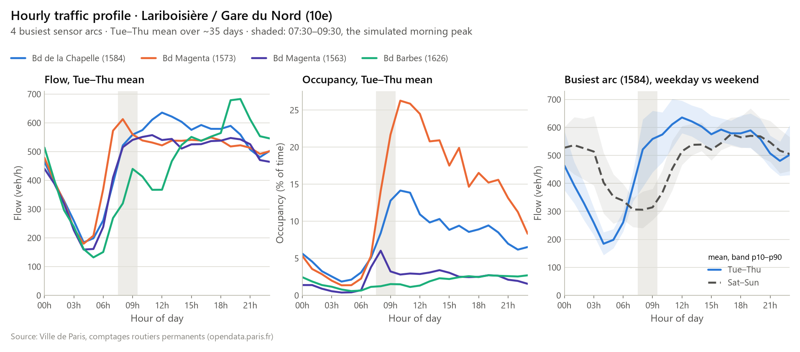
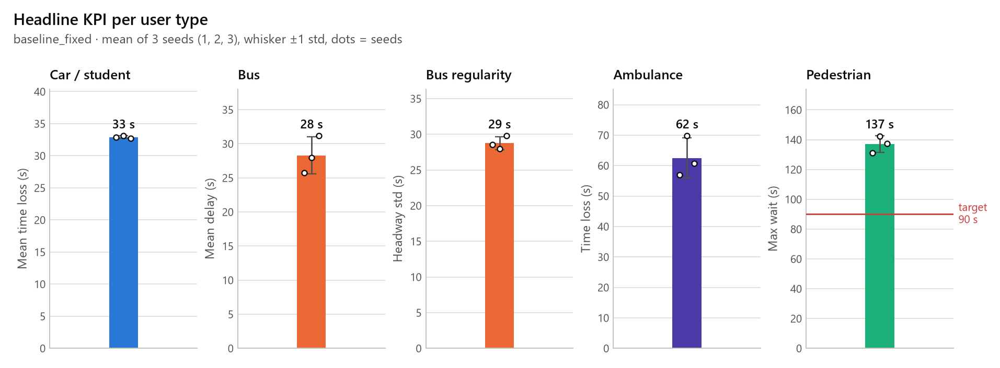
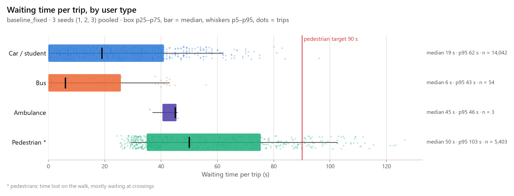
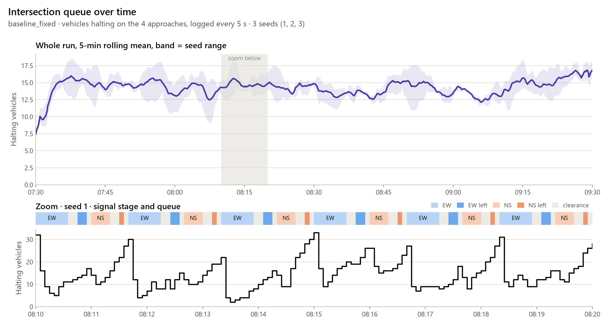

# Urban Traffic Twin

Digital twin of **one signalised Paris intersection** in Eclipse SUMO, calibrated on City of
Paris permanent sensor data (hourly flow and occupancy). It compares four signal controllers
(fixed time, actuated, rule based, reinforcement learning) and shows the effect for five kinds
of users (student, ambulance, bus, pedestrian, operator). The spec in `docs/` is the source of
truth for scope.

Storage is **Supabase**: the spec's tables (section 9.1) live in Postgres, and large raw
simulation logs go to the private Storage bucket `sim-logs` as Parquet.

Developer guide (module map, data flow, controller contract, invariants):
[docs/architecture.md](docs/architecture.md).

## Roadmap

Built in 10 parts, one demoable PR each. Parts 1 (repo, Supabase schema, sensor
exploration, intersection grid) and 2 (SUMO network, provisional demand, fixed-time
baseline, first KPIs) are merged on `main`. **Part 3** is next.

| Part | Content |
| --- | --- |
| 1 | Repo, Supabase schema, sensor data exploration, intersection choice |
| 2 | SUMO network (signals, crossings, bus), provisional demand, fixed-time baseline, first KPIs |
| 3 | Demand calibration, sim vs reality validation, actuated baseline |
| 4 | Rule-based controller (preemption, bus TSP, pedestrians), Safety Guard, per-user KPIs |
| 5 | ETA model (XGBoost quantiles), API v1 |
| 6-7 | Gymnasium env and RL training |
| 8 | Final evaluation (10 seeds) |
| 9 | App views and replay, user tests |
| 10 | Report and demo |

## Quick start

Run every command **from the repo root with the virtualenv's Python**. Config paths are
relative to the repo root, and the system Python does not have the package installed:
running from another directory (e.g. `C:\WINDOWS\system32`) or with the system
interpreter fails with `ModuleNotFoundError: No module named 'traffic_twin'`.

`tasks.py` is the cross-platform task runner (stdlib only; Windows has no `make`). Each
step runs with the interpreter that launched `tasks.py`, so launch it with the venv's.

Windows (PowerShell):

```powershell
cd C:\path\to\urban-traffic-twin
python -m venv .venv
.venv\Scripts\activate                     # or call .venv\Scripts\python.exe directly
python tasks.py install                    # pip install -e .[dev,db,sim]; SUMO via eclipse-sumo
python tasks.py baseline                   # net + sim (seeds 1 2 3) + plots
python tasks.py check                      # lint + tests, what CI runs
```

Without activating: `.venv\Scripts\python.exe tasks.py baseline`.

Linux / macOS: the Makefile has the same target names.

```bash
python3 -m venv .venv && source .venv/bin/activate
make install
make baseline
make check
```

Main tasks (`python tasks.py --help` lists them all; `-n` prints the commands without
running them; several tasks run in order, e.g. `tasks.py net sim plots`):

| Task | What it does |
| --- | --- |
| `data`, `explore`, `score` | Part 1: download and clean sensors, plot profiles, rank candidates |
| `net` | build the SUMO network with netconvert |
| `sim --seeds 1 2 3` | run `--scenario` (default `configs/scenario_base.yaml`) headless, one run per seed |
| `sim-gui` | the same scenario in sumo-gui (first seed) |
| `plots` | KPI figures from `data/results/` into `docs/figures/` |
| `baseline` | `net` + `sim` + `plots` |
| `db-load`, `db-runs` | load sensor rows, finished runs into Supabase |
| `test`, `test-fast`, `lint`, `format`, `check` | tests and ruff |

With make, options are variables: `make sim SEEDS="1 2 3" SCENARIO=configs/scenario_base.yaml`.

`data` calls the opendata.paris.fr Explore API (no key needed) and keeps only arcs
within `radius_m` of each zone in `configs/data.yaml`.

## Choosing the intersection

1. `tasks.py data explore` and look at `data/processed/arc_coverage.csv` and the figures.
   A candidate needs a sensor with at least ~80% coverage on its main approaches.
2. Update the `sensor` score of each candidate in `configs/intersections.yaml`
   (0 means no usable sensor, which eliminates it), and adjust the other scores after
   checking Street View and the bus map.
3. `tasks.py score` prints the ranking and the chosen intersection.


*Hourly flow and occupancy of the busiest sensor arcs near Lariboisiere; the shaded band is the simulated 07:30-09:30 peak.*

## Simulation (Part 2)

`sumo/network/plain/` describes a **provisional** 4-arm signalised intersection: a main
axis (W-E) with 2 lanes plus a left-turn lane on each approach, a cross street (N-S)
with 2 approach lanes, sidewalks and zebra crossings on every arm, a bus line B1 with a
stop, and one ambulance trip. It stands in for the real Paris intersection, which
replaces it (OSM extract) once Part 1's choice is made; the code does not depend on
the geometry beyond `configs/scenario_base.yaml`.

- `tasks.py net` runs netconvert. The signal program has 4 green stages (EW, EW_LEFT, NS,
  NS_LEFT), each followed by pedestrian clearance, yellow and all-red phases.
- `tasks.py sim --seeds 1 2 3` writes demand from the config, runs SUMO headless through
  libsumo, and writes per run in `data/results/<scenario>_seed<n>/`: `kpi_run.csv`
  (spec 9.4 format), `trip.parquet`, `state_log.parquet` and `run.json`.
- `tasks.py sim-gui` runs the same scenario in sumo-gui with the view in
  `sumo/gui/view.xml` (vehicles in their type colour, pedestrians coloured by waiting time
  up to the 90 s target). The view is display only; headless runs never load it. Closing
  the window stops the run with a warning and exit code 1; no partial results are written.
- The scenario's `controller:` key picks the controller from a registry. `SignalPlan`
  always runs the clearance phases before a new green and holds any switch requested
  before `safety.min_green_s`, so no controller can skip a yellow or cut a green short.
- Flows use per-second probabilities, so every scenario sees the same expected demand and
  each seed gives a different draw (spec 13.3).

Fixed-time baseline (cycle 100 s, provisional demand 07:30-09:30, mean of seeds 1-3):

| User | KPI | Value |
| --- | --- | --- |
| Car | mean time loss | 32.9 s |
| Car | wait p95 | 61 s |
| Bus | mean delay | 28.3 s |
| Bus | headway std | 28.8 s |
| Pedestrian | mean wait (time lost) | 56.8 s |
| Pedestrian | max wait | 137 s (spec target 90 s) |
| Ambulance | time loss | 62.5 s |

The ambulance and pedestrian numbers are what the rule-based controller in Part 4 targets.


*Headline KPI per user type: mean of seeds 1-3, whiskers one standard deviation, dots are seeds.*


*Waiting time per trip by user type, seeds pooled; the pedestrian tail runs past the 90 s target.*


*Vehicles halting on the four approaches over the run, with a 10-minute zoom on the signal stages.*

`tasks.py plots` regenerates these from `data/results/`. Every plot takes several
scenarios, so later parts compare controllers on the same figures.

## Testing and CI

- `tasks.py test` runs the whole suite; `tasks.py test-fast` (`pytest -m "not sumo"`)
  leaves out the integration test that runs the real SUMO binaries.
- Tests marked `sumo` are also skipped automatically when SUMO is not installed
  (`pip install -e ".[sim]"` provides it through the `eclipse-sumo` wheel).
- GitHub Actions (`.github/workflows/ci.yml`) runs ruff lint, the ruff format check and
  the full suite, SUMO test included, on Python 3.11 and 3.12 for pushes and pull
  requests to `main`. `tasks.py check` runs the same checks locally.

## Supabase

```bash
cp .env.example .env        # fill SUPABASE_URL, SUPABASE_SERVICE_ROLE_KEY, SUPABASE_DB_URL
supabase db push            # or apply supabase/migrations/*.sql from the SQL editor
python tasks.py db-load     # upsert cleaned sensor rows into sensor_hourly
python tasks.py db-runs     # load run, kpi_run, trip rows; upload state logs to sim-logs
```

`.mcp.json` registers the Supabase MCP server for Claude Code in this project.
All tables have row level security on with no policies, so only the service role
(backend and API) can read or write them.

## Layout

```
configs/            data.yaml, intersections.yaml, scenario_base.yaml, rl.yaml
data/               raw/, processed/, results/ (not versioned)
sumo/               network/ (plain XML, OSM extract, generated .net.xml),
                    demand/ (generated), gui/view.xml (sumo-gui view settings)
src/traffic_twin/
  paths.py          default file locations, relative to the repo root
  config.py         YAML loading, required-key checks, ConfigError
  data/             download, clean, explore, intersection_score
  db/               Supabase loaders (sensors, runs)
  sim/              network, demand, signal (SignalPlan), sumo (command line),
                    session (SimSession), results, kpi, run_scenario (CLI)
  control/          Controller interface, registry, fixed time
  viz/              KPI figures (plots) and the shared figure style
  rl/ ml/ api/ app/ later parts
supabase/migrations/
tests/              pytest; conftest.py skips `sumo` tests when SUMO is missing
docs/               spec, architecture.md, figures/
.github/workflows/  CI (ci.yml)
tasks.py            cross-platform task runner (same targets as the Makefile)
Makefile
```
