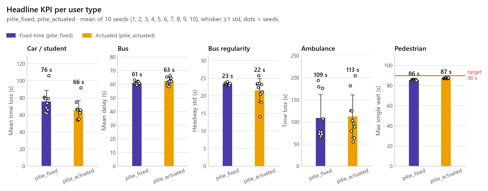

# Urban Traffic Twin

Digital twin of **one signalised Paris intersection** in Eclipse SUMO, calibrated on City of
Paris permanent sensor data (hourly flow and occupancy). It compares four signal controllers
(fixed time, actuated, rule based, reinforcement learning) and shows the effect for five kinds
of users (student, ambulance, bus, pedestrian, operator). The spec in `docs/` is the source of
truth for scope.

The intersection is **Bd de l'Hôpital x Bd Saint-Marcel**, next to the Pitié-Salpêtrière
hospital (Paris 13e, sensor node 302). The provisional grid intersection of Part 2 is kept as a
frozen regression scenario.

Storage is **Supabase**: the spec's tables (section 9.1) live in Postgres, and large raw
simulation logs go to the private Storage bucket `sim-logs` as Parquet.

Developer guide (module map, data flow, controller contract, invariants):
[docs/architecture.md](docs/architecture.md). Simulation vs reality validation:
[docs/validation.md](docs/validation.md). Site visit checklist:
[docs/field_protocol.md](docs/field_protocol.md).

## Roadmap

Built in 10 parts, one demoable PR each. Parts 1 (repo, Supabase schema, sensor
exploration, intersection grid) and 2 (SUMO network, provisional demand, fixed-time
baseline, first KPIs) are done. Part 3 (real junction from OSM, demand calibration, sim vs
reality validation, actuated baseline) is done up to the field visit: of the three checks
of spec 13.4, the flows pass, while the signal timing and the queues wait for the site
measurements and the signal program is ASSUMED. Until then the S0 vs S1 comparison is
provisional. **Part 4** is next.

| Part | Content | Status |
| --- | --- | --- |
| 1 | Repo, Supabase schema, sensor data exploration, intersection choice | done |
| 2 | SUMO network (signals, crossings, bus), provisional demand, fixed-time baseline, first KPIs | done |
| 3 | Demand calibration, sim vs reality validation, actuated baseline | done (field visit pending) |
| 4 | Rule-based controller (preemption, bus TSP, pedestrians), Safety Guard, per-user KPIs | next |
| 5 | ETA model (XGBoost quantiles), API v1 | |
| 6-7 | Gymnasium env and RL training | |
| 8 | Final evaluation (10 seeds) | |
| 9 | App views and replay, user tests | |
| 10 | Report and demo | |

## Quick start

Run every command **from the repo root with the virtualenv's Python**. Config paths are
relative to the repo root, and the system Python does not have the package installed:
running from another directory (e.g. `C:\WINDOWS\system32`) or with the system
interpreter fails with `ModuleNotFoundError: No module named 'traffic_twin'`.

`tasks.py` is the cross-platform task runner (stdlib only; Windows has no `make`). Each
step runs with the interpreter that launched `tasks.py`, so launch it with the venv's.

Windows (PowerShell):

```powershell
cd C:\path\to\urban-traffic-twin
python -m venv .venv
.venv\Scripts\activate                     # or call .venv\Scripts\python.exe directly
python tasks.py install                    # pip install -e .[dev,db,sim]; SUMO via eclipse-sumo
python tasks.py baseline                   # grid: net + sim (seeds 1 2 3) + plots
python tasks.py part3                      # Pitié: checks, calibration, S0 vs S1, validation
python tasks.py check                      # lint + tests, what CI runs
```

Without activating: `.venv\Scripts\python.exe tasks.py baseline`.

Linux / macOS: the Makefile has the same target names.

```bash
python3 -m venv .venv && source .venv/bin/activate
make install
make baseline
make check
```

Main tasks (`python tasks.py --help` lists them all; `-n` prints the commands without
running them; several tasks run in order, e.g. `tasks.py net sim plots`). The Part 3 tasks
are listed in [Pitié-Salpêtrière junction](#pitié-salpêtrière-junction-part-3).

| Task | What it does |
| --- | --- |
| `data`, `explore`, `score` | Part 1: download and clean sensors, plot profiles, rank candidates |
| `net` | build the SUMO network of `--scenario` with netconvert (default: the grid) |
| `sim --seeds 1 2 3` | run `--scenario` (default `configs/scenario_base.yaml`) headless, one run per seed |
| `sim-gui` | the same scenario in sumo-gui (first seed) |
| `plots` | KPI figures from `data/results/` into `docs/figures/` |
| `baseline` | `net` + `sim` + `plots` |
| `db-load`, `db-runs` | load sensor rows, finished runs into Supabase |
| `test`, `test-fast`, `lint`, `format`, `check` | tests and ruff |

With make, options are variables: `make sim SEEDS="1 2 3" SCENARIO=configs/scenario_base.yaml`.

`data` calls the opendata.paris.fr Explore API (no key needed) and keeps only arcs
within `radius_m` of each zone in `configs/data.yaml`. The Part 3 calibration and
validation read only versioned extracts (`data/reference/`, `configs/calibration/`), so
they need neither the API nor `data/processed/`.

## Choosing the intersection

1. `tasks.py data explore` and look at `data/processed/arc_coverage.csv` and the figures.
   A candidate needs a sensor with at least ~80% coverage on its main approaches.
2. Update the `sensor` score of each candidate in `configs/intersections.yaml`
   (0 means no usable sensor, which eliminates it), and adjust the other scores after
   checking Street View and the bus map.
3. `tasks.py score` prints the ranking and the chosen intersection.

Result: Bd de l'Hôpital x Bd Saint-Marcel / Pitié-Salpêtrière (13e), score 79.3 %. It is the
only candidate whose sensors were assessed (sensor score 3: a flow station on each general
approach, but some arcs share one station, see Part 3); Lariboisière and Porte de Pantin
keep a sensor score of 0 (not assessed) and are eliminated.

Sensor values are stamped at the **end** of their hour (decision D3), so profiles use the
hour the period starts. The profile records which days it averages (`day_set`), and the
figure labels come from it. `tasks.py explore` refuses a `data/processed/` written before
Part 3 (end-of-period `hour` column, holidays included): rerun
`python -m traffic_twin.data.clean --config configs/data.yaml` (no download) first.


*Hourly flow and occupancy of the four busiest sensor arcs near Pitié-Salpêtrière, school-term Tue-Thu mean, each hourly mean drawn as a step over the hour it covers; right: the busiest arc against the school-term weekends. The shaded band is the simulated 07:30-09:30 peak, which takes half of the 07:00 and 09:00 sensor hours.*

## Simulation (Part 2)

`sumo/network/plain/` describes a **provisional** 4-arm signalised intersection: a main
axis (W-E) with 2 lanes plus a left-turn lane on each approach, a cross street (N-S)
with 2 approach lanes, sidewalks and zebra crossings on every arm, a bus line B1 with a
stop, and one ambulance trip. It stood in for the real Paris intersection until Part 3.
It is now a frozen regression scenario: its files are never edited, and
`tests/test_grid_regression.py` compares its KPIs for seeds 1-3 with a fixture captured
before Part 3 (exact on Windows, where the fixture was captured; within 5 % elsewhere).

- `tasks.py net` runs netconvert. The signal program has 4 green stages (EW, EW_LEFT, NS,
  NS_LEFT), each followed by pedestrian clearance, yellow and all-red phases. The grid
  build rewrites the timestamp line of `sumo/network/intersection.net.xml`; revert it with
  `git checkout -- sumo/network/intersection.net.xml` when that is the only change.
- `tasks.py sim --seeds 1 2 3` writes demand from the config, runs SUMO headless through
  libsumo, and writes per run in `data/results/<scenario>_seed<n>/`: `kpi_run.csv`
  (spec 9.4 format), `trip.parquet`, `state_log.parquet` and `run.json` (since Part 3 also
  the config and demand hashes, a health block and a safety block).
- `tasks.py sim-gui` runs the same scenario in sumo-gui with the view in
  `sumo/gui/view.xml` (vehicles in their type colour, pedestrians coloured by waiting time
  up to the 90 s target). The view is display only; headless runs never load it. Closing
  the window stops the run with a warning and exit code 1; no partial results are written.
- The scenario's `controller:` key picks the controller from a registry. `SignalPlan`
  always runs the clearance phases before a new green and holds any switch requested
  before `safety.min_green_s`, so no controller can skip a yellow or cut a green short.
  Since Part 3 every request also goes through the safety guard, and every run audits
  the phases it showed (see below).
- Flows use per-second probabilities, so every scenario sees the same expected demand and
  each seed gives a different draw (spec 13.3).

Fixed-time baseline (cycle 100 s, provisional demand 07:30-09:30, mean of seeds 1-3):

| User | KPI | Value |
| --- | --- | --- |
| Car | mean time loss | 32.9 s |
| Car | wait p95 | 61 s |
| Bus | mean delay | 28.3 s |
| Bus | headway std | 28.8 s |
| Pedestrian | mean wait (time lost) | 56.8 s |
| Pedestrian | max wait | 137 s (spec target 90 s) |
| Ambulance | time loss | 62.5 s |

The ambulance and pedestrian numbers are what the rule-based controller in Part 4 targets.


*Headline KPI per user type: mean of seeds 1-3, whiskers one standard deviation, dots are seeds.*


*Waiting time per trip by user type, seeds pooled; the pedestrian tail runs past the 90 s target.*


*Vehicles halting on the four approaches over the run, with a 10-minute zoom on the signal stages.*

`tasks.py plots` regenerates these from `data/results/`. Every plot takes several
scenarios, so later parts compare controllers on the same figures.

## Pitié-Salpêtrière junction (Part 3)

Two scenarios on the real junction, with the same demand and seeds (spec 13.3):

- **S0** `configs/pitie_fixed.yaml`: fixed time, controller `fixed`;
- **S1** `configs/pitie_actuated.yaml`: SUMO-style actuated control (EF-06), controller
  `actuated`. It `extends` S0 and changes only the scenario name and the controller.

S0 is assembled with `extends` from four fragments: `configs/pitie/network.yaml` (network,
stages, fixed greens, crossings, bus stops), `demand.yaml`, `control.yaml` (control loops,
actuated parameters, safety guard) and `measurement.yaml` (detectors for validation). The
simulated window is 07:30-09:30 (`begin_s` 27000, 7200 s), without warm-up.

Decision numbers (D1-D18) refer to the table in
[docs/architecture.md](docs/architecture.md#part-3-decisions). The validation thresholds
were fixed in `configs/validation.yaml` before any calibrated result (spec 17).

### Site

Junction and traffic light `C`. Three general legs: N (Bd de l'Hôpital towards
Austerlitz), S (Bd de l'Hôpital towards Place d'Italie) and W (Bd Saint-Marcel). Two
bus-only legs: NB (Bd de l'Hôpital east bus road) and WB (Bd Saint-Marcel bus road). Bus
lines 91 and 24 run between the two bus roads and stop at Saint-Marcel - La Pitié; line 57
runs between the S leg and the NB bus road. The hospital gate on the NB bus road is not a
leg. Pedestrian crossings are signalised over NB, S, WB and W; OSM has none on the N arm.

### Network pipeline

```
sumo/network/osm/pitie.osm
  --tasks.py osm (sim.osm_import)-->  sumo/network/pitie/pitie.{nod,edg,con}.xml   curated plain XML
  + sumo/network/pitie/pitie.tll.xml                                              provisional program
  --tasks.py net (sim.network)----->  sumo/network/pitie/pitie.net.xml
  --tasks.py tls-check (sim.tls_check): foe greens, intergreens, worst-case crossing red
```

- `osm_import` crops the OSM extract around the junction, keeps car and bus roads and joins
  the signal nodes within 20 m into one node. A topology-driven step then names each leg
  `<leg>_in` / `<leg>_out`, writes explicit lane-to-lane connections (no U-turns) and
  explicit crossings, and opens the bus lanes to emergency vehicles. It is deterministic,
  and its output is versioned.
- `net` builds the net with the options in `network.build` (3 m sidewalks, static program
  from `pitie.tll.xml`). SUMO is pinned to 1.28.0 in `pyproject.toml`: netconvert output and
  the link order of the traffic light depend on the version.
- `tls-check` checks the program against the junction geometry: no two foe vehicle links
  green together (a vehicle may be permissive only against a crossing), intergreens that
  cover the path to the conflict point plus the vehicle length at 6 m/s (4 m/s for buses
  leaving the near-side stop; pedestrians clear a crossing at 1.2 m/s), and a worst-case red
  of every crossing of at most 88 s (90 s target minus a 2 s margin). Its output on the
  committed program: 17 phases, cycle 123 s, 16 links (4 crossings); foe greens 0,
  permissive vehicle-vehicle 0, intergreen violations 0; worst-case red NB 42 s, S 86 s,
  WB 42 s, W 86 s.

Provisional program (ASSUMED until the field visit; cycle 123 s = 74 s of green + 49 s of
clearance):

| Stage | S0 green | Served |
| --- | --- | --- |
| HOP | 36 s | N straight, S straight, crossings NB, WB, W |
| S_LEFT | 6 s | S straight and left, bus 57 N, crossing WB |
| STM | 20 s | W (Saint-Marcel), N right, crossings NB, S, WB |
| BUS_91 | 6 s | bus 91/24 both ways, N right, crossing S |
| BUS_57 | 6 s | bus 57 S, bus 91/24 W, N right |

`tasks.py sim-gui --scenario configs/pitie_fixed.yaml` opens the junction in sumo-gui with
`sumo/gui/pitie_view.xml`.

### Demand and calibration (EF-02)

- **Sensor data.** Hourly flows of the Paris permanent sensors, stamped at the end of the
  hour (D3). Typical days are Tue-Thu in school term (zone C) without public holidays
  (`configs/data.yaml: calendar`), then a per-arc robust MAD filter (k = 3.5). The extract
  covers 2026-07-13 to 2026-10-10, which leaves 16 to 18 typical days per arc and slot
  (September and early October 2026).
- **Reference arcs (D6).** N inbound: arc 508, the nearest station with its own flow,
  upstream of Rue Poliveau. Arc 510 copies station 505 near Austerlitz and is a sensitivity
  row only. S inbound: arc 511 (one station with 509 and 5071). W inbound: arc 513 (one
  station copied along about 700 m). The outbound arcs 509, 512 and 514 are information only.
- **Calibration file.** `tasks.py calib-data` (needs `data/raw/`) writes the versioned
  extract `data/reference/pitie_302_hours.csv`; the calibration file
  `configs/calibration/pitie_302.yaml` is rebuilt from it. Each 900 s slot of an arm gets
  the typical-day mean of its sensor hour (flat within the hour, D5). The tests rebuild the
  file from the CSV and compare, so CI needs neither `data/raw/` nor `data/processed/`.
- **Demand.** Car flows per slot and movement with the assumed turn shares, bus lines 91,
  24 and 57 with their stops, pedestrian flows along every crossing and one ambulance (N to
  S, 08:10). Elements of the route file are sorted by departure: SUMO ignores out-of-order
  ones.
- **Calibration loop.** `tasks.py calibrate` runs S0 on the calibration seeds 101-103
  (never the evaluation seeds) and scales each inbound arm until its 07:30-09:30 loop flow
  is within 5 % of the sensor flow. An arm that stops following its demand is reported as
  capacity-limited instead of being inflated. Result (`docs/calibration_log.yaml`):
  converged at iteration 0, no capacity-limited arm, `demand.arm_scale` stays 1.0.

| Arm | Arc | Typical days | Real 07:30-09:30 (veh/h) | Sim, seeds 101-103 (veh/h) | Error | GEH |
| --- | --- | --- | --- | --- | --- | --- |
| N | 508 | 16 | 626.0 | 616.5 | -1.52 % | 0.38 |
| S | 511 | 17 | 369.8 | 359.5 | -2.79 % | 0.54 |
| W | 513 | 17 | 206.3 | 206.2 | -0.08 % | 0.01 |

### Controllers and safety guard

- **S0 `fixed`** runs the provisional program above.
- **S1 `actuated`** (`control/actuated.py`) emulates SUMO's gap-based `type="actuated"`
  logic through the common controller interface: each green lasts at least 6 s, is
  extended while a vehicle crossed one of the stage's control loops less than 3 s ago, and
  ends at its max green; stages run in cycle order, none skipped. It keeps SUMO's defaults
  (max-gap 3 s, detector-gap 2 s, passing-time 1.9 s) and SUMO's loop placement: one loop
  per incoming lane, min(detector-gap x speed, (min green / passing-time + 0.5) x 7.5 m)
  before the stop line. Every Pitié approach lane is limited to 30 km/h (8.33 m/s), so the
  detector-gap term binds and the loops sit 16.66 m before the stop line.
  `tests/test_actuated_native.py` checks that it takes the same decisions as SUMO's own
  actuated logic, step by step, on the grid and on Pitié.
- **S1 max greens** are HOP 38 s, STM 22 s and 6 s for the other stages: the largest values
  that keep the worst-case red of every crossing at or under 88 s with every stage at its
  max (a static bound in Part 3; the pedestrian forcing of Part 4 may allow longer maxima).
  HOP and STM can therefore run at most 2 s longer than in S0 and the other stages stay at
  6 s, so most of S1's freedom is to end HOP and STM early when no vehicle comes. Nothing is
  tuned on the evaluation seeds.
- **Safety guard** (`control/safety.py`). Every stage request of any controller goes through
  it inside `SimSession.step`: min green, anti-starvation (`safety.max_red_s` 150 s), strict
  stage order and a max-green cap (60 s). The fixed and actuated controllers must cause no
  intervention. Every run also audits the phases it showed (`sim/audit.py`: vehicle green to
  red without yellow, pedestrian green cut outside clearance, yellow to green, green shorter
  than the minimum, green out of order). Both counts go to the `safety` block of `run.json`.
  Part 4 adds pedestrian forcing and emergency pre-emption.

### Validation against reality (spec 13.4, A-02)

`tasks.py validate` writes [docs/validation.md](docs/validation.md): runs and sensor days,
pre-registered thresholds, every ASSUMED input, flow, signal and queue tables, safety,
pedestrians, S0 vs S1, limitations. S0 is evaluated over seeds 1-10; the simulated flows are
E1 loops standing in for the Paris sensors.

A-02 verdict: **PASS**, 6 of 6 inbound arm x slot rows within ±15 % of the real flow.

| Arm | Arc | Slot | Real veh/h (typical days) | Sim veh/h (10 seeds) | Error | GEH | Status |
| --- | --- | --- | --- | --- | --- | --- | --- |
| N in | 508 | 07:30-08:30 | 593 ± 41 (16 d) | 600 ± 15 | +1.1 % | 0.27 | PASS |
| N in | 508 | 08:30-09:30 | 659 ± 49 (16 d) | 660 ± 21 | +0.2 % | 0.05 | PASS |
| S in | 511 | 07:30-08:30 | 321 ± 41 (18 d) | 325 ± 21 | +1.4 % | 0.26 | PASS |
| S in | 511 | 08:30-09:30 | 417 ± 47 (17 d) | 414 ± 10 | -0.9 % | 0.18 | PASS |
| W in | 513 | 07:30-08:30 | 186 ± 12 (18 d) | 188 ± 11 | +0.8 % | 0.11 | PASS |
| W in | 513 | 08:30-09:30 | 223 ± 13 (16 d) | 221 ± 10 | -0.9 % | 0.14 | PASS |

Each slot keeps its own typical days: the filter is the one the calibration uses, but
completeness and the MAD filter are judged on each slot, so a row's day count can differ
from the calibration's (16-17 days over 07:30-09:30).

| Check | Result |
| --- | --- |
| GEH < 5 on at least 85 % of distinct counts | 10 of 10 (100 %), met |
| Outbound flows (information only, depend on the assumed turn shares) | N out (509) +33.6 / +34.6 %, S out (512) +22.7 / +22.5 %, W out (514) +6.9 / +2.1 % |
| Sensitivity: arc 510 as N inbound | -51.3 / -52.2 %, GEH 20.85 / 22.59 |
| Signal timing | 41 rows NOT_MEASURED; simulated cycle 123.0 ± 0.0 s |
| Queues | 6 rows NOT_MEASURED |
| Safety, S0 and S1, seeds 1-10 (20 runs) | 0 collisions, 0 teleports, 0 emergency stops, 0 emergency braking, 0 vehicles left, 0 drain timeouts, 0 guard interventions, 0 audit violations |
| Longest single pedestrian wait (target 90 s, D14) | S0 85.6 s (worst seed 86 s), S1 87.3 s (worst seed 88 s) |

The inbound check is close to circular: the car demand is built from the same sensors, so
A-02 mainly shows that the network carries the demand in the right time slots. The
independent checks are the outbound flows, the signal timing and the queues, and the last
two wait for the field visit. Arc 509 is the same station as 511, so the N out row compares
with the northbound count. The 08:00-09:00 field count also settles 508 against 510 as the N
reference.


*Simulated vs real flow per station for the A-02 slots (left) and per inbound arm and slot (right): real = typical-day mean ± sd, simulated = mean of seeds 1-10 ± sd.*

### S0 vs S1 (spec 13.3)

**Provisional until the field visit.** Spec 13.4 asks that the simulation match reality
before any comparison. Of its three checks only the flow per arm is done (A-02 PASS above).
The simulated cycle against the site timing and the queues against the video are
NOT_MEASURED, and S0 runs the ASSUMED provisional program (see
[ASSUMED inputs](#assumed-inputs-until-the-field-visit)). The results below therefore compare
the two controllers on the modelled junction. They describe the real junction only once
the visit is done and `tasks.py part3` has been rerun with the measured program (see
[Field visit](#field-visit)).

`tasks.py compare` pairs the runs per seed (seeds 1-10) and refuses to compare unless both
scenarios have the same seeds and one shared `demand_hash`. Test: exact two-sided Wilcoxon
signed-rank on the per-seed differences, Holm correction over the 7 headline KPIs, α = 0.05;
with 10 seeds the smallest possible p is 0.0020. Equity flag: a KPI more than 5 % worse.
Mean ± sd over seeds 1-10, times in seconds:

| User | KPI | S0 fixed | S1 actuated | Change | p | p (Holm) | Equity flag |
| --- | --- | --- | --- | --- | --- | --- | --- |
| Car | mean time loss | 75.9 ± 12.9 | 65.8 ± 11.3 | -13.3 % | 0.0020 | 0.0137 | no |
| Car | wait p95 | 164.5 ± 26.3 | 140.0 ± 22.7 | -14.9 % | 0.0020 | 0.0137 | no |
| Bus | mean delay | 61.0 ± 1.1 | 62.6 ± 2.6 | +2.5 % | 0.0371 | 0.1484 | no |
| Bus | headway std | 23.4 ± 0.3 | 21.6 ± 3.4 | -7.9 % | 0.0840 | 0.2520 | no |
| Pedestrian | mean wait (time lost) | 21.8 ± 0.7 | 22.2 ± 0.7 | +1.6 % | 0.2754 | 0.5508 | no |
| Pedestrian | longest single wait | 85.6 ± 0.5 | 87.3 ± 0.5 | +2.0 % | 0.0020 | 0.0137 | no |
| Ambulance | time loss | 109.2 ± 52.5 | 112.5 ± 48.7 | +3.1 % | 0.9219 | 0.9219 | no |

On the modelled junction, S1 lowers the car time loss and the car wait p95 (significant
after Holm). The longest single pedestrian wait rises from 85.6 to 87.3 s (significant),
still under the 90 s target.
Bus delay is 2.5 % worse (p 0.0371, not significant after Holm), under the 5 % equity
threshold. Outside the headline KPIs, KPIs more than 5 % worse: bus mean insertion delay
+20.2 % (p 0.0195) and max insertion delay +60.0 % (p 0.0312), both under 5 s, and
ambulance stops +23.1 % (p 0.3750). The ambulance time loss shows no significant change.


*Headline KPI per user type, S0 and S1: mean of seeds 1-10, whiskers one standard deviation, dots are seeds.*


*Per-seed paired differences S1 - S0 for the 7 headline KPIs, with the mean and its 95 % t interval.*

`docs/figures/pitie/` also holds `wait_distribution.png` and `queue_timeline.png` for the two
scenarios.

### ASSUMED inputs (until the field visit)

These model inputs are not measured on site. `docs/validation.md` lists them, and every
signal and queue row stays NOT_MEASURED until the visit.

- Signal program: provisional (lead sketch v7 adapted, cycle 123 s). EF-05 asks for the
  phases measured on site.
- Lane use at the stop lines from OSM, not surveyed. The right lane of the S approach
  (`s_in` lane 1) is shared by buses and straight-ahead cars; the S left turn uses lane 2
  only.
- No pedestrian crossing on the N arm; the W and WB crossings are signalised at the
  junction.
- Bus 57 northbound is served only in S_LEFT.
- Sidewalks 3 m wide; bus lanes open to emergency vehicles.
- The network is cropped to the junction: Rue Poliveau, Rue des Wallons and the nearby
  signals are not modelled.
- Turn shares: N to S 0.63, N to W 0.37; S to N 0.90, S to W 0.10; W to N 0.85, W to S 0.15.
- N inbound flow from arc 508 (proxy upstream of Rue Poliveau).
- Bus headways (91: 360 s, 24: 600 s, 57: 480 s) and dwell (20 s); pedestrian flows of
  100 per hour per walk direction.
- The sensors count buses: an arm's car demand is its sensor flow minus the buses
  scheduled to enter by it (57 northbound on S, 7.5 per hour), and the simulated stations
  count every vehicle, so both sides of A-02 use the same convention.
- Ambulance route N to S (Austerlitz towards the hospital main gate), departing 08:10.

### Field visit

The checklist is [docs/field_protocol.md](docs/field_protocol.md); results go into
`data/field/pitie_measurements.yaml`. That file is an empty template: a null value is
NOT_MEASURED, and no estimate is ever typed into it.

- **When:** Tue 13, Wed 14 or Thu 15 Oct 2026, 07:30-09:30, before the Toussaint holidays
  (17 Oct to 1 Nov). Otherwise Tue 3, Wed 4 or Thu 5 Nov 2026 (Wed 11 Nov is a public
  holiday).
- **Within a week after:** download the sensor data again (the dataset is rolling) to get
  the same-day values of arcs 508, 511 and 513. The 08:00-09:00 video count should match the
  sensor value stamped 09:00, which confirms the end-of-hour convention. The download covers
  12 months, but the calibration and the A-02 reference keep only the autumn 2026 term
  (`calendar.typical_period` in `configs/data.yaml`). Typical days outside it, such as the
  spring term, become hold-out days: they are listed under `day_filter.hold_out_days` in
  `configs/calibration/pitie_302.yaml` and never mixed into the demand.
- **MUST:** signal timing on video over at least 5 consecutive cycles (ideally 10) at
  08:00-09:00, per head the start of green, yellow and red to 1 s, plus the stage order,
  whether greens vary between cycles, whether bus stages appear every cycle and any
  pedestrian-only stage. Turning counts in 15-minute bins for the 6 movements (buses by line,
  two-wheelers apart); the N total settles 508 against 510 (about 165 against about 340
  vehicles per 15 min). Queues at 2-3 instants per approach (N, S, W) with the clock time and
  the distance the camera sees. Lane use and crossings: arrows at each stop line, the start of
  the S bus lane and whether cars use it, whether the S left turn is allowed and protected, a
  crossing on the N arm, and whether the W and WB crossings are signalised.
- **SHOULD:** pedestrian counts per crossing, bus arrivals and departures at Saint-Marcel -
  La Pitié, Rue Poliveau and Rue des Wallons flows, loop locations. **NICE:** saturation
  headways, the gate ambulances use, weather and incidents.

After the visit:

1. Fill `data/field/pitie_measurements.yaml` and run `tasks.py field-check`.
2. If the stage structure differs, update `sumo/network/pitie/pitie.tll.xml` and the
   stages, signal groups and crossings in `configs/pitie/network.yaml`, then
   `tasks.py net tls-check --scenario configs/pitie_fixed.yaml`. If a measured all-red is
   shorter than the geometric requirement, keep the minimal safe value and let the signal
   table show the difference.
3. Set `fixed.green_s` so that each head's green matches the measured mean.
4. Put the counts into the calibration (`tasks.py calib-data`: turn shares become
   `source: field`). Check in its output that the arms still use 16-18 autumn days and that
   any new spring days are listed as hold-out days.
5. Rerun `tasks.py part3`. The signal and queue rows become PASS or FAIL; a failure is fixed
   through the demand or the driving parameters and documented (spec 13.4).

### Part 3 tasks

The Pitié tasks default to `--scenario configs/pitie_fixed.yaml`; `compare` and `part3`
take S1 as `--scenario` (default `configs/pitie_actuated.yaml`) and S0 as `--baseline`
(default `configs/pitie_fixed.yaml`). Simulation results go to `data/results/` (not
versioned).

| Task | What it does |
| --- | --- |
| `osm` | OSM extract to curated plain XML under `sumo/network/pitie/` |
| `net --scenario configs/pitie_fixed.yaml` | build `pitie.net.xml` |
| `tls-check` | check the signal program (exit 1 on errors) |
| `calib-data` | reference CSV and calibration file from `data/raw/` |
| `field-check` | check the field file and count what is measured |
| `calibrate` | demand scaling of S0 on the calibration seeds, log in `docs/calibration_log.yaml` |
| `compare` | paired S0 vs S1 on seeds 1-10 (runs the missing seeds) |
| `validate` | validation tables and `docs/validation.md` (runs the missing seeds) |
| `plots-pitie` | KPI figures of S0 and S1 into `docs/figures/pitie/` |
| `part3` | `tls-check field-check calibrate compare validate plots-pitie` |

The Makefile has the same targets; `make compare BASELINE=... SCENARIO=...`.

## Testing and CI

- `tasks.py test` runs the whole suite; `tasks.py test-fast` (`pytest -m "not sumo"`)
  leaves out the integration tests that run the real SUMO binaries.
- Tests marked `sumo` are also skipped automatically when SUMO is not installed
  (`pip install -e ".[sim]"` provides it through the `eclipse-sumo` wheel).
- Tests read only versioned files (`data/reference/`, `configs/calibration/`,
  `data/field/`, `tests/data/`); none needs `data/raw/`, `data/processed/` or
  `data/results/`.
- `tests/test_docs.py` checks README statements against the code: the S1 loop distance
  against the detector layout, and the provisional caveat on S0 vs S1 while the field file
  has no signal timing or queue.
- `tests/test_grid_regression.py` runs the grid for seeds 1-3 and compares every KPI with
  `tests/data/grid_baseline_kpis.csv`: exact on Windows, where the fixture was captured,
  within 5 % with a warning elsewhere.
- GitHub Actions (`.github/workflows/ci.yml`) runs ruff lint, the ruff format check and
  the full suite, SUMO tests included, on Python 3.11 and 3.12 for pushes and pull
  requests to `main`. `tasks.py check` runs the same checks locally.

## Supabase

```bash
cp .env.example .env        # fill SUPABASE_URL, SUPABASE_SERVICE_ROLE_KEY, SUPABASE_DB_URL
supabase db push            # or apply supabase/migrations/*.sql from the SQL editor
python tasks.py db-load     # upsert cleaned sensor rows into sensor_hourly
python tasks.py db-runs     # load run, kpi_run, trip rows; upload state logs to sim-logs
```

`.mcp.json` registers the Supabase MCP server for Claude Code in this project.
All tables have row level security on with no policies, so only the service role
(backend and API) can read or write them.

## Layout

```
configs/            data.yaml, intersections.yaml, scenario_base.yaml (grid), rl.yaml,
                    pitie_fixed.yaml (S0), pitie_actuated.yaml (S1), validation.yaml,
                    pitie/ (S0 fragments), calibration/ (generated demand calibration)
data/               raw/, processed/, results/ (not versioned),
                    reference/ (versioned sensor extracts), field/ (site measurements)
sumo/               network/ (grid plain XML, OSM extract, pitie/, generated .net.xml),
                    demand/ (generated), gui/ (sumo-gui view settings)
src/traffic_twin/
  paths.py          default file locations, relative to the repo root
  config.py         YAML loading with `extends`, required-key checks, hashes, ConfigError
  data/             download, clean, explore, intersection_score, calendar, calibrate
  db/               Supabase loaders (sensors, runs)
  sim/              network, osm_import, tls_check, demand, signal (SignalPlan), sumo,
                    session (SimSession), detectors, audit, results, kpi, run_scenario (CLI)
  control/          Controller interface, registry, fixed time, actuated, safety guard
  validation/       reference, field, flows, signal, queues, calibration_loop, report
  evaluation/       paired statistics, scenario comparison
  viz/              KPI figures (plots), validation figures, the shared figure style
  rl/ ml/ api/ app/ later parts
supabase/migrations/
tests/              pytest; conftest.py skips `sumo` tests when SUMO is missing;
                    data/ holds the grid regression fixture
docs/               spec, architecture.md, validation.md, field_protocol.md,
                    calibration_log.yaml, figures/ (grid), figures/pitie/
.github/workflows/  CI (ci.yml)
tasks.py            cross-platform task runner (same targets as the Makefile)
Makefile
```
