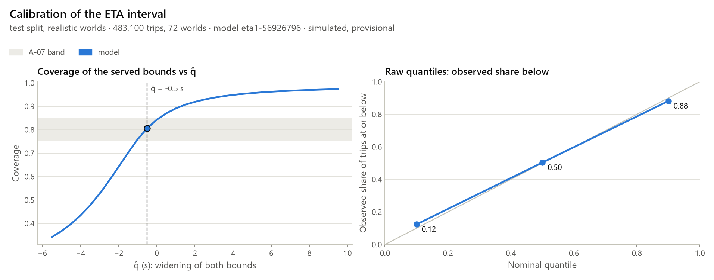
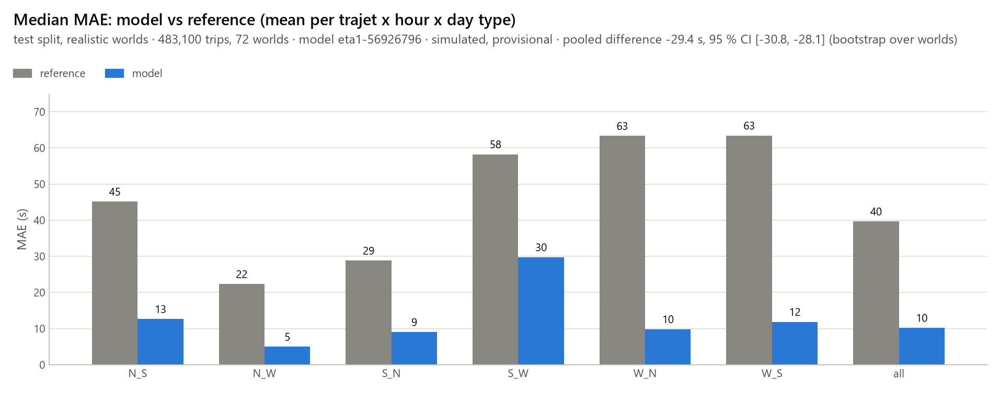
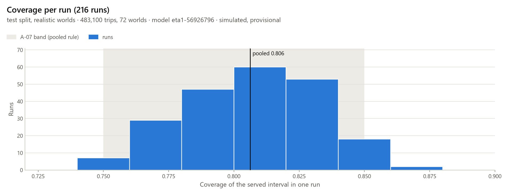

# ETA model and its evaluation (Part 5, EF-13, EF-14, A-07)

Generated by `python -m traffic_twin.ml.evaluate_eta --config configs/eta.yaml --split test`. Do not edit by hand: rerun `tasks.py eta-eval`. Every number is **simulated** and **provisional** until the field visit (3-5 Nov 2026): the model learns the simulator (spec 11.2) running the ASSUMED 123 s signal program.

**A-07 / EF-14 (test split, realistic worlds): PASS.** Coverage of the served 80 % interval 0.806 (95 % CI [0.802, 0.810], band [0.75, 0.85] inclusive); median MAE 10.2 s vs reference 39.6 s, difference CI [-30.8, -28.1] s; mean width 31.0 s.

## 1. Data and provenance

- Dataset `eta1-ce9b6451-dev` (`data/eta/<dataset_id>/`, gitignored), sampler `eta-sampler-1`, feature schema `eta-features-1`, dataset code version `8fd1026-dirty`.
- Each world is run under the three controllers `fixed` (S0), `actuated` (S1) and `rules` (S2) on the same demand (paired, D43); a world draws its kind (realistic 0.7 / stress 0.3), day type (ASSUMED ratio profiles, D44), demand multiplier and arm scales, 0-2 ambulances and 0-2 incidents (lane slowdown to 2 m/s, ASSUMED, D45).
- Sample rows in the dataset (manifest; before the D39 drops):

| Split | Worlds | fixed | actuated | rules |
|---|---|---|---|---|
| calib | 100 | 228,952 | 229,561 | 231,154 |
| test | 100 | 225,389 | 225,873 | 227,247 |
| train | 300 | 682,982 | 684,509 | 689,150 |
| val | 50 | 112,943 | 113,252 | 113,905 |

- Model fit rows: train 2,056,419, val 340,049, calib 689,595; evaluated test: 678,428 rows (483,100 in the A-07 population, 72 worlds, 216 runs). Dropped from the recorded samples (teleported / recorded without an exit / no feature row): `{"teleported": 0, "missing_exit": 0, "unjoined": 81}`.
- **Censored, not in the dataset (no D39 drop):** trajet cars still in the network when a run's drain hit its time limit have no tripinfo record, hence no sample (`runs.parquet` `n_unfinished_cars`, any insertion time, so an upper bound of the censored in-window trips). test: realistic 29 cars (1 of 216 runs with a drain timeout); stress 306 cars (10 of 84 runs with a drain timeout). All splits: 1,906 cars, 71 runs with a drain timeout. They are among the longest trips, and every metric on this page is computed without them. If every censored realistic trip fell outside the interval, the A-07 coverage would be 0.8061 instead of 0.8062.
- Bundle `eta1-56926796` (sha256 `9f9b65f00635`), model code version `8fd1026-dirty`, evaluation code version `8fd1026-dirty`, xgboost 3.4.1.

## 2. Target and features

- **Target `y_zone_s`** (D39, spec 11.1) = first second on the out-edge minus the physical insertion on the approach in-edge, whole seconds, for cars of the six trajets N_S, N_W, S_N, S_W, W_N, W_S inserted in [0, 7200) s. Teleported cars and recorded cars without an exit are dropped (counted). Cars still in the network when a run's drain hit its time limit have no record at all: they are censored, absent from the dataset, and counted separately (section 1). The insertion backlog beyond the zone is not in the target; the API flags it (`queue_beyond_zone`).
- **Student ETA** (D40) = `y_zone_s` + a fixed rest of trip (ASSUMED, no uncertainty): N_S Gare d'Austerlitz -> Pitie main gate +120 s; W_S Bd Saint-Marcel -> Pitie main gate +120 s. The deadline is a user input; the advice follows spec 11.5 (D52).
- **Features** `eta-features-1` (D41, 72 inputs), joined at `t_feat = floor(insert_t) - 1` (no look-ahead): time of day, day type, controller, trajet; per arm halting and vehicle counts, longest wait (ASSUMED camera), E2 jam length, exit halting, 1- and 5-min E1 occupancy, 5-min flow; signal stage, transition, time in stage, clearance left, time to change and to green (D42); bus calls; ambulance presence and distance bins (ASSUMED V2I); incidents; pedestrians. Excluded: pending_N, pending_S, pending_W (simulation-only insertion backlog, D41) and every world parameter.

## 3. Splits and pre-registration

`configs/eta.yaml` (sha256 `52a86941dd9d`), pre-registered **2026-10-16**, changes only through dated `changes` entries (0 so far). Split by world, never by row (D38):

| Split | World seeds | Use |
|---|---|---|
| train | 2000-2299 | fit, reference table |
| val | 2300-2349 | early stopping, max_depth grid |
| calib | 2350-2449 | conformal q-hat (realistic worlds) |
| reserve | 2450-2899 | unused |
| test | 2900-2999 | A-07, once, after the freeze |

Freeze: `eta1-56926796` frozen at 2026-10-16T00:41:45+00:00 (bundle sha256 `9f9b65f00635`), before any test world was generated; the test evaluation checks it (D51).

## 4. Model and calibration

- One XGBoost model, `reg:quantileerror`, quantiles [0.1, 0.5, 0.9] (D47); max_depth grid [6, 8] chosen on the val pinball loss: depth 8, best iteration 5999, learning rate 0.1, min_child_weight 10, subsample 0.8, colsample 0.8. Outputs sorted per row (crossing repair).
- **Interval (D48):** served `low = floor(q10 - q̂)`, `median = round(q50)`, `high = ceil(q90 + q̂)`, clipped to `0 <= low <= median <= high`; q̂ = **-0.5 s**, the smallest value of the grid [-20.0, 60.0, 0.1] reaching pooled coverage 0.80 on the calib realistic worlds (calib coverage 0.806, raw quantiles 0.758). The same bounds are stored, served and evaluated.
- **Reference (D49, spec 11.4):** mean, p10 and p90 of `y_zone_s` per (trajet, hour, day type) on **all** train worlds, realistic and stress (`reference.population: all`), falling back to the trajet; it is also the degraded mode. Every stress world is labelled `tue_wed_thu_term` (D43), so 49.8% of the `tue_wed_thu_term` train rows come from stress worlds (multiplier U(0.6, 1.4)): for that day type the reference is not a historical mean of normal days.
- **Sensitivity (post hoc, reported, never changes the verdict):** a reference fitted on the realistic train worlds only has MAE 37.98 s on the A-07 population instead of 39.65 s, so the model's pooled advantage is -27.77 s instead of -29.44 s; its q10-q90 coverage / width are 0.818 / 117.8 s instead of 0.825 / 127.3 s. The frozen comparison above is somewhat flattered by the mix.

## 5. A-07 / EF-14 verdict

Population: realistic worlds of the test split, all controllers (483,100 trips, 72 worlds). Bootstrap: unit world, 2000 resamples, seed 0.

| Metric | Value | Rule | Result |
|---|---|---|---|
| Coverage of the served interval | 0.806 [0.802, 0.810] | in [0.75, 0.85] | ok |
| MAE model − reference (s) | -29.44 [-30.78, -28.12] | CI < 0 | ok |
| MAE model / reference (s) | 10.21 / 39.65 |  |  |
| RMSE model (s) | 26.44 |  |  |
| Mean width (s) | 31.0 |  |  |
| Raw q10-q90 coverage | 0.758 |  |  |
| Reference q10-q90 coverage / width (s) | 0.825 / 127.3 |  |  |
| Reference MAE, realistic-only fit / model − it (s), post hoc | 37.98 / -27.77 |  | not judged |
| Reference q10-q90 coverage / width, realistic-only fit (s), post hoc | 0.818 / 117.8 |  | not judged |
| **Verdict** | **PASS** | both |  |

## 6. Breakdowns and flags

A subgroup whose coverage falls outside [0.75, 0.85] is a **flag**, not a failure (D50).

**Trajet**

| Group | Trips | Worlds | Coverage | MAE (s) | Ref MAE (s) | Width (s) | Flag |
|---|---|---|---|---|---|---|---|
| N_S | 160,156 | 72 | 0.790 | 12.6 | 45.1 | 38.8 |  |
| N_W | 96,471 | 72 | 0.806 | 5.0 | 22.3 | 14.6 |  |
| S_N | 130,125 | 72 | 0.828 | 9.0 | 28.8 | 27.6 |  |
| S_W | 14,391 | 72 | 0.786 | 29.7 | 58.2 | 86.7 |  |
| W_N | 69,505 | 72 | 0.813 | 9.8 | 63.3 | 30.1 |  |
| W_S | 12,452 | 72 | 0.779 | 11.9 | 63.4 | 34.4 |  |

**Controller**

| Group | Trips | Worlds | Coverage | MAE (s) | Ref MAE (s) | Width (s) | Flag |
|---|---|---|---|---|---|---|---|
| actuated | 160,879 | 72 | 0.809 | 9.9 | 39.1 | 30.4 |  |
| fixed | 160,722 | 72 | 0.822 | 9.5 | 41.3 | 28.6 |  |
| rules | 161,499 | 72 | 0.788 | 11.2 | 38.6 | 34.0 |  |

**Day type**

| Group | Trips | Worlds | Coverage | MAE (s) | Ref MAE (s) | Width (s) | Flag |
|---|---|---|---|---|---|---|---|
| mon_fri_term | 125,043 | 18 | 0.806 | 10.0 | 39.6 | 30.7 |  |
| school_holiday | 82,085 | 15 | 0.809 | 8.3 | 28.7 | 24.5 |  |
| tue_wed_thu_term | 275,972 | 39 | 0.805 | 10.9 | 42.9 | 33.1 |  |

**Active incident at entry**

| Group | Trips | Worlds | Coverage | MAE (s) | Ref MAE (s) | Width (s) | Flag |
|---|---|---|---|---|---|---|---|
| no | 449,459 | 72 | 0.813 | 9.2 | 38.3 | 28.8 |  |
| yes | 33,641 | 42 | 0.719 | 24.3 | 57.6 | 60.3 | **flag** |

**Ambulance present or pending at entry**

| Group | Trips | Worlds | Coverage | MAE (s) | Ref MAE (s) | Width (s) | Flag |
|---|---|---|---|---|---|---|---|
| no | 479,845 | 72 | 0.806 | 10.2 | 39.6 | 31.0 |  |
| yes | 3,255 | 27 | 0.765 | 11.2 | 41.3 | 33.3 |  |

**World kind (all worlds)**

| Group | Trips | Worlds | Coverage | MAE (s) | Ref MAE (s) | Width (s) | Flag |
|---|---|---|---|---|---|---|---|
| realistic | 483,100 | 72 | 0.806 | 10.2 | 39.6 | 31.0 |  |
| stress | 195,328 | 28 | 0.788 | 12.5 | 52.4 | 36.0 |  |

Flags: incident_active=yes coverage 0.719.

Per-trajet q̂ variant (fitted on calib, reported, never served): pooled coverage 0.806; N_S q̂ -0.3 s → 0.804; N_W q̂ -0.5 s → 0.806; S_N q̂ -0.7 s → 0.807; S_W q̂ 0.2 s → 0.819; W_N q̂ -0.6 s → 0.805; W_S q̂ 0.0 s → 0.810.

Coverage per run (216 runs): min 0.742, p10 0.771, median 0.809, p90 0.839, max 0.864.

## 7. Stress worlds (reported, never judged)

195,328 trips in 28 worlds (multiplier U(0.6, 1.4)): coverage 0.788 [0.778, 0.799], MAE 12.5 s vs reference 52.4 s, width 36.0 s.

This coverage leaves out up to 306 stress trips of this split that were still in the network at the drain cut (censored, section 1), the longest ones: if every one fell outside the interval it would be 0.7872 instead of 0.7885.

## 8. Degraded mode (ENF-03)

- Predictions are precomputed per run (`<run_dir>/eta_prediction.parquet`, the Supabase `eta_prediction` columns) from the passive recorder's 5 s snapshots; the API is a lookup and never imports xgboost.
- A run without snapshots, an unseen controller (e.g. `rl`) or an unseen day type gets no predictions: `/eta` serves the reference table (hour of t, run day type, falling back to the trajet) with `approximate: true` and the notice "estimation approximative"; without a bundle it answers `unavailable`.
- **The degraded table holds the stress worlds.** It is the bundle's reference, fitted on realistic and stress train worlds: on `tue_wed_thu_term` its means are up to 37.8 s and its p90 up to 125.0 s above a realistic-only table (S_W 09h mean +37.8 s / p90 +125.0 s, W_N 09h mean +31.9 s / p90 +95.0 s, W_S 09h mean +30.3 s / p90 +64.0 s), so the approximate estimate and its bounds are too high and too wide on a normal day there. `reference.population: realistic` in eta.yaml (with a dated `changes` entry) fits the next bundle on realistic worlds only (post-field-visit retrain, D67); the frozen bundle keeps its table, so its evaluation stays the frozen one.
- A bundle is checked on load (sha256 of model and reference, version string, feature list and categories); a failed check refuses the bundle.

## 9. Limitations

- **The model learns the simulator** (spec 11.2): SUMO's car-following, insertion and signal logic on the ASSUMED 123 s program and a single calibrated day (Tue-Thu, school term). Regenerate, retrain and re-evaluate after the field visit (D67); the API keeps `provisional: true` until then.
- **Day types** Mon/Fri term and school holiday are ASSUMED ratio profiles of the sensor extract (D44; the holiday profile is summer only); Saturday is not modelled.
- **Detection** is ASSUMED ideal: longest wait per arm (camera), ambulance distance (V2I), bus calls; the insertion backlog is excluded as simulation-only.
- **Incidents** are a lane slowdown to 2 m/s (ASSUMED, D45), not a closure.
- The rest of the student trip (120 s) is ASSUMED and carries no uncertainty (D40).
