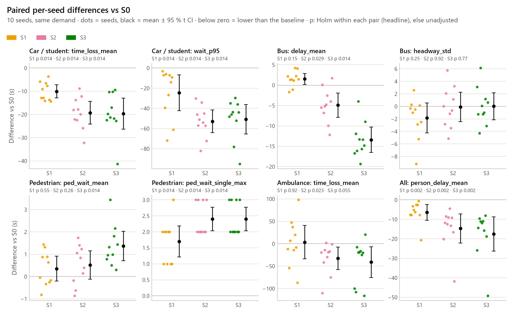
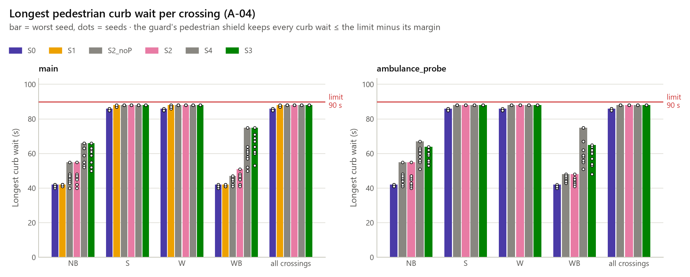

# Evaluation: S0 to S4 on the Pitié-Salpêtrière junction (Parts 4 and 8)

Generated by `python -m traffic_twin.evaluation.evaluate --config configs/evaluation.yaml` (spec 13.2, 13.3, A-03 to A-06). Do not edit by hand: rerun `tasks.py evaluate` (figures: `tasks.py plots-eval`). Results are provisional until the field visit (ASSUMED signal program).

**Verdicts:** A-03 4/4; A-04 PASS; A-05 PASS; A-06 PASS; hidden degradation: main S1, main S2, main S2_noP, main S3, main S4, ambulance_probe S2, ambulance_probe S2_noP, ambulance_probe S3, ambulance_probe S4.

**A-06 primary:** S3 vs S1 (actuated): all/person_delay_mean 57.1 → 46.0 s (n = 10), HL -9.5 s [95 % CI -17.5, -6.4], exact two-sided p 0.0020, Holm p 0.0059 (α 0.05): S3 better.

**Spec 10.6 check (reported, not gating):** Seeds 1-10 confirm the interim FALLBACK (C2 fails on pedestrian/ped_curb_wait_mean). The main solution stays S2.

## 1. Final comparison table (Part 8)

Family `main`, pre-registered layout (`final_table`, changes 2026-10-23): mean ± sd over the 10 evaluation seeds, change vs S0 in brackets; columns S0, S1, S2, S3, ablations S2_noP, S4 (greyed in the app). The person delay (`all/person_delay_mean`) is the A-06 KPI; the tests are in the next section and in the pair tables. Machine-readable: `final_table.csv` next to `summary.json` (the API, the app and the report read it).

| User | KPI | Unit | Better if | S0 | S1 | S2 | S3 | S2_noP (ablation) | S4 (ablation) |
|---|---|---|---|---|---|---|---|---|---|
| car | `time_loss_mean` | s | lower | 75.9 ± 12.9 | 65.8 ± 11.3 (-13.3 %) | 56.6 ± 7.2 (-25.4 %) | 56.2 ± 4.3 (-25.9 %) | 55.9 ± 6.7 (-26.3 %) | 56.1 ± 4.0 (-26.1 %) |
| car | `wait_mean` | s | lower | 60.9 ± 10.9 | 52.0 ± 9.6 (-14.7 %) | 44.2 ± 6.3 (-27.5 %) | 44.2 ± 3.7 (-27.5 %) | 43.5 ± 5.9 (-28.6 %) | 44.0 ± 3.5 (-27.7 %) |
| car | `wait_p95` | s | lower | 164.5 ± 26.3 | 140.0 ± 22.7 (-14.9 %) | 111.6 ± 19.9 (-32.1 %) | 113.7 ± 11.0 (-30.8 %) | 109.6 ± 19.7 (-33.4 %) | 112.9 ± 10.9 (-31.3 %) |
| car | `throughput_vph` | veh/h | higher | 1178.8 ± 26.7 | 1179.5 ± 30.2 (+0.1 %) | 1185.7 ± 32.5 (+0.6 %) | 1185.7 ± 32.9 (+0.6 %) | 1184.7 ± 32.6 (+0.5 %) | 1185.3 ± 32.0 (+0.6 %) |
| bus | `delay_mean` | s | lower | 61.0 ± 1.1 | 62.6 ± 2.6 (+2.5 %) | 56.1 ± 4.0 (-8.0 %) | 47.6 ± 4.2 (-22.0 %) | 57.2 ± 5.4 (-6.3 %) | 47.4 ± 2.6 (-22.3 %) |
| bus | `headway_std` | s | lower | 23.4 ± 0.3 | 21.6 ± 3.4 (-7.9 %) | 23.3 ± 3.2 (-0.4 %) | 23.4 ± 3.1 (+0.1 %) | 23.4 ± 3.5 (-0.1 %) | 23.3 ± 2.5 (-0.4 %) |
| bus | `dwell_mean` | s | n/a | 20.0 ± 0.0 | 20.0 ± 0.0 (+0.0 %) | 20.0 ± 0.0 (+0.0 %) | 20.0 ± 0.0 (+0.0 %) | 20.0 ± 0.0 (+0.0 %) | 20.0 ± 0.0 (+0.0 %) |
| pedestrian | `ped_curb_wait_mean` | s | lower | 18.9 ± 0.7 | 19.2 ± 0.7 (+1.8 %) | 19.4 ± 0.8 (+2.6 %) | 20.2 ± 0.7 (+7.0 %) | 19.1 ± 0.6 (+1.3 %) | 20.1 ± 1.0 (+6.6 %) |
| pedestrian | `ped_curb_wait_p95` | s | lower | 72.9 ± 1.9 | 72.0 ± 1.4 (-1.2 %) | 73.4 ± 2.6 (+0.7 %) | 75.5 ± 1.8 (+3.6 %) | 73.2 ± 2.0 (+0.4 %) | 75.4 ± 1.5 (+3.4 %) |
| pedestrian | `ped_curb_wait_max` | s | lower | 85.6 ± 0.5 | 87.4 ± 0.5 (+2.1 %) | 88.0 ± 0.0 (+2.8 %) | 88.0 ± 0.0 (+2.8 %) | 88.0 ± 0.0 (+2.8 %) | 88.0 ± 0.0 (+2.8 %) |
| pedestrian | `crossing_complete_rate` | – | higher | 0.9998 ± 0.0003 | 0.9998 ± 0.0003 (-0.0 %) | 0.9999 ± 0.0002 (+0.0 %) | 0.9999 ± 0.0002 (+0.0 %) | 0.9999 ± 0.0003 (+0.0 %) | 0.9999 ± 0.0003 (+0.0 %) |
| ambulance | `travel_time_total` | s | lower | 152.2 ± 60.9 | 149.1 ± 55.3 (-2.0 %) | 110.5 ± 43.7 (-27.4 %) | 101.3 ± 24.9 (-33.4 %) | 134.4 ± 45.1 (-11.7 %) | 125.3 ± 30.5 (-17.7 %) |
| ambulance | `stops` | – | lower | 1.30 ± 0.48 | 1.60 ± 0.70 (+23.1 %) | 1.20 ± 0.63 (-7.7 %) | 1.10 ± 0.32 (-15.4 %) | 1.40 ± 0.52 (+7.7 %) | 1.10 ± 0.32 (-15.4 %) |
| ambulance | `stop_duration_mean` | s | lower | 60.9 ± 13.6 | 54.0 ± 17.6 (-11.4 %) | 34.8 ± 18.4 (-42.9 %) | 38.5 ± 11.0 (-36.9 %) | 51.2 ± 19.7 (-15.8 %) | 61.6 ± 23.0 (+1.2 %) |
| all | `person_delay_mean` | s | lower | 63.6 ± 14.5 | 57.1 ± 9.4 (-10.1 %) | 48.9 ± 4.4 (-23.1 %) | 46.0 ± 3.2 (-27.6 %) | 48.9 ± 4.3 (-23.0 %) | 45.9 ± 2.6 (-27.8 %) |

Ambulance-probe family `ambulance_probe` (7 ambulances per run, the robust ambulance evidence):

| User | KPI | Unit | Better if | S0 | S2 | S3 | S2_noP (ablation) | S4 (ablation) |
|---|---|---|---|---|---|---|---|---|
| ambulance | `travel_time_total` | s | lower | 179.8 ± 49.0 | 87.0 ± 15.6 (-51.6 %) | 86.5 ± 18.4 (-51.9 %) | 106.0 ± 22.1 (-41.0 %) | 129.5 ± 18.6 (-28.0 %) |
| ambulance | `stops` | – | lower | 1.71 ± 0.23 | 1.23 ± 0.24 (-28.3 %) | 1.16 ± 0.23 (-32.5 %) | 1.13 ± 0.28 (-34.2 %) | 1.49 ± 0.25 (-13.3 %) |

Safety and preemption (A-04 per scenario; preemption totals over the runs):

| User | Counter | S0 | S1 | S2 | S3 | S2_noP | S4 |
|---|---|---|---|---|---|---|---|
| all | `a04_pass` | 1 | 1 | 1 | 1 | 1 | 1 |
| all | `danger_total` | 0 | 0 | 0 | 0 | 0 | 0 |
| all | `collisions` | 0 | 0 | 0 | 0 | 0 | 0 |
| pedestrian | `ped_curb_wait_max_worst` | 86 | 88 | 88 | 88 | 88 | 88 |
| ambulance | `preemption_requests` | 0 | 0 | 10 | 10 | 0 | 0 |
| ambulance | `preemption_served` | 0 | 0 | 10 | 10 | 0 | 0 |
| ambulance | `preemption_timeouts` | 0 | 0 | 0 | 0 | 0 | 0 |
| all | `a04_pass__probe` | 1 | – | 1 | 1 | 1 | 1 |
| all | `danger_total__probe` | 0 | – | 0 | 0 | 0 | 0 |
| all | `collisions__probe` | 0 | – | 0 | 0 | 0 | 0 |
| pedestrian | `ped_curb_wait_max_worst__probe` | 86 | – | 88 | 88 | 88 | 88 |
| ambulance | `preemption_requests__probe` | 0 | – | 70 | 70 | 0 | 0 |
| ambulance | `preemption_served__probe` | 0 | – | 70 | 70 | 0 | 0 |
| ambulance | `preemption_timeouts__probe` | 0 | – | 0 | 0 | 0 | 0 |

Guard interventions per run:

| User | Counter | S0 | S1 | S2 | S3 | S2_noP | S4 |
|---|---|---|---|---|---|---|---|
| all | `interventions_per_run` | 0 | 0 | 0 | 29 | 0 | 30 |
| all | `interventions_per_run__min_green` | 0 | 0 | 0 | 0 | 0 | 0 |
| all | `interventions_per_run__order` | 0 | 0 | 0 | 0 | 0 | 0 |
| all | `interventions_per_run__max_green` | 0 | 0 | 0 | 1.30 | 0 | 0.90 |
| all | `interventions_per_run__starvation` | 0 | 0 | 0 | 0 | 0 | 0.10 |
| all | `interventions_per_run__ped_wait` | 0 | 0 | 0 | 27.70 | 0 | 29 |
| all | `interventions_per_run__probe` | 0 | – | 0 | 31.70 | 0 | 31.30 |
| all | `interventions_per_run__min_green__probe` | 0 | – | 0 | 0 | 0 | 0 |
| all | `interventions_per_run__order__probe` | 0 | – | 0 | 0 | 0 | 0 |
| all | `interventions_per_run__max_green__probe` | 0 | – | 0 | 0.90 | 0 | 1.10 |
| all | `interventions_per_run__starvation__probe` | 0 | – | 0 | 0 | 0 | 0.20 |
| all | `interventions_per_run__ped_wait__probe` | 0 | – | 0 | 30.80 | 0 | 30 |

Equity vs S0 (13.3): primary / subgroup KPIs flagged, every KPI flagged, hidden degradation (1 = yes):

| User | Counter | S0 | S1 | S2 | S3 | S2_noP | S4 |
|---|---|---|---|---|---|---|---|
| all | `equity_flags_vs_S0` | – | 5 | 4 | 3 | 2 | 3 |
| all | `worse_kpis_vs_S0` | – | 14 | 17 | 19 | 12 | 19 |
| all | `hidden_degradation` | – | 1 | 1 | 1 | 1 | 1 |
| all | `equity_flags_vs_S0__probe` | – | – | 6 | 3 | 4 | 3 |
| all | `worse_kpis_vs_S0__probe` | – | – | 19 | 20 | 17 | 22 |
| all | `hidden_degradation__probe` | – | – | 1 | 1 | 1 | 1 |

Person delay at the bus occupancy sensitivity values (ASSUMED occupancies):

| User | KPI | Unit | Better if | S0 | S1 | S2 | S3 | S2_noP (ablation) | S4 (ablation) |
|---|---|---|---|---|---|---|---|---|---|
| all | `person_delay_mean__occ_bus_20` | s | lower | 63.7 ± 15.5 | 56.7 ± 10.0 (-11.0 %) | 48.4 ± 4.5 (-24.1 %) | 45.9 ± 3.1 (-27.9 %) | 48.3 ± 4.4 (-24.1 %) | 45.8 ± 2.7 (-28.1 %) |
| all | `person_delay_mean__occ_bus_30` | s | lower | 63.4 ± 13.6 | 57.5 ± 8.8 (-9.4 %) | 49.4 ± 4.3 (-22.2 %) | 46.1 ± 3.2 (-27.2 %) | 49.5 ± 4.3 (-22.0 %) | 46.0 ± 2.6 (-27.4 %) |

## 2. A-06: S3 against the baselines (Part 8)

**A-06 PASS** (procedural, D94: PASS when every comparison has its 10 paired seeds, the S3 runs are current and the frozen inputs match; INVALID otherwise; never FAIL because of the direction of a result).

Pre-registered (`a06`, changes 2026-10-23): family `main`, candidate S3 (`pitie_rl_s3`), `all/person_delay_mean`, d = S3 − reference per seed, exact two-sided paired Wilcoxon, Hodges-Lehmann estimate and 95 % CI, Holm across the 3 comparisons, α 0.05. Outcome: "S3 better" if Holm p < α and HL < 0, "S3 worse" if Holm p < α and HL > 0, else "no significant difference".

| Comparison | Role | n | Reference mean ± sd (s) | S3 mean ± sd (s) | S3 − reference: HL [95 % CI] | p | p (Holm) | Outcome |
|---|---|---|---|---|---|---|---|---|
| S3 vs S1 (actuated) | primary | 10 | 57.1 ± 9.4 | 46.0 ± 3.2 | -9.5 [-17.5, -6.4] s | 0.0020 | 0.0059 | **S3 better** |
| S3 vs S2 (rules) | Holm family | 10 | 48.9 ± 4.4 | 46.0 ± 3.2 | -2.5 [-5.0, -0.6] s | 0.0137 | 0.0137 | **S3 better** |
| S3 vs S0 (fixed) | Holm family | 10 | 63.6 ± 14.5 | 46.0 ± 3.2 | -14.3 [-29.4, -10.7] s | 0.0020 | 0.0059 | **S3 better** |

**Primary result:** S3 vs S1 (actuated): all/person_delay_mean 57.1 → 46.0 s (n = 10), HL -9.5 s [95 % CI -17.5, -6.4], exact two-sided p 0.0020, Holm p 0.0059 (α 0.05): S3 better.

- Model: `rl7-dqn-v1-s0-415724a4`, sha256 `151c6f692acc` (pinned by `configs/pitie_rl_s3.yaml`: `151c6f692acc`), config_hash `8dac6ad90ea8`; all 4 pinned rl.config files match (D100).
- Registration (D92): commit `ca1a7c1` at 2026-10-23 18:26 UTC; first S3 run started 2026-10-23 18:43 UTC; committed before the first S3 run (second resolution).
- The main solution stays S2 (Part 7 interim FALLBACK, spec 15 week-7 rule): A-06 is the confirmatory test of record for RL against the baselines, presented whatever its direction; it does not reopen that choice (changes 2026-10-23).

## 3. Spec 10.6 check on seeds 1-10 (Part 8)

Reported, not gating (D95): Part 7's D79 checks C1-C3 repeated on the evaluation seeds against S1; C4 is a training property and is cited from Part 7.

| Check | Rule | Result | Pass |
|---|---|---|---|
| C1 | `all/person_delay_mean`: HL < 0 and exact two-sided p < 0.05 vs S1 | HL -9.5 s [-17.5, -6.4], p 0.0020, n 10 | yes |
| C2 | no listed KPI more than 5 % worse than S1 (means) | `car/time_loss_mean` -14.5 %; `bus/delay_mean` -23.9 %; `pedestrian/ped_curb_wait_mean` +5.2 % (worse) | **no** |
| C3 | every S3 run: danger, collisions, teleports 0; curb wait ≤ 90 s; every preemption served or timed out; time-outs ≤ S2 | 0 violation(s) | yes |
| C4 | training property, cited from Part 7 | `data/rl7/devtest/verdict.json`: pass | cited |

**Seeds 1-10 confirm the interim FALLBACK (C2 fails on pedestrian/ped_curb_wait_mean). The main solution stays S2.**

| C2 KPI | S1 mean | S3 mean | Change | Worse |
|---|---|---|---|---|
| `car/time_loss_mean` | 65.8 | 56.2 | -14.5 % | no |
| `bus/delay_mean` | 62.6 | 47.6 | -23.9 % | no |
| `pedestrian/ped_curb_wait_mean` | 19.2 | 20.2 | +5.2 % | yes |

## 4. Runs, code versions, seeds and demand

Evaluation seeds 1-10 (10 runs per scenario); KPI version required 3. Every run was checked against its CURRENT config (`config_hash`, `demand_hash`) before use; a family shares one `demand_hash` (same demand, paired per seed).

| Family | Label | Scenario | Controller | Config | config_hash | demand_hash | Code version | Run dates | kpi_version |
|---|---|---|---|---|---|---|---|---|---|
| main | S0 | `pitie_fixed` | fixed | `configs/pitie_fixed.yaml` | `290b20f0b6f2` | `83a4f220fd20` | ca1a7c1 | 2026-10-23 | 3 |
| main | S1 | `pitie_actuated` | actuated | `configs/pitie_actuated.yaml` | `9a8742f4ac1c` | `83a4f220fd20` | ca1a7c1 | 2026-10-23 | 3 |
| main | S2 | `pitie_rules` | rules | `configs/pitie_rules.yaml` | `ba8be2a56475` | `83a4f220fd20` | ca1a7c1 | 2026-10-23 | 3 |
| main | S2_noP | `pitie_rules_nopreempt` | rules | `configs/pitie_rules_nopreempt.yaml` | `a039fe99679a` | `83a4f220fd20` | ca1a7c1 | 2026-10-23 | 3 |
| main | S3 | `pitie_rl_s3` | rl | `configs/pitie_rl_s3.yaml` | `8dac6ad90ea8` | `83a4f220fd20` | ca1a7c1 | 2026-10-23 | 3 |
| main | S4 | `pitie_rl_s3_nopreempt` | rl | `configs/pitie_rl_s3_nopreempt.yaml` | `a4127fffba7c` | `83a4f220fd20` | ca1a7c1 | 2026-10-23 | 3 |
| ambulance_probe | S0 | `pitie_amb_fixed` | fixed | `configs/pitie_amb_fixed.yaml` | `8f561d3c6ebf` | `a54278790e5a` | ca1a7c1 | 2026-10-23 | 3 |
| ambulance_probe | S2 | `pitie_amb_rules` | rules | `configs/pitie_amb_rules.yaml` | `8153ee1d051c` | `a54278790e5a` | ca1a7c1 | 2026-10-23 | 3 |
| ambulance_probe | S2_noP | `pitie_amb_rules_nopreempt` | rules | `configs/pitie_amb_rules_nopreempt.yaml` | `f2a6f6dd3e59` | `a54278790e5a` | ca1a7c1 | 2026-10-23 | 3 |
| ambulance_probe | S3 | `pitie_amb_rl_s3` | rl | `configs/pitie_amb_rl_s3.yaml` | `26e4a3d48e3f` | `a54278790e5a` | ca1a7c1 | 2026-10-23 | 3 |
| ambulance_probe | S4 | `pitie_amb_rl_s3_nopreempt` | rl | `configs/pitie_amb_rl_s3_nopreempt.yaml` | `46f986aba8fd` | `a54278790e5a` | ca1a7c1 | 2026-10-23 | 3 |

## 5. Pre-registration

`configs/evaluation.yaml` (sha256 `349aa029d4f5`), pre-registered **2026-10-12**; first run 2026-10-23, started 2026-10-23 18:41 UTC (pre-registered before the runs). It changes only through dated entries in `changes`.

Families and pairs (each pair is its own Holm family over the 7 Part 3 headline KPIs of `configs/validation.yaml`; new KPIs are secondary, unadjusted):

- `main`: S0 = `pitie_fixed` (fixed), S1 = `pitie_actuated` (actuated), S2 = `pitie_rules` (rules), S2_noP = `pitie_rules_nopreempt` (rules), S3 = `pitie_rl_s3` (rl), S4 = `pitie_rl_s3_nopreempt` (rl); baseline S0; pairs S0 vs S1 (part3), S0 vs S2 (confirmatory), S1 vs S2 (confirmatory), S2_noP vs S2 (exploratory), S0 vs S3 (confirmatory), S1 vs S3 (confirmatory), S2 vs S3 (confirmatory), S4 vs S3 (exploratory), S2_noP vs S4 (exploratory).
- `ambulance_probe`: S0 = `pitie_amb_fixed` (fixed), S2 = `pitie_amb_rules` (rules), S2_noP = `pitie_amb_rules_nopreempt` (rules), S3 = `pitie_amb_rl_s3` (rl), S4 = `pitie_amb_rl_s3_nopreempt` (rl); baseline S0; pairs S0 vs S2 (secondary), S2_noP vs S2 (secondary), S0 vs S3 (secondary), S4 vs S3 (secondary), S2 vs S3 (secondary).

- **A-05** (D26): main family, S2 vs S0, ambulance `travel_time_total`, exact one-sided Wilcoxon (alternative `less`: S2 lower), α 0.05; PASS iff p < α. The secondary tests (ambulance-probe family; S3 in both families) are reported, not judged.
- **A-04** (D27): every run of main, ambulance_probe: each danger audit count 0, collisions ≤ 0, `ped_curb_wait_max` ≤ `safety.ped_max_wait_s` (90 s) (pre-registered: `ped_wait_single_max` ≤ 90 s, now reported alongside; see the 2026-10-12 changes), 0 guard interventions for fixed, actuated (D13).
- **Equity** (D29): a KPI more than 5 % worse than the baseline in its bad direction is flagged (a KPI whose baseline mean is 0: any move in its bad direction; rates: `crossing_complete_rate` by more than 1 pp, `served_share` by more than 1 pp (no run produces this KPI: not applied)). Hidden degradation: the person-weighted delay (`all.person_delay_mean`) significantly better while a primary (car `time_loss_mean`, bus `delay_mean`, pedestrian `ped_curb_wait_max`, ambulance `travel_time_total`) or subgroup KPI (car `delay_total_mean__arm_*`, bus `delay_mean__flow_*`, pedestrian `ped_curb_wait_mean__crossing_*`) is flagged.
- Occupancies (ASSUMED, spec 10.3): car 1.3, bus 25, pedestrian 1, ambulance 1; sensitivity: bus 20, 30.
- **A-06** (D94, changes 2026-10-23): family `main`, S3 vs S1, S2, S0 (primary S1) on `all.person_delay_mean`, exact two-sided paired Wilcoxon, Holm across the comparisons, n = 10 required; procedural status (PASS / INVALID, never FAIL on direction). The spec 10.6 check is repeated against S1 (reported, not gating); the main solution stays S2.
- **Registration** (D92): commit `ca1a7c1` at 2026-10-23 18:26 UTC; first S3 run started 2026-10-23 18:43 UTC; committed before the first S3 run (second resolution).

| Date | Change | Why |
|---|---|---|
| 2026-10-12 | Equity (D29): a KPI whose baseline mean is 0 is flagged worse on any move in its bad direction (its relative change is undefined). | Review finding: the relative rule could never flag a 0 -> >0 change, e.g. pedestrian crossing_red_entries. No result changes: in the seed 1-10 runs no KPI has a 0 baseline and a non-zero scenario mean. |
| 2026-10-12 | A-03 checks the (user, kpi) set in every seed, not over the union of the seeds; an A-05 test with fewer pairs than the evaluation seeds, or a run whose planned ambulances did not all arrive, is INVALID, never PASS. | Review finding: a run without the KPI (an ambulance that never arrived) left the paired sample silently, so A-05 could PASS on n = 9 (D26 pre-registers n = 10). No result changes: every pair has 10 seeds and every planned ambulance arrived. |
| 2026-10-12 | equity.rates_pp.served_share stays as pre-registered but is not applied: no run produces a served_share KPI (the evaluation page marks it). | Review finding; the planned served-share KPI was never built. |
| 2026-10-12 | A-04 (D27, amending D14) judges the pedestrian curb wait: PASS needs, in every run, `ped_curb_wait_max` <= the scenario's `safety.ped_max_wait_s` (90 s; `a04.ped_curb_wait_max_s`). `ped_wait_single_max` (D14, Part 3) is still computed, unchanged, and reported next to it, but no longer judged. kpi_version 2 -> 3: runs without the curb-wait rows (`ped_curb_wait_{mean,p95,max}` and per crossing) are stale and are rerun by `--run-missing` / `tasks.py rebaseline`. The pedestrian shield's detected w_c (D21) is the same curb wait. | Correctness fix found on the calibration seeds 101-103, before any regenerated seed 1-10 run: SUMO resets `person.getWaitingTime` whenever a waiting pedestrian creeps faster than 0.1 m/s at the curb, so the single wait (and the shield input that read it) undercounted the real wait at a red crossing (an S2 pedestrian stood 91 s at a red crossing while getWaitingTime peaked at 88 s). The session now keeps a per-person curb clock that runs through such creeps (never below getWaitingTime). |
| 2026-10-12 | Preemption time-out (D24): a request is dropped after `preemption.max_hold_s` (120 s) without the ambulance getting `preemption.progress_m` (1 m) closer to the stop line, instead of 120 s after its first detection. A stationary ambulance still times out 120 s after its first detection. | Found on calibration seed 101 (Part 4 gate): the pedestrian shield can cut a hold and force a detour of up to one S2 cycle (177 s > 120 s), and the first-detection clock then dropped an ambulance that was still moving up its queue just before its target stage came back. Ambulance travel times on 101-103 are unchanged; only the served / timeout bookkeeping is. |
| 2026-10-12 | Equity (D29): the pedestrian primary KPI is `ped_curb_wait_max` (was `ped_wait_single_max`) and the pedestrian subgroup KPIs are `ped_curb_wait_mean__crossing_*` (were `ped_wait_single_mean__crossing_*`). The single-wait KPIs stay in the equity table as ordinary (non-primary, non-subgroup) KPIs. | Same correctness fix as the A-04 entry, found on the calibration seeds 101-103 before any regenerated seed 1-10 run: `person.getWaitingTime` resets when a waiting pedestrian creeps at the curb, so the single wait undercounts the wait at a red crossing; the curb wait (KPI version 3) is the pedestrian wait that the shield bounds and A-04 judges. |
| 2026-10-23 | Part 8 scenarios (D93): S3 (`configs/pitie_rl_s3.yaml`, the selected Part 7 policy, unchanged) and S4 (`configs/pitie_rl_s3_nopreempt.yaml`, the S3 policy with emergency preemption off) join the main family, and their ambulance-probe versions (`configs/pitie_amb_rl_s3.yaml`, `configs/pitie_amb_rl_s3_nopreempt.yaml`) join the ambulance_probe family. New pairs (a = reference, b = candidate): main S0-S3, S1-S3, S2-S3 confirmatory, S4-S3 and S2_noP-S4 exploratory; probe S0-S3, S4-S3, S2-S3 secondary; each pair keeps its own 7-KPI Holm table (D28). Three A-05 secondary tests (one-sided `less`): main S0 vs S3, probe S0 vs S3, probe S4 vs S3. The A-05 primary (main S0 vs S2) is unchanged. | Spec S8 (final evaluation on 10 seeds), 13.1 (scenario list) and A-06 (RL vs the baselines). S4 is the 13.1 "without preemption" option for the RL controller; it is out of distribution (the policy never decided with an ambulance present), so its results describe degradation, not a design, and it is never part of A-06. Written before any S3 or S4 run on seeds 1-10; no S3 or S4 result on seeds 1-10 had been seen when it was written. Disclosure (a gate fix of 2026-10-23, recorded in this uncommitted text per D92): later that day, before the registration commit, a gate check called `python -m traffic_twin.evaluation.compare --run-missing` directly (compare.py, validation/report.py and sim/run_scenario.py have no run lock of their own; only `evaluate` and the `tasks.py` tasks check it). It ran S3 on seeds 1-10 from the uncommitted tree (started 2026-10-23 17:12-17:13 UTC) and showed three rows of the main S0-S3 pair table: pedestrian ped_wait_mean and ped_wait_single_max (S3 worse, Holm p 0.0137 each) and ambulance time_loss_mean (S3 better, -37.6 %, Holm p 0.0547). The A-06 KPI all/person_delay_mean, the S1-S3 and S2-S3 pairs, the 10.6 check, S4 and the probe family were not shown; the A-05 secondary test main S0 vs S3 uses ambulance travel_time_total, a KPI related to the one shown. This file (last written 2026-10-23 14:48 UTC) was not changed after that look except for this disclosure. The runs and the comparison were moved out of the repository and are never used; `tasks.py part8` re-makes them once from the registration commit. |
| 2026-10-23 | A-06 (D94, block `a06`): family main, candidate S3, `all/person_delay_mean`, exact two-sided paired Wilcoxon on d = S3 - reference per seed with the Hodges-Lehmann estimate and 95 % CI, against S1 (primary), S2 and S0, Holm across the three. The status is procedural: PASS when each comparison has the 10 paired seeds, every S3 run is current (config_hash with the pinned model_sha256, and the pinned text sha256 of the rl.config chain), the family shares one demand_hash and A-03 passes; INVALID otherwise; never FAIL because of the direction of a result. Outcome per comparison: "S3 better" (Holm p < 0.05, HL < 0), "S3 worse" (Holm p < 0.05, HL > 0), else "no significant difference"; raw p, Holm p, means, SDs and the HL CI are always shown. The spec 10.6 check of Part 7 (D79 C1-C3) is repeated on seeds 1-10 against S1 and reported, not gating (`a06.replication_10_6`; C4 is cited from Part 7). The main solution stays S2 whatever the result. "Binding" (D68, README, Part 7 page) now means: A-06 is the confirmatory test of record for RL against the baselines, presented whatever its direction; it does not reopen the choice of the main solution. The final comparison table layout is fixed in `final_table` (D98). | User decision of 2026-10-23 (S3 tested exactly as registered, no retraining; S2 stays the main solution per the spec 15 week-7 rule and the Part 7 interim FALLBACK). The rule was drafted after seeing the Part 7 dev-test and the scratch prototype on seeds 3200-3209 (S3 vs S2 p 0.049 there); this is harmless because the status is procedural and the outcome rule is fixed in advance, so neither can be tuned to a result. Written before any S3 or S4 run on seeds 1-10 (the later accidental S3 run is disclosed in the first 2026-10-23 entry; it did not show the A-06 KPI). |
| 2026-10-23 | Part 8 seed records (D101, block `part8.seeds`, outside the top-level `seeds` block so the Part 3-4 seed sets are unchanged): 3200-3209 burned by the Part 8 prototype, 3210-3229 the Part 8 development range, both carved from rl7.reserve (3200-3999). | The Part 8 prototype ran S0-S4 on the scratch seeds 3200-3209 (no seed 1-10 run), so they are recorded as used; implementers need a separate development range that no other part uses. |

## 6. ASSUMED inputs added in Parts 4 and 8

- ASSUMED: pedestrian detection is ideal (camera / push button): the guard's pedestrian shield reads the curb wait of every waiting pedestrian (`safety.ped_forcing`: detected).
- ASSUMED: bus detection for transit priority is ideal (TraCI positions of every bus on an approach, standing for AVL or a check-in loop; lines 24, 57, 91; `rules.tsp.enabled` in main/S2, main/S2_noP, ambulance_probe/S2, ambulance_probe/S2_noP).
- ASSUMED: exit blocking for box clearing is read ideally (TraCI: a vehicle below 0.5 m/s within 15 m of an exit lane's start, standing for a queue detector at each exit; `rules.box.enabled` in main/S2, main/S2_noP, ambulance_probe/S2, ambulance_probe/S2_noP).
- ASSUMED: the ambulance obeys the signals: its vType (`sim.demand`) has no bluelight device, so it never passes a red and no rescue lane forms.
- ASSUMED: ambulance departures and routes (`emergency`): `main` 1 ambulance per run (08:10 N → S); `ambulance_probe` 7 ambulances per run (07:35 N → S, 07:50 W → S, 08:10 N → S, 08:25 W → S, 08:40 N → S, 08:55 W → S, 09:10 N → S).
- ASSUMED: the ambulance is detected before it enters the network (upstream / V2I detection, `preemption.detection.pending`: true).
- ASSUMED: occupancies of the person-weighted delay: car 1.3, bus 25, pedestrian 1, ambulance 1.
- ASSUMED: the signal program (cycle 123 s = 74 s green + 49 s clearance, stages HOP → S_LEFT → STM → BUS_91 → BUS_57) and every Pitié number derived from it (maxima, hold caps, crossing reds) until the field visit.
- ASSUMED: the RL policy (`models/rl/rl7-dqn-v1-s0-415724a4/model.zip`) was trained and selected in Part 7 on the ASSUMED signal program and demand; it is evaluated unchanged (frozen inputs, D100).
- ASSUMED: main/S4 (`pitie_rl_s3_nopreempt`), ambulance_probe/S4 (`pitie_amb_rl_s3_nopreempt`) run the S3 policy with emergency preemption off: OUT OF DISTRIBUTION (the policy never decided with an ambulance present without preemption), so their results describe how the agent degrades, not a design; exploratory, never part of A-06.
- `main` demand frozen as in Part 3 (1 ambulance per run; demand_hash `83a4f220fd20`); bus headway updates and per-seed jitter are left for a later sensitivity family.

## 7. KPI definitions

Qualified KPIs are named `<base>__<qualifier>` (e.g. `time_loss_mean__arm_N`) and take the direction and unit of their base.

| KPI | Users | SUMO source | Formula | Unit | Better if |
|---|---|---|---|---|---|
| `count` | ambulance, bus, car, pedestrian | tripinfo / personinfo | finished trips (pedestrians: persons) | – | higher |
| `travel_time` | ambulance, bus, car, pedestrian | tripinfo `duration` | mean in-network travel time (walks: duration) | s | lower |
| `time_loss_mean` | ambulance, bus, car | tripinfo `timeLoss` | mean time lost (insertion delay excluded); also per arm | s | lower |
| `wait_mean` | ambulance, bus, car | tripinfo `waitingTime` | mean time standing (speed < 0.1 m/s) | s | lower |
| `wait_p95` | ambulance, bus, car | tripinfo `waitingTime` | 95th percentile of the time standing | s | lower |
| `stops` | ambulance, bus, car | tripinfo `waitingCount` | mean number of stops | – | lower |
| `depart_delay_mean` | ambulance, bus, car | tripinfo `departDelay` | mean insertion delay | s | lower |
| `depart_delay_max` | ambulance, bus, car | tripinfo `departDelay` | largest insertion delay | s | lower |
| `delay_mean` | bus | bus tripinfo `timeLoss` | mean bus delay (scheduled dwell excluded); also per bus flow | s | lower |
| `headway_std` | bus | stopinfo `started` | headway std per (stop, line), mean over groups; also per bus line | s | lower |
| `dwell_mean` | bus | stopinfo | mean `ended - started` (set by the dwell config) | s | n/a |
| `ped_wait_mean` | pedestrian | personinfo walk `timeLoss` | mean time lost per walk | s | lower |
| `ped_wait_max` | pedestrian | personinfo walk `timeLoss` | largest time lost over a walk | s | lower |
| `ped_wait_p95` | pedestrian | personinfo walk `timeLoss` | 95th percentile of the time lost | s | lower |
| `ped_wait_single_mean` | pedestrian | TraCI `person.getWaitingTime` | longest single wait, mean; also per crossing | s | lower |
| `ped_wait_single_p95` | pedestrian | TraCI `person.getWaitingTime` | longest single wait, p95 | s | lower |
| `ped_wait_single_max` | pedestrian | TraCI `person.getWaitingTime` | longest single wait; also per crossing | s | lower |
| `ped_curb_wait_mean` | pedestrian | TraCI per step: curb clock from `person.getWaitingTime`, kept running through creeps at a red curb | longest curb wait per person, mean; also per crossing | s | lower |
| `ped_curb_wait_p95` | pedestrian | TraCI per step: curb clock from `person.getWaitingTime`, kept running through creeps at a red curb | longest curb wait per person, p95 | s | lower |
| `ped_curb_wait_max` | pedestrian | TraCI per step: curb clock from `person.getWaitingTime`, kept running through creeps at a red curb | longest curb wait (90 s target, A-04); also per crossing | s | lower |
| `throughput_vph` | car | tripinfo `arrival` | car arrivals inside the window ÷ hours | veh/h | higher |
| `delay_total_mean` | bus, car | tripinfo `timeLoss` + `departDelay` | mean delay incl. insertion; also per arm | s | lower |
| `travel_time_total` | ambulance | tripinfo `duration` + `departDelay` | arrival − planned departure | s | lower |
| `stop_duration_mean` | ambulance | tripinfo `waitingTime`, `waitingCount` | Σ time standing ÷ Σ stops (0 without a stop) | s | lower |
| `crossing_complete_rate` | pedestrian | TraCI per step | 1 − exposed ÷ crossing traversals; exposed: a foe vehicle link showed G while the person was on the crossing | – | higher |
| `crossing_red_entries` | pedestrian | TraCI per step | entries onto a crossing while its own link showed r | – | lower |
| `box_halt_red_s` | junction | TraCI per step | vehicle-seconds halted inside the junction on a link not G/g | s | lower |
| `box_foe_onsets` | junction | TraCI per step | green onsets of a foe of a halted box vehicle's link | – | lower |
| `exit_blocked_s` | junction | TraCI per step | seconds with a vehicle halted (< 0.5 m/s) within 15 m of an exit lane's start | s | lower |
| `exit_blocked_green_s` | junction | TraCI per step | the same while a link feeding that exit is green | s | lower |
| `person_delay_mean` | all | trip.parquet (evaluation) | occupancy-weighted mean of vehicle `timeLoss` + `departDelay` and walk `timeLoss`; also occupancy sensitivity | s | lower |

## 8. KPIs per user and scenario

Family `main`: mean ± sd over the seeds (qualified KPIs: `kpis.csv`).

| User | KPI | Unit | S0 | S1 | S2 | S2_noP | S3 | S4 |
|---|---|---|---|---|---|---|---|---|
| car | `count` | – | 2406.7 ± 61.9 | 2406.7 ± 61.9 | 2406.7 ± 61.9 | 2406.7 ± 61.9 | 2406.7 ± 61.9 | 2406.7 ± 61.9 |
| car | `travel_time` | s | 124.4 ± 12.8 | 114.4 ± 11.2 | 105.2 ± 7.1 | 104.5 ± 6.7 | 104.8 ± 4.3 | 104.7 ± 4.0 |
| car | `time_loss_mean` | s | 75.9 ± 12.9 | 65.8 ± 11.3 | 56.6 ± 7.2 | 55.9 ± 6.7 | 56.2 ± 4.3 | 56.1 ± 4.0 |
| car | `wait_mean` | s | 60.9 ± 10.9 | 52.0 ± 9.6 | 44.2 ± 6.3 | 43.5 ± 5.9 | 44.2 ± 3.7 | 44.0 ± 3.5 |
| car | `wait_p95` | s | 164.5 ± 26.3 | 140.0 ± 22.7 | 111.6 ± 19.9 | 109.6 ± 19.7 | 113.7 ± 11.0 | 112.9 ± 10.9 |
| car | `stops` | – | 1.24 ± 0.13 | 1.15 ± 0.11 | 1.04 ± 0.07 | 1.03 ± 0.07 | 0.999 ± 0.046 | 0.994 ± 0.038 |
| car | `depart_delay_mean` | s | 10.6 ± 20.0 | 4.85 ± 9.69 | 0.328 ± 0.444 | 0.428 ± 0.696 | 0.173 ± 0.302 | 0.204 ± 0.295 |
| car | `depart_delay_max` | s | 132.2 ± 143.4 | 87.1 ± 77.7 | 36.5 ± 30.7 | 40.4 ± 33.0 | 19.5 ± 18.0 | 28.6 ± 30.1 |
| car | `throughput_vph` | veh/h | 1178.8 ± 26.7 | 1179.5 ± 30.2 | 1185.7 ± 32.5 | 1184.7 ± 32.6 | 1185.7 ± 32.9 | 1185.3 ± 32.0 |
| car | `delay_total_mean` | s | 86.5 ± 32.1 | 70.6 ± 20.5 | 56.9 ± 7.6 | 56.3 ± 7.4 | 56.4 ± 4.5 | 56.3 ± 4.3 |
| bus | `count` | – | 94.0 ± 0.0 | 94.0 ± 0.0 | 94.0 ± 0.0 | 94.0 ± 0.0 | 94.0 ± 0.0 | 94.0 ± 0.0 |
| bus | `travel_time` | s | 137.3 ± 1.2 | 138.9 ± 2.7 | 132.6 ± 3.9 | 133.6 ± 5.4 | 124.0 ± 4.2 | 123.8 ± 2.5 |
| bus | `time_loss_mean` | s | 61.0 ± 1.1 | 62.6 ± 2.6 | 56.1 ± 4.0 | 57.2 ± 5.4 | 47.6 ± 4.2 | 47.4 ± 2.6 |
| bus | `wait_mean` | s | 50.8 ± 1.1 | 52.3 ± 2.5 | 46.3 ± 3.6 | 47.4 ± 5.2 | 38.5 ± 3.9 | 38.2 ± 2.3 |
| bus | `wait_p95` | s | 110.8 ± 1.9 | 107.9 ± 5.5 | 105.6 ± 7.5 | 105.6 ± 6.9 | 106.4 ± 6.5 | 104.2 ± 5.9 |
| bus | `stops` | – | 1.21 ± 0.06 | 1.20 ± 0.05 | 1.16 ± 0.07 | 1.17 ± 0.04 | 1.04 ± 0.09 | 1.04 ± 0.08 |
| bus | `depart_delay_mean` | s | 0.137 ± 0.011 | 0.165 ± 0.030 | 0.161 ± 0.021 | 0.163 ± 0.020 | 0.166 ± 0.021 | 0.165 ± 0.029 |
| bus | `depart_delay_max` | s | 3.00 ± 0.00 | 4.80 ± 1.55 | 5.20 ± 1.55 | 4.60 ± 1.78 | 4.80 ± 1.62 | 4.70 ± 1.49 |
| bus | `delay_mean` | s | 61.0 ± 1.1 | 62.6 ± 2.6 | 56.1 ± 4.0 | 57.2 ± 5.4 | 47.6 ± 4.2 | 47.4 ± 2.6 |
| bus | `headway_std` | s | 23.4 ± 0.3 | 21.6 ± 3.4 | 23.3 ± 3.2 | 23.4 ± 3.5 | 23.4 ± 3.1 | 23.3 ± 2.5 |
| bus | `dwell_mean` | s | 20.0 ± 0.0 | 20.0 ± 0.0 | 20.0 ± 0.0 | 20.0 ± 0.0 | 20.0 ± 0.0 | 20.0 ± 0.0 |
| bus | `delay_total_mean` | s | 61.1 ± 1.2 | 62.7 ± 2.6 | 56.3 ± 4.0 | 57.3 ± 5.4 | 47.8 ± 4.3 | 47.6 ± 2.5 |
| pedestrian | `count` | – | 1600.3 ± 51.0 | 1600.3 ± 51.0 | 1600.3 ± 51.0 | 1600.3 ± 51.0 | 1600.3 ± 51.0 | 1600.3 ± 51.0 |
| pedestrian | `ped_wait_mean` | s | 21.8 ± 0.7 | 22.2 ± 0.7 | 22.3 ± 0.8 | 22.1 ± 0.6 | 23.2 ± 0.7 | 23.1 ± 1.0 |
| pedestrian | `ped_wait_max` | s | 89.6 ± 0.8 | 91.2 ± 0.9 | 93.6 ± 0.8 | 93.2 ± 0.5 | 94.1 ± 0.9 | 93.8 ± 0.9 |
| pedestrian | `travel_time` | s | 40.1 ± 0.7 | 40.5 ± 0.7 | 40.6 ± 0.8 | 40.4 ± 0.6 | 41.5 ± 0.7 | 41.4 ± 1.0 |
| pedestrian | `ped_wait_p95` | s | 76.2 ± 1.8 | 75.2 ± 1.4 | 76.9 ± 2.5 | 76.4 ± 2.0 | 78.7 ± 1.4 | 78.6 ± 1.5 |
| pedestrian | `ped_wait_single_mean` | s | 17.9 ± 0.7 | 18.3 ± 0.7 | 18.4 ± 0.8 | 18.2 ± 0.6 | 19.2 ± 0.7 | 19.1 ± 0.9 |
| pedestrian | `ped_wait_single_p95` | s | 71.8 ± 2.0 | 70.5 ± 1.4 | 72.2 ± 2.5 | 72.0 ± 1.7 | 74.2 ± 1.3 | 74.3 ± 0.9 |
| pedestrian | `ped_wait_single_max` | s | 85.6 ± 0.5 | 87.3 ± 0.5 | 88.0 ± 0.0 | 88.0 ± 0.0 | 88.0 ± 0.0 | 88.0 ± 0.0 |
| pedestrian | `ped_curb_wait_mean` | s | 18.9 ± 0.7 | 19.2 ± 0.7 | 19.4 ± 0.8 | 19.1 ± 0.6 | 20.2 ± 0.7 | 20.1 ± 1.0 |
| pedestrian | `ped_curb_wait_p95` | s | 72.9 ± 1.9 | 72.0 ± 1.4 | 73.4 ± 2.6 | 73.2 ± 2.0 | 75.5 ± 1.8 | 75.4 ± 1.5 |
| pedestrian | `ped_curb_wait_max` | s | 85.6 ± 0.5 | 87.4 ± 0.5 | 88.0 ± 0.0 | 88.0 ± 0.0 | 88.0 ± 0.0 | 88.0 ± 0.0 |
| pedestrian | `crossing_complete_rate` | – | 0.9998 ± 0.0003 | 0.9998 ± 0.0003 | 0.9999 ± 0.0002 | 0.9999 ± 0.0003 | 0.9999 ± 0.0002 | 0.9999 ± 0.0003 |
| pedestrian | `crossing_red_entries` | – | 0.000 ± 0.000 | 0.000 ± 0.000 | 0.000 ± 0.000 | 0.000 ± 0.000 | 0.000 ± 0.000 | 0.000 ± 0.000 |
| ambulance | `count` | – | 1.00 ± 0.00 | 1.00 ± 0.00 | 1.00 ± 0.00 | 1.00 ± 0.00 | 1.00 ± 0.00 | 1.00 ± 0.00 |
| ambulance | `travel_time` | s | 142.2 ± 52.6 | 145.6 ± 48.7 | 109.7 ± 41.6 | 133.6 ± 43.1 | 101.3 ± 24.9 | 125.3 ± 30.5 |
| ambulance | `time_loss_mean` | s | 109.2 ± 52.5 | 112.5 ± 48.7 | 76.7 ± 41.6 | 100.6 ± 43.0 | 68.2 ± 25.0 | 92.2 ± 30.5 |
| ambulance | `wait_mean` | s | 83.6 ± 47.7 | 85.2 ± 42.9 | 47.5 ± 34.0 | 70.9 ± 34.7 | 42.7 ± 18.5 | 66.7 ± 25.6 |
| ambulance | `wait_p95` | s | 83.6 ± 47.7 | 85.2 ± 42.9 | 47.5 ± 34.0 | 70.9 ± 34.7 | 42.7 ± 18.5 | 66.7 ± 25.6 |
| ambulance | `stops` | – | 1.30 ± 0.48 | 1.60 ± 0.70 | 1.20 ± 0.63 | 1.40 ± 0.52 | 1.10 ± 0.32 | 1.10 ± 0.32 |
| ambulance | `depart_delay_mean` | s | 10.0 ± 31.6 | 3.50 ± 7.38 | 0.800 ± 2.530 | 0.800 ± 2.530 | 0.000 ± 0.000 | 0.000 ± 0.000 |
| ambulance | `depart_delay_max` | s | 10.0 ± 31.6 | 3.50 ± 7.38 | 0.800 ± 2.530 | 0.800 ± 2.530 | 0.000 ± 0.000 | 0.000 ± 0.000 |
| ambulance | `travel_time_total` | s | 152.2 ± 60.9 | 149.1 ± 55.3 | 110.5 ± 43.7 | 134.4 ± 45.1 | 101.3 ± 24.9 | 125.3 ± 30.5 |
| ambulance | `stop_duration_mean` | s | 60.9 ± 13.6 | 54.0 ± 17.6 | 34.8 ± 18.4 | 51.2 ± 19.7 | 38.5 ± 11.0 | 61.6 ± 23.0 |
| junction | `box_halt_red_s` | s | 45.8 ± 24.5 | 41.3 ± 22.4 | 41.5 ± 18.7 | 34.6 ± 22.7 | 50.9 ± 18.2 | 54.2 ± 23.0 |
| junction | `box_foe_onsets` | – | 2.40 ± 1.96 | 3.00 ± 2.36 | 2.50 ± 1.43 | 1.50 ± 1.08 | 2.50 ± 1.58 | 2.80 ± 1.48 |
| junction | `exit_blocked_s` | s | 24.5 ± 7.1 | 25.9 ± 10.6 | 26.7 ± 6.2 | 24.1 ± 7.8 | 15.8 ± 5.4 | 17.8 ± 6.8 |
| junction | `exit_blocked_green_s` | s | 1.80 ± 1.81 | 8.00 ± 4.03 | 10.8 ± 3.6 | 9.10 ± 3.00 | 11.9 ± 4.4 | 14.1 ± 6.1 |
| all | `person_delay_mean` | s | 63.6 ± 14.5 | 57.1 ± 9.4 | 48.9 ± 4.4 | 48.9 ± 4.3 | 46.0 ± 3.2 | 45.9 ± 2.6 |

Family `ambulance_probe`: mean ± sd over the seeds (qualified KPIs: `kpis.csv`).

| User | KPI | Unit | S0 | S2 | S2_noP | S3 | S4 |
|---|---|---|---|---|---|---|---|
| car | `count` | – | 2406.7 ± 61.9 | 2406.7 ± 61.9 | 2406.7 ± 61.9 | 2406.7 ± 61.9 | 2406.7 ± 61.9 |
| car | `travel_time` | s | 125.8 ± 11.7 | 107.2 ± 6.6 | 104.6 ± 6.6 | 108.0 ± 9.8 | 105.8 ± 5.3 |
| car | `time_loss_mean` | s | 77.2 ± 11.8 | 58.6 ± 6.7 | 56.0 ± 6.6 | 59.4 ± 9.8 | 57.2 ± 5.3 |
| car | `wait_mean` | s | 62.1 ± 10.0 | 45.9 ± 5.8 | 43.6 ± 5.7 | 47.0 ± 8.7 | 45.0 ± 4.6 |
| car | `wait_p95` | s | 170.0 ± 26.0 | 119.7 ± 20.8 | 113.3 ± 23.2 | 124.7 ± 27.1 | 116.2 ± 15.1 |
| car | `stops` | – | 1.25 ± 0.12 | 1.06 ± 0.07 | 1.03 ± 0.06 | 1.04 ± 0.09 | 1.02 ± 0.05 |
| car | `depart_delay_mean` | s | 10.7 ± 19.9 | 0.641 ± 1.008 | 0.767 ± 1.500 | 0.930 ± 2.409 | 0.462 ± 1.169 |
| car | `depart_delay_max` | s | 139.4 ± 140.6 | 49.9 ± 36.3 | 39.1 ± 36.9 | 48.3 ± 59.2 | 29.6 ± 41.6 |
| car | `throughput_vph` | veh/h | 1178.7 ± 26.6 | 1185.2 ± 32.0 | 1185.6 ± 33.2 | 1184.2 ± 33.0 | 1185.0 ± 32.3 |
| car | `delay_total_mean` | s | 87.9 ± 30.9 | 59.2 ± 7.4 | 56.8 ± 7.8 | 60.4 ± 12.1 | 57.7 ± 6.4 |
| bus | `count` | – | 94.0 ± 0.0 | 94.0 ± 0.0 | 94.0 ± 0.0 | 94.0 ± 0.0 | 94.0 ± 0.0 |
| bus | `travel_time` | s | 137.5 ± 1.9 | 135.6 ± 6.2 | 134.1 ± 2.9 | 126.2 ± 5.5 | 124.6 ± 4.4 |
| bus | `time_loss_mean` | s | 61.2 ± 1.8 | 59.1 ± 6.2 | 57.6 ± 2.9 | 49.7 ± 5.5 | 48.2 ± 4.5 |
| bus | `wait_mean` | s | 51.0 ± 1.8 | 49.1 ± 5.8 | 47.7 ± 2.8 | 40.6 ± 5.3 | 39.0 ± 4.2 |
| bus | `wait_p95` | s | 112.2 ± 5.0 | 110.6 ± 9.6 | 107.0 ± 6.6 | 108.1 ± 5.6 | 106.6 ± 8.9 |
| bus | `stops` | – | 1.22 ± 0.06 | 1.20 ± 0.08 | 1.15 ± 0.06 | 1.05 ± 0.07 | 1.04 ± 0.08 |
| bus | `depart_delay_mean` | s | 0.141 ± 0.014 | 0.156 ± 0.020 | 0.154 ± 0.022 | 0.167 ± 0.007 | 0.153 ± 0.024 |
| bus | `depart_delay_max` | s | 3.00 ± 0.00 | 4.80 ± 1.55 | 4.30 ± 1.70 | 4.90 ± 1.66 | 4.20 ± 1.55 |
| bus | `delay_mean` | s | 61.2 ± 1.8 | 59.1 ± 6.2 | 57.6 ± 2.9 | 49.7 ± 5.5 | 48.2 ± 4.5 |
| bus | `headway_std` | s | 23.5 ± 0.4 | 24.5 ± 3.0 | 24.4 ± 3.3 | 24.7 ± 3.3 | 22.2 ± 3.8 |
| bus | `dwell_mean` | s | 20.0 ± 0.0 | 20.0 ± 0.0 | 20.0 ± 0.0 | 20.0 ± 0.0 | 20.0 ± 0.0 |
| bus | `delay_total_mean` | s | 61.3 ± 1.8 | 59.3 ± 6.3 | 57.8 ± 2.9 | 49.9 ± 5.5 | 48.3 ± 4.5 |
| pedestrian | `count` | – | 1600.3 ± 51.0 | 1600.3 ± 51.0 | 1600.3 ± 51.0 | 1600.3 ± 51.0 | 1600.3 ± 51.0 |
| pedestrian | `ped_wait_mean` | s | 21.8 ± 0.7 | 22.2 ± 0.5 | 22.3 ± 0.7 | 23.2 ± 0.7 | 23.3 ± 0.4 |
| pedestrian | `ped_wait_max` | s | 89.5 ± 0.9 | 93.2 ± 0.5 | 93.6 ± 0.6 | 93.7 ± 0.9 | 93.7 ± 0.6 |
| pedestrian | `travel_time` | s | 40.1 ± 0.8 | 40.5 ± 0.5 | 40.6 ± 0.8 | 41.5 ± 0.7 | 41.5 ± 0.4 |
| pedestrian | `ped_wait_p95` | s | 76.1 ± 1.8 | 76.9 ± 2.2 | 77.6 ± 2.0 | 79.6 ± 1.7 | 80.4 ± 1.8 |
| pedestrian | `ped_wait_single_mean` | s | 17.9 ± 0.7 | 18.3 ± 0.5 | 18.4 ± 0.7 | 19.3 ± 0.7 | 19.3 ± 0.4 |
| pedestrian | `ped_wait_single_p95` | s | 71.7 ± 2.1 | 72.5 ± 2.0 | 73.1 ± 2.1 | 75.2 ± 1.7 | 75.8 ± 1.5 |
| pedestrian | `ped_wait_single_max` | s | 85.4 ± 0.5 | 88.0 ± 0.0 | 88.0 ± 0.0 | 88.0 ± 0.0 | 88.0 ± 0.0 |
| pedestrian | `ped_curb_wait_mean` | s | 18.9 ± 0.7 | 19.3 ± 0.5 | 19.4 ± 0.7 | 20.3 ± 0.7 | 20.3 ± 0.4 |
| pedestrian | `ped_curb_wait_p95` | s | 72.9 ± 1.9 | 73.5 ± 2.1 | 74.3 ± 2.2 | 76.3 ± 2.1 | 76.8 ± 1.7 |
| pedestrian | `ped_curb_wait_max` | s | 85.6 ± 0.5 | 88.0 ± 0.0 | 88.0 ± 0.0 | 88.0 ± 0.0 | 88.0 ± 0.0 |
| pedestrian | `crossing_complete_rate` | – | 0.9998 ± 0.0004 | 0.9999 ± 0.0004 | 0.9998 ± 0.0004 | 0.9998 ± 0.0004 | 0.9998 ± 0.0003 |
| pedestrian | `crossing_red_entries` | – | 0.000 ± 0.000 | 0.000 ± 0.000 | 0.000 ± 0.000 | 0.000 ± 0.000 | 0.000 ± 0.000 |
| ambulance | `count` | – | 7.00 ± 0.00 | 7.00 ± 0.00 | 7.00 ± 0.00 | 7.00 ± 0.00 | 7.00 ± 0.00 |
| ambulance | `travel_time` | s | 161.5 ± 18.0 | 87.0 ± 15.6 | 105.3 ± 21.2 | 84.9 ± 15.3 | 128.8 ± 17.7 |
| ambulance | `time_loss_mean` | s | 128.2 ± 18.1 | 53.6 ± 15.6 | 72.0 ± 21.2 | 51.5 ± 15.3 | 95.4 ± 17.7 |
| ambulance | `wait_mean` | s | 103.7 ± 15.9 | 33.9 ± 13.4 | 52.7 ± 18.6 | 32.1 ± 13.1 | 73.7 ± 15.3 |
| ambulance | `wait_p95` | s | 192.3 ± 46.6 | 75.8 ± 22.4 | 103.7 ± 26.3 | 70.2 ± 26.2 | 144.7 ± 31.5 |
| ambulance | `stops` | – | 1.71 ± 0.23 | 1.23 ± 0.24 | 1.13 ± 0.28 | 1.16 ± 0.23 | 1.49 ± 0.25 |
| ambulance | `depart_delay_mean` | s | 18.3 ± 35.7 | 0.071 ± 0.121 | 0.686 ± 1.428 | 1.61 ± 4.96 | 0.729 ± 2.155 |
| ambulance | `depart_delay_max` | s | 84.6 ± 137.2 | 0.500 ± 0.850 | 4.60 ± 9.44 | 11.3 ± 34.7 | 5.10 ± 15.09 |
| ambulance | `travel_time_total` | s | 179.8 ± 49.0 | 87.0 ± 15.6 | 106.0 ± 22.1 | 86.5 ± 18.4 | 129.5 ± 18.6 |
| ambulance | `stop_duration_mean` | s | 60.9 ± 8.6 | 27.3 ± 7.6 | 46.0 ± 8.8 | 27.0 ± 6.9 | 50.1 ± 9.1 |
| junction | `box_halt_red_s` | s | 46.7 ± 22.6 | 45.8 ± 21.7 | 50.2 ± 29.2 | 60.1 ± 33.6 | 69.1 ± 47.8 |
| junction | `box_foe_onsets` | – | 2.20 ± 1.55 | 2.80 ± 1.48 | 3.30 ± 2.31 | 3.60 ± 2.55 | 4.10 ± 3.31 |
| junction | `exit_blocked_s` | s | 26.3 ± 6.7 | 23.1 ± 5.9 | 22.4 ± 7.2 | 18.9 ± 5.2 | 18.9 ± 5.3 |
| junction | `exit_blocked_green_s` | s | 2.20 ± 1.62 | 9.90 ± 3.31 | 7.60 ± 2.37 | 16.5 ± 6.3 | 16.0 ± 5.2 |
| all | `person_delay_mean` | s | 64.3 ± 14.0 | 50.9 ± 4.9 | 49.4 ± 4.0 | 48.5 ± 6.8 | 46.8 ± 4.0 |

## 9. Pairs vs the baseline (Holm)

**S0** (`pitie_fixed`) vs **S1** (`pitie_actuated`), family `main`, role *part3*: 10 seeds, one demand. Exact two-sided Wilcoxon, Holm over the 7 headline KPIs of this pair only; α = 0.05.

| User | KPI | S0 mean ± sd | S1 mean ± sd | S1 − S0 [95 % CI] | Change | p | p (Holm) | Effect | Equity flag |
|---|---|---|---|---|---|---|---|---|---|
| car | `time_loss_mean` | 75.9 ± 12.9 | 65.8 ± 11.3 | -10.1 [-12.9, -7.2] s | -13.3 % | 0.0020 | 0.0137 | better | no |
| car | `wait_p95` | 164.5 ± 26.3 | 140.0 ± 22.7 | -24.5 [-42.3, -6.7] s | -14.9 % | 0.0020 | 0.0137 | better | no |
| bus | `delay_mean` | 61.0 ± 1.1 | 62.6 ± 2.6 | +1.5 [0.2, 2.9] s | 2.5 % | 0.0371 | 0.1484 | worse | no |
| bus | `headway_std` | 23.4 ± 0.3 | 21.6 ± 3.4 | -1.8 [-4.2, 0.5] s | -7.9 % | 0.0840 | 0.2520 | better | no |
| pedestrian | `ped_wait_mean` | 21.8 ± 0.7 | 22.2 ± 0.7 | +0.4 [-0.2, 0.9] s | 1.6 % | 0.2754 | 0.5508 | worse | no |
| pedestrian | `ped_wait_single_max` | 85.6 ± 0.5 | 87.3 ± 0.5 | +1.7 [1.2, 2.2] s | 2.0 % | 0.0020 | 0.0137 | worse | no |
| ambulance | `time_loss_mean` | 109.2 ± 52.5 | 112.5 ± 48.7 | +3.4 [-33.8, 40.6] s | 3.1 % | 0.9219 | 0.9219 | worse | no |

Other KPIs more than 5 % worse (secondary, unadjusted p):

- ambulance `stops`: 1.30 → 1.60 (+23.1 %, p 0.3750)
- bus `depart_delay_mean`: 0.137 → 0.165 s (+20.2 %, p 0.0195)
- bus `depart_delay_max`: 3.00 → 4.80 s (+60.0 %, p 0.0312)
- bus `delay_mean__flow_24_W`: 49.1 → 57.6 s (+17.3 %, p 0.0273)
- bus `delay_mean__flow_57_N`: 53.5 → 66.9 s (+25.0 %, p 0.0020)
- pedestrian `ped_wait_single_mean__crossing_NB`: 8.63 → 9.19 s (+6.5 %, p 0.1641)
- pedestrian `ped_wait_single_mean__crossing_WB`: 6.46 → 6.82 s (+5.5 %, p 0.0488)
- pedestrian `ped_wait_single_mean__crossing_W`: 27.8 → 29.6 s (+6.3 %, p 0.0195)
- pedestrian `ped_curb_wait_mean__crossing_NB`: 9.32 → 9.84 s (+5.6 %, p 0.1602)
- pedestrian `ped_curb_wait_mean__crossing_WB`: 7.00 → 7.40 s (+5.8 %, p 0.0488)
- pedestrian `ped_curb_wait_mean__crossing_W`: 29.1 → 30.9 s (+6.2 %, p 0.0195)
- junction `box_foe_onsets`: 2.40 → 3.00 (+25.0 %, p 0.3711)
- junction `exit_blocked_s`: 24.5 → 25.9 s (+5.7 %, p 0.7188)
- junction `exit_blocked_green_s`: 1.80 → 8.00 s (+344.4 %, p 0.0020)

**S0** (`pitie_fixed`) vs **S2** (`pitie_rules`), family `main`, role *confirmatory*: 10 seeds, one demand. Exact two-sided Wilcoxon, Holm over the 7 headline KPIs of this pair only; α = 0.05.

| User | KPI | S0 mean ± sd | S2 mean ± sd | S2 − S0 [95 % CI] | Change | p | p (Holm) | Effect | Equity flag |
|---|---|---|---|---|---|---|---|---|---|
| car | `time_loss_mean` | 75.9 ± 12.9 | 56.6 ± 7.2 | -19.3 [-24.2, -14.4] s | -25.4 % | 0.0020 | 0.0137 | better | no |
| car | `wait_p95` | 164.5 ± 26.3 | 111.6 ± 19.9 | -52.8 [-64.1, -41.5] s | -32.1 % | 0.0020 | 0.0137 | better | no |
| bus | `delay_mean` | 61.0 ± 1.1 | 56.1 ± 4.0 | -4.9 [-7.9, -1.9] s | -8.0 % | 0.0098 | 0.0293 | better | no |
| bus | `headway_std` | 23.4 ± 0.3 | 23.3 ± 3.2 | -0.1 [-2.4, 2.2] s | -0.4 % | 0.9219 | 0.9219 | better | no |
| pedestrian | `ped_wait_mean` | 21.8 ± 0.7 | 22.3 ± 0.8 | +0.5 [-0.1, 1.1] s | 2.4 % | 0.1309 | 0.2617 | worse | no |
| pedestrian | `ped_wait_single_max` | 85.6 ± 0.5 | 88.0 ± 0.0 | +2.4 [2.0, 2.8] s | 2.8 % | 0.0020 | 0.0137 | worse | no |
| ambulance | `time_loss_mean` | 109.2 ± 52.5 | 76.7 ± 41.6 | -32.5 [-57.5, -7.4] s | -29.7 % | 0.0059 | 0.0234 | better | no |

Other KPIs more than 5 % worse (secondary, unadjusted p):

- bus `depart_delay_mean`: 0.137 → 0.161 s (+17.1 %, p 0.0156)
- bus `depart_delay_max`: 3.00 → 5.20 s (+73.3 %, p 0.0156)
- car `time_loss_mean__arm_S`: 44.1 → 48.4 s (+9.6 %, p 0.0020)
- car `delay_total_mean__arm_S`: 44.1 → 48.4 s (+9.8 %, p 0.0020)
- bus `delay_mean__flow_57_N`: 53.5 → 59.9 s (+11.8 %, p 0.0645)
- bus `headway_std__line_57`: 23.4 → 27.7 s (+18.1 %, p 0.0488)
- pedestrian `ped_wait_single_mean__crossing_NB`: 8.63 → 9.11 s (+5.6 %, p 0.1309)
- pedestrian `ped_wait_single_mean__crossing_WB`: 6.46 → 6.87 s (+6.3 %, p 0.2324)
- pedestrian `ped_wait_single_mean__crossing_W`: 27.8 → 29.5 s (+6.0 %, p 0.0371)
- pedestrian `ped_wait_single_max__crossing_NB`: 40.9 → 45.3 s (+10.8 %, p 0.0156)
- pedestrian `ped_wait_single_max__crossing_WB`: 40.9 → 44.8 s (+9.5 %, p 0.0039)
- pedestrian `ped_curb_wait_mean__crossing_WB`: 7.00 → 7.42 s (+5.9 %, p 0.3223)
- pedestrian `ped_curb_wait_mean__crossing_W`: 29.1 → 30.9 s (+6.0 %, p 0.0371)
- pedestrian `ped_curb_wait_max__crossing_NB`: 41.2 → 45.9 s (+11.4 %, p 0.0117)
- pedestrian `ped_curb_wait_max__crossing_WB`: 40.9 → 45.2 s (+10.5 %, p 0.0039)
- junction `exit_blocked_s`: 24.5 → 26.7 s (+9.0 %, p 0.3555)
- junction `exit_blocked_green_s`: 1.8 → 10.8 s (+500.0 %, p 0.0020)

**S0** (`pitie_fixed`) vs **S3** (`pitie_rl_s3`), family `main`, role *confirmatory*: 10 seeds, one demand. Exact two-sided Wilcoxon, Holm over the 7 headline KPIs of this pair only; α = 0.05.

| User | KPI | S0 mean ± sd | S3 mean ± sd | S3 − S0 [95 % CI] | Change | p | p (Holm) | Effect | Equity flag |
|---|---|---|---|---|---|---|---|---|---|
| car | `time_loss_mean` | 75.9 ± 12.9 | 56.2 ± 4.3 | -19.6 [-26.3, -12.9] s | -25.9 % | 0.0020 | 0.0137 | better | no |
| car | `wait_p95` | 164.5 ± 26.3 | 113.7 ± 11.0 | -50.7 [-65.4, -36.1] s | -30.8 % | 0.0020 | 0.0137 | better | no |
| bus | `delay_mean` | 61.0 ± 1.1 | 47.6 ± 4.2 | -13.4 [-16.5, -10.3] s | -22.0 % | 0.0020 | 0.0137 | better | no |
| bus | `headway_std` | 23.4 ± 0.3 | 23.4 ± 3.1 | +0.0 [-2.1, 2.2] s | 0.1 % | 0.7695 | 0.7695 | worse | no |
| pedestrian | `ped_wait_mean` | 21.8 ± 0.7 | 23.2 ± 0.7 | +1.4 [0.7, 2.0] s | 6.3 % | 0.0020 | 0.0137 | worse | **yes** |
| pedestrian | `ped_wait_single_max` | 85.6 ± 0.5 | 88.0 ± 0.0 | +2.4 [2.0, 2.8] s | 2.8 % | 0.0020 | 0.0137 | worse | no |
| ambulance | `time_loss_mean` | 109.2 ± 52.5 | 68.2 ± 25.0 | -41.0 [-75.4, -6.6] s | -37.6 % | 0.0273 | 0.0547 | better | no |

Other KPIs more than 5 % worse (secondary, unadjusted p):

- bus `depart_delay_mean`: 0.137 → 0.166 s (+20.9 %, p 0.0078)
- bus `depart_delay_max`: 3.00 → 4.80 s (+60.0 %, p 0.0312)
- pedestrian `ped_wait_single_mean`: 17.9 → 19.2 s (+7.3 %, p 0.0020)
- bus `headway_std__line_24`: 3.91 → 4.17 s (+6.7 %, p 0.5566)
- bus `headway_std__line_57`: 23.4 → 31.8 s (+35.8 %, p 0.0020)
- pedestrian `ped_wait_single_mean__crossing_NB`: 8.6 → 10.1 s (+16.5 %, p 0.0020)
- pedestrian `ped_wait_single_mean__crossing_S`: 28.4 → 29.8 s (+5.2 %, p 0.0488)
- pedestrian `ped_wait_single_mean__crossing_WB`: 6.46 → 7.60 s (+17.7 %, p 0.0039)
- pedestrian `ped_wait_single_max__crossing_NB`: 40.9 → 58.7 s (+43.5 %, p 0.0020)
- pedestrian `ped_wait_single_max__crossing_WB`: 40.9 → 64.3 s (+57.2 %, p 0.0020)
- pedestrian `ped_curb_wait_mean`: 18.9 → 20.2 s (+7.0 %, p 0.0020)
- pedestrian `ped_curb_wait_mean__crossing_NB`: 9.3 → 10.8 s (+15.5 %, p 0.0020)
- pedestrian `ped_curb_wait_mean__crossing_S`: 29.7 → 31.2 s (+5.1 %, p 0.0488)
- pedestrian `ped_curb_wait_mean__crossing_WB`: 7.00 → 8.17 s (+16.7 %, p 0.0039)
- pedestrian `ped_curb_wait_max__crossing_NB`: 41.2 → 59.0 s (+43.2 %, p 0.0020)
- pedestrian `ped_curb_wait_max__crossing_WB`: 40.9 → 64.5 s (+57.7 %, p 0.0020)
- junction `box_halt_red_s`: 45.8 → 50.9 s (+11.1 %, p 0.4961)
- junction `exit_blocked_green_s`: 1.8 → 11.9 s (+561.1 %, p 0.0020)

**S0** (`pitie_amb_fixed`) vs **S2** (`pitie_amb_rules`), family `ambulance_probe`, role *secondary*: 10 seeds, one demand. Exact two-sided Wilcoxon, Holm over the 7 headline KPIs of this pair only; α = 0.05.

| User | KPI | S0 mean ± sd | S2 mean ± sd | S2 − S0 [95 % CI] | Change | p | p (Holm) | Effect | Equity flag |
|---|---|---|---|---|---|---|---|---|---|
| car | `time_loss_mean` | 77.2 ± 11.8 | 58.6 ± 6.7 | -18.6 [-23.4, -13.8] s | -24.1 % | 0.0020 | 0.0137 | better | no |
| car | `wait_p95` | 170.0 ± 26.0 | 119.7 ± 20.8 | -50.3 [-68.4, -32.2] s | -29.6 % | 0.0020 | 0.0137 | better | no |
| bus | `delay_mean` | 61.2 ± 1.8 | 59.1 ± 6.2 | -2.1 [-6.3, 2.2] s | -3.4 % | 0.3750 | 0.8262 | better | no |
| bus | `headway_std` | 23.5 ± 0.4 | 24.5 ± 3.0 | +1.0 [-1.2, 3.2] s | 4.3 % | 0.4316 | 0.8262 | worse | no |
| pedestrian | `ped_wait_mean` | 21.8 ± 0.7 | 22.2 ± 0.5 | +0.4 [-0.4, 1.1] s | 1.7 % | 0.2754 | 0.8262 | worse | no |
| pedestrian | `ped_wait_single_max` | 85.4 ± 0.5 | 88.0 ± 0.0 | +2.6 [2.2, 3.0] s | 3.0 % | 0.0020 | 0.0137 | worse | no |
| ambulance | `time_loss_mean` | 128.2 ± 18.1 | 53.6 ± 15.6 | -74.5 [-90.6, -58.5] s | -58.2 % | 0.0020 | 0.0137 | better | no |

Other KPIs more than 5 % worse (secondary, unadjusted p):

- bus `depart_delay_mean`: 0.141 → 0.156 s (+10.5 %, p 0.0312)
- bus `depart_delay_max`: 3.00 → 4.80 s (+60.0 %, p 0.0312)
- car `time_loss_mean__arm_S`: 43.5 → 48.1 s (+10.5 %, p 0.0020)
- car `delay_total_mean__arm_S`: 43.5 → 48.1 s (+10.6 %, p 0.0020)
- bus `delay_mean__flow_24_W`: 48.3 → 57.8 s (+19.8 %, p 0.0645)
- bus `delay_mean__flow_57_N`: 53.5 → 61.7 s (+15.3 %, p 0.0371)
- bus `headway_std__line_57`: 23.4 → 28.9 s (+23.4 %, p 0.0098)
- pedestrian `ped_wait_single_mean__crossing_NB`: 8.67 → 9.22 s (+6.4 %, p 0.0371)
- pedestrian `ped_wait_single_mean__crossing_WB`: 6.46 → 6.87 s (+6.2 %, p 0.1934)
- pedestrian `ped_wait_single_mean__crossing_W`: 27.8 → 29.4 s (+5.5 %, p 0.1055)
- pedestrian `ped_wait_single_max__crossing_NB`: 41.3 → 45.1 s (+9.2 %, p 0.0215)
- pedestrian `ped_wait_single_max__crossing_WB`: 40.8 → 44.2 s (+8.3 %, p 0.0039)
- pedestrian `ped_curb_wait_mean__crossing_NB`: 9.36 → 9.88 s (+5.6 %, p 0.0488)
- pedestrian `ped_curb_wait_mean__crossing_WB`: 6.99 → 7.41 s (+6.1 %, p 0.2324)
- pedestrian `ped_curb_wait_mean__crossing_W`: 29.1 → 30.7 s (+5.2 %, p 0.0840)
- pedestrian `ped_curb_wait_max__crossing_NB`: 41.4 → 45.1 s (+8.9 %, p 0.0215)
- pedestrian `ped_curb_wait_max__crossing_WB`: 40.8 → 44.2 s (+8.3 %, p 0.0039)
- junction `box_foe_onsets`: 2.20 → 2.80 (+27.3 %, p 0.4414)
- junction `exit_blocked_green_s`: 2.20 → 9.90 s (+350.0 %, p 0.0020)

**S0** (`pitie_amb_fixed`) vs **S3** (`pitie_amb_rl_s3`), family `ambulance_probe`, role *secondary*: 10 seeds, one demand. Exact two-sided Wilcoxon, Holm over the 7 headline KPIs of this pair only; α = 0.05.

| User | KPI | S0 mean ± sd | S3 mean ± sd | S3 − S0 [95 % CI] | Change | p | p (Holm) | Effect | Equity flag |
|---|---|---|---|---|---|---|---|---|---|
| car | `time_loss_mean` | 77.2 ± 11.8 | 59.4 ± 9.8 | -17.8 [-21.8, -13.7] s | -23.0 % | 0.0020 | 0.0137 | better | no |
| car | `wait_p95` | 170.0 ± 26.0 | 124.7 ± 27.1 | -45.3 [-62.1, -28.4] s | -26.6 % | 0.0020 | 0.0137 | better | no |
| bus | `delay_mean` | 61.2 ± 1.8 | 49.7 ± 5.5 | -11.5 [-15.5, -7.4] s | -18.7 % | 0.0020 | 0.0137 | better | no |
| bus | `headway_std` | 23.5 ± 0.4 | 24.7 ± 3.3 | +1.2 [-1.0, 3.5] s | 5.2 % | 0.3750 | 0.3750 | worse | **yes** |
| pedestrian | `ped_wait_mean` | 21.8 ± 0.7 | 23.2 ± 0.7 | +1.4 [0.8, 2.0] s | 6.4 % | 0.0039 | 0.0137 | worse | **yes** |
| pedestrian | `ped_wait_single_max` | 85.4 ± 0.5 | 88.0 ± 0.0 | +2.6 [2.2, 3.0] s | 3.0 % | 0.0020 | 0.0137 | worse | no |
| ambulance | `time_loss_mean` | 128.2 ± 18.1 | 51.5 ± 15.3 | -76.7 [-89.0, -64.4] s | -59.8 % | 0.0020 | 0.0137 | better | no |

Other KPIs more than 5 % worse (secondary, unadjusted p):

- bus `depart_delay_mean`: 0.141 → 0.167 s (+18.0 %, p 0.0078)
- bus `depart_delay_max`: 3.00 → 4.90 s (+63.3 %, p 0.0312)
- pedestrian `ped_wait_single_mean`: 17.9 → 19.3 s (+7.4 %, p 0.0039)
- bus `headway_std__line_57`: 23.4 → 30.1 s (+28.7 %, p 0.0020)
- pedestrian `ped_wait_single_mean__crossing_NB`: 8.67 → 9.79 s (+12.9 %, p 0.0371)
- pedestrian `ped_wait_single_mean__crossing_S`: 28.4 → 30.2 s (+6.5 %, p 0.0273)
- pedestrian `ped_wait_single_mean__crossing_WB`: 6.46 → 7.82 s (+21.0 %, p 0.0020)
- pedestrian `ped_wait_single_max__crossing_NB`: 41.3 → 58.3 s (+41.2 %, p 0.0020)
- pedestrian `ped_wait_single_max__crossing_WB`: 40.8 → 57.6 s (+41.2 %, p 0.0020)
- pedestrian `ped_curb_wait_mean`: 18.9 → 20.3 s (+7.2 %, p 0.0039)
- pedestrian `ped_curb_wait_mean__crossing_NB`: 9.4 → 10.4 s (+11.6 %, p 0.0488)
- pedestrian `ped_curb_wait_mean__crossing_S`: 29.7 → 31.6 s (+6.4 %, p 0.0195)
- pedestrian `ped_curb_wait_mean__crossing_WB`: 6.99 → 8.42 s (+20.5 %, p 0.0039)
- pedestrian `ped_curb_wait_max__crossing_NB`: 41.4 → 58.7 s (+41.8 %, p 0.0020)
- pedestrian `ped_curb_wait_max__crossing_WB`: 40.8 → 57.7 s (+41.4 %, p 0.0020)
- junction `box_halt_red_s`: 46.7 → 60.1 s (+28.7 %, p 0.2422)
- junction `box_foe_onsets`: 2.20 → 3.60 (+63.6 %, p 0.1406)
- junction `exit_blocked_green_s`: 2.2 → 16.5 s (+650.0 %, p 0.0020)

## 10. Other confirmatory pairs

**S1** (`pitie_actuated`) vs **S2** (`pitie_rules`), family `main`, role *confirmatory*: 10 seeds, one demand. Exact two-sided Wilcoxon, Holm over the 7 headline KPIs of this pair only; α = 0.05.

| User | KPI | S1 mean ± sd | S2 mean ± sd | S2 − S1 [95 % CI] | Change | p | p (Holm) | Effect | Equity flag |
|---|---|---|---|---|---|---|---|---|---|
| car | `time_loss_mean` | 65.8 ± 11.3 | 56.6 ± 7.2 | -9.2 [-12.6, -5.9] s | -14.0 % | 0.0020 | 0.0137 | better | no |
| car | `wait_p95` | 140.0 ± 22.7 | 111.6 ± 19.9 | -28.3 [-39.8, -16.9] s | -20.2 % | 0.0020 | 0.0137 | better | no |
| bus | `delay_mean` | 62.6 ± 2.6 | 56.1 ± 4.0 | -6.4 [-10.3, -2.6] s | -10.3 % | 0.0098 | 0.0488 | better | no |
| bus | `headway_std` | 21.6 ± 3.4 | 23.3 ± 3.2 | +1.8 [-1.1, 4.6] s | 8.1 % | 0.2324 | 0.4648 | worse | **yes** |
| pedestrian | `ped_wait_mean` | 22.2 ± 0.7 | 22.3 ± 0.8 | +0.2 [-0.4, 0.8] s | 0.7 % | 0.4316 | 0.4648 | worse | no |
| pedestrian | `ped_wait_single_max` | 87.3 ± 0.5 | 88.0 ± 0.0 | +0.7 [0.4, 1.0] s | 0.8 % | 0.0156 | 0.0488 | worse | no |
| ambulance | `time_loss_mean` | 112.5 ± 48.7 | 76.7 ± 41.6 | -35.8 [-58.8, -12.8] s | -31.8 % | 0.0098 | 0.0488 | better | no |

Other KPIs more than 5 % worse (secondary, unadjusted p):

- bus `depart_delay_max`: 4.80 → 5.20 s (+8.3 %, p 0.7500)
- car `time_loss_mean__arm_S`: 44.9 → 48.4 s (+7.6 %, p 0.0020)
- car `delay_total_mean__arm_S`: 45.0 → 48.4 s (+7.7 %, p 0.0020)
- bus `headway_std__line_57`: 20.9 → 27.7 s (+32.4 %, p 0.0059)
- pedestrian `ped_wait_single_max__crossing_NB`: 41.6 → 45.3 s (+8.9 %, p 0.0156)
- pedestrian `ped_wait_single_max__crossing_WB`: 41.2 → 44.8 s (+8.7 %, p 0.0078)
- pedestrian `ped_curb_wait_max__crossing_NB`: 41.8 → 45.9 s (+9.8 %, p 0.0117)
- pedestrian `ped_curb_wait_max__crossing_WB`: 41.3 → 45.2 s (+9.4 %, p 0.0117)
- junction `exit_blocked_green_s`: 8.0 → 10.8 s (+35.0 %, p 0.0977)

**S1** (`pitie_actuated`) vs **S3** (`pitie_rl_s3`), family `main`, role *confirmatory*: 10 seeds, one demand. Exact two-sided Wilcoxon, Holm over the 7 headline KPIs of this pair only; α = 0.05.

| User | KPI | S1 mean ± sd | S3 mean ± sd | S3 − S1 [95 % CI] | Change | p | p (Holm) | Effect | Equity flag |
|---|---|---|---|---|---|---|---|---|---|
| car | `time_loss_mean` | 65.8 ± 11.3 | 56.2 ± 4.3 | -9.6 [-15.1, -4.0] s | -14.5 % | 0.0020 | 0.0137 | better | no |
| car | `wait_p95` | 140.0 ± 22.7 | 113.7 ± 11.0 | -26.2 [-37.7, -14.8] s | -18.7 % | 0.0020 | 0.0137 | better | no |
| bus | `delay_mean` | 62.6 ± 2.6 | 47.6 ± 4.2 | -15.0 [-18.6, -11.3] s | -23.9 % | 0.0020 | 0.0137 | better | no |
| bus | `headway_std` | 21.6 ± 3.4 | 23.4 ± 3.1 | +1.9 [-0.9, 4.6] s | 8.7 % | 0.1602 | 0.1602 | worse | **yes** |
| pedestrian | `ped_wait_mean` | 22.2 ± 0.7 | 23.2 ± 0.7 | +1.0 [0.4, 1.6] s | 4.6 % | 0.0098 | 0.0293 | worse | no |
| pedestrian | `ped_wait_single_max` | 87.3 ± 0.5 | 88.0 ± 0.0 | +0.7 [0.4, 1.0] s | 0.8 % | 0.0156 | 0.0312 | worse | no |
| ambulance | `time_loss_mean` | 112.5 ± 48.7 | 68.2 ± 25.0 | -44.4 [-65.2, -23.6] s | -39.4 % | 0.0020 | 0.0137 | better | no |

Other KPIs more than 5 % worse (secondary, unadjusted p):

- pedestrian `ped_wait_single_mean`: 18.3 → 19.2 s (+5.3 %, p 0.0098)
- pedestrian `ped_wait_single_p95`: 70.5 → 74.2 s (+5.2 %, p 0.0020)
- car `time_loss_mean__arm_W`: 82.9 → 89.7 s (+8.2 %, p 0.0840)
- car `delay_total_mean__arm_W`: 83.0 → 89.8 s (+8.2 %, p 0.0840)
- bus `headway_std__line_24`: 3.76 → 4.17 s (+11.0 %, p 0.3223)
- bus `headway_std__line_57`: 20.9 → 31.8 s (+52.3 %, p 0.0020)
- pedestrian `ped_wait_single_mean__crossing_NB`: 9.2 → 10.1 s (+9.4 %, p 0.0020)
- pedestrian `ped_wait_single_mean__crossing_S`: 27.0 → 29.8 s (+10.6 %, p 0.0039)
- pedestrian `ped_wait_single_mean__crossing_WB`: 6.82 → 7.60 s (+11.5 %, p 0.0273)
- pedestrian `ped_wait_single_max__crossing_NB`: 41.6 → 58.7 s (+41.1 %, p 0.0020)
- pedestrian `ped_wait_single_max__crossing_WB`: 41.2 → 64.3 s (+56.1 %, p 0.0020)
- pedestrian `ped_curb_wait_mean`: 19.2 → 20.2 s (+5.2 %, p 0.0137)
- pedestrian `ped_curb_wait_mean__crossing_NB`: 9.8 → 10.8 s (+9.4 %, p 0.0039)
- pedestrian `ped_curb_wait_mean__crossing_S`: 28.3 → 31.2 s (+10.3 %, p 0.0039)
- pedestrian `ped_curb_wait_mean__crossing_WB`: 7.40 → 8.17 s (+10.3 %, p 0.0273)
- pedestrian `ped_curb_wait_max__crossing_NB`: 41.8 → 59.0 s (+41.1 %, p 0.0020)
- pedestrian `ped_curb_wait_max__crossing_WB`: 41.3 → 64.5 s (+56.2 %, p 0.0020)
- junction `box_halt_red_s`: 41.3 → 50.9 s (+23.2 %, p 0.4902)
- junction `exit_blocked_green_s`: 8.0 → 11.9 s (+48.8 %, p 0.0391)

**S2** (`pitie_rules`) vs **S3** (`pitie_rl_s3`), family `main`, role *confirmatory*: 10 seeds, one demand. Exact two-sided Wilcoxon, Holm over the 7 headline KPIs of this pair only; α = 0.05.

| User | KPI | S2 mean ± sd | S3 mean ± sd | S3 − S2 [95 % CI] | Change | p | p (Holm) | Effect | Equity flag |
|---|---|---|---|---|---|---|---|---|---|
| car | `time_loss_mean` | 56.6 ± 7.2 | 56.2 ± 4.3 | -0.3 [-3.2, 2.5] s | -0.6 % | 0.9219 | 1.0000 | better | no |
| car | `wait_p95` | 111.6 ± 19.9 | 113.7 ± 11.0 | +2.1 [-6.8, 11.0] s | 1.9 % | 0.4160 | 1.0000 | worse | no |
| bus | `delay_mean` | 56.1 ± 4.0 | 47.6 ± 4.2 | -8.5 [-12.3, -4.7] s | -15.2 % | 0.0059 | 0.0410 | better | no |
| bus | `headway_std` | 23.3 ± 3.2 | 23.4 ± 3.1 | +0.1 [-2.4, 2.7] s | 0.5 % | 0.8457 | 1.0000 | worse | no |
| pedestrian | `ped_wait_mean` | 22.3 ± 0.8 | 23.2 ± 0.7 | +0.9 [0.1, 1.6] s | 3.8 % | 0.0645 | 0.3867 | worse | no |
| pedestrian | `ped_wait_single_max` | 88.0 ± 0.0 | 88.0 ± 0.0 | +0.0 [0.0, 0.0] s | 0.0 % | 1.0000 | 1.0000 | same | no |
| ambulance | `time_loss_mean` | 76.7 ± 41.6 | 68.2 ± 25.0 | -8.5 [-32.1, 15.0] s | -11.1 % | 0.5566 | 1.0000 | better | no |

Other KPIs more than 5 % worse (secondary, unadjusted p):

- car `time_loss_mean__arm_W`: 69.5 → 89.7 s (+29.2 %, p 0.0020)
- car `delay_total_mean__arm_W`: 69.5 → 89.8 s (+29.2 %, p 0.0020)
- bus `delay_mean__flow_24_E`: 52.5 → 56.1 s (+6.9 %, p 0.4922)
- ambulance `stop_duration_mean`: 34.8 → 38.5 s (+10.6 %, p 0.6523)
- bus `headway_std__line_24`: 3.73 → 4.17 s (+11.8 %, p 0.4316)
- bus `headway_std__line_57`: 27.7 → 31.8 s (+15.0 %, p 0.1602)
- pedestrian `ped_wait_single_mean__crossing_NB`: 9.1 → 10.1 s (+10.3 %, p 0.0039)
- pedestrian `ped_wait_single_mean__crossing_S`: 27.7 → 29.8 s (+7.6 %, p 0.0137)
- pedestrian `ped_wait_single_mean__crossing_WB`: 6.87 → 7.60 s (+10.7 %, p 0.0098)
- pedestrian `ped_wait_single_max__crossing_NB`: 45.3 → 58.7 s (+29.6 %, p 0.0020)
- pedestrian `ped_wait_single_max__crossing_WB`: 44.8 → 64.3 s (+43.5 %, p 0.0020)
- pedestrian `ped_curb_wait_mean__crossing_NB`: 9.8 → 10.8 s (+10.2 %, p 0.0059)
- pedestrian `ped_curb_wait_mean__crossing_S`: 29.0 → 31.2 s (+7.6 %, p 0.0137)
- pedestrian `ped_curb_wait_mean__crossing_WB`: 7.42 → 8.17 s (+10.1 %, p 0.0195)
- pedestrian `ped_curb_wait_max__crossing_NB`: 45.9 → 59.0 s (+28.5 %, p 0.0020)
- pedestrian `ped_curb_wait_max__crossing_WB`: 45.2 → 64.5 s (+42.7 %, p 0.0020)
- junction `box_halt_red_s`: 41.5 → 50.9 s (+22.7 %, p 0.3438)
- junction `exit_blocked_green_s`: 10.8 → 11.9 s (+10.2 %, p 0.6328)

## 11. Secondary and exploratory pairs (ablation, probe attribution, S4)

**S2_noP** (`pitie_rules_nopreempt`) vs **S2** (`pitie_rules`), family `main`, role *exploratory*: 10 seeds, one demand. Exact two-sided Wilcoxon, Holm over the 7 headline KPIs of this pair only; α = 0.05.

| User | KPI | S2_noP mean ± sd | S2 mean ± sd | S2 − S2_noP [95 % CI] | Change | p | p (Holm) | Effect | Equity flag |
|---|---|---|---|---|---|---|---|---|---|
| car | `time_loss_mean` | 55.9 ± 6.7 | 56.6 ± 7.2 | +0.7 [-0.4, 1.8] s | 1.2 % | 0.2754 | 1.0000 | worse | no |
| car | `wait_p95` | 109.6 ± 19.7 | 111.6 ± 19.9 | +2.1 [-0.2, 4.4] s | 1.9 % | 0.0879 | 0.5273 | worse | no |
| bus | `delay_mean` | 57.2 ± 5.4 | 56.1 ± 4.0 | -1.1 [-4.4, 2.3] s | -1.9 % | 0.5566 | 1.0000 | better | no |
| bus | `headway_std` | 23.4 ± 3.5 | 23.3 ± 3.2 | -0.1 [-2.5, 2.3] s | -0.4 % | 0.9219 | 1.0000 | better | no |
| pedestrian | `ped_wait_mean` | 22.1 ± 0.6 | 22.3 ± 0.8 | +0.2 [-0.2, 0.6] s | 1.1 % | 0.2754 | 1.0000 | worse | no |
| pedestrian | `ped_wait_single_max` | 88.0 ± 0.0 | 88.0 ± 0.0 | +0.0 [0.0, 0.0] s | 0.0 % | 1.0000 | 1.0000 | same | no |
| ambulance | `time_loss_mean` | 100.6 ± 43.0 | 76.7 ± 41.6 | -23.9 [-42.8, -5.0] s | -23.7 % | 0.0039 | 0.0273 | better | no |

Other KPIs more than 5 % worse (secondary, unadjusted p):

- bus `depart_delay_max`: 4.60 → 5.20 s (+13.0 %, p 0.3438)
- car `time_loss_mean__arm_W`: 63.7 → 69.5 s (+9.0 %, p 0.0039)
- car `delay_total_mean__arm_W`: 63.8 → 69.5 s (+9.0 %, p 0.0039)
- bus `delay_mean__flow_91_W`: 51.6 → 54.6 s (+5.7 %, p 0.3750)
- bus `headway_std__line_91`: 26.3 → 28.7 s (+9.4 %, p 0.3223)
- junction `box_halt_red_s`: 34.6 → 41.5 s (+19.9 %, p 0.3594)
- junction `box_foe_onsets`: 1.50 → 2.50 (+66.7 %, p 0.1406)
- junction `exit_blocked_s`: 24.1 → 26.7 s (+10.8 %, p 0.2031)
- junction `exit_blocked_green_s`: 9.1 → 10.8 s (+18.7 %, p 0.1562)

**S4** (`pitie_rl_s3_nopreempt`) vs **S3** (`pitie_rl_s3`), family `main`, role *exploratory*: 10 seeds, one demand. Exact two-sided Wilcoxon, Holm over the 7 headline KPIs of this pair only; α = 0.05.

| User | KPI | S4 mean ± sd | S3 mean ± sd | S3 − S4 [95 % CI] | Change | p | p (Holm) | Effect | Equity flag |
|---|---|---|---|---|---|---|---|---|---|
| car | `time_loss_mean` | 56.1 ± 4.0 | 56.2 ± 4.3 | +0.2 [-0.7, 1.0] s | 0.3 % | 0.8203 | 1.0000 | worse | no |
| car | `wait_p95` | 112.9 ± 10.9 | 113.7 ± 11.0 | +0.8 [-1.0, 2.6] s | 0.7 % | 0.2188 | 1.0000 | worse | no |
| bus | `delay_mean` | 47.4 ± 2.6 | 47.6 ± 4.2 | +0.2 [-1.5, 1.9] s | 0.4 % | 0.8203 | 1.0000 | worse | no |
| bus | `headway_std` | 23.3 ± 2.5 | 23.4 ± 3.1 | +0.1 [-1.4, 1.6] s | 0.4 % | 0.9102 | 1.0000 | worse | no |
| pedestrian | `ped_wait_mean` | 23.1 ± 1.0 | 23.2 ± 0.7 | +0.1 [-0.4, 0.6] s | 0.4 % | 0.9102 | 1.0000 | worse | no |
| pedestrian | `ped_wait_single_max` | 88.0 ± 0.0 | 88.0 ± 0.0 | +0.0 [0.0, 0.0] s | 0.0 % | 1.0000 | 1.0000 | same | no |
| ambulance | `time_loss_mean` | 92.2 ± 30.5 | 68.2 ± 25.0 | -24.1 [-36.8, -11.4] s | -26.1 % | 0.0039 | 0.0273 | better | no |

Other KPIs more than 5 % worse (secondary, unadjusted p):

- bus `delay_mean__flow_91_E`: 56.4 → 59.8 s (+6.0 %, p 0.2031)
- bus `headway_std__line_24`: 3.75 → 4.17 s (+11.3 %, p 0.3594)
- pedestrian `ped_wait_single_max__crossing_WB`: 59.5 → 64.3 s (+8.1 %, p 0.0312)
- pedestrian `ped_curb_wait_max__crossing_WB`: 60.0 → 64.5 s (+7.5 %, p 0.0312)

**S2_noP** (`pitie_rules_nopreempt`) vs **S4** (`pitie_rl_s3_nopreempt`), family `main`, role *exploratory*: 10 seeds, one demand. Exact two-sided Wilcoxon, Holm over the 7 headline KPIs of this pair only; α = 0.05.

| User | KPI | S2_noP mean ± sd | S4 mean ± sd | S4 − S2_noP [95 % CI] | Change | p | p (Holm) | Effect | Equity flag |
|---|---|---|---|---|---|---|---|---|---|
| car | `time_loss_mean` | 55.9 ± 6.7 | 56.1 ± 4.0 | +0.2 [-2.1, 2.5] s | 0.4 % | 0.4316 | 1.0000 | worse | no |
| car | `wait_p95` | 109.6 ± 19.7 | 112.9 ± 10.9 | +3.4 [-4.7, 11.4] s | 3.1 % | 0.4160 | 1.0000 | worse | no |
| bus | `delay_mean` | 57.2 ± 5.4 | 47.4 ± 2.6 | -9.8 [-13.5, -6.0] s | -17.1 % | 0.0020 | 0.0137 | better | no |
| bus | `headway_std` | 23.4 ± 3.5 | 23.3 ± 2.5 | -0.1 [-2.2, 2.0] s | -0.3 % | 0.7695 | 1.0000 | better | no |
| pedestrian | `ped_wait_mean` | 22.1 ± 0.6 | 23.1 ± 1.0 | +1.0 [0.2, 1.9] s | 4.6 % | 0.0273 | 0.1641 | worse | no |
| pedestrian | `ped_wait_single_max` | 88.0 ± 0.0 | 88.0 ± 0.0 | +0.0 [0.0, 0.0] s | 0.0 % | 1.0000 | 1.0000 | same | no |
| ambulance | `time_loss_mean` | 100.6 ± 43.0 | 92.2 ± 30.5 | -8.3 [-37.9, 21.2] s | -8.3 % | 0.8457 | 1.0000 | better | no |

Other KPIs more than 5 % worse (secondary, unadjusted p):

- pedestrian `ped_wait_single_mean`: 18.2 → 19.1 s (+5.3 %, p 0.0195)
- car `time_loss_mean__arm_W`: 63.7 → 87.6 s (+37.5 %, p 0.0020)
- car `delay_total_mean__arm_W`: 63.8 → 87.6 s (+37.5 %, p 0.0020)
- bus `delay_mean__flow_24_E`: 52.4 → 55.8 s (+6.5 %, p 0.5566)
- ambulance `stop_duration_mean`: 51.2 → 61.6 s (+20.3 %, p 0.2871)
- pedestrian `ped_wait_single_mean__crossing_NB`: 8.93 → 9.86 s (+10.4 %, p 0.0059)
- pedestrian `ped_wait_single_mean__crossing_S`: 27.8 → 30.0 s (+8.0 %, p 0.0195)
- pedestrian `ped_wait_single_mean__crossing_WB`: 6.78 → 7.42 s (+9.5 %, p 0.1309)
- pedestrian `ped_wait_single_max__crossing_NB`: 45.4 → 59.5 s (+31.1 %, p 0.0020)
- pedestrian `ped_wait_single_max__crossing_WB`: 44.1 → 59.5 s (+34.9 %, p 0.0020)
- pedestrian `ped_curb_wait_mean`: 19.1 → 20.1 s (+5.2 %, p 0.0273)
- pedestrian `ped_curb_wait_mean__crossing_NB`: 9.6 → 10.6 s (+10.2 %, p 0.0059)
- pedestrian `ped_curb_wait_mean__crossing_S`: 29.1 → 31.4 s (+7.9 %, p 0.0195)
- pedestrian `ped_curb_wait_mean__crossing_WB`: 7.32 → 7.99 s (+9.2 %, p 0.1055)
- pedestrian `ped_curb_wait_max__crossing_NB`: 46.2 → 59.9 s (+29.7 %, p 0.0020)
- pedestrian `ped_curb_wait_max__crossing_WB`: 44.4 → 60.0 s (+35.1 %, p 0.0020)
- junction `box_halt_red_s`: 34.6 → 54.2 s (+56.6 %, p 0.0117)
- junction `box_foe_onsets`: 1.50 → 2.80 (+86.7 %, p 0.0156)
- junction `exit_blocked_green_s`: 9.1 → 14.1 s (+54.9 %, p 0.0586)

**S2_noP** (`pitie_amb_rules_nopreempt`) vs **S2** (`pitie_amb_rules`), family `ambulance_probe`, role *secondary*: 10 seeds, one demand. Exact two-sided Wilcoxon, Holm over the 7 headline KPIs of this pair only; α = 0.05.

| User | KPI | S2_noP mean ± sd | S2 mean ± sd | S2 − S2_noP [95 % CI] | Change | p | p (Holm) | Effect | Equity flag |
|---|---|---|---|---|---|---|---|---|---|
| car | `time_loss_mean` | 56.0 ± 6.6 | 58.6 ± 6.7 | +2.6 [1.0, 4.1] s | 4.6 % | 0.0039 | 0.0234 | worse | no |
| car | `wait_p95` | 113.3 ± 23.2 | 119.7 ± 20.8 | +6.4 [0.0, 12.7] s | 5.6 % | 0.0625 | 0.3125 | worse | **yes** |
| bus | `delay_mean` | 57.6 ± 2.9 | 59.1 ± 6.2 | +1.5 [-1.7, 4.7] s | 2.6 % | 0.4316 | 1.0000 | worse | no |
| bus | `headway_std` | 24.4 ± 3.3 | 24.5 ± 3.0 | +0.1 [-1.6, 1.8] s | 0.5 % | 0.6250 | 1.0000 | worse | no |
| pedestrian | `ped_wait_mean` | 22.3 ± 0.7 | 22.2 ± 0.5 | -0.1 [-0.8, 0.5] s | -0.7 % | 0.8457 | 1.0000 | better | no |
| pedestrian | `ped_wait_single_max` | 88.0 ± 0.0 | 88.0 ± 0.0 | +0.0 [0.0, 0.0] s | 0.0 % | 1.0000 | 1.0000 | same | no |
| ambulance | `time_loss_mean` | 72.0 ± 21.2 | 53.6 ± 15.6 | -18.3 [-31.3, -5.4] s | -25.5 % | 0.0020 | 0.0137 | better | no |

Other KPIs more than 5 % worse (secondary, unadjusted p):

- ambulance `stops`: 1.13 → 1.23 (+8.9 %, p 0.1758)
- bus `depart_delay_max`: 4.30 → 4.80 s (+11.6 %, p 1.0000)
- car `wait_mean`: 43.6 → 45.9 s (+5.2 %, p 0.0020)
- car `depart_delay_max`: 39.1 → 49.9 s (+27.6 %, p 0.1934)
- car `time_loss_mean__arm_W`: 64.4 → 71.9 s (+11.7 %, p 0.0098)
- car `delay_total_mean__arm_W`: 64.4 → 72.0 s (+11.7 %, p 0.0098)
- bus `delay_mean__flow_24_W`: 49.5 → 57.8 s (+16.7 %, p 0.1309)
- bus `delay_mean__flow_91_W`: 53.4 → 57.9 s (+8.3 %, p 0.1309)
- bus `headway_std__line_91`: 28.5 → 30.4 s (+6.6 %, p 0.2754)
- junction `exit_blocked_green_s`: 7.60 → 9.90 s (+30.3 %, p 0.2109)

**S4** (`pitie_amb_rl_s3_nopreempt`) vs **S3** (`pitie_amb_rl_s3`), family `ambulance_probe`, role *secondary*: 10 seeds, one demand. Exact two-sided Wilcoxon, Holm over the 7 headline KPIs of this pair only; α = 0.05.

| User | KPI | S4 mean ± sd | S3 mean ± sd | S3 − S4 [95 % CI] | Change | p | p (Holm) | Effect | Equity flag |
|---|---|---|---|---|---|---|---|---|---|
| car | `time_loss_mean` | 57.2 ± 5.3 | 59.4 ± 9.8 | +2.2 [-1.4, 5.8] s | 3.9 % | 0.4922 | 1.0000 | worse | no |
| car | `wait_p95` | 116.2 ± 15.1 | 124.7 ± 27.1 | +8.5 [-1.6, 18.6] s | 7.3 % | 0.0703 | 0.4219 | worse | **yes** |
| bus | `delay_mean` | 48.2 ± 4.5 | 49.7 ± 5.5 | +1.6 [-1.9, 5.1] s | 3.3 % | 0.3750 | 1.0000 | worse | no |
| bus | `headway_std` | 22.2 ± 3.8 | 24.7 ± 3.3 | +2.5 [-0.9, 5.9] s | 11.3 % | 0.1934 | 0.9668 | worse | **yes** |
| pedestrian | `ped_wait_mean` | 23.3 ± 0.4 | 23.2 ± 0.7 | -0.0 [-0.6, 0.5] s | -0.2 % | 0.4922 | 1.0000 | better | no |
| pedestrian | `ped_wait_single_max` | 88.0 ± 0.0 | 88.0 ± 0.0 | +0.0 [0.0, 0.0] s | 0.0 % | 1.0000 | 1.0000 | same | no |
| ambulance | `time_loss_mean` | 95.4 ± 17.7 | 51.5 ± 15.3 | -43.9 [-52.6, -35.2] s | -46.0 % | 0.0020 | 0.0137 | better | no |

Other KPIs more than 5 % worse (secondary, unadjusted p):

- ambulance `depart_delay_mean`: 0.73 → 1.61 s (+121.6 %, p 1.0000)
- ambulance `depart_delay_max`: 5.1 → 11.3 s (+121.6 %, p 1.0000)
- bus `depart_delay_mean`: 0.153 → 0.167 s (+9.0 %, p 0.1055)
- bus `depart_delay_max`: 4.20 → 4.90 s (+16.7 %, p 0.2500)
- car `depart_delay_mean`: 0.462 → 0.930 s (+101.0 %, p 0.0488)
- car `depart_delay_max`: 29.6 → 48.3 s (+63.2 %, p 0.0430)
- car `time_loss_mean__arm_W`: 84.9 → 90.8 s (+7.0 %, p 0.3750)
- car `delay_total_mean__arm_W`: 84.9 → 91.0 s (+7.1 %, p 0.3750)
- bus `delay_mean__flow_57_N`: 46.3 → 52.0 s (+12.1 %, p 0.1934)
- bus `delay_mean__flow_91_W`: 36.1 → 41.6 s (+15.2 %, p 0.0098)
- bus `headway_std__line_91`: 25.0 → 29.9 s (+19.5 %, p 0.1934)
- pedestrian `ped_wait_single_mean__crossing_WB`: 7.23 → 7.82 s (+8.1 %, p 0.0645)
- pedestrian `ped_curb_wait_mean__crossing_WB`: 7.78 → 8.42 s (+8.2 %, p 0.0645)

**S2** (`pitie_amb_rules`) vs **S3** (`pitie_amb_rl_s3`), family `ambulance_probe`, role *secondary*: 10 seeds, one demand. Exact two-sided Wilcoxon, Holm over the 7 headline KPIs of this pair only; α = 0.05.

| User | KPI | S2 mean ± sd | S3 mean ± sd | S3 − S2 [95 % CI] | Change | p | p (Holm) | Effect | Equity flag |
|---|---|---|---|---|---|---|---|---|---|
| car | `time_loss_mean` | 58.6 ± 6.7 | 59.4 ± 9.8 | +0.9 [-2.4, 4.1] s | 1.5 % | 0.8457 | 1.0000 | worse | no |
| car | `wait_p95` | 119.7 ± 20.8 | 124.7 ± 27.1 | +5.0 [-4.9, 15.0] s | 4.2 % | 0.3750 | 1.0000 | worse | no |
| bus | `delay_mean` | 59.1 ± 6.2 | 49.7 ± 5.5 | -9.4 [-13.7, -5.1] s | -15.9 % | 0.0020 | 0.0137 | better | no |
| bus | `headway_std` | 24.5 ± 3.0 | 24.7 ± 3.3 | +0.2 [-2.7, 3.2] s | 0.9 % | 0.9219 | 1.0000 | worse | no |
| pedestrian | `ped_wait_mean` | 22.2 ± 0.5 | 23.2 ± 0.7 | +1.0 [0.5, 1.6] s | 4.6 % | 0.0039 | 0.0234 | worse | no |
| pedestrian | `ped_wait_single_max` | 88.0 ± 0.0 | 88.0 ± 0.0 | +0.0 [0.0, 0.0] s | 0.0 % | 1.0000 | 1.0000 | same | no |
| ambulance | `time_loss_mean` | 53.6 ± 15.6 | 51.5 ± 15.3 | -2.1 [-11.8, 7.5] s | -4.0 % | 0.5566 | 1.0000 | better | no |

Other KPIs more than 5 % worse (secondary, unadjusted p):

- ambulance `depart_delay_mean`: 0.07 → 1.61 s (+2160.0 %, p 1.0000)
- ambulance `depart_delay_max`: 0.5 → 11.3 s (+2160.0 %, p 1.0000)
- bus `depart_delay_mean`: 0.156 → 0.167 s (+6.8 %, p 0.1406)
- car `depart_delay_mean`: 0.641 → 0.930 s (+45.0 %, p 0.4922)
- pedestrian `ped_wait_single_mean`: 18.3 → 19.3 s (+5.2 %, p 0.0039)
- car `time_loss_mean__arm_W`: 71.9 → 90.8 s (+26.3 %, p 0.0020)
- car `delay_total_mean__arm_W`: 72.0 → 91.0 s (+26.4 %, p 0.0020)
- bus `delay_mean__flow_24_E`: 57.1 → 64.9 s (+13.7 %, p 0.1309)
- pedestrian `ped_wait_single_mean__crossing_NB`: 9.22 → 9.79 s (+6.1 %, p 0.1055)
- pedestrian `ped_wait_single_mean__crossing_S`: 27.4 → 30.2 s (+10.3 %, p 0.0020)
- pedestrian `ped_wait_single_mean__crossing_WB`: 6.87 → 7.82 s (+13.8 %, p 0.0098)
- pedestrian `ped_wait_single_max__crossing_NB`: 45.1 → 58.3 s (+29.3 %, p 0.0020)
- pedestrian `ped_wait_single_max__crossing_WB`: 44.2 → 57.6 s (+30.3 %, p 0.0020)
- pedestrian `ped_curb_wait_mean`: 19.3 → 20.3 s (+5.2 %, p 0.0039)
- pedestrian `ped_curb_wait_mean__crossing_NB`: 9.9 → 10.4 s (+5.7 %, p 0.1055)
- pedestrian `ped_curb_wait_mean__crossing_S`: 28.7 → 31.6 s (+10.2 %, p 0.0020)
- pedestrian `ped_curb_wait_mean__crossing_WB`: 7.41 → 8.42 s (+13.6 %, p 0.0137)
- pedestrian `ped_curb_wait_max__crossing_NB`: 45.1 → 58.7 s (+30.2 %, p 0.0020)
- pedestrian `ped_curb_wait_max__crossing_WB`: 44.2 → 57.7 s (+30.5 %, p 0.0020)
- junction `box_halt_red_s`: 45.8 → 60.1 s (+31.2 %, p 0.4805)
- junction `box_foe_onsets`: 2.80 → 3.60 (+28.6 %, p 0.5625)
- junction `exit_blocked_green_s`: 9.9 → 16.5 s (+66.7 %, p 0.0176)

## 12. Equity and hidden degradation (13.3)

| Family | Scenario vs baseline | Person delay change | Significantly better | Flagged primary / subgroup KPIs | 13.3 verdict |
|---|---|---|---|---|---|
| main | S1 | -10.1 % (p 0.0020) | yes | `bus.delay_mean__flow_24_W`, `bus.delay_mean__flow_57_N`, `pedestrian.ped_curb_wait_mean__crossing_NB`, `pedestrian.ped_curb_wait_mean__crossing_WB`, `pedestrian.ped_curb_wait_mean__crossing_W` | **HIDDEN DEGRADATION** |
| main | S2 | -23.1 % (p 0.0020) | yes | `car.delay_total_mean__arm_S`, `bus.delay_mean__flow_57_N`, `pedestrian.ped_curb_wait_mean__crossing_WB`, `pedestrian.ped_curb_wait_mean__crossing_W` | **HIDDEN DEGRADATION** |
| main | S2_noP | -23.0 % (p 0.0020) | yes | `car.delay_total_mean__arm_S`, `bus.delay_mean__flow_57_N` | **HIDDEN DEGRADATION** |
| main | S3 | -27.6 % (p 0.0020) | yes | `pedestrian.ped_curb_wait_mean__crossing_NB`, `pedestrian.ped_curb_wait_mean__crossing_S`, `pedestrian.ped_curb_wait_mean__crossing_WB` | **HIDDEN DEGRADATION** |
| main | S4 | -27.8 % (p 0.0020) | yes | `pedestrian.ped_curb_wait_mean__crossing_NB`, `pedestrian.ped_curb_wait_mean__crossing_S`, `pedestrian.ped_curb_wait_mean__crossing_WB` | **HIDDEN DEGRADATION** |
| ambulance_probe | S2 | -20.9 % (p 0.0020) | yes | `car.delay_total_mean__arm_S`, `bus.delay_mean__flow_24_W`, `bus.delay_mean__flow_57_N`, `pedestrian.ped_curb_wait_mean__crossing_NB`, `pedestrian.ped_curb_wait_mean__crossing_WB`, `pedestrian.ped_curb_wait_mean__crossing_W` | **HIDDEN DEGRADATION** |
| ambulance_probe | S2_noP | -23.2 % (p 0.0020) | yes | `car.delay_total_mean__arm_S`, `bus.delay_mean__flow_57_N`, `pedestrian.ped_curb_wait_mean__crossing_WB`, `pedestrian.ped_curb_wait_mean__crossing_W` | **HIDDEN DEGRADATION** |
| ambulance_probe | S3 | -24.6 % (p 0.0020) | yes | `pedestrian.ped_curb_wait_mean__crossing_NB`, `pedestrian.ped_curb_wait_mean__crossing_S`, `pedestrian.ped_curb_wait_mean__crossing_WB` | **HIDDEN DEGRADATION** |
| ambulance_probe | S4 | -27.2 % (p 0.0020) | yes | `pedestrian.ped_curb_wait_mean__crossing_NB`, `pedestrian.ped_curb_wait_mean__crossing_S`, `pedestrian.ped_curb_wait_mean__crossing_WB` | **HIDDEN DEGRADATION** |

Every KPI flagged worse than the baseline (159):

| Family | Scenario | User | KPI | Baseline | Scenario mean | Change | p |
|---|---|---|---|---|---|---|---|
| main | S1 | ambulance | `stops` | 1.30 | 1.60 | +23.1 % | 0.3750 |
| main | S1 | bus | `depart_delay_mean` | 0.137 | 0.165 | +20.2 % | 0.0195 |
| main | S1 | bus | `depart_delay_max` | 3.00 | 4.80 | +60.0 % | 0.0312 |
| main | S1 | bus | `delay_mean__flow_24_W` | 49.1 | 57.6 | +17.3 % | 0.0273 |
| main | S1 | bus | `delay_mean__flow_57_N` | 53.5 | 66.9 | +25.0 % | 0.0020 |
| main | S1 | pedestrian | `ped_wait_single_mean__crossing_NB` | 8.63 | 9.19 | +6.5 % | 0.1641 |
| main | S1 | pedestrian | `ped_wait_single_mean__crossing_WB` | 6.46 | 6.82 | +5.5 % | 0.0488 |
| main | S1 | pedestrian | `ped_wait_single_mean__crossing_W` | 27.8 | 29.6 | +6.3 % | 0.0195 |
| main | S1 | pedestrian | `ped_curb_wait_mean__crossing_NB` | 9.32 | 9.84 | +5.6 % | 0.1602 |
| main | S1 | pedestrian | `ped_curb_wait_mean__crossing_WB` | 7.00 | 7.40 | +5.8 % | 0.0488 |
| main | S1 | pedestrian | `ped_curb_wait_mean__crossing_W` | 29.1 | 30.9 | +6.2 % | 0.0195 |
| main | S1 | junction | `box_foe_onsets` | 2.40 | 3.00 | +25.0 % | 0.3711 |
| main | S1 | junction | `exit_blocked_s` | 24.5 | 25.9 | +5.7 % | 0.7188 |
| main | S1 | junction | `exit_blocked_green_s` | 1.80 | 8.00 | +344.4 % | 0.0020 |
| main | S2 | bus | `depart_delay_mean` | 0.137 | 0.161 | +17.1 % | 0.0156 |
| main | S2 | bus | `depart_delay_max` | 3.00 | 5.20 | +73.3 % | 0.0156 |
| main | S2 | car | `time_loss_mean__arm_S` | 44.1 | 48.4 | +9.6 % | 0.0020 |
| main | S2 | car | `delay_total_mean__arm_S` | 44.1 | 48.4 | +9.8 % | 0.0020 |
| main | S2 | bus | `delay_mean__flow_57_N` | 53.5 | 59.9 | +11.8 % | 0.0645 |
| main | S2 | bus | `headway_std__line_57` | 23.4 | 27.7 | +18.1 % | 0.0488 |
| main | S2 | pedestrian | `ped_wait_single_mean__crossing_NB` | 8.63 | 9.11 | +5.6 % | 0.1309 |
| main | S2 | pedestrian | `ped_wait_single_mean__crossing_WB` | 6.46 | 6.87 | +6.3 % | 0.2324 |
| main | S2 | pedestrian | `ped_wait_single_mean__crossing_W` | 27.8 | 29.5 | +6.0 % | 0.0371 |
| main | S2 | pedestrian | `ped_wait_single_max__crossing_NB` | 40.9 | 45.3 | +10.8 % | 0.0156 |
| main | S2 | pedestrian | `ped_wait_single_max__crossing_WB` | 40.9 | 44.8 | +9.5 % | 0.0039 |
| main | S2 | pedestrian | `ped_curb_wait_mean__crossing_WB` | 7.00 | 7.42 | +5.9 % | 0.3223 |
| main | S2 | pedestrian | `ped_curb_wait_mean__crossing_W` | 29.1 | 30.9 | +6.0 % | 0.0371 |
| main | S2 | pedestrian | `ped_curb_wait_max__crossing_NB` | 41.2 | 45.9 | +11.4 % | 0.0117 |
| main | S2 | pedestrian | `ped_curb_wait_max__crossing_WB` | 40.9 | 45.2 | +10.5 % | 0.0039 |
| main | S2 | junction | `exit_blocked_s` | 24.5 | 26.7 | +9.0 % | 0.3555 |
| main | S2 | junction | `exit_blocked_green_s` | 1.80 | 10.8 | +500.0 % | 0.0020 |
| main | S2_noP | ambulance | `stops` | 1.30 | 1.40 | +7.7 % | 1.0000 |
| main | S2_noP | bus | `depart_delay_mean` | 0.137 | 0.163 | +18.6 % | 0.0156 |
| main | S2_noP | bus | `depart_delay_max` | 3.00 | 4.60 | +53.3 % | 0.0625 |
| main | S2_noP | car | `time_loss_mean__arm_S` | 44.1 | 49.1 | +11.3 % | 0.0059 |
| main | S2_noP | car | `delay_total_mean__arm_S` | 44.1 | 49.2 | +11.4 % | 0.0059 |
| main | S2_noP | bus | `delay_mean__flow_57_N` | 53.5 | 62.6 | +16.8 % | 0.0371 |
| main | S2_noP | bus | `headway_std__line_57` | 23.4 | 30.4 | +29.6 % | 0.0098 |
| main | S2_noP | pedestrian | `ped_wait_single_max__crossing_NB` | 40.9 | 45.4 | +11.0 % | 0.0078 |
| main | S2_noP | pedestrian | `ped_wait_single_max__crossing_WB` | 40.9 | 44.1 | +7.8 % | 0.0039 |
| main | S2_noP | pedestrian | `ped_curb_wait_max__crossing_NB` | 41.2 | 46.2 | +12.1 % | 0.0059 |
| main | S2_noP | pedestrian | `ped_curb_wait_max__crossing_WB` | 40.9 | 44.4 | +8.6 % | 0.0039 |
| main | S2_noP | junction | `exit_blocked_green_s` | 1.80 | 9.10 | +405.6 % | 0.0020 |
| main | S3 | bus | `depart_delay_mean` | 0.137 | 0.166 | +20.9 % | 0.0078 |
| main | S3 | bus | `depart_delay_max` | 3.00 | 4.80 | +60.0 % | 0.0312 |
| main | S3 | pedestrian | `ped_wait_mean` | 21.8 | 23.2 | +6.3 % | 0.0020 |
| main | S3 | pedestrian | `ped_wait_single_mean` | 17.9 | 19.2 | +7.3 % | 0.0020 |
| main | S3 | bus | `headway_std__line_24` | 3.91 | 4.17 | +6.7 % | 0.5566 |
| main | S3 | bus | `headway_std__line_57` | 23.4 | 31.8 | +35.8 % | 0.0020 |
| main | S3 | pedestrian | `ped_wait_single_mean__crossing_NB` | 8.63 | 10.1 | +16.5 % | 0.0020 |
| main | S3 | pedestrian | `ped_wait_single_mean__crossing_S` | 28.4 | 29.8 | +5.2 % | 0.0488 |
| main | S3 | pedestrian | `ped_wait_single_mean__crossing_WB` | 6.46 | 7.60 | +17.7 % | 0.0039 |
| main | S3 | pedestrian | `ped_wait_single_max__crossing_NB` | 40.9 | 58.7 | +43.5 % | 0.0020 |
| main | S3 | pedestrian | `ped_wait_single_max__crossing_WB` | 40.9 | 64.3 | +57.2 % | 0.0020 |
| main | S3 | pedestrian | `ped_curb_wait_mean` | 18.9 | 20.2 | +7.0 % | 0.0020 |
| main | S3 | pedestrian | `ped_curb_wait_mean__crossing_NB` | 9.32 | 10.8 | +15.5 % | 0.0020 |
| main | S3 | pedestrian | `ped_curb_wait_mean__crossing_S` | 29.7 | 31.2 | +5.1 % | 0.0488 |
| main | S3 | pedestrian | `ped_curb_wait_mean__crossing_WB` | 7.00 | 8.17 | +16.7 % | 0.0039 |
| main | S3 | pedestrian | `ped_curb_wait_max__crossing_NB` | 41.2 | 59.0 | +43.2 % | 0.0020 |
| main | S3 | pedestrian | `ped_curb_wait_max__crossing_WB` | 40.9 | 64.5 | +57.7 % | 0.0020 |
| main | S3 | junction | `box_halt_red_s` | 45.8 | 50.9 | +11.1 % | 0.4961 |
| main | S3 | junction | `exit_blocked_green_s` | 1.80 | 11.9 | +561.1 % | 0.0020 |
| main | S4 | bus | `depart_delay_mean` | 0.137 | 0.165 | +20.2 % | 0.0234 |
| main | S4 | bus | `depart_delay_max` | 3.00 | 4.70 | +56.7 % | 0.0312 |
| main | S4 | pedestrian | `ped_wait_mean` | 21.8 | 23.1 | +5.9 % | 0.0137 |
| main | S4 | pedestrian | `ped_wait_single_mean` | 17.9 | 19.1 | +6.8 % | 0.0098 |
| main | S4 | bus | `headway_std__line_57` | 23.4 | 31.6 | +35.0 % | 0.0020 |
| main | S4 | pedestrian | `ped_wait_single_mean__crossing_NB` | 8.63 | 9.86 | +14.2 % | 0.0020 |
| main | S4 | pedestrian | `ped_wait_single_mean__crossing_S` | 28.4 | 30.0 | +5.6 % | 0.0137 |
| main | S4 | pedestrian | `ped_wait_single_mean__crossing_WB` | 6.46 | 7.42 | +14.8 % | 0.0039 |
| main | S4 | pedestrian | `ped_wait_single_max__crossing_NB` | 40.9 | 59.5 | +45.5 % | 0.0020 |
| main | S4 | pedestrian | `ped_wait_single_max__crossing_WB` | 40.9 | 59.5 | +45.5 % | 0.0020 |
| main | S4 | pedestrian | `ped_curb_wait_mean` | 18.9 | 20.1 | +6.6 % | 0.0137 |
| main | S4 | pedestrian | `ped_curb_wait_mean__crossing_NB` | 9.32 | 10.6 | +13.2 % | 0.0020 |
| main | S4 | pedestrian | `ped_curb_wait_mean__crossing_S` | 29.7 | 31.4 | +5.6 % | 0.0137 |
| main | S4 | pedestrian | `ped_curb_wait_mean__crossing_WB` | 7.00 | 7.99 | +14.2 % | 0.0039 |
| main | S4 | pedestrian | `ped_curb_wait_max__crossing_NB` | 41.2 | 59.9 | +45.4 % | 0.0020 |
| main | S4 | pedestrian | `ped_curb_wait_max__crossing_WB` | 40.9 | 60.0 | +46.7 % | 0.0020 |
| main | S4 | junction | `box_halt_red_s` | 45.8 | 54.2 | +18.3 % | 0.3594 |
| main | S4 | junction | `box_foe_onsets` | 2.40 | 2.80 | +16.7 % | 0.5312 |
| main | S4 | junction | `exit_blocked_green_s` | 1.80 | 14.1 | +683.3 % | 0.0020 |
| ambulance_probe | S2 | bus | `depart_delay_mean` | 0.141 | 0.156 | +10.5 % | 0.0312 |
| ambulance_probe | S2 | bus | `depart_delay_max` | 3.00 | 4.80 | +60.0 % | 0.0312 |
| ambulance_probe | S2 | car | `time_loss_mean__arm_S` | 43.5 | 48.1 | +10.5 % | 0.0020 |
| ambulance_probe | S2 | car | `delay_total_mean__arm_S` | 43.5 | 48.1 | +10.6 % | 0.0020 |
| ambulance_probe | S2 | bus | `delay_mean__flow_24_W` | 48.3 | 57.8 | +19.8 % | 0.0645 |
| ambulance_probe | S2 | bus | `delay_mean__flow_57_N` | 53.5 | 61.7 | +15.3 % | 0.0371 |
| ambulance_probe | S2 | bus | `headway_std__line_57` | 23.4 | 28.9 | +23.4 % | 0.0098 |
| ambulance_probe | S2 | pedestrian | `ped_wait_single_mean__crossing_NB` | 8.67 | 9.22 | +6.4 % | 0.0371 |
| ambulance_probe | S2 | pedestrian | `ped_wait_single_mean__crossing_WB` | 6.46 | 6.87 | +6.2 % | 0.1934 |
| ambulance_probe | S2 | pedestrian | `ped_wait_single_mean__crossing_W` | 27.8 | 29.4 | +5.5 % | 0.1055 |
| ambulance_probe | S2 | pedestrian | `ped_wait_single_max__crossing_NB` | 41.3 | 45.1 | +9.2 % | 0.0215 |
| ambulance_probe | S2 | pedestrian | `ped_wait_single_max__crossing_WB` | 40.8 | 44.2 | +8.3 % | 0.0039 |
| ambulance_probe | S2 | pedestrian | `ped_curb_wait_mean__crossing_NB` | 9.36 | 9.88 | +5.6 % | 0.0488 |
| ambulance_probe | S2 | pedestrian | `ped_curb_wait_mean__crossing_WB` | 6.99 | 7.41 | +6.1 % | 0.2324 |
| ambulance_probe | S2 | pedestrian | `ped_curb_wait_mean__crossing_W` | 29.1 | 30.7 | +5.2 % | 0.0840 |
| ambulance_probe | S2 | pedestrian | `ped_curb_wait_max__crossing_NB` | 41.4 | 45.1 | +8.9 % | 0.0215 |
| ambulance_probe | S2 | pedestrian | `ped_curb_wait_max__crossing_WB` | 40.8 | 44.2 | +8.3 % | 0.0039 |
| ambulance_probe | S2 | junction | `box_foe_onsets` | 2.20 | 2.80 | +27.3 % | 0.4414 |
| ambulance_probe | S2 | junction | `exit_blocked_green_s` | 2.20 | 9.90 | +350.0 % | 0.0020 |
| ambulance_probe | S2_noP | bus | `depart_delay_mean` | 0.141 | 0.154 | +9.0 % | 0.0938 |
| ambulance_probe | S2_noP | bus | `depart_delay_max` | 3.00 | 4.30 | +43.3 % | 0.1250 |
| ambulance_probe | S2_noP | car | `time_loss_mean__arm_S` | 43.5 | 48.7 | +12.0 % | 0.0020 |
| ambulance_probe | S2_noP | car | `delay_total_mean__arm_S` | 43.5 | 48.8 | +12.2 % | 0.0020 |
| ambulance_probe | S2_noP | bus | `delay_mean__flow_57_N` | 53.5 | 62.5 | +16.8 % | 0.0039 |
| ambulance_probe | S2_noP | bus | `headway_std__line_57` | 23.4 | 30.4 | +30.1 % | 0.0039 |
| ambulance_probe | S2_noP | pedestrian | `ped_wait_single_mean__crossing_WB` | 6.46 | 6.85 | +6.0 % | 0.2754 |
| ambulance_probe | S2_noP | pedestrian | `ped_wait_single_mean__crossing_W` | 27.8 | 30.0 | +7.7 % | 0.0020 |
| ambulance_probe | S2_noP | pedestrian | `ped_wait_single_max__crossing_NB` | 41.3 | 45.1 | +9.2 % | 0.0156 |
| ambulance_probe | S2_noP | pedestrian | `ped_wait_single_max__crossing_WB` | 40.8 | 44.6 | +9.3 % | 0.0020 |
| ambulance_probe | S2_noP | pedestrian | `ped_curb_wait_mean__crossing_WB` | 6.99 | 7.39 | +5.8 % | 0.2754 |
| ambulance_probe | S2_noP | pedestrian | `ped_curb_wait_mean__crossing_W` | 29.1 | 31.3 | +7.5 % | 0.0020 |
| ambulance_probe | S2_noP | pedestrian | `ped_curb_wait_max__crossing_NB` | 41.4 | 45.7 | +10.4 % | 0.0078 |
| ambulance_probe | S2_noP | pedestrian | `ped_curb_wait_max__crossing_WB` | 40.8 | 44.9 | +10.0 % | 0.0020 |
| ambulance_probe | S2_noP | junction | `box_halt_red_s` | 46.7 | 50.2 | +7.5 % | 0.9414 |
| ambulance_probe | S2_noP | junction | `box_foe_onsets` | 2.20 | 3.30 | +50.0 % | 0.1758 |
| ambulance_probe | S2_noP | junction | `exit_blocked_green_s` | 2.20 | 7.60 | +245.5 % | 0.0039 |
| ambulance_probe | S3 | bus | `depart_delay_mean` | 0.141 | 0.167 | +18.0 % | 0.0078 |
| ambulance_probe | S3 | bus | `depart_delay_max` | 3.00 | 4.90 | +63.3 % | 0.0312 |
| ambulance_probe | S3 | bus | `headway_std` | 23.5 | 24.7 | +5.2 % | 0.3750 |
| ambulance_probe | S3 | pedestrian | `ped_wait_mean` | 21.8 | 23.2 | +6.4 % | 0.0039 |
| ambulance_probe | S3 | pedestrian | `ped_wait_single_mean` | 17.9 | 19.3 | +7.4 % | 0.0039 |
| ambulance_probe | S3 | bus | `headway_std__line_57` | 23.4 | 30.1 | +28.7 % | 0.0020 |
| ambulance_probe | S3 | pedestrian | `ped_wait_single_mean__crossing_NB` | 8.67 | 9.79 | +12.9 % | 0.0371 |
| ambulance_probe | S3 | pedestrian | `ped_wait_single_mean__crossing_S` | 28.4 | 30.2 | +6.5 % | 0.0273 |
| ambulance_probe | S3 | pedestrian | `ped_wait_single_mean__crossing_WB` | 6.46 | 7.82 | +21.0 % | 0.0020 |
| ambulance_probe | S3 | pedestrian | `ped_wait_single_max__crossing_NB` | 41.3 | 58.3 | +41.2 % | 0.0020 |
| ambulance_probe | S3 | pedestrian | `ped_wait_single_max__crossing_WB` | 40.8 | 57.6 | +41.2 % | 0.0020 |
| ambulance_probe | S3 | pedestrian | `ped_curb_wait_mean` | 18.9 | 20.3 | +7.2 % | 0.0039 |
| ambulance_probe | S3 | pedestrian | `ped_curb_wait_mean__crossing_NB` | 9.36 | 10.4 | +11.6 % | 0.0488 |
| ambulance_probe | S3 | pedestrian | `ped_curb_wait_mean__crossing_S` | 29.7 | 31.6 | +6.4 % | 0.0195 |
| ambulance_probe | S3 | pedestrian | `ped_curb_wait_mean__crossing_WB` | 6.99 | 8.42 | +20.5 % | 0.0039 |
| ambulance_probe | S3 | pedestrian | `ped_curb_wait_max__crossing_NB` | 41.4 | 58.7 | +41.8 % | 0.0020 |
| ambulance_probe | S3 | pedestrian | `ped_curb_wait_max__crossing_WB` | 40.8 | 57.7 | +41.4 % | 0.0020 |
| ambulance_probe | S3 | junction | `box_halt_red_s` | 46.7 | 60.1 | +28.7 % | 0.2422 |
| ambulance_probe | S3 | junction | `box_foe_onsets` | 2.20 | 3.60 | +63.6 % | 0.1406 |
| ambulance_probe | S3 | junction | `exit_blocked_green_s` | 2.20 | 16.5 | +650.0 % | 0.0020 |
| ambulance_probe | S4 | bus | `depart_delay_mean` | 0.141 | 0.153 | +8.3 % | 0.1250 |
| ambulance_probe | S4 | bus | `depart_delay_max` | 3.00 | 4.20 | +40.0 % | 0.1250 |
| ambulance_probe | S4 | pedestrian | `ped_wait_mean` | 21.8 | 23.3 | +6.6 % | 0.0020 |
| ambulance_probe | S4 | pedestrian | `ped_wait_p95` | 76.1 | 80.4 | +5.5 % | 0.0020 |
| ambulance_probe | S4 | pedestrian | `ped_wait_single_mean` | 17.9 | 19.3 | +7.6 % | 0.0020 |
| ambulance_probe | S4 | pedestrian | `ped_wait_single_p95` | 71.7 | 75.8 | +5.7 % | 0.0020 |
| ambulance_probe | S4 | bus | `headway_std__line_57` | 23.4 | 28.7 | +22.6 % | 0.0059 |
| ambulance_probe | S4 | pedestrian | `ped_wait_single_mean__crossing_NB` | 8.67 | 9.75 | +12.5 % | 0.0020 |
| ambulance_probe | S4 | pedestrian | `ped_wait_single_mean__crossing_S` | 28.4 | 30.7 | +8.2 % | 0.0020 |
| ambulance_probe | S4 | pedestrian | `ped_wait_single_mean__crossing_WB` | 6.46 | 7.23 | +11.8 % | 0.0488 |
| ambulance_probe | S4 | pedestrian | `ped_wait_single_max__crossing_NB` | 41.3 | 57.9 | +40.2 % | 0.0020 |
| ambulance_probe | S4 | pedestrian | `ped_wait_single_max__crossing_WB` | 40.8 | 61.4 | +50.5 % | 0.0020 |
| ambulance_probe | S4 | pedestrian | `ped_curb_wait_mean` | 18.9 | 20.3 | +7.4 % | 0.0020 |
| ambulance_probe | S4 | pedestrian | `ped_curb_wait_p95` | 72.9 | 76.8 | +5.4 % | 0.0020 |
| ambulance_probe | S4 | pedestrian | `ped_curb_wait_mean__crossing_NB` | 9.36 | 10.4 | +11.7 % | 0.0039 |
| ambulance_probe | S4 | pedestrian | `ped_curb_wait_mean__crossing_S` | 29.7 | 32.1 | +8.1 % | 0.0039 |
| ambulance_probe | S4 | pedestrian | `ped_curb_wait_mean__crossing_WB` | 6.99 | 7.78 | +11.4 % | 0.0488 |
| ambulance_probe | S4 | pedestrian | `ped_curb_wait_max__crossing_NB` | 41.4 | 59.5 | +43.7 % | 0.0020 |
| ambulance_probe | S4 | pedestrian | `ped_curb_wait_max__crossing_WB` | 40.8 | 61.7 | +51.2 % | 0.0020 |
| ambulance_probe | S4 | junction | `box_halt_red_s` | 46.7 | 69.1 | +48.0 % | 0.1602 |
| ambulance_probe | S4 | junction | `box_foe_onsets` | 2.20 | 4.10 | +86.4 % | 0.0195 |
| ambulance_probe | S4 | junction | `exit_blocked_green_s` | 2.20 | 16.0 | +627.3 % | 0.0020 |

S3 against the other controllers (D96): the per-user primary KPIs and the 10.6 C2 KPIs, flagged when more than 5 % worse (two-sided p, unadjusted):

| Pair | User | KPI | Reference mean | S3 mean | Change | p | Flag |
|---|---|---|---|---|---|---|---|
| S3 vs S1 | car | `time_loss_mean` | 65.8 | 56.2 | -14.5 % | 0.0020 | no |
| S3 vs S1 | bus | `delay_mean` | 62.6 | 47.6 | -23.9 % | 0.0020 | no |
| S3 vs S1 | pedestrian | `ped_curb_wait_max` | 87.4 | 88.0 | +0.7 % | 0.0312 | no |
| S3 vs S1 | ambulance | `travel_time_total` | 149.1 | 101.3 | -32.1 % | 0.0020 | no |
| S3 vs S1 | pedestrian | `ped_curb_wait_mean` | 19.2 | 20.2 | +5.2 % | 0.0137 | **yes** |
| S3 vs S2 | car | `time_loss_mean` | 56.6 | 56.2 | -0.6 % | 0.9219 | no |
| S3 vs S2 | bus | `delay_mean` | 56.1 | 47.6 | -15.2 % | 0.0059 | no |
| S3 vs S2 | pedestrian | `ped_curb_wait_max` | 88.0 | 88.0 | +0.0 % | 1.0000 | no |
| S3 vs S2 | ambulance | `travel_time_total` | 110.5 | 101.3 | -8.3 % | 0.5039 | no |
| S3 vs S2 | pedestrian | `ped_curb_wait_mean` | 19.4 | 20.2 | +4.4 % | 0.0645 | no |

Full table: `equity.csv` of each family (relative change, pp for rates, p, flags).

## 13. Acceptance: A-03 to A-06

### A-03

Controllers evaluated on one scenario and one KPI set: 4/4 (fixed, actuated, rules, rl); KPI set size per family: main 83, ambulance_probe 83.

### A-04

**A-04 PASS** over 110 runs.

| Family | Scenario | Controller | Runs | Collisions | Teleports | Danger audit | Out-of-order greens (info) | Guard interventions | Worst curb ped wait (s) | Bound (s) | Worst single ped wait (s, reported) | A-04 |
|---|---|---|---|---|---|---|---|---|---|---|---|---|
| main | `pitie_fixed` | fixed | 10 | 0 | 0 | 0 | 0 | 0 | 86.0 | 90.0 | 86.0 | PASS |
| main | `pitie_actuated` | actuated | 10 | 0 | 0 | 0 | 0 | 0 | 88.0 | 90.0 | 88.0 | PASS |
| main | `pitie_rules` | rules | 10 | 0 | 0 | 0 | 0 | 0 | 88.0 | 90.0 | 88.0 | PASS |
| main | `pitie_rules_nopreempt` | rules | 10 | 0 | 0 | 0 | 0 | 0 | 88.0 | 90.0 | 88.0 | PASS |
| main | `pitie_rl_s3` | rl | 10 | 0 | 0 | 0 | 0 | 290 | 88.0 | 90.0 | 88.0 | PASS |
| main | `pitie_rl_s3_nopreempt` | rl | 10 | 0 | 0 | 0 | 0 | 300 | 88.0 | 90.0 | 88.0 | PASS |
| ambulance_probe | `pitie_amb_fixed` | fixed | 10 | 0 | 0 | 0 | 0 | 0 | 86.0 | 90.0 | 86.0 | PASS |
| ambulance_probe | `pitie_amb_rules` | rules | 10 | 0 | 0 | 0 | 2 | 0 | 88.0 | 90.0 | 88.0 | PASS |
| ambulance_probe | `pitie_amb_rules_nopreempt` | rules | 10 | 0 | 0 | 0 | 0 | 0 | 88.0 | 90.0 | 88.0 | PASS |
| ambulance_probe | `pitie_amb_rl_s3` | rl | 10 | 0 | 0 | 0 | 0 | 317 | 88.0 | 90.0 | 88.0 | PASS |
| ambulance_probe | `pitie_amb_rl_s3_nopreempt` | rl | 10 | 0 | 0 | 0 | 0 | 313 | 88.0 | 90.0 | 88.0 | PASS |

### A-05

- Primary (acceptance): family `main`, S2 vs S0, ambulance `travel_time_total`: **PASS**. n = 10, mean 152.2 → 110.5 s, HL -36.5 s [-70.0, -14.0], exact one-sided p 0.0020 (smallest possible 0.0010), α 0.05.

| Seed | S0 | S2 | S2 − S0 |
|---|---|---|---|
| 1 | 227.0 | 215.0 | -12.0 |
| 2 | 213.0 | 103.0 | -110.0 |
| 3 | 106.0 | 64.0 | -42.0 |
| 4 | 111.0 | 97.0 | -14.0 |
| 5 | 99.0 | 101.0 | 2.0 |
| 6 | 102.0 | 72.0 | -30.0 |
| 7 | 110.0 | 91.0 | -19.0 |
| 8 | 105.0 | 88.0 | -17.0 |
| 9 | 209.0 | 134.0 | -75.0 |
| 10 | 240.0 | 140.0 | -100.0 |

| Also reported | S0 | S2 | Mean diff | HL | p (two-sided) |
|---|---|---|---|---|---|
| `travel_time` | 142.20 | 109.70 | -32.50 | -24.50 | 0.0078 |
| `stops` | 1.30 | 1.20 | -0.10 | 0.00 | 1.0000 |
| `stop_duration_mean` | 60.90 | 34.75 | -26.15 | -27.00 | 0.0039 |

- Secondary (reported): family `ambulance_probe`, S2 vs S2_noP, ambulance `travel_time_total`: **PASS**. n = 10, mean 106.0 → 87.0 s, HL -15.8 s [-33.8, -7.0], exact one-sided p 0.0010 (smallest possible 0.0010), α 0.05.

| Also reported | S2_noP | S2 | Mean diff | HL | p (two-sided) |
|---|---|---|---|---|---|
| `travel_time` | 105.31 | 86.97 | -18.34 | -15.43 | 0.0020 |
| `stops` | 1.13 | 1.23 | 0.10 | 0.14 | 0.1758 |
| `stop_duration_mean` | 46.00 | 27.29 | -18.71 | -18.62 | 0.0020 |

- Secondary (reported): family `ambulance_probe`, S2 vs S0, ambulance `travel_time_total`: **PASS**. n = 10, mean 179.8 → 87.0 s, HL -83.1 s [-135.3, -67.0], exact one-sided p 0.0010 (smallest possible 0.0010), α 0.05.

| Also reported | S0 | S2 | Mean diff | HL | p (two-sided) |
|---|---|---|---|---|---|
| `travel_time` | 161.51 | 86.97 | -74.54 | -75.21 | 0.0020 |
| `stops` | 1.71 | 1.23 | -0.49 | -0.50 | 0.0078 |
| `stop_duration_mean` | 60.86 | 27.29 | -33.57 | -32.71 | 0.0020 |

- Secondary (reported): family `main`, S3 vs S0, ambulance `travel_time_total`: **PASS**. n = 10, mean 152.2 → 101.3 s, HL -54.0 s [-89.5, -17.5], exact one-sided p 0.0010 (smallest possible 0.0010), α 0.05.

| Also reported | S0 | S3 | Mean diff | HL | p (two-sided) |
|---|---|---|---|---|---|
| `travel_time` | 142.20 | 101.30 | -40.90 | -24.00 | 0.0254 |
| `stops` | 1.30 | 1.10 | -0.20 | 0.00 | 0.6250 |
| `stop_duration_mean` | 60.90 | 38.45 | -22.45 | -22.00 | 0.0020 |

- Secondary (reported): family `ambulance_probe`, S3 vs S0, ambulance `travel_time_total`: **PASS**. n = 10, mean 179.8 → 86.5 s, HL -88.7 s [-120.2, -70.9], exact one-sided p 0.0010 (smallest possible 0.0010), α 0.05.

| Also reported | S0 | S3 | Mean diff | HL | p (two-sided) |
|---|---|---|---|---|---|
| `travel_time` | 161.51 | 84.89 | -76.63 | -79.50 | 0.0020 |
| `stops` | 1.71 | 1.16 | -0.56 | -0.57 | 0.0039 |
| `stop_duration_mean` | 60.86 | 27.01 | -33.85 | -33.09 | 0.0020 |

- Secondary (reported): family `ambulance_probe`, S3 vs S4, ambulance `travel_time_total`: **PASS**. n = 10, mean 129.5 → 86.5 s, HL -42.7 s [-53.5, -34.6], exact one-sided p 0.0010 (smallest possible 0.0010), α 0.05.

| Also reported | S4 | S3 | Mean diff | HL | p (two-sided) |
|---|---|---|---|---|---|
| `travel_time` | 128.79 | 84.89 | -43.90 | -43.36 | 0.0020 |
| `stops` | 1.49 | 1.16 | -0.33 | -0.36 | 0.0156 |
| `stop_duration_mean` | 50.07 | 27.01 | -23.06 | -20.99 | 0.0020 |

### A-06

**A-06 PASS** (procedural; section 2 has the tests, the model identity and the registration record). Primary: S3 vs S1 (actuated): all/person_delay_mean 57.1 → 46.0 s (n = 10), HL -9.5 s [95 % CI -17.5, -6.4], exact two-sided p 0.0020, Holm p 0.0059 (α 0.05): S3 better.

## 14. Guard and controller activity

Totals over the runs of each scenario: guard interventions (`guard.*`, D20), preemption (`preemption.*`), the rule controller's report (`control.*`, `tsp.*`) and the events of `events.parquet` (`events.<source>.<rule>`). Counters that are 0 for every scenario are left out, except the guard's.

Family `main`:

| Counter | S0 | S1 | S2 | S2_noP | S3 | S4 |
|---|---|---|---|---|---|---|
| runs | 10 | 10 | 10 | 10 | 10 | 10 |
| `guard.min_green` | 0 | 0 | 0 | 0 | 0 | 0 |
| `guard.order` | 0 | 0 | 0 | 0 | 0 | 0 |
| `guard.max_green` | 0 | 0 | 0 | 0 | 13 | 9 |
| `guard.starvation` | 0 | 0 | 0 | 0 | 0 | 1 |
| `guard.ped_wait` | 0 | 0 | 0 | 0 | 277 | 290 |
| `guard_runs.starvation` | 0 | 0 | 0 | 0 | 0 | 1 |
| `preemption.requests` | 0 | 0 | 10 | 0 | 10 | 0 |
| `preemption.served` | 0 | 0 | 10 | 0 | 10 | 0 |
| `preemption.active_s` | 0 | 0 | 873 | 0 | 782 | 0 |
| `preemption.hold_s` | 0 | 0 | 260 | 0 | 221 | 0 |
| `preemption.ped_yield` | 0 | 0 | 8 | 0 | 3 | 0 |
| `control.ped_protect` | 0 | 0 | 168 | 164 | 0 | 0 |
| `control.box_gapouts` | 0 | 0 | 62 | 56 | 0 | 0 |
| `tsp.calls` | 0 | 0 | 940 | 940 | 0 | 0 |
| `tsp.extended_greens` | 0 | 0 | 166 | 163 | 0 | 0 |
| `tsp.extension_s` | 0 | 0 | 554 | 547 | 0 | 0 |
| `events.controller.box_gapout` | 0 | 0 | 62 | 56 | 0 | 0 |
| `events.controller.ped_protect` | 0 | 0 | 168 | 164 | 0 | 0 |
| `events.controller.tsp_extend` | 0 | 0 | 166 | 163 | 0 | 0 |
| `events.guard.ped_yield` | 0 | 0 | 8 | 0 | 3 | 0 |
| `events.preemption.request` | 0 | 0 | 10 | 0 | 10 | 0 |
| `events.preemption.served` | 0 | 0 | 10 | 0 | 10 | 0 |
| `rl.decisions` | 0 | 0 | 0 | 0 | 8335 | 8403 |
| `rl.advances` | 0 | 0 | 0 | 0 | 2550 | 2572 |
| `rl.iv_split.cut` | 0 | 0 | 0 | 0 | 290 | 299 |
| `rl.iv_split.replaced` | 0 | 0 | 0 | 0 | 0 | 1 |
| `rl.iv_split.cut_foreseeable` | 0 | 0 | 0 | 0 | 290 | 299 |
| `events.guard.max_green` | 0 | 0 | 0 | 0 | 13 | 9 |
| `events.guard.ped_wait` | 0 | 0 | 0 | 0 | 277 | 290 |
| `events.guard.starvation` | 0 | 0 | 0 | 0 | 0 | 1 |

Family `ambulance_probe`:

| Counter | S0 | S2 | S2_noP | S3 | S4 |
|---|---|---|---|---|---|
| runs | 10 | 10 | 10 | 10 | 10 |
| `guard.min_green` | 0 | 0 | 0 | 0 | 0 |
| `guard.order` | 0 | 0 | 0 | 0 | 0 |
| `guard.max_green` | 0 | 0 | 0 | 9 | 11 |
| `guard.starvation` | 0 | 0 | 0 | 0 | 2 |
| `guard.ped_wait` | 0 | 0 | 0 | 308 | 300 |
| `guard_runs.starvation` | 0 | 0 | 0 | 0 | 1 |
| `preemption.requests` | 0 | 70 | 0 | 70 | 0 |
| `preemption.served` | 0 | 70 | 0 | 70 | 0 |
| `preemption.active_s` | 0 | 4597 | 0 | 4572 | 0 |
| `preemption.hold_s` | 0 | 1322 | 0 | 1194 | 0 |
| `preemption.jumps` | 0 | 2 | 0 | 0 | 0 |
| `preemption.ped_yield` | 0 | 50 | 0 | 27 | 0 |
| `control.ped_protect` | 0 | 212 | 194 | 0 | 0 |
| `control.box_gapouts` | 0 | 53 | 43 | 0 | 0 |
| `tsp.calls` | 0 | 940 | 940 | 0 | 0 |
| `tsp.extended_greens` | 0 | 154 | 165 | 0 | 0 |
| `tsp.extension_s` | 0 | 440 | 491 | 0 | 0 |
| `events.controller.box_gapout` | 0 | 53 | 43 | 0 | 0 |
| `events.controller.ped_protect` | 0 | 212 | 194 | 0 | 0 |
| `events.controller.tsp_extend` | 0 | 154 | 165 | 0 | 0 |
| `events.guard.ped_yield` | 0 | 50 | 0 | 27 | 0 |
| `events.preemption.request` | 0 | 70 | 0 | 70 | 0 |
| `events.preemption.served` | 0 | 70 | 0 | 70 | 0 |
| `rl.decisions` | 0 | 0 | 0 | 7978 | 8421 |
| `rl.advances` | 0 | 0 | 0 | 2377 | 2540 |
| `rl.iv_split.cut` | 0 | 0 | 0 | 317 | 311 |
| `rl.iv_split.replaced` | 0 | 0 | 0 | 0 | 2 |
| `rl.iv_split.cut_foreseeable` | 0 | 0 | 0 | 317 | 311 |
| `events.guard.max_green` | 0 | 0 | 0 | 9 | 11 |
| `events.guard.ped_wait` | 0 | 0 | 0 | 308 | 300 |
| `events.guard.starvation` | 0 | 0 | 0 | 0 | 2 |

## 15. Limitations

- Provisional: the signal program is ASSUMED until the field visit; every Pitié number (maxima, hold caps, crossing reds, cycle) is derived from it. After the visit, rerun `tasks.py net tls-check part3 part4`.
- The 13.4 signal-timing and queue checks stay NOT_MEASURED until the field visit (docs/validation.md).
- The `main` family has a single ambulance per run (08:10 N → S); the attribution of the ambulance gain to preemption rests on the `ambulance_probe` family (7 ambulances per run).
- **Power note (D96):** the A-05 primary rests on one ambulance per run in `main` (one travel time per seed, so one long red can decide a seed): its power is limited; the probe family `ambulance_probe` (7 ambulances per run) is the robust evidence. Nothing is retuned on this account.
- Pedestrian, bus (TSP), exit-blocking (box clearing) detection is ideal (ASSUMED): without pedestrian detection the shield falls back to the static bound and S2's relaxed maxima would be cut back.
- Bus demand is frozen (Part 3 headways, no per-seed jitter, no timetable): bus delay is SUMO `timeLoss`, not lateness.
- Occupancies are ASSUMED; the person-weighted delay is also reported for the bus sensitivity values (`person_delay_mean__occ_*`).
- The RL policy was trained on the ASSUMED signal program: after the field visit its results are rerun with the unchanged model and labelled "trained on the ASSUMED program" (D119); retraining is optional.
- S4 (the S3 policy without preemption) is out of distribution: it shows what preemption adds under RL, not a design to deploy.
- A-06 and the 10.6 check are presented whatever their direction; the main solution stays S2 (decided at week 7).
