# Urban Traffic Twin

## A calibrated digital twin of one Paris junction: signal control for every user

**Final report, v1 — provisional (before the field visit)**

Bd de l'Hôpital × Bd Saint-Marcel, next to the Pitié-Salpêtrière hospital, Paris 13e

Authors: Motez Jerbi, mrvolcon1<br>
Institution: to be confirmed · Supervisor: to be confirmed<br>
Date: 2026-10-23 · Code version: `ca1a7c1-dirty`

> Every number in this report comes from simulation. The twin is calibrated on City of Paris sensor data, but its signal program is ASSUMED until the field visit (3-5 Nov 2026). Until then the signal timing and queue checks are NOT_MEASURED and every result is provisional. A value that does not exist yet is printed **PENDING**, never estimated.

<!-- toc -->

## Abstract

This report presents a digital twin of one signalised Paris junction, Bd de l'Hôpital × Bd Saint-Marcel next to the Pitié-Salpêtrière hospital. It is built in Eclipse SUMO and calibrated on the City of Paris permanent traffic sensors. On the twin, four signal controllers are compared for four kinds of users: car drivers, bus drivers, an ambulance and pedestrians. The controllers are fixed time (S0), actuated (S1), rule based (S2) and reinforcement learning (S3). The results are shown in an application with one view per user profile.

**Calibration.** The calibrated demand reproduces the real inbound flows: **A-02 PASS**, with 6 of 6 arm × slot rows within ±15 % of the sensors.

**Results on seeds 1-10.** Every controller runs on the same demand and the same seeds. Against fixed time, the rules controller S2 lowers the mean delay per person from 63.6 s to 48.9 s (-23.1 %). With emergency preemption, S2 against S0 shortens the ambulance travel time by a Hodges-Lehmann shift of 36.5 s (**A-05 PASS**).

**Reinforcement learning.** The selected RL policy S3 was looked at once in the Part 7 development test, on four pre-registered criteria: C1, the person-weighted delay against the actuated baseline S1, is a pass (HL -9.5 s, Holm p 0.0137); C2, equity against S1 within 5 %, is a fail: over the limit for the pedestrian mean curb wait; C3, safety, is a pass with 0 violations; C4, reproducibility, is a pass (reproduce7 at 2b41e22: identical). The pedestrian curb wait changed by +6.2 % against S1 (limit 5 %). The interim spec 10.6 verdict is **FALLBACK**. Spec 10.6 applies: RL does not beat the actuated baseline on the pre-registered criteria, so the rules controller S2 is the main solution and RL is reported as a study. A-06, the pre-registered test of record on seeds 1-10, reads: S3 vs S1 (actuated): all/person_delay_mean 57.1 → 46.0 s (n = 10), HL -9.5 s [95 % CI -17.5, -6.4], exact two-sided p 0.0020, Holm p 0.0059 (α 0.05): S3 better (**A-06 PASS**).

**Travel time and application.** The served 80 % travel-time interval covers 80.6 % of the test trips (**A-07 PASS**). The application answers through one API in every view and labels its data as simulated. The user tests (A-10) are **PENDING** until real sessions are run.

## 1. Context and objectives

### Context

Picture one morning peak and four people caught in the same congestion, each needing something different:

- students who must not be late for an exam;
- an ambulance driver who has to reach a patient;
- a bus driver who has to keep to the timetable;
- a pedestrian stuck at a busy crossing.

Fixed-cycle signals treat all four the same. The central question of the project (spec 1.2) is whether adaptive signal control, learned from real traffic data and tested in a faithful simulation, can cut the delay of every user category without sacrificing one of them for the others.

The product is a prototype digital twin of one junction (spec 1.3). It has four parts:

- a calibrated simulation;
- several signal strategies that can be compared with each other;
- a travel-time prediction model;
- an application that shows each user the information that matters to them.

The application's data come from the simulation, which is calibrated on real data. They are not a live feed from the city. The interface states this limit on every screen.

The project follows five guiding principles (spec 1.4):

- every screen supports one decision;
- there is no account and no needless notification;
- uncertainty is shown honestly (a travel time always comes with its interval);
- the comparison is fair (every scenario runs on the same demand and the same random seeds);
- every ambitious component has a simpler fallback that already works.

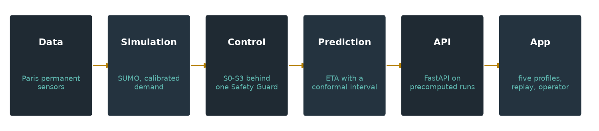

### Objectives

The specific objectives of spec 3.2 are listed below. The result column is generated from the evidence files: a result that does not exist yet reads PENDING.

| Objective | Measure of success (spec 3.2) | Result |
|---|---|---|
| O1 realistic SUMO model | simulated vs real flow within the threshold | A-02 PASS: 6 of 6 rows within ±15 % |
| O2 baselines | fixed and actuated evaluated on 10 seeds | S0 and S1 on seeds 1-10: person delay 63.6 s and 57.1 s |
| O3 lower the total time lost | RL time loss against fixed time | car time loss S3 vs S0 -25.9 %; A-06 PASS |
| O4 faster ambulance | emergency travel time below the baseline | A-05 PASS: HL -36.5 s |
| O5 regular buses | bus headway std reduced | S2 23.3 s vs S0 23.4 s; S3 23.4 s |
| O6 protect pedestrians | longest wait bounded (90 s) in every scenario | worst curb wait 88 s (bound 90 s); A-04 PASS |
| O7 honest travel time | 80 % interval covers 75-85 % of cases | A-07 PASS: coverage 80.6 % |
| O8 usable information | app tested with 3 to 5 people | A-10 PENDING |

### Scope and deviations

The scope is one signalised, real and calibrated junction. The users are cars, buses, one ambulance and pedestrians, and the 07:30-09:30 morning peak is simulated. The application has five profiles: student, ambulance, bus, pedestrian and operator. These are the project's deviations from the spec, each decided and recorded (D91):

- **User views.** The views are an HTML and JavaScript client of the API, built on Motez Jerbi's design. The Operator is a Streamlit page; its existing Altair charts are kept, and Plotly is used only for the new charts.
- **Replay (EF-21).** Only simulated runs are replayed. A recorded real day is not available.
- **What is not built.** The simulation-on-demand endpoint (EF-22) is not built, and the export (EF-23) is CSV only. Both are priority C in a frozen scope (spec 16).

## 2. Site choice

Paris was chosen for its data (spec 2.1). The City of Paris publishes the hourly flow and occupancy of its permanent loop sensors, for free and without a key. Flow and occupancy together separate free-flowing traffic from saturated traffic. The site can also be filmed to validate the simulation.

The junction was chosen with the weighted grid of spec 2.2. A usable sensor near each main approach is an eliminating criterion. The other criteria are: signals with three or four legs, a bus line, a busy pedestrian crossing, a hospital within a kilometre, a nearby university or station, a simple geometry, and access for filming.

The three candidate zones of spec 2.3 were scored with `tasks.py score`. **Bd de l'Hôpital × Bd Saint-Marcel (Pitié-Salpêtrière, Paris 13e, sensor node 302)** has the best score. It is the only candidate whose sensors were assessed: Lariboisière and Porte de Pantin keep a sensor score of 0 and are eliminated.

The junction has three general legs:

- N: Bd de l'Hôpital towards Austerlitz;
- S: Bd de l'Hôpital towards Place d'Italie;
- W: Bd Saint-Marcel.

It also has two bus-only legs (the Bd de l'Hôpital east bus road and the Bd Saint-Marcel bus road) and four signalised crossings. Bus lines 91, 24 and 57 stop at Saint-Marcel - La Pitié. The hospital gate on the bus road gives a realistic ambulance trip through the junction.

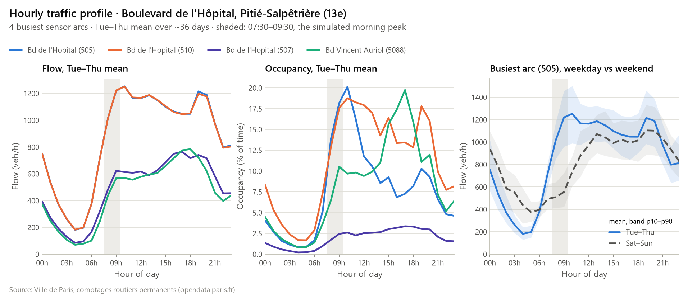

The profile above shows the hourly flow and occupancy of the four busiest sensor arcs near the site, averaged over school-term Tuesday-Thursday days. The shaded band is the simulated 07:30-09:30 peak.

## 3. Data and calibration

**Sensor data.** The demand comes from the hourly flows of the Paris permanent sensors. Each value is stamped at the end of its hour (D3). Typical days are Tuesday to Thursday in school term, without public holidays. A robust per-arc MAD filter then removes outliers. The extract covers 2026-07-13 to 2026-10-10, which leaves 16 to 18 typical days per arc and slot.

**Reference arcs (D6).** One reference arc is used per inbound arm:

- N inbound: arc 508, upstream of Rue Poliveau, the nearest station with its own flow;
- S inbound: arc 511;
- W inbound: arc 513.

Several Paris arcs copy one station, so the twin has about three independent inbound counts. The extract is versioned in `data/reference/pitie_302_hours.csv`, so the calibration rebuilds without the raw download.

**Demand.** The demand is built per 900-second slot from the typical-day means:

- car flows per movement, using ASSUMED turn shares;
- bus lines 91, 24 and 57 with their stop;
- pedestrian flows along every crossing;
- one ambulance (N to S at 08:10).

Flows use per-second probabilities. Every scenario therefore sees the same expected demand, and each seed gives a different draw (spec 13.3).

**Calibration loop.** `tasks.py calibrate` runs S0 on the calibration seeds 101-103, never on the evaluation seeds. It scales each inbound arm until the arm's loop flow matches the sensor flow within the calibration tolerance. An arm that stops following its demand would be reported as capacity-limited instead of being inflated. Result: **converged** (`docs/calibration_log.yaml`); no arm needed rescaling (every recommended arm scale is 1).

The validation thresholds were written in `configs/validation.yaml` on 2026-10-11, before any calibrated result (spec 17). They are:

- a flow error of at most ±15 % per inbound arm and slot;
- GEH below 5 on at least 85 % of the distinct counts.

The checks themselves are in section 10.

## 4. Network and signal program

**Network pipeline.** The network is built from OpenStreetMap:

1. `osm_import` crops the OSM extract around the junction and joins the signal nodes into one node.
2. It names each leg, and writes explicit lane-to-lane connections and explicit crossings.
3. It opens the bus lanes to emergency vehicles.
4. `netconvert` builds the SUMO network from these curated plain files.

The process is deterministic and its output is versioned. SUMO is pinned, because the link order of the traffic light depends on its version.

**Signal program check.** `tasks.py tls-check` checks the program against the geometry:

- no two conflicting vehicle links are green together;
- every intergreen covers the path to the conflict point;
- the worst-case red of every crossing is at most 88 s, the 90 s pedestrian target minus a 2 s margin.

The check is recomputed from the committed S0 program when the report is built. It reads **OK**: 17 phases and a cycle of 123 s, 0 conflicting greens and 0 intergreen violations. The worst-case reds are 42 s on crossings NB and WB, 86 s on crossings S and W.

**Provisional program (ASSUMED until the field visit).** The cycle is 123 s: 74 s of green and 49 s of clearance. The stage greens below are the design values of `configs/pitie/network.yaml` (`fixed.green_s`), not measurements:

| Stage | S0 green (s) | Served |
|---|---|---|
| HOP | 36 | N straight, S straight, crossings NB, WB, W |
| S_LEFT | 6 | S straight and left, bus 57 north, crossing WB |
| STM | 20 | W (Saint-Marcel), N right, crossings NB, S, WB |
| BUS_91 | 6 | bus 91 and 24 both ways, N right, crossing S |
| BUS_57 | 6 | bus 57 south, bus 91 and 24 west, N right |

The program is a lead sketch adapted to the junction; spec EF-05 asks for the phases measured on site. Other inputs are also ASSUMED until the visit:

- lane use at the stop lines;
- the turn shares;
- bus headways and dwell times;
- pedestrian flows;
- the absence of a crossing on the N arm.

The network is cropped to the junction, so the neighbouring signals are not modelled.

## 5. Controllers S0-S3 and the Safety Guard

Every controller runs on the same SUMO session, the same demand and the same seeds. Its stage requests go through one Safety Guard.

- **S0, fixed time** (`configs/pitie_fixed.yaml`) runs the provisional program of section 4.
- **S1, actuated** (`configs/pitie_actuated.yaml`, EF-06) emulates SUMO's gap-based actuated logic through the common controller interface. Each green lasts at least 6 s, is extended while a vehicle crossed one of the stage's loops in the last 3 s, and ends at its max green. Its max greens keep every crossing's worst-case red at or under 88 s. `tests/test_actuated_native.py` checks, step by step, that it takes the same decisions as SUMO's own actuated logic.
- **S2, rules** (`configs/pitie_rules.yaml`, EF-07 to EF-09) adds four rules on top of the S1 gap logic, with longer max greens:
  - *Emergency preemption.* Every emergency vehicle on an approach, or waiting to enter, is detected, served first come first served and held until it passes the stop line. A request is dropped after 120 s without progress.
  - *Bus priority.* A bus green is extended by up to 10 s for a bus of lines 91, 24 or 57 that can reach the stop line in time.
  - *Box clearing.* A loop whose lane only feeds a blocked exit does not extend the green.
  - *Pedestrian protection.* The controller leaves a green itself before the shield would force it.
- **S2_noP** is S2 without preemption, an ablation that attributes the ambulance gain.
- **S3, reinforcement learning** (`configs/pitie_rl_s3.yaml`) plays the DQN policy selected in Part 7 (section 6). It chooses between staying in the current stage and advancing to the next one, under strict stage order. The guard and the preemption keep priority over it.
- **S4** is S3 with preemption switched off, the spec 13.1 option. It is **out of distribution**: the policy never decided with an ambulance present without preemption. Its results describe a degradation, not a design, and they never enter A-06.

**Safety Guard (EF-11, ENF-11).** One guard (`control/safety.py`) filters every request of every controller (D20). It applies these rules in order:

1. an unknown stage is an error;
2. clearance (yellow and all-red) is never cut;
3. the min green of 6 s holds, even for an ambulance;
4. emergency preemption moves to the next link-safe stage towards the ambulance's movement;
5. anti-starvation, strict stage order and the max green apply, all suspended during preemption;
6. last and hard, the **pedestrian shield**.

The shield keeps every crossing's curb wait under 88 s. A green may continue only while, for every crossing, the longest current curb wait plus the time to that crossing's next green stays within the bound. The curb wait is a per-person clock that keeps running when a waiting pedestrian creeps a few centimetres, which SUMO's own waiting time does not do.

Every run also audits the phases it showed: a green ending without yellow, a pedestrian green cut outside clearance, a yellow turning green, a short green, an incomplete clearance, an intergreen that is too short, conflicting greens, illegal transitions. The counts go to the run's safety record and are judged by A-04.

## 6. Reinforcement learning: design, training and the fallback

### Environment (EF-10)

`rl/env.py` (`TrafficEnv`, Gymnasium) runs the junction through the same session, Safety Guard and ambulance preemption as S0 to S2. Its design:

- **Action.** Stay in the current stage, or advance to the next stage of the cycle. This is the spec 10.2 choice of the next green among the allowed stages.
- **Decision clock.** The agent decides only outside a transition, after the minimum green, outside a preemption, and at least 5 s after its last decision.
- **Reward.** Minus the person-weighted waiting each second, with weights per waiting car, bus, pedestrian and ambulance. A penalty applies while a pedestrian has waited more than 80 s (`configs/rl.yaml`).
- **Training episodes.** 30-minute windows with a random start, demand multiplier, day type, ambulances and incidents.

### Training and selection (Part 7)

The campaign was pre-registered in `configs/rl7.yaml` (D68-D90) and ran on one clean commit. It went through two stages:

- **Stage T (tuning)** chose the variant `v1`, a DQN without the pedestrian feature group.
- **Stage F** trained five final runs. The pick is the one with the lowest cost over full two-hour episodes of separate selection seeds.

The selected policy S3 has these properties:

- version `rl7-dqn-v1-s0-415724a4`, model sha256 `151c6f69…`;
- 1,000,000 decision steps;
- 62 features; the observation drops the group `pedestrian`.

It is committed under `models/rl/`, and `configs/pitie_rl_s3.yaml` pins its hash. **S3 does not observe pedestrians**: the shield alone keeps their bound.

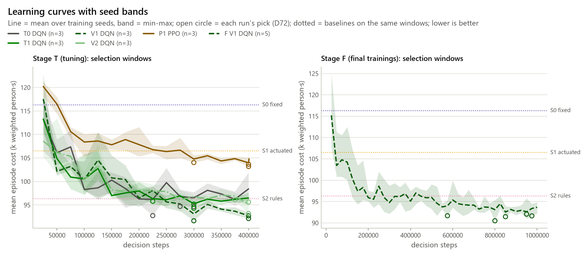

### Interim spec 10.6 verdict (Part 7, development-test seeds)

The four criteria (D79) were fixed before the look. S3 and the baselines were run once on the development-test seeds 3020-3029:

| Criterion (D79) | Result | Pass |
|---|---|---|
| C1 person-weighted delay, S3 vs S1 | HL -9.5 s [-15.5, -6.4] s, exact p 0.0020 (Holm 0.0137); 57.5 s to 46.7 s | pass |
| C2 equity vs S1 (limit 5 %) | car time loss -13.9 %, bus delay -21.7 %, pedestrian mean curb wait **+6.2 %** | **fail** |
| C3 safety | 0 violations | pass |
| C4 reproducibility | 5 of 5 stage-F picks below S1 on the holdout windows | pass |

**Verdict: FALLBACK.** Failed criteria: C2; a failed criterion is final (D79). Spec 10.6 applies: RL does not beat the actuated baseline on the pre-registered criteria, so the rules controller S2 is the main solution and RL is reported as a study. Against S1, S3 changes the car time loss by -13.9 % (lower, better), the bus delay by -21.7 % (lower, better) and the pedestrian mean curb wait by +6.2 % (higher, worse, over the limit). S3 does not observe pedestrians, so only the shield bounds their wait. Whether a policy that observes pedestrians would pass C2 was not tested, and no configuration was added after the look.

Against S2 (reported, not gating), the verdict file reads "S3 beats rules (S2) on the primary KPI": person-delay HL -1.7 s, unadjusted p 0.0488. This is exploratory: ten seeds and one model.

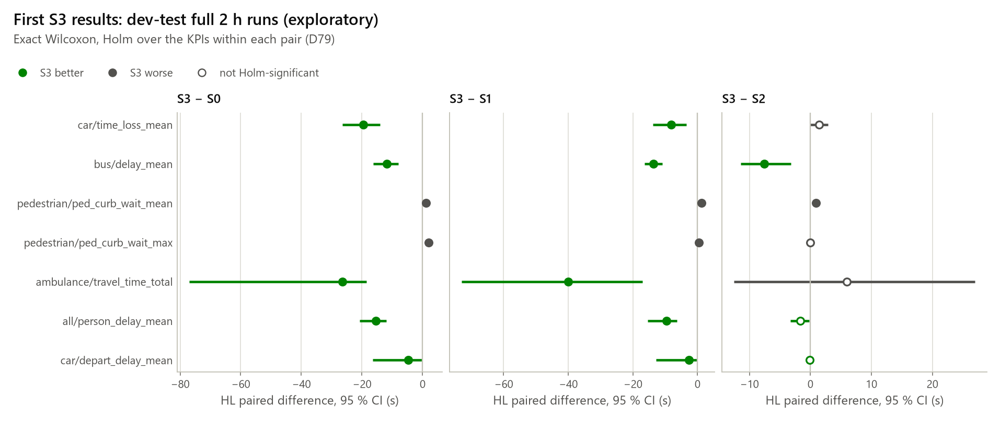

### Weight sensitivity (spec 10.3, descriptive)

Each sensitivity setting changes one reward weight, or moves two corners, and trains its own policies on the full observation. These are not S3's agent. Of the 10 settings, 10 flag at least one pedestrian, bus or car subgroup as worse than S0. The full table is in `docs/rl_training.md`, and the Operator view shows it ("Sensibilité des poids").

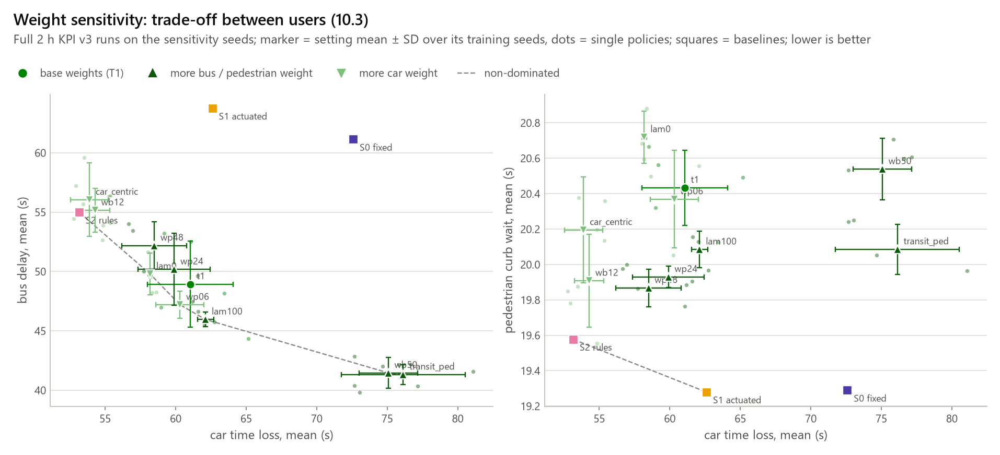

The test of record of S3 against the baselines is **A-06 on seeds 1-10** (section 9). It is presented whatever its direction. A dated change of the evaluation pre-registration defines it that way, and it does not reopen the choice of the main solution.

## 7. Travel-time model (ETA, A-07)

**Target (spec 11.1).** The target is the whole seconds from a car's entry on its approach to its first second on its out-edge, for the six car trajets through the junction. The student ETA adds a fixed rest of trip on the two student routes, from Gare d'Austerlitz and from Bd Saint-Marcel to the hospital main gate.

**Features (spec 11.3).** One definition in `ml/features.py` serves both the dataset and the prediction. The features are read one second before the car enters:

- time of day, day type, controller and trajet;
- per arm, halting and present vehicles, the longest wait, the jam length, occupancy and flow;
- the signal stage and the time remaining before it changes;
- bus calls, the ambulance, active incidents and waiting pedestrians.

**Dataset (EF-12).** A world is one seed with its own demand, ambulances and incidents, run under S0, S1 and S2. Worlds are split, never their trips. The test worlds were generated once, after the model was frozen.

**Model and interval (EF-13).** One XGBoost model predicts the low, median and high quantiles, and a conformal step (CQR) on separate calibration worlds adjusts the served integer bounds. The reference model of spec 11.4 is the mean per trajet, hour and day type. It is also the API's degraded mode ("estimation approximative").

The A-07 rule was pre-registered. On the realistic test worlds, the coverage of the served interval must lie in the target band, and the model must beat the reference on MAE (bootstrap by world). The model used is `eta1-56926796`:

| Metric | Value | Rule | Result |
|---|---|---|---|
| Coverage of the served interval | 0.806 [0.802, 0.810] | in [0.75, 0.85] | ok |
| MAE model − reference (s) | -29.44 [-30.78, -28.12] | CI < 0 | ok |
| MAE model / reference (s) | 10.21 / 39.65 |  |  |
| RMSE model (s) | 26.44 |  |  |
| Mean width (s) | 31.0 |  |  |
| Raw q10-q90 coverage | 0.758 |  |  |
| Reference q10-q90 coverage / width (s) | 0.825 / 127.3 |  |  |
| Reference MAE, realistic-only fit / model − it (s), post hoc | 37.98 / -27.77 |  | not judged |
| Reference q10-q90 coverage / width, realistic-only fit (s), post hoc | 0.818 / 117.8 |  | not judged |
| **Verdict** | **PASS** | both |  |

*Source: [docs/eta.md](../eta.md), section "A-07 / EF-14 verdict".*

**A-07 PASS.** The served 80 % interval covers 80.6 % [80.2 %, 81.0 %] of 483,100 test trips in 72 worlds (band 75-85 %). The median's MAE is 10.2 s, against 39.6 s for the reference.


**Departure advice (spec 11.5).** The advice depends on which estimate reaches the exam in time:

- if the high bound plus the rest of the trip arrives in time: "Partez maintenant, marge confortable";
- if only the median does: "Marge faible";
- otherwise: "Risque de retard, prévenez".

In degraded mode the message says that it is approximate. The model learns the simulator (spec 11.2), so it is retrained after the field visit.

## 8. API and application

### API (spec 9)

A FastAPI service reads the precomputed run folders and evaluation outputs. It has no live connection, no account and no access log, and answers GET requests only (ENF-07).

- **Envelope.** Every answer, errors included, carries the spec 9.2 envelope: data source (`simulation`), calibration date, timestamp, data age, stale flag, type, status (`ok`, `degraded` or `unavailable`), notice, `provisional`, the run and the replay time.
- **Errors (ENF-03, ENF-04).** Unknown ids and bad parameters give 404 with a code. Missing data give a `degraded` or `unavailable` answer with a French notice. Unexpected errors give 503 without a traceback.
- **Endpoints (spec 9.3).**
  - Part 5: health, scenarios, KPIs, replay, crossing, bus status, ambulance corridor and ETA.
  - Parts 8 and 9: the final evaluation, the pair comparisons, the queue series, the weight-sensitivity table and the replay events.
  - A label that is registered but not evaluated yet answers `unavailable` ("pas encore évalué"), never an error page.

| Endpoint | In-process p50 (ms) | p95 | max | HTTP p50 (ms) | p95 | max | Answers |
|---|---|---|---|---|---|---|---|
| health | 5.7 | 7.7 | 14.1 | 1.2 | 1.6 | 2.0 | 200 ok: 200 |
| scenarios | 20.8 | 25.0 | 89.2 | 14.1 | 17.5 | 19.7 | 200 ok: 200 |
| kpi | 14.8 | 19.7 | 25.8 | 9.2 | 11.5 | 60.1 | 200 ok: 200 |
| replay (default run) | 21.7 | 27.0 | 98.8 | 17.6 | 20.4 | 23.4 | 200 ok: 200 |
| replay (positions) | 21.3 | 26.3 | 37.1 | 17.5 | 19.9 | 22.3 | 200 ok: 200 |
| replay (random run) | 26.7 | 53.6 | 110.8 | 21.7 | 37.3 | 87.3 | 200 ok: 200 |
| crossing | 7.0 | 16.1 | 22.2 | 3.6 | 6.9 | 8.3 | 200 ok: 194, 200 unavailable: 6 |
| bus | 10.1 | 25.5 | 104.7 | 7.7 | 20.6 | 32.1 | 200 degraded: 5, 200 ok: 188, 200 unavailable: 7 |
| ambulance | 15.4 | 28.5 | 87.3 | 18.5 | 30.3 | 37.5 | 200 degraded: 193, 200 unavailable: 7 |
| eta | 16.1 | 19.1 | 67.4 | 18.5 | 21.1 | 24.4 | 200 ok: 200 |
| evaluation | 9.0 | 11.0 | 13.0 | 10.8 | 12.7 | 89.1 | 200 ok: 200 |
| compare | 5.9 | 7.8 | 11.5 | 6.5 | 8.9 | 10.8 | 200 ok: 200 |
| series | 14.2 | 22.8 | 106.7 | 15.4 | 19.2 | 82.3 | 200 ok: 200 |
| sensitivity | 4.7 | 6.0 | 8.6 | 3.2 | 3.8 | 4.8 | 200 ok: 200 |
| replay events | 6.3 | 9.1 | 10.4 | 4.0 | 6.8 | 8.7 | 200 ok: 200 |
| error (404) | 3.0 | 3.8 | 4.4 | 1.4 | 1.8 | 2.2 | 404 unavailable: 200 |

*Source: [docs/api.md](../api.md), section "Latency (ENF-02)".*

**ENF-02 PASS**: worst p95 53.6 ms on precomputed results (measured 2026-10-23).

### Two front ends, one API

The application has two front ends, and both read only the API:

- **The user application** (`/mock`, Motez Jerbi's design) has a home screen with five profiles, plus views for the pedestrian, the student, the bus driver, the ambulance and the replay. A deep link opens any view of any run at any time (`?view=…&scenario=…&seed=…&t=…`), and the ambulance screen has a kiosk mode.
- **The Operator** (Streamlit) compares the scenarios. It has tabs for the final table, tests and pairs, equity, safety and the ambulance, queue curves, and weight sensitivity, and it offers CSV exports.

The application invents no value. A value the API does not give is shown as a degraded or unavailable state with its reason. Every view follows these rules:

- one main item and at most two secondary items (spec 12);
- the states of spec 12.1: loading, ok, degraded, stale, unavailable and error;
- a footer with the data source ("données simulées"), the calibration date, "programme de feux provisoire" while the program is ASSUMED, and the data timestamp and age (ENF-04, ENF-05);
- every answer within two clicks of the home screen (ENF-06).

**Replay (EF-21).** Motez's 2D and 3D renderers replay any simulated run, with the vehicle positions, the signal states and an event ticker from the API.


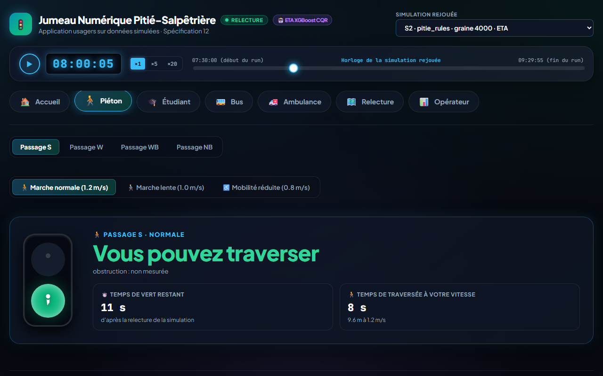

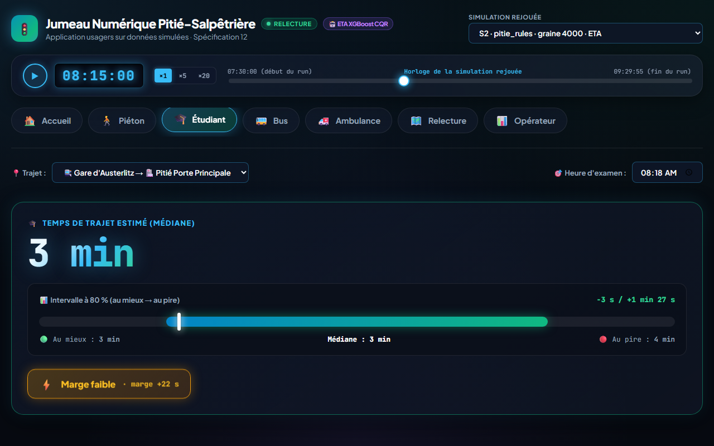

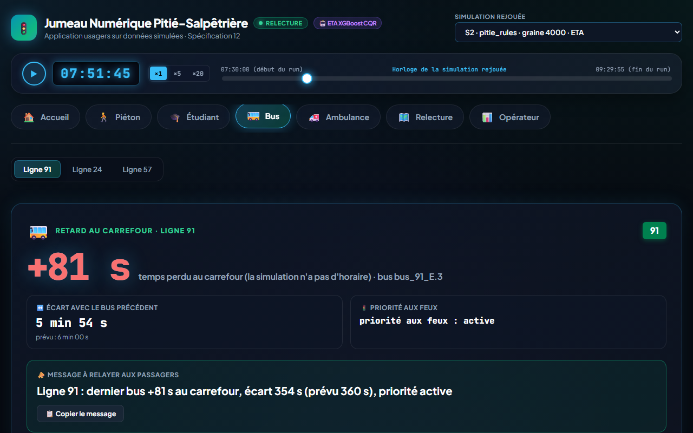

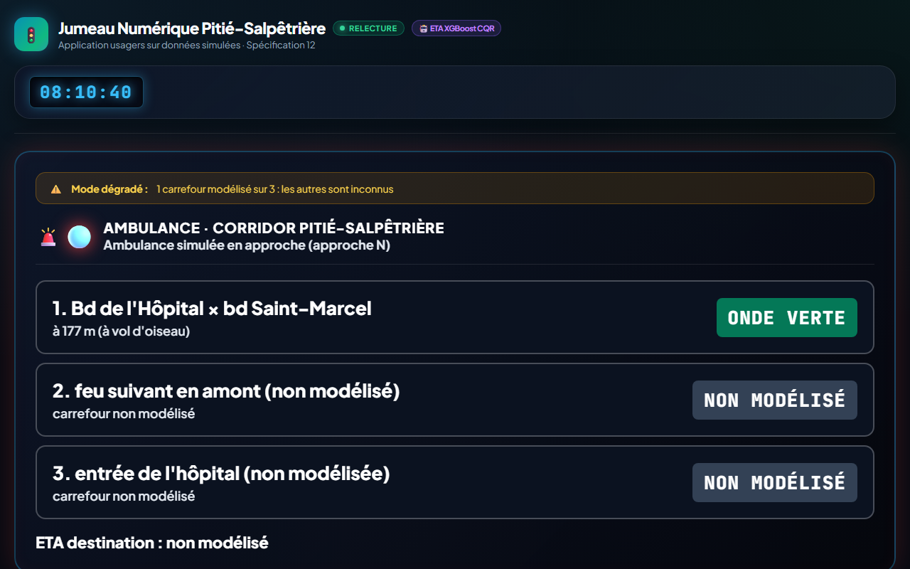

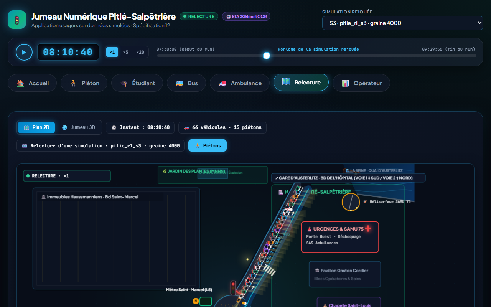

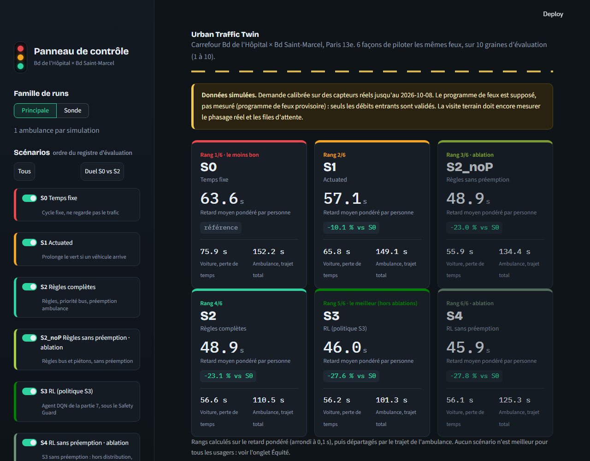

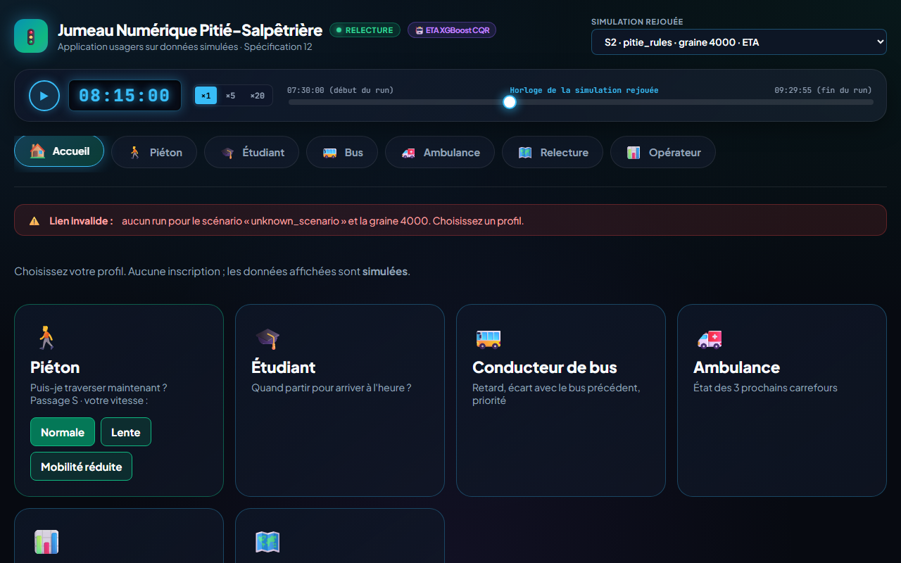

**A-08 PASS.** The evidence is the recorded rehearsal (`docs/demo/rehearsal.json`). It checks every view through the API, the footer, and the loading, error and degraded states.

## 9. Evaluation protocol and results

### Pre-registration

Spec 17 asks that the targets be fixed before the controllers are evaluated, so this section states the pre-registration before any result.

**The evaluation configuration.** `configs/evaluation.yaml` was pre-registered on **2026-10-12**, before any S2 run on the evaluation seeds. It changes only through dated entries; there are 9 of them, listed below.

**The Part 8 keys.** S3 and S4, their pairs, the three new A-05 secondary tests, the A-06 rule, the spec 10.6 replication and the final-table layout were written in a dated change before any S3 or S4 run on seeds 1-10. A run lock in `evaluate` refuses any run on those seeds from an uncommitted tree or before that registration is committed. The record is:

- registration commit `ca1a7c1`, committed 2026-10-23T20:26:19+02:00;
- first retained S3 run on the evaluation seeds (the registered `tasks.py part8` run) started 2026-10-23T18:43:48.875285+00:00; the earlier, discarded look is disclosed below;
- registration before the retained runs: **before**.

**Disclosure: one early S3 look.** After the Part 8 keys were written and before the registration commit, a gate check called `python -m traffic_twin.evaluation.compare --run-missing` directly, outside the run lock (only `evaluate` and the `tasks.py` tasks check it). It ran S3 on seeds 1-10 from the uncommitted tree (2026-10-23, started 17:12-17:13 UTC) and showed three rows of the main S0-S3 pair table: two pedestrian waits, with the outcome "S3 worse", and the ambulance time loss, with the outcome "S3 better". The A-06 KPI `all/person_delay_mean`, the S1-S3 and S2-S3 pairs, the spec 10.6 check, S4 and the probe family were not shown; the A-05 secondary test main S0 against S3 uses the ambulance travel time, a KPI related to the one shown. The registered text was not changed after that look except to add this disclosure. Those runs and the comparison were moved out of the repository and are never used: every S3 and S4 run on seeds 1-10 in this report comes from the single `tasks.py part8` run at the registration commit. The details are in the "why" of the first 2026-10-23 change of `configs/evaluation.yaml`, a column the table below leaves out.

| Date | Change |
| --- | --- |
| 2026-10-12 | Equity (D29): a KPI whose baseline mean is 0 is flagged worse on any move in its bad direction (its relative change is undefined). |
| 2026-10-12 | A-03 checks the (user, kpi) set in every seed, not over the union of the seeds; an A-05 test with fewer pairs than the evaluation seeds, or a run whose planned ambulances did not all arrive, is INVALID, never PASS. |
| 2026-10-12 | equity.rates_pp.served_share stays as pre-registered but is not applied: no run produces a served_share KPI (the evaluation page marks it). |
| 2026-10-12 | A-04 (D27, amending D14) judges the pedestrian curb wait: PASS needs, in every run, `ped_curb_wait_max` <= the scenario's `safety.ped_max_wait_s` (90 s; `a04.ped_curb_wait_max_s`). `ped_wait_single_max` (D14, Part 3) is still computed, unchanged, and reported next to it, but no longer judged. kpi_version 2 -> 3: runs without the curb-wait rows (`ped_curb_wait_{mean,p95,max}` and per crossing) are stale and are rerun by `--run-missing` / `tasks.py rebaseline`. The pedestrian shield's detected w_c (D21) is the same curb wait. |
| 2026-10-12 | Preemption time-out (D24): a request is dropped after `preemption.max_hold_s` (120 s) without the ambulance getting `preemption.progress_m` (1 m) closer to the stop line, instead of 120 s after its first detection. A stationary ambulance still times out 120 s after its first detection. |
| 2026-10-12 | Equity (D29): the pedestrian primary KPI is `ped_curb_wait_max` (was `ped_wait_single_max`) and the pedestrian subgroup KPIs are `ped_curb_wait_mean__crossing_*` (were `ped_wait_single_mean__crossing_*`). The single-wait KPIs stay in the equity table as ordinary (non-primary, non-subgroup) KPIs. |
| 2026-10-23 | Part 8 scenarios (D93): S3 (`configs/pitie_rl_s3.yaml`, the selected Part 7 policy, unchanged) and S4 (`configs/pitie_rl_s3_nopreempt.yaml`, the S3 policy with emergency preemption off) join the main family, and their ambulance-probe versions (`configs/pitie_amb_rl_s3.yaml`, `configs/pitie_amb_rl_s3_nopreempt.yaml`) join the ambulance_probe family. New pairs (a = reference, b = candidate): main S0-S3, S1-S3, S2-S3 confirmatory, S4-S3 and S2_noP-S4 exploratory; probe S0-S3, S4-S3, S2-S3 secondary; each pair keeps its own 7-KPI Holm table (D28). Three A-05 secondary tests (one-sided `less`): main S0 vs S3, probe S0 vs S3, probe S4 vs S3. The A-05 primary (main S0 vs S2) is unchanged. |
| 2026-10-23 | A-06 (D94, block `a06`): family main, candidate S3, `all/person_delay_mean`, exact two-sided paired Wilcoxon on d = S3 - reference per seed with the Hodges-Lehmann estimate and 95 % CI, against S1 (primary), S2 and S0, Holm across the three. The status is procedural: PASS when each comparison has the 10 paired seeds, every S3 run is current (config_hash with the pinned model_sha256, and the pinned text sha256 of the rl.config chain), the family shares one demand_hash and A-03 passes; INVALID otherwise; never FAIL because of the direction of a result. Outcome per comparison: "S3 better" (Holm p < 0.05, HL < 0), "S3 worse" (Holm p < 0.05, HL > 0), else "no significant difference"; raw p, Holm p, means, SDs and the HL CI are always shown. The spec 10.6 check of Part 7 (D79 C1-C3) is repeated on seeds 1-10 against S1 and reported, not gating (`a06.replication_10_6`; C4 is cited from Part 7). The main solution stays S2 whatever the result. "Binding" (D68, README, Part 7 page) now means: A-06 is the confirmatory test of record for RL against the baselines, presented whatever its direction; it does not reopen the choice of the main solution. The final comparison table layout is fixed in `final_table` (D98). |
| 2026-10-23 | Part 8 seed records (D101, block `part8.seeds`, outside the top-level `seeds` block so the Part 3-4 seed sets are unchanged): 3200-3209 burned by the Part 8 prototype, 3210-3229 the Part 8 development range, both carved from rl7.reserve (3200-3999). |

*Source: [docs/evaluation.md](../evaluation.md), section "Pre-registration".*

**Method (spec 13.2, 13.3).**

- **Families.** The main family runs S0, S1, S2, S2_noP, S3 and S4 on one demand with one ambulance per run. The ambulance-probe family runs seven ambulances per run to attribute the ambulance gain.
- **Pairs.** Every pair is compared per seed on seeds 1-10 with the exact paired Wilcoxon test. Holm's correction applies over the headline KPIs within each pair; the other KPIs are secondary (unadjusted).
- **Equity.** A KPI more than 5 % worse than S0 in its bad direction is flagged. A hidden degradation is a person-weighted delay that improves significantly while a primary or subgroup KPI is flagged.
- **Person-weighted delay.** It counts car occupants at 1.3 and bus riders at 25 per vehicle (ASSUMED).

### Final comparison table (spec S8)

| User | KPI | S0 | S1 | S2 | S3 | S2_noP | S4 |
|---|---|---|---|---|---|---|---|
| car | `time_loss_mean` | 75.9 s | 65.8 s (-13.3 %) | 56.6 s (-25.4 %) | 56.2 s (-25.9 %) | 55.9 s (-26.3 %) | 56.1 s (-26.1 %) |
| car | `wait_mean` | 60.9 s | 52.0 s (-14.7 %) | 44.2 s (-27.5 %) | 44.2 s (-27.5 %) | 43.5 s (-28.6 %) | 44.0 s (-27.7 %) |
| car | `wait_p95` | 164.5 s | 140.0 s (-14.9 %) | 111.6 s (-32.1 %) | 113.7 s (-30.8 %) | 109.6 s (-33.4 %) | 112.9 s (-31.3 %) |
| car | `throughput_vph` | 1178.8 veh/h | 1179.5 veh/h (+0.1 %) | 1185.7 veh/h (+0.6 %) | 1185.7 veh/h (+0.6 %) | 1184.7 veh/h (+0.5 %) | 1185.3 veh/h (+0.6 %) |
| bus | `delay_mean` | 61.0 s | 62.6 s (+2.5 %) | 56.1 s (-8.0 %) | 47.6 s (-22.0 %) | 57.2 s (-6.3 %) | 47.4 s (-22.3 %) |
| bus | `headway_std` | 23.4 s | 21.6 s (-7.9 %) | 23.3 s (-0.4 %) | 23.4 s (+0.1 %) | 23.4 s (-0.1 %) | 23.3 s (-0.4 %) |
| bus | `dwell_mean` | 20.0 s | 20.0 s (0.0 %) | 20.0 s (0.0 %) | 20.0 s (0.0 %) | 20.0 s (0.0 %) | 20.0 s (0.0 %) |
| pedestrian | `ped_curb_wait_mean` | 18.9 s | 19.2 s (+1.8 %) | 19.4 s (+2.6 %) | 20.2 s (+7.0 %) | 19.1 s (+1.3 %) | 20.1 s (+6.6 %) |
| pedestrian | `ped_curb_wait_p95` | 72.9 s | 72.0 s (-1.2 %) | 73.4 s (+0.7 %) | 75.5 s (+3.6 %) | 73.2 s (+0.4 %) | 75.4 s (+3.4 %) |
| pedestrian | `ped_curb_wait_max` | 85.6 s | 87.4 s (+2.1 %) | 88.0 s (+2.8 %) | 88.0 s (+2.8 %) | 88.0 s (+2.8 %) | 88.0 s (+2.8 %) |
| pedestrian | `crossing_complete_rate` | 1.00 | 1.00 (0.0 %) | 1.00 (0.0 %) | 1.00 (0.0 %) | 1.00 (0.0 %) | 1.00 (0.0 %) |
| ambulance | `travel_time_total` | 152.2 s | 149.1 s (-2.0 %) | 110.5 s (-27.4 %) | 101.3 s (-33.4 %) | 134.4 s (-11.7 %) | 125.3 s (-17.7 %) |
| ambulance | `stops` | 1.30 | 1.60 (+23.1 %) | 1.20 (-7.7 %) | 1.10 (-15.4 %) | 1.40 (+7.7 %) | 1.10 (-15.4 %) |
| ambulance | `stop_duration_mean` | 60.9 s | 54.0 s (-11.4 %) | 34.8 s (-42.9 %) | 38.5 s (-36.9 %) | 51.2 s (-15.8 %) | 61.6 s (+1.2 %) |
| all | `person_delay_mean` | 63.6 s | 57.1 s (-10.1 %) | 48.9 s (-23.1 %) | 46.0 s (-27.6 %) | 48.9 s (-23.0 %) | 45.9 s (-27.8 %) |

Mean over seeds 1-10; in brackets the change against S0. S2_noP and S4 are ablations (S4 is out of distribution).

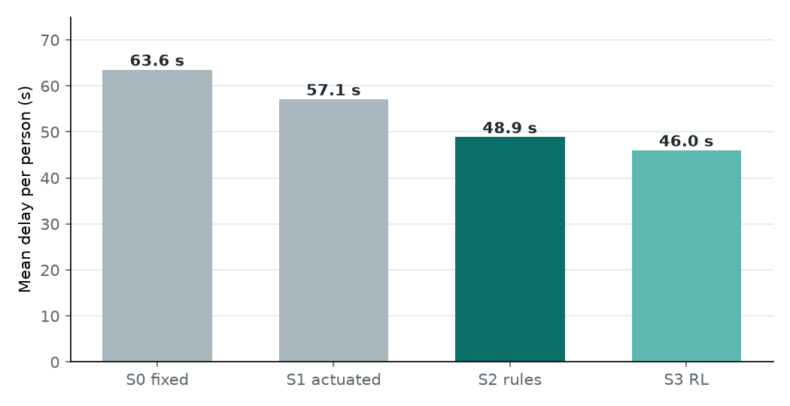

### A-06: S3 against the baselines

**The rule (D94).** The test is the exact two-sided paired Wilcoxon on `all/person_delay_mean`, with the difference d = S3 − reference per seed. It reports the Hodges-Lehmann estimate and its confidence interval, against S1 (the primary), S2 and S0, with Holm's correction across the three.

**The status is procedural.** A-06 is PASS when every comparison has ten paired seeds, every S3 run is current with its pinned model and inputs, the family shares one demand, and A-03 passes. Otherwise it is INVALID, with the reasons. It is never FAIL because a result is unfavourable.

**The outcome** of each comparison is "S3 better" or "S3 worse" when Holm's p is under alpha, and "no significant difference" otherwise.

| Reference | n | Mean reference | Mean S3 | HL (S3 - ref) | 95 % CI | p | p (Holm) | Outcome |
|---|---|---|---|---|---|---|---|---|
| S1 | 10 | 57.1 s | 46.0 s | -9.5 s | [-17.5, -6.4] s | 0.0020 | 0.0059 | better |
| S2 | 10 | 48.9 s | 46.0 s | -2.5 s | [-5.0, -0.6] s | 0.0137 | 0.0137 | better |
| S0 | 10 | 63.6 s | 46.0 s | -14.3 s | [-29.4, -10.7] s | 0.0020 | 0.0059 | better |

**A-06 PASS.** Primary comparison: S3 vs S1 (actuated): all/person_delay_mean 57.1 → 46.0 s (n = 10), HL -9.5 s [95 % CI -17.5, -6.4], exact two-sided p 0.0020, Holm p 0.0059 (α 0.05): S3 better. Problems: none.

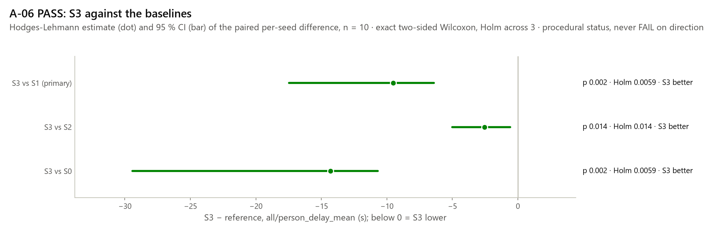

### Spec 10.6 check on seeds 1-10 (reported, not gating)

The Part 7 criteria C1 to C3 are repeated exactly on seeds 1-10 against S1; C4 is cited from Part 7.

| Criterion (D79, repeated on seeds 1-10) | Result | Pass |
|---|---|---|
| C1 person-weighted delay, S3 vs S1 | HL -9.5 s, p 0.0020 | pass |
| C2 equity vs S1 (5 % limit) | worst: pedestrian/ped_curb_wait_mean +5.2 % | fail |
| C3 safety | 0 violations | pass |
| C4 reproducibility (cited from Part 7) | pass | pass |

Seeds 1-10 confirm the interim FALLBACK (C2 fails on pedestrian/ped_curb_wait_mean). The main solution stays S2. That choice of **S2** does not depend on this check: it was fixed at week 7 (spec 15), and A-06 does not reopen it.

### KPIs per user (S0 to S2, main family)

| User | KPI | Unit | S0 | S1 | S2 | S2_noP |
| --- | --- | --- | --- | --- | --- | --- |
| car | `time_loss_mean` | s | 75.9 ± 12.9 | 65.8 ± 11.3 | 56.6 ± 7.2 | 55.9 ± 6.7 |
| car | `wait_p95` | s | 164.5 ± 26.3 | 140.0 ± 22.7 | 111.6 ± 19.9 | 109.6 ± 19.7 |
| car | `throughput_vph` | veh/h | 1178.8 ± 26.7 | 1179.5 ± 30.2 | 1185.7 ± 32.5 | 1184.7 ± 32.6 |
| bus | `delay_mean` | s | 61.0 ± 1.1 | 62.6 ± 2.6 | 56.1 ± 4.0 | 57.2 ± 5.4 |
| bus | `headway_std` | s | 23.4 ± 0.3 | 21.6 ± 3.4 | 23.3 ± 3.2 | 23.4 ± 3.5 |
| pedestrian | `ped_curb_wait_mean` | s | 18.9 ± 0.7 | 19.2 ± 0.7 | 19.4 ± 0.8 | 19.1 ± 0.6 |
| pedestrian | `ped_curb_wait_max` | s | 85.6 ± 0.5 | 87.4 ± 0.5 | 88.0 ± 0.0 | 88.0 ± 0.0 |
| ambulance | `travel_time_total` | s | 152.2 ± 60.9 | 149.1 ± 55.3 | 110.5 ± 43.7 | 134.4 ± 45.1 |
| all | `person_delay_mean` | s | 63.6 ± 14.5 | 57.1 ± 9.4 | 48.9 ± 4.4 | 48.9 ± 4.3 |

*Source: [docs/evaluation.md](../evaluation.md), section "KPIs per user and scenario".*

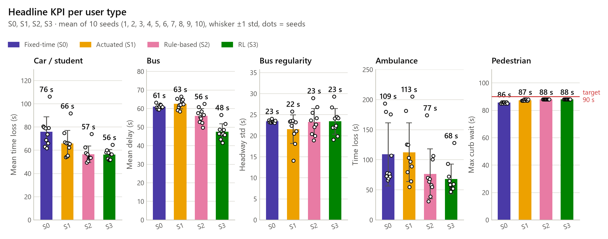

### Ambulance (A-05)

The primary test is pre-registered: main family, S2 against S0, ambulance travel time from the planned departure, exact one-sided Wilcoxon. The result is a Hodges-Lehmann shift of -36.5 s [-70.0, -14.0] s, from 152.2 s to 110.5 s, with p 0.0020 on n = 10: **A-05 PASS**.

The ambulance-probe family runs seven ambulances per run, which gives the robust evidence:

- S2 against S0: HL -83.1 s, p 0.0010;
- S2 against S2 without preemption: HL -15.8 s, p 0.0010.

This second comparison isolates the effect of preemption.

**Power note.** With one ambulance per run, the main-family test has limited power, so the probe family carries the attribution. Nothing was retuned after seeing a result.

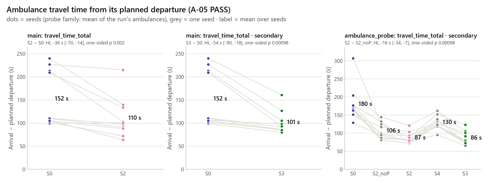

### Safety (A-04)

| Family | Scenario | Controller | Runs | Collisions | Teleports | Danger audit | Guard interventions | Worst curb ped wait (s) | Bound (s) | A-04 |
| --- | --- | --- | --- | --- | --- | --- | --- | --- | --- | --- |
| main | `pitie_fixed` | fixed | 10 | 0 | 0 | 0 | 0 | 86.0 | 90.0 | PASS |
| main | `pitie_actuated` | actuated | 10 | 0 | 0 | 0 | 0 | 88.0 | 90.0 | PASS |
| main | `pitie_rules` | rules | 10 | 0 | 0 | 0 | 0 | 88.0 | 90.0 | PASS |
| main | `pitie_rules_nopreempt` | rules | 10 | 0 | 0 | 0 | 0 | 88.0 | 90.0 | PASS |
| main | `pitie_rl_s3` | rl | 10 | 0 | 0 | 0 | 290 | 88.0 | 90.0 | PASS |
| main | `pitie_rl_s3_nopreempt` | rl | 10 | 0 | 0 | 0 | 300 | 88.0 | 90.0 | PASS |
| ambulance_probe | `pitie_amb_fixed` | fixed | 10 | 0 | 0 | 0 | 0 | 86.0 | 90.0 | PASS |
| ambulance_probe | `pitie_amb_rules` | rules | 10 | 0 | 0 | 0 | 0 | 88.0 | 90.0 | PASS |
| ambulance_probe | `pitie_amb_rules_nopreempt` | rules | 10 | 0 | 0 | 0 | 0 | 88.0 | 90.0 | PASS |
| ambulance_probe | `pitie_amb_rl_s3` | rl | 10 | 0 | 0 | 0 | 317 | 88.0 | 90.0 | PASS |
| ambulance_probe | `pitie_amb_rl_s3_nopreempt` | rl | 10 | 0 | 0 | 0 | 313 | 88.0 | 90.0 | PASS |

*Source: [docs/evaluation.md](../evaluation.md), section "A-04".*

Across every evaluated run, the longest pedestrian curb wait is 88 s; the bound is 90 s (A-04 PASS). The guard interventions per controller are in the table above.

### Equity and hidden degradation (spec 13.3)

| Family | Scenario vs baseline | Person delay change | Significantly better | Flagged primary / subgroup KPIs | 13.3 verdict |
|---|---|---|---|---|---|
| main | S1 | -10.1 % (p 0.0020) | yes | `bus.delay_mean__flow_24_W`, `bus.delay_mean__flow_57_N`, `pedestrian.ped_curb_wait_mean__crossing_NB`, `pedestrian.ped_curb_wait_mean__crossing_WB`, `pedestrian.ped_curb_wait_mean__crossing_W` | **HIDDEN DEGRADATION** |
| main | S2 | -23.1 % (p 0.0020) | yes | `car.delay_total_mean__arm_S`, `bus.delay_mean__flow_57_N`, `pedestrian.ped_curb_wait_mean__crossing_WB`, `pedestrian.ped_curb_wait_mean__crossing_W` | **HIDDEN DEGRADATION** |
| main | S2_noP | -23.0 % (p 0.0020) | yes | `car.delay_total_mean__arm_S`, `bus.delay_mean__flow_57_N` | **HIDDEN DEGRADATION** |
| main | S3 | -27.6 % (p 0.0020) | yes | `pedestrian.ped_curb_wait_mean__crossing_NB`, `pedestrian.ped_curb_wait_mean__crossing_S`, `pedestrian.ped_curb_wait_mean__crossing_WB` | **HIDDEN DEGRADATION** |
| main | S4 | -27.8 % (p 0.0020) | yes | `pedestrian.ped_curb_wait_mean__crossing_NB`, `pedestrian.ped_curb_wait_mean__crossing_S`, `pedestrian.ped_curb_wait_mean__crossing_WB` | **HIDDEN DEGRADATION** |
| ambulance_probe | S2 | -20.9 % (p 0.0020) | yes | `car.delay_total_mean__arm_S`, `bus.delay_mean__flow_24_W`, `bus.delay_mean__flow_57_N`, `pedestrian.ped_curb_wait_mean__crossing_NB`, `pedestrian.ped_curb_wait_mean__crossing_WB`, `pedestrian.ped_curb_wait_mean__crossing_W` | **HIDDEN DEGRADATION** |
| ambulance_probe | S2_noP | -23.2 % (p 0.0020) | yes | `car.delay_total_mean__arm_S`, `bus.delay_mean__flow_57_N`, `pedestrian.ped_curb_wait_mean__crossing_WB`, `pedestrian.ped_curb_wait_mean__crossing_W` | **HIDDEN DEGRADATION** |
| ambulance_probe | S3 | -24.6 % (p 0.0020) | yes | `pedestrian.ped_curb_wait_mean__crossing_NB`, `pedestrian.ped_curb_wait_mean__crossing_S`, `pedestrian.ped_curb_wait_mean__crossing_WB` | **HIDDEN DEGRADATION** |
| ambulance_probe | S4 | -27.2 % (p 0.0020) | yes | `pedestrian.ped_curb_wait_mean__crossing_NB`, `pedestrian.ped_curb_wait_mean__crossing_S`, `pedestrian.ped_curb_wait_mean__crossing_WB` | **HIDDEN DEGRADATION** |

*Source: [docs/evaluation.md](../evaluation.md), section "Equity and hidden degradation (13.3)".*

9 of the 9 scenarios (family and controller, over the evaluation seeds) that lower the person-weighted delay significantly against S0 also make a KPI more than 5 % worse than S0 (user groups in brackets): main S1 (bus, pedestrian); main S2 (bus, car, pedestrian); main S2_noP (bus, car); main S3 (pedestrian); main S4 (pedestrian); ambulance_probe S2 (bus, car, pedestrian); ambulance_probe S2_noP (bus, car, pedestrian); ambulance_probe S3 (pedestrian); ambulance_probe S4 (pedestrian); each of them pays for its average gain somewhere. Spec 13.3 asks for this check because an average gain can hide a user group that pays for it.

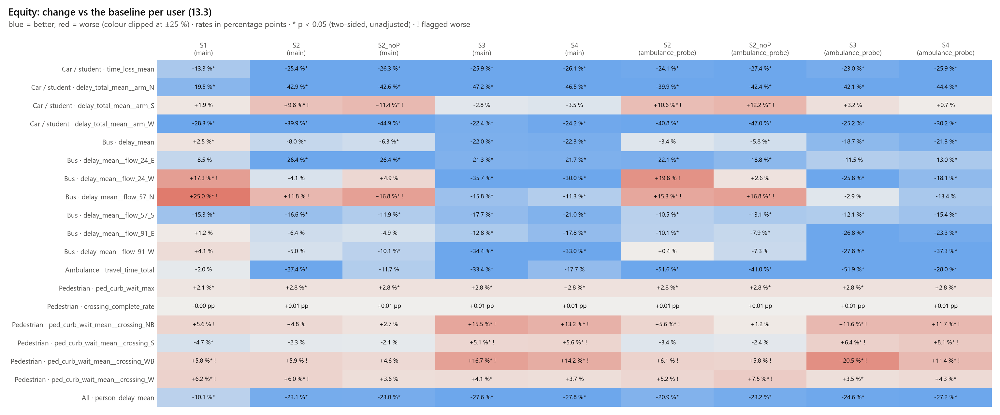

### S4, out of distribution

S4 is S3 with preemption switched off. The policy never decided with an ambulance present without preemption, so S4 shows how far a learned policy degrades outside its training conditions. It is not an alternative design. S4 is exploratory, its pairs are reported in `docs/evaluation.md`, and it is never part of A-06.

## 10. Validation against reality

Spec 13.4 asks that the simulation match reality before any comparison, on three checks:

- the flow per arm;
- the signal timing;
- the queues.

`tasks.py validate` writes `docs/validation.md` from S0 on seeds 1-10. The simulated flows come from E1 loops that stand in for the Paris sensors.

**Flows: A-02 PASS.** 6 of 6 inbound arm × slot rows are within ±15 % of the real flow. GEH is under 5 on 10 of 10 distinct counts (100 %, target 85 %).

| Station | Arc | Slot | Role | Real veh/h | Sim veh/h | Error % | GEH | Status |
|---|---|---|---|---|---|---|---|---|
| N_in | 508 | 07:30-08:30 | A-02 | 593 ± 41 (16 d) | 600 ± 15 (10 s) | 1.1 | 0.27 | PASS |
| N_in | 508 | 08:30-09:30 | A-02 | 659 ± 49 (16 d) | 660 ± 21 (10 s) | 0.2 | 0.05 | PASS |
| S_in | 511 | 07:30-08:30 | A-02 | 321 ± 41 (18 d) | 325 ± 21 (10 s) | 1.4 | 0.26 | PASS |
| S_in | 511 | 08:30-09:30 | A-02 | 417 ± 47 (17 d) | 414 ± 10 (10 s) | -0.9 | 0.18 | PASS |
| W_in | 513 | 07:30-08:30 | A-02 | 186 ± 12 (18 d) | 188 ± 11 (10 s) | 0.8 | 0.11 | PASS |
| W_in | 513 | 08:30-09:30 | A-02 | 223 ± 13 (16 d) | 221 ± 10 (10 s) | -0.9 | 0.14 | PASS |

*Source: [docs/validation.md](../validation.md), section "Flows (A-02)".*


**The inbound check is close to circular.** The car demand is built from the same sensors, so A-02 mainly shows that the network carries the demand in the right time slots. The independent checks are these:

- the outbound flows, which are information only because they depend on the ASSUMED turn shares;
- the signal timing (41 rows NOT_MEASURED);
- the queues (6 rows NOT_MEASURED).

The signal timing and the queues wait for the field visit.

**After the field visit (3-5 Nov 2026).** The measurements go into `data/field/pitie_measurements.yaml`, an empty template in which a missing value stays NOT_MEASURED and no estimate is ever typed. If the measured program or cycle differs beyond the validation thresholds, these steps follow (D119):

1. A dated change goes into the validation and evaluation configurations.
2. Part 3 is rerun: calibration, validation and the signal and queue rows.
3. The evaluation is rerun: S0 to S2, plus S3 with its unchanged model, labelled "trained on the ASSUMED program".
4. The ETA model is retrained.
5. The report becomes version 2.

Retraining RL is optional.

## 11. User tests (spec 12.2, A-10)

**Status: PENDING** (complete sessions: 0). A-10 is **PENDING**.

The protocol was pre-registered before any session (`configs/usertests.yaml`, `docs/usertest_protocol.md`):

- **Tasks.** Each participant does six core tasks on the frozen app and on one frozen run (the rules controller on the demo seed): the pedestrian verdict, the pedestrian with reduced mobility, the student's departure advice, the bus delay, the ambulance corridor and the operator's comparison. The pedestrian task comes first for everyone, the other tasks rotate, and a replay task is optional.
- **Measures.** Each task is timed with a stopwatch and scored as success, partial, fail or skipped. The participant answers the single ease question after each task. The SUS questionnaire is optional and indicative.
- **Privacy (ENF-07).** Participants are identified only as P1, P2, and so on. There is no recording, and no e-mail or phone number. Reduced mobility is never recorded (the participant is marked as a real user or a proxy), and paper consent stays offline.
- **Fix loop.** Each issue gets an id (U01, U02, and so on). A fix needs a commit and is verified by a later session or by an automated test.

The results file `docs/usertests/results.yaml` is filled in by hand after each real session. The synthesis page `docs/usertests.md` is then generated. A-10 is DONE with three to five complete sessions and is never reported as PASS. Below three sessions every rate stays PENDING. No session has been invented: until real users are tested, this section reports PENDING.

## 12. Acceptance A-01 to A-10

The table is generated from the evidence files (spec 17, D115). The statuses are PASS, FAIL, INVALID, PENDING and DONE:

- **PENDING**: the evidence does not exist yet.
- **A-06**: presented whatever its direction; INVALID only when the comparison itself is not valid.
- **A-10**: DONE, never PASS, once three to five real sessions are synthesised.

| ID | Criterion | Status | Evidence |
|---|---|---|---|
| A-01 | The simulation runs headless and reproducibly: two runs with the same seed give the same KPIs. | **PASS** | 70 of 70 re-made evaluation runs byte-identical (code ca1a7c1) |
| A-02 | The simulated flow per arm is within the fixed threshold of the real flow. | **PASS** | 6 of 6 inbound arm × slot rows within ±15 % of the real flow; GEH < 5 on 10 of 10 counts |
| A-03 | The four controllers (fixed, actuated, rules, RL) run on the same scenario and produce the KPI file. | **PASS** | 4 of 4 controllers on one scenario and one KPI set (83 KPIs in each family) |
| A-04 | No dangerous signal sequence in the 10 test seeds, and the longest pedestrian wait stays under the bound. | **PASS** | PASS over 110 runs (the criterion allows 0 dangerous sequences); worst curb wait 88 s (bound 90 s) |
| A-05 | Preemption reduces the ambulance travel time compared with S0. | **PASS** | main family S2 vs S0, ambulance travel time: HL -36.5 s [-70.0, -14.0] s, exact one-sided p 0.0020 (n = 10) |
| A-06 | RL is compared with the baselines on 10 seeds with a statistical test; the result is presented, favourable or not. | **PASS** | presented: S3 vs S1 (actuated): all/person_delay_mean 57.1 → 46.0 s (n = 10), HL -9.5 s [95 % CI -17.5, -6.4], exact two-sided p 0.0020, Holm p 0.0059 (α 0.05): S3 better |
| A-07 | The announced 80 % ETA interval covers between 75 % and 85 % of the cases. | **PASS** | coverage 80.6 % [80.2 %, 81.0 %] on the realistic test worlds (band 75-85 %); median MAE 10.2 s against 39.6 s for the reference |
| A-08 | Every view answers through the API, shows 'données simulées' and handles the loading, error and degraded states. | **PASS** | the recorded rehearsal (every view, states, footer), 2026-10-23, code ca1a7c1-dirty |
| A-09 | The full demo runs without manual intervention on the code. | **PENDING** | no fresh-clone readiness rehearsal yet (python tasks.py demo-readiness on the release commit) |
| A-10 | A test with 3 to 5 users is carried out and synthesised. | **PENDING** | no session yet; 3 to 5 real sessions needed (spec 12.2) |

**The demo.** A-09 also has a human counterpart. The deliverable "demonstration rehearsed" needs at least one human rehearsal, logged in `docs/demo/rehearsal_log.yaml` with a date, a commit and no manual code edit. So far 0 such rehearsals are logged: rehearsed by a presenter **PENDING**.

## 13. Limitations

- **The twin learns the simulator.** One junction, one day type (the school-term Tuesday-Thursday peak) and ten evaluation seeds: the results compare controllers on the modelled junction. They describe the real junction only once the field visit has validated the program.
- **The signal program is ASSUMED.** So are every number derived from it: max greens, hold caps, crossing reds. The signal-timing and queue checks of spec 13.4 are NOT_MEASURED until the visit.
- **The inbound flow check is close to circular.** The demand comes from the same sensors. Several Paris arcs copy one station, which leaves about three independent inbound counts.
- **Detection is ideal.** Pedestrians (camera or push button), buses (positions on the approach) and the ambulance (detected before it enters the network) are all seen perfectly. The ambulance obeys red lights; no rescue lane forms.
- **S3 does not observe pedestrians.** Its pedestrian cost is that of a policy that cannot see them, and only the shield bounds their wait. S4 is out of distribution.
- **One ambulance per run** gives the main A-05 test limited power; the probe family carries the attribution.
- **Occupancies are ASSUMED.** The person-weighted delay depends on the assumed car and bus occupancies; the evaluation reports its sensitivity to the bus occupancy.
- **Insertion delay is not in the delay KPIs.** Cars waiting to enter a capacity-limited arm are outside the delay KPIs, so those KPIs understate the gap between controllers on the seeds where an arm saturates.
- **The application shows simulated data only.** The replay plays simulated runs, not a recorded real day.
- **User tests and rehearsal depend on people.** The user tests (A-10, **PENDING**) and the human demo rehearsal (**PENDING**) each stay PENDING until they happen.

## 14. Future work and the field-visit version

- **Field visit (3-5 Nov 2026).** The visit measures the signal program, the cycle and the queues, and makes counts on video. If the program differs, a dated change and a version 2 of Parts 3 to 8 follow (section 10), together with version 2 of this report and of the slides.
- **User tests.** Three to five real sessions are needed: round 1 with P1 to P3, then the fixes, then round 2 with P4 and P5. A-10 can then be reported as DONE.
- **RL that observes pedestrians.** This is tested only as a new, pre-registered study, never as a change after the look. Retraining after the field visit is optional.
- **Deferred features.** Running a simulation on demand from the application (EF-22), a PDF export (EF-23 beyond CSV) and the replay of a recorded real day (EF-21) were left out of the frozen scope.
- **Extensions.** A second, neighbouring junction (spec 2.4) and a sensitivity family for bus headways and demand jitter.

## Appendix A. Decision index

The numbered decisions are recorded in `docs/architecture.md`:

- **D1-D18**, Part 3: the network, the calibration and the validation.
- **D19-D36**, Part 4: the Safety Guard, the shield, preemption, bus priority and the evaluation.
- **D37-D67**, Parts 5 and 6: the ETA model, the API and the RL environment.
- **D68-D90**, Part 7: the RL campaign, the selection and the interim spec 10.6 verdict.
- **D91-D120**, Parts 8 to 10: the final evaluation, A-06, the app, the user tests, this report and the demo.

## Appendix B. Reproduction

Every result rebuilds from the repository with these commands, run from the repo root. Seeds 1-10 are run only by the registered Part 8 step.

```
.venv\Scripts\python.exe tasks.py part3        # calibration, validation (A-02)
.venv\Scripts\python.exe tasks.py part8        # rebaseline S0-S2, the S3/S4 runs, A-06 (seeds 1-10, once)
.venv\Scripts\python.exe tasks.py part9        # demo runs, API bench, user-test kit and synthesis
.venv\Scripts\python.exe tasks.py report-facts # docs/report/facts.json from the local outputs
.venv\Scripts\python.exe tasks.py report       # report.md and report.pdf from facts.json
.venv\Scripts\python.exe tasks.py slides       # docs/slides/urban_traffic_twin.pptx
.venv\Scripts\python.exe tasks.py demo         # API + Operator for the live demo
```

## Appendix C. Glossary

| Term | Definition |
|---|---|
| TraCI | The interface through which a Python program reads and drives a SUMO simulation step by step. |
| timeLoss | The time a vehicle loses compared with an unhindered trip. |
| Headway | The time between two successive buses of the same line. |
| TSP | Transit signal priority: signal priority for public transport. |
| Preemption | Taking over the signals to clear the way for an emergency vehicle. |
| Box clearing | The rule that forbids entering the junction when the exit is blocked. |
| Actuated | Standard adaptive signals that extend the green on vehicle detection. |
| Occupancy | The share of time a sensor detects a vehicle; it shows saturation. |
| Digital twin | A simulation model calibrated on real data that reproduces a system's behaviour. |
| Replay | Playing back a simulation in the application. |
| Safety Guard | The layer that every controller's request goes through and that enforces the signal safety rules. |
| Hodges-Lehmann (HL) | The median of the pairwise averages of the per-seed differences: the paired shift estimate. |
| Holm | A step-down correction of p-values for several tests. |
| ASSUMED | A model input that is not measured on site yet. |
| NOT_MEASURED | A validation row that waits for a field measurement. |
| PENDING | A result that does not exist yet; it is never estimated. |

## Appendix D. Provenance of the numbers

Every result the report quotes, number or result sentence, is a fact of `docs/report/facts.json`; the template lint (D113) refuses a typed decimal, percentage, p-value or result claim. The integers typed in the templates are seed counts, rule thresholds and design constants of the configurations (the ASSUMED signal program among them). Each fact records its source file, that file's sha256 and the code version the source records. The table below groups the facts by source.

| Source | sha256 | Code version | Facts |
|---|---|---|---|
| `configs/eta.yaml` | `52a86941dd9d` | – | 1: `eta.interval_pct` |
| `configs/evaluation.yaml` | `349aa029d4f5` | – | 5: `eval.changes_n`, `eval.equity_pct`, `eval.occupancy`, `final.layout` |
| `configs/validation.yaml` | `585fc373d5fe` | – | 2: `val.flow_threshold_pct`, `val.geh_target_share_pct` |
| `data/models/eta/eta1-56926796/eval.json` | `89572956c661` | 8fd1026-dirty | 9: `eta.a07`, `eta.model_version` |
| `data/results/_rebaseline/ca1a7c1/verify.json` | `458d07b109b7` | ca1a7c1 | 3: `a01.head`, `a01.identical`, `a01.of` |
| `data/results/evaluation/a05.json` | `86652b4a1d4b` | – | 6: `eval.a05`, `eval.a05.probe`, `eval.a05.probe_nop` |
| `data/results/evaluation/a06.json` | `0c4d10289793` | – | 55: `a06.inputs_ok`, `a06.model_sha8`, `a06.n_required`, `a06.primary`, `a06.primary_sentence`, `a06.problems`, … |
| `data/results/evaluation/final_table.csv` | `0aca8e896cbd` | – | 191: `final.all.person_delay_mean`, `final.all.person_delay_mean.s0`, `final.all.person_delay_mean.s1`, `final.all.person_delay_mean.s2`, `final.all.person_delay_mean.s2_nop`, `final.all.person_delay_mean.s3`, … |
| `data/results/evaluation/main/a04.csv` | `9e7a4ed55140` | – | 2: `eval.a04` |
| `data/results/evaluation/main/kpis.csv` | `15aafb6d029c` | – | 60: `eval.kpi.all.person_delay_mean`, `eval.kpi.ambulance.stop_duration_mean`, `eval.kpi.ambulance.stops`, `eval.kpi.ambulance.travel_time_total`, `eval.kpi.bus.delay_mean`, `eval.kpi.bus.dwell_mean`, … |
| `data/results/evaluation/summary.json` | `5585c124879a` | – | 26: `eval.a03`, `eval.a04`, `eval.a05`, `eval.equity`, `eval.hidden_degradation`, `eval.n_seeds`, … |
| `data/results/validation/pitie_fixed/summary.json` | `b5262bc9197c` | ca1a7c1 | 12: `val.a02`, `val.calibration`, `val.geh`, `val.preregistered`, `val.queue_not_measured`, `val.seeds`, … |
| `data/rl7/devtest/verdict.json` | `867bba664fc7` | 5bec559-dirty | 25: `rl7.c1`, `rl7.c2`, `rl7.c3`, `rl7.c4`, `rl7.criteria_sentence`, `rl7.failed`, … |
| `docs/api.md` | `c99b51f83919` | ca1a7c1 | 3: `api.bench` |
| `docs/demo/rehearsal.json` | `0a5fe3a52006` | ca1a7c1-dirty | 7: `demo.a08`, `demo.a09`, `demo.date`, `demo.fresh_clone` |
| `docs/demo/rehearsal_log.yaml` | `91afb01e38f7` | – | 1: `demo.human_rehearsals` |
| `docs/figures/rl7/sensitivity.csv` | `ee579ef9135d` | – | 2: `rl7.sensitivity` |
| `docs/report/meta.yaml` | `e0e517d52cdc` | – | 9: `meta.authors`, `meta.date`, `meta.field_visit`, `meta.institution`, `meta.site`, `meta.subtitle`, … |
| `docs/usertests/synthesis.json` | `3496222999b6` | – | 2: `usertests.n`, `usertests.status` |
| `models/rl/rl7-dqn-v1-s0-415724a4/manifest.json` | `0232ba6c3ec0` | – | 5: `rl7.model_sha8`, `rl7.model_version`, `rl7.n_features`, `rl7.obs_drop`, `rl7.steps` |
| `sumo/network/pitie/pitie.net.xml` | `d6f0055b8176` | – | 9: `net.clearance`, `net.cycle`, `net.foe_greens`, `net.green_total`, `net.intergreen_violations`, `net.phases`, … |

## Appendix E. PENDING items

These facts and sections do not exist yet. Each one says what it waits for.

| Facts, sections or figures | Waits for |
|---|---|
| `demo.rehearsed` | no human rehearsal in docs/demo/rehearsal_log.yaml with a date, a commit and manual_code_edits: 0 (D116) |
