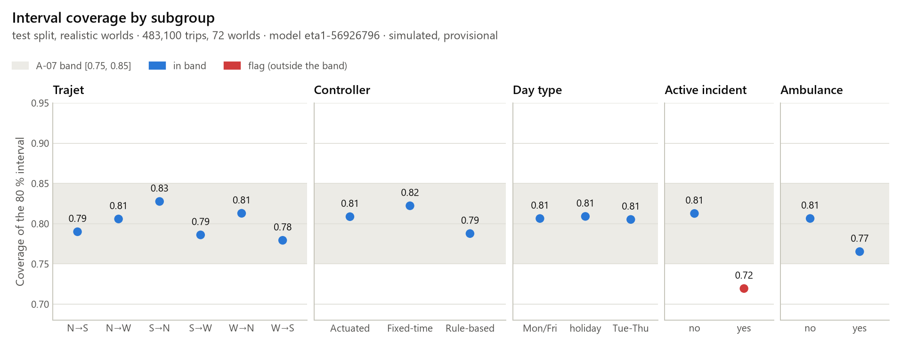

## 7. Travel-time model (ETA, A-07)

**Target (spec 11.1).** The target is the whole seconds from a car's entry on its approach to its first second on its out-edge, for the six car trajets through the junction. The student ETA adds a fixed rest of trip on the two student routes, from Gare d'Austerlitz and from Bd Saint-Marcel to the hospital main gate.

**Features (spec 11.3).** One definition in `ml/features.py` serves both the dataset and the prediction. The features are read one second before the car enters:

- time of day, day type, controller and trajet;
- per arm, halting and present vehicles, the longest wait, the jam length, occupancy and flow;
- the signal stage and the time remaining before it changes;
- bus calls, the ambulance, active incidents and waiting pedestrians.

**Dataset (EF-12).** A world is one seed with its own demand, ambulances and incidents, run under S0, S1 and S2. Worlds are split, never their trips. The test worlds were generated once, after the model was frozen.

**Model and interval (EF-13).** One XGBoost model predicts the low, median and high quantiles, and a conformal step (CQR) on separate calibration worlds adjusts the served integer bounds. The reference model of spec 11.4 is the mean per trajet, hour and day type. It is also the API's degraded mode ("estimation approximative").

The A-07 rule was pre-registered. On the realistic test worlds, the coverage of the served interval must lie in the target band, and the model must beat the reference on MAE (bootstrap by world). The model used is `{{eta.model_version}}`:

<!-- include: docs/eta.md#A-07 / EF-14 verdict | table: 1 -->

**A-07 {{eta.a07.verdict}}.** The served {{eta.interval_pct}} interval covers {{eta.a07.coverage_pct}} {{eta.a07.ci}} of {{eta.a07.n}} test trips in {{eta.a07.n_worlds}} worlds (band {{eta.a07.band}}). The median's MAE is {{eta.a07.mae}}, against {{eta.a07.ref_mae}} for the reference.

**Departure advice (spec 11.5).** The advice depends on which estimate reaches the exam in time:

- if the high bound plus the rest of the trip arrives in time: "Partez maintenant, marge confortable";
- if only the median does: "Marge faible";
- otherwise: "Risque de retard, prévenez".

In degraded mode the message says that it is approximate. The model learns the simulator (spec 11.2), so it is retrained after the field visit.
