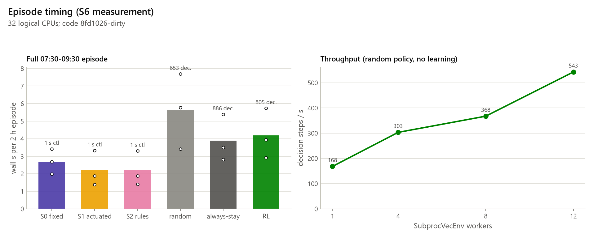
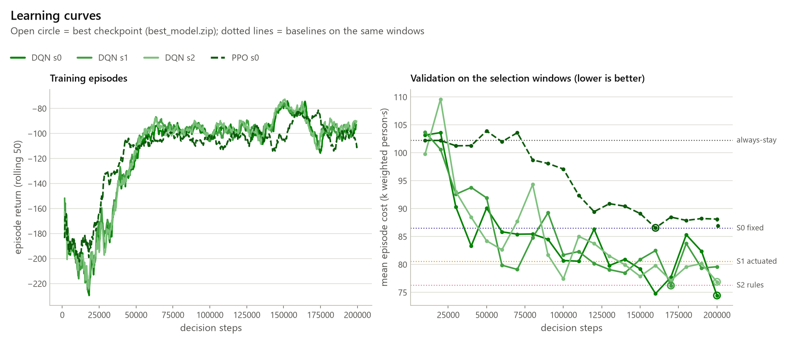
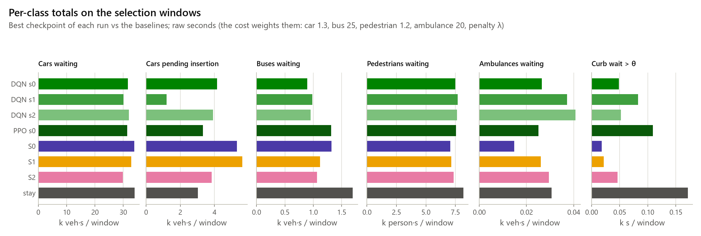
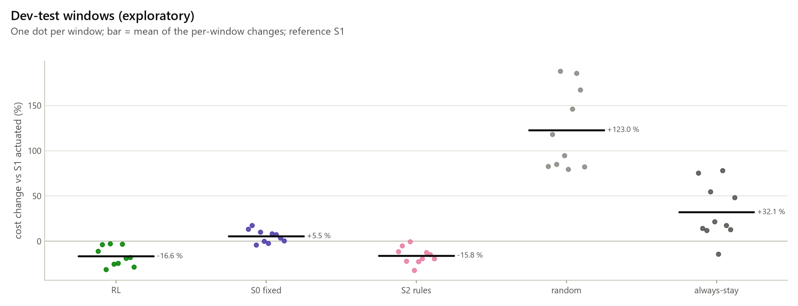

# RL environment and first trainings (Part 6)

Generated by `python -m traffic_twin.rl.evaluate docs` (spec chapter 10, EF-10, S6; decisions D55-D62). Do not edit by hand: rerun `tasks.py rl-eval`. Every result is simulated and provisional until the field visit (ASSUMED signal program).

**Summary:** S6 criterion **PASS** (3 of 3 DQN runs); full 2 h episode 2.2-5.6 s wall; selected model `rl1-dqn-s0-3e1539b9`; dev-test windows RL vs S1 -16.6 % (p 0.002, exploratory); safety OK.

## 1. Environment

Single agent on one junction (spec 10.1): `rl.env.TrafficEnv`, a Gymnasium env over `SimSession` (libsumo). The Safety Guard and the deterministic ambulance preemption stay in force and take priority over the agent (10.5). Preemption is bounded: a request is dropped after 120 s without progress and control returns to the agent (section 10).

- **Action** (D55): `Discrete(2)`, 0 = stay, 1 = advance to the cycle successor, under `safety.stage_order: strict`. Under strict order the guard allows exactly the current stage and its successor, so this is spec 10.2 "next green among the allowed phases"; yellow and all-red come from `SignalPlan`.
- **Decision clock** (D56, `rl.clock`): a decision every 5 s at most, only out of transition, after the minimum green and never during an active preemption. Between decisions the env holds the stage (semi-MDP). The controller `rl` uses the same clock and features.
- **Observation** `rl-obs-1` (D57, `rl.features`): 74 values in [0, 1] — per TLS lane halting, vehicles (per 7.5 m) and max wait (/120 s) (ASSUMED ideal lane detection: a camera or loops on every signal-controlled lane, read from the simulator; S1 sees only its loops); pending insertions per arm (/20, ASSUMED upstream detection); stage one-hot, in-transition, time in stage (/60 s), red time per stage (/180 s); per crossing waiting count, curb wait and shield slack (ASSUMED ideal pedestrian detection, as for S2); ambulance presence, pending, distance bins [50, 150] m, arm and preemption flag (ASSUMED V2I); per bus approach presence, distance and delay bin [30, 90] s (time-loss proxy, no timetable); time of day (sin, cos).
- **Reward** `rl-reward-1` (D58, `rl.reward`, spec 10.3): every simulated second c = 1.3·cars + 25.0·buses + 1.2·pedestrians + 20.0·ambulances waiting (persons; pending insertions count as waiting) + 30.0·1(longest curb wait > 80.0 s); R = −0.001 · Σc over the decision interval. The episode **cost** Σc used below is in weighted person-seconds.
- **Episodes** (D59): training windows of 1800 s starting on a random minute inside 07:30-09:30 after 300 s of `actuated` warm-up, truncated at the window end (no drain); full mode 07:30-09:30 truncated at 7,200 s (timing).
- **Diversity** (10.4): demand multiplier U(0.6, 1.4); day types tue_wed_thu_term 0.6, mon_fri_term 0.25, school_holiday 0.15 (ASSUMED ratio profiles, D44); ambulances 0/1/2 with p [0.4, 0.4, 0.2]; a lane incident with p 0.3 for [300, 600, 900] s (D45).

## 2. Pre-registration

`configs/rl.yaml` (sha256 `c0b7dd7b6ca4`), pre-registered **2026-10-16**, before any training; it changes only through dated `changes` entries (0 so far). The Part 3-4 seeds of `configs/evaluation.yaml` (1-10, 101-103, 201-207) are never run in Part 6.

| Seed set | Range | Use |
|---|---|---|
| train | 1000-1999 | training episodes (worker i plays i, i + n, ...) |
| selection | 3000-3009 | validation every 10000 steps, best checkpoint, timing |
| burned | 3010-3019 | seen by a prototype, never used |
| dev_test | 3020-3049 | exploratory comparison (Part 6 uses the first 10) |

**Budget (S6):** DQN seeds [0, 1, 2] × 200,000 decision steps; PPO seeds [0] × 200,000 decision steps; 8 SubprocVecEnv workers, torch threads 1, checkpoints every 50000 steps.

| Algorithm | Hyperparameters (SB3, from the rl_train prototype) |
|---|---|
| DQN | learning_rate 0.0005, buffer_size 100000, learning_starts 5000, batch_size 128, gamma 0.95, train_freq 1, gradient_steps 2, target_update_interval 2000, exploration_fraction 0.25, exploration_final_eps 0.02, net_arch [128, 128] |
| PPO | learning_rate 0.0003, n_steps 256, batch_size 256, n_epochs 5, gamma 0.95, gae_lambda 0.95, ent_coef 0.01, clip_range 0.2, net_arch [128, 128] |

## 3. Episode timing (S6 measurement)

Full episodes (07:30-09:30, no warm-up, truncated at 7,200 s, no drain) on selection seeds [3000, 3001, 3002], measured in one process on 32 logical CPUs (Windows-11-10.0.26200-SP0), code `8fd1026-dirty`. Baselines decide every second through `run_baseline` (timed as a whole); env-action policies are split into reset, env steps (SUMO, reward, features) and NN inference.

| Policy | Episodes | Wall s (mean) | Wall s (max) | Decisions | Reset s | Env steps s | SUMO s | Features s | Reward s | NN s | Decisions/s |
|---|---|---|---|---|---|---|---|---|---|---|---|
| fixed | 3 | 2.70 | 3.41 | every s (controller) | – | – | 1.41 | 0.00 | 0.70 | – | – |
| actuated | 3 | 2.20 | 3.32 | every s (controller) | – | – | 1.37 | 0.00 | 0.66 | – | – |
| rules | 3 | 2.19 | 3.30 | every s (controller) | – | – | 1.39 | 0.00 | 0.63 | – | – |
| random | 3 | 5.63 | 7.69 | 653 | 0.20 | 5.42 | 3.36 | 0.23 | 1.77 | 0.010 | 131 |
| stay | 3 | 3.90 | 5.38 | 886 | 0.20 | 3.69 | 2.51 | 0.18 | 0.96 | 0.000 | 246 |
| model | 3 | 4.20 | 5.73 | 805 | 0.24 | 3.73 | 2.56 | 0.18 | 0.94 | 0.218 | 205 |

Env construction in a fresh process: 0.03 s.

SubprocVecEnv throughput (train-mode windows, random policy, 5000 decision steps):

| n_envs | Steps/s | Start-up s | Episodes finished |
|---|---|---|---|
| 1 | 168 | 3.4 | 31 |
| 4 | 303 | 3.9 | 30 |
| 8 | 368 | 4.8 | 27 |
| 12 | 543 | 5.6 | 24 |

**Budget:** at 543 env steps/s (12 envs, no learning), 200k decision steps take about 6 min of simulation; learning and validation add to it (section 4 gives the measured training rates).

## 4. Trainings

Each row is one `rl.train` run folder (`data/rl_runs/<run>/manifest.json`). Costs are mean episode Σc on the 10 selection windows; changes are against the baselines on the same windows.

| Run | Algo | Seed | Steps | Envs | Wall min | Train steps/s | Validation s | Best step | Best cost | vs S0 | vs S1 | vs S2 | vs stay | Code |
|---|---|---|---|---|---|---|---|---|---|---|---|---|---|---|
| `dqn_s0_200k_c0b7dd7b` | DQN | 0 | 200,000 | 8 | 14.5 | 322 | 213 | 200000 | 74,453 | -13.9 % | -7.5 % | -2.4 % | -27.2 % | 8fd1026-dirty |
| `dqn_s1_200k_c0b7dd7b` | DQN | 1 | 200,000 | 8 | 11.0 | 428 | 163 | 170000 | 76,238 | -11.8 % | -5.3 % | -0.0 % | -25.4 % | 8fd1026-dirty |
| `dqn_s2_200k_c0b7dd7b` | DQN | 2 | 200,000 | 8 | 10.8 | 430 | 154 | 200000 | 76,902 | -11.1 % | -4.5 % | +0.8 % | -24.8 % | 8fd1026-dirty |
| `ppo_s0_200k_c0b7dd7b` | PPO | 0 | 200,704 | 8 | 9.8 | 503 | 174 | 160000 | 86,571 | +0.1 % | +7.5 % | +13.5 % | -15.3 % | 8fd1026-dirty |

Baselines on the selection windows: S0 86,484, S1 80,514, S2 76,257, stay 102,220.

## 5. Learning curves

Left: training episode return (rolling mean over 50 episodes, VecMonitor). Right: validation cost on the selection windows every 10000 steps, with the baselines on the same windows.

Per-class totals of the best checkpoints and the baselines (selection windows, mean per window):

## 6. S6 criterion

Pre-registered (D60): in at least 2 of the 3 DQN runs (200,000 steps), the best validation cost is at least 5 % below both the S0 and the always-stay costs on the same selection windows (S6 "an agent that learns on short episodes").

| Seed | Run | Best cost | vs S0 | vs stay | Pass |
|---|---|---|---|---|---|
| 0 | `dqn_s0_200k_c0b7dd7b` | 74,453 | -13.9 % | -27.2 % | yes |
| 1 | `dqn_s1_200k_c0b7dd7b` | 76,238 | -11.8 % | -25.4 % | yes |
| 2 | `dqn_s2_200k_c0b7dd7b` | 76,902 | -11.1 % | -24.8 % | yes |

**Verdict: PASS** (3 of 3 runs pass).

Selected for evaluation (`rl.evaluate select`, lowest best validation cost among the DQN runs): `dqn_s0_200k_c0b7dd7b` step 200000 -> `rl1-dqn-s0-3e1539b9` (model sha256 `e14715675837`).

## 7. Dev-test window comparison (exploratory)

Selected model `rl1-dqn-s0-3e1539b9` and the baselines on the same 10 train-mode windows (dev-test seeds [3020, 3021, 3022, 3023, 3024, 3025, 3026, 3027, 3028, 3029], never used for training or selection). Cost = episode Σc; changes are means of the per-window % changes; p = exact two-sided Wilcoxon signed-rank test against S1, unadjusted (exploratory, no acceptance).

| Policy | Cost (mean) | vs S0 | vs S1 | Wins vs S1 | p vs S1 | Interventions | Curb max s | Preemptions served/requests (timeouts) |
|---|---|---|---|---|---|---|---|---|
| RL | 68,555 | -21.2 % | -16.6 % | 10/10 | 0.002 | 3.1 | 88 | 7/7 (0) |
| S0 | 87,235 | – | +5.5 % | 2/10 | 0.064 | 0.0 | 88 | 5/7 (1) |
| S1 | 83,494 | -4.9 % | – | – | – | 0.0 | 88 | 6/7 (1) |
| S2 | 69,814 | -20.3 % | -15.8 % | 10/10 | 0.002 | 0.0 | 88 | 6/7 (0) |
| random | 181,712 | +111.0 % | +123.0 % | 0/10 | 0.002 | 5.1 | 88 | 3/7 (4) |
| stay | 100,201 | +24.9 % | +32.1 % | 1/10 | 0.037 | 54.4 | 88 | 7/7 (0) |

## 8. Full 2 h runs (exploratory KPIs)

`run_scenario` runs of S0 `configs/pitie_fixed.yaml`, S1 `configs/pitie_actuated.yaml`, S2 `configs/pitie_rules.yaml`, RL `configs/pitie_rl.yaml` on dev-test seeds [3020, 3021, 3022, 3023, 3024, 3025, 3026, 3027, 3028, 3029] (07:30-09:30 plus the drain, KPI v3, same demand_hash). Means over the seeds; RL vs S1 is the paired mean difference with the exact Wilcoxon p (exploratory, unadjusted). The RL objective is the env cost, not KPI v3. A-06 (seeds 1-10) is Part 8.

RL runs made with model `rl1-dqn-s0-3e1539b9` (sha256 `e14715675837`, checked against every run.json); code versions of the runs: `8fd1026-dirty`.

| KPI | S0 | S1 | S2 | RL | RL − S1 | p |
|---|---|---|---|---|---|---|
| `car/time_loss_mean` | 75.9 | 65.5 | 55.0 | 59.4 | -6.1 | 0.027 |
| `car/delay_total_mean` | 84.5 | 71.3 | 55.4 | 59.5 | -11.7 | 0.027 |
| `car/depart_delay_mean` | 8.6 | 5.8 | 0.3 | 0.2 | -5.6 | 0.020 |
| `bus/delay_mean` | 61.4 | 63.1 | 56.7 | 48.5 | -14.6 | 0.002 |
| `pedestrian/ped_curb_wait_max` | 85.9 | 87.3 | 88.0 | 88.0 | 0.7 | 0.031 |
| `pedestrian/ped_curb_wait_mean` | 19.2 | 19.2 | 19.5 | 19.9 | 0.8 | 0.020 |
| `ambulance/travel_time_total` | 141.5 | 141.6 | 93.2 | 98.6 | -43.0 | 0.049 |
| `all/person_delay_mean` | 62.7 | 57.5 | 48.4 | 47.6 | -9.9 | 0.002 |

## 9. Safety

Full 2 h runs: dangerous audit findings, collisions, longest curb wait (A-04 bound 90 s) and Safety Guard interventions per run (mean). `zero_interventions` stays [fixed, actuated] (D62).

| Scenario | Runs | Danger | Collisions | Curb max s | Interventions | min_green | order | max_green | starvation | ped_wait | Teleports | Drain timeouts | Preemptions served/requests (timeouts) |
|---|---|---|---|---|---|---|---|---|---|---|---|---|---|
| S0 | 10 | 0 | 0 | 86 | 0.0 | 0.0 | 0.0 | 0.0 | 0.0 | 0.0 | 0 | 0 | off |
| S1 | 10 | 0 | 0 | 88 | 0.0 | 0.0 | 0.0 | 0.0 | 0.0 | 0.0 | 0 | 0 | off |
| S2 | 10 | 0 | 0 | 88 | 0.0 | 0.0 | 0.0 | 0.0 | 0.0 | 0.0 | 0 | 0 | 10/10 (0) |
| RL | 10 | 0 | 0 | 88 | 11.3 | 0.0 | 0.0 | 2.1 | 0.0 | 9.2 | 0 | 0 | 10/10 (0) |

**Safety bounds:** all runs within danger 0, collisions 0, curb wait ≤ 90 s.

Dev-test windows: the RL policy triggered 3.1 guard interventions per 30-min window (min_green 0.0, order 0.0, max_green 0.8, starvation 0.0, ped_wait 2.3), danger max 0, curb wait max 88 s.

## 10. Ambulance in the state (10.5)

Preemption is deterministic and has priority while it is active (10.5): decisions are skipped during it (D56), and pending detection triggers it before the ambulance reaches the approach. It is **bounded, not an unconditional guarantee**: a request is dropped after 120 s without 1 m of progress (`preemption.max_hold_s`, D24), for example when the ambulance is stuck in a queue the policy built, and control then returns to the agent with the ambulance still present. The ambulance features are therefore ~0 at decision points only while every preemption is served.

Dev-test windows (train-mode, 0-2 random ambulances each): preemption outcome summed over the windows (requests neither served nor timed out were still active when the window was truncated) and the share of decisions with an ambulance present.

| Policy | Requests | Served | Timeouts | Windows with a timeout | Ambulance share (mean) | Ambulance share (max) |
|---|---|---|---|---|---|---|
| RL | 7 | 7 | 0 | 0/10 | 0.00 % | 0.00 % |
| S0 | 7 | 5 | 1 | 1/10 | 0.00 % | 0.00 % |
| S1 | 7 | 6 | 1 | 1/10 | 0.00 % | 0.00 % |
| S2 | 7 | 6 | 0 | 0/10 | 0.00 % | 0.00 % |
| random | 7 | 3 | 4 | 3/10 | 11.10 % | 69.44 % |
| stay | 7 | 7 | 0 | 0/10 | 0.00 % | 0.00 % |

Full 2 h runs (one fixed N→S ambulance per run): S0 off, S1 off, S2 10/10 (0), RL 10/10 (0) (served/requests (timeouts)).

- `dqn_s0_200k_c0b7dd7b` best checkpoint on the selection windows: ambulance share 0.00 %
- `dqn_s1_200k_c0b7dd7b` best checkpoint on the selection windows: ambulance share 0.00 %
- `dqn_s2_200k_c0b7dd7b` best checkpoint on the selection windows: ambulance share 0.00 %
- `ppo_s0_200k_c0b7dd7b` best checkpoint on the selection windows: ambulance share 0.00 %

The validation files of `dqn_s0_200k_c0b7dd7b`, `dqn_s1_200k_c0b7dd7b`, `dqn_s2_200k_c0b7dd7b`, `ppo_s0_200k_c0b7dd7b` predate the preemption columns, so their preemption outcomes on the selection windows were not recorded (new trainings record them).

No earlier ambulance warning is given to the agent: it would change S2 and A-05 (Q13).

## 11. Reproducibility

Every run records its code version (`-dirty` for an uncommitted tree), the rl.yaml sha256, seeds, n_envs, torch threads and library versions. Bitwise reproducibility holds only at the same `n_envs`, one torch thread and the pinned versions (D61); runs are compared on the policy parameters (zip files carry timestamps). After the commit, `tasks.py part6` from the clean tree must reproduce the run manifests exactly (D65).

Versions: python 3.12.10, torch 2.14.1+cpu, sb3 2.9.0, gymnasium 1.4.0, libsumo 1.28.0, numpy 2.5.4.
Code versions of the runs: 8fd1026-dirty.

Determinism check (`rl.evaluate repro`, n_envs [4, 4]): **identical** (best_policy_sha256 same, final_policy_sha256 same, best_step same, steps_done same, monitor_r_l same, validation_cost same).

## 12. Limitations and the 10.6 fallback

- The agent learns the simulator (spec 11.2) on the ASSUMED 123 s signal program and the calibration; every number here is provisional until the field visit (3-5 Nov 2026) and is simulated, not measured.
- The S6 headline uses the env cost on 30-min windows, not KPI v3 over 2 h with drain; the full 2 h runs are exploratory. Selection on 3000-3009 is optimistic.
- Reward weights (bus 25, pedestrian 1.2, ambulance 20) and λ are ASSUMED starting values (10.3); the agent can push pedestrian waits toward the shield bound, which the guard enforces at the cost of interventions.
- The observation reads every signal-controlled lane's halting and present vehicles and its longest wait, and the pedestrian curb waits, straight from the simulator: ASSUMED ideal detection (a camera or loops per lane, ideal pedestrian detection). S1 uses only its loop detectors, so part of the RL gain over S1 may be an information advantage; the gains rest on that sensing being available on site.
- Day-type profiles are ratio extrapolations (D44); the ambulance features are seen at decision points only after a preemption timeout (section 10).
- **Spec 10.6 fallback:** if RL does not beat the actuated baseline after a reasonable number of trials, the rules (S2) become the main solution and RL is reported as a study with its analysis. On the dev-test windows the RL policy has a lower env cost than S1 (actuated), -16.6 % per window (p 0.002, exploratory and unadjusted; env cost only, on 10 30-min windows, the model picked from 3 runs on the selection seeds). Against S2 (rules) its window cost is -1.8 % (change of the means). In the full 2 h runs it is worse than S1 on `pedestrian/ped_curb_wait_max` +0.7 (p 0.031), `pedestrian/ped_curb_wait_mean` +0.8 (p 0.020). It stays behind S2 on `car/time_loss_mean` 59.4 vs 55.0, `car/delay_total_mean` 59.5 vs 55.4, `pedestrian/ped_curb_wait_mean` 19.9 vs 19.5, `ambulance/travel_time_total` 98.6 vs 93.2. It needs 11.3 Safety Guard interventions per 2 h run (S0 0.0, S1 0.0, S2 0.0). All of this has to be confirmed in Part 8 (A-06).

## 13. Part 7 plan

- Full trainings (300-500k steps, 3 seeds per setting), validation on full 2 h windows once short-window training plateaus.
- Weight sensitivity (w_b, w_p, λ ∈ {0, 30, 100}) and its effect on every user's KPIs (10.3).
- Optional free-order action with masking (needs sb3-contrib, user approval).
- Commit the selected model (about 0.5 MB) with its manifest for Part 8 (A-06 on seeds 1-10, never touched in Part 6).
