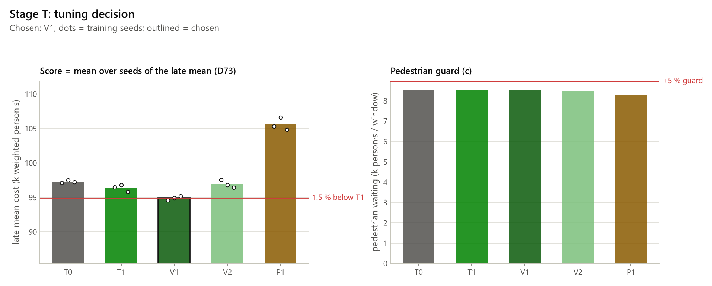
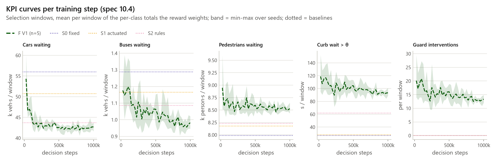
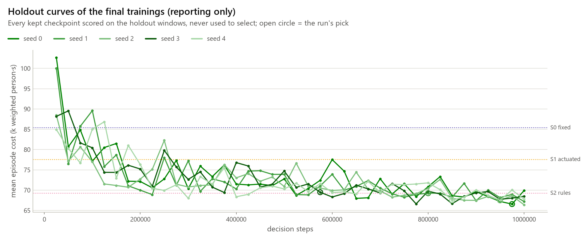
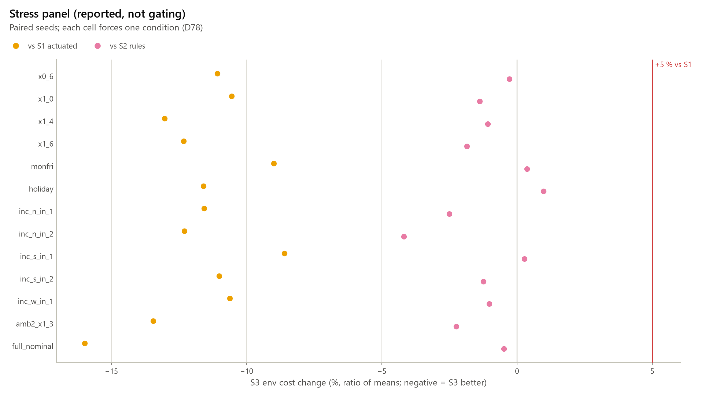
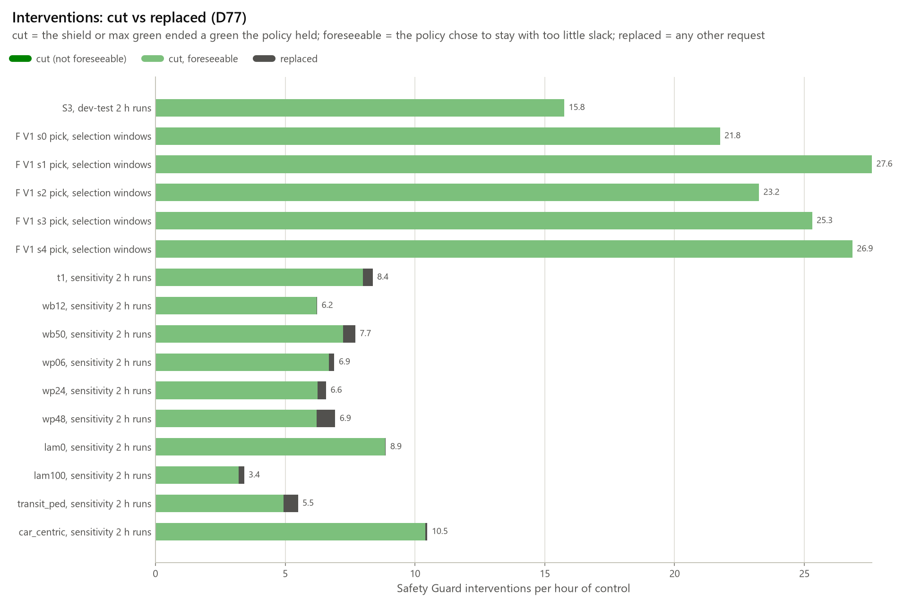

# Full RL training, tuning and weight sensitivity (Part 7)

Generated by `python -m traffic_twin.rl.report7` (spec S7, 10.3-10.6; decisions D68-D90). Do not edit by hand: rerun `tasks.py rl7-docs`. Every result is simulated and provisional until the field visit (ASSUMED signal program). `docs/rl.md` stays the Part 6 record.

Code version of this page: `5bec559-dirty`.

## 1. Summary and interim 10.6 verdict

**So far:** stage T chose **V1** (D73); 5 final trainings (stage F); S3 = `rl7-dqn-v1-s0-415724a4`.

**Interim 10.6 verdict: FALLBACK** (dev-test seeds 3020-3029, looked at once; exploratory, n = 10).

| Criterion (D79) | Result | Pass |
|---|---|---|
| C1 person delay vs S1 | HL -9.5 s, p 0.002 | yes |
| C2 equity vs S1 | `car/time_loss_mean` -13.9 %; `bus/delay_mean` -21.7 %; `pedestrian/ped_curb_wait_mean` +6.2 % (worse); limit +5 % | no |
| C3 safety | no violation | yes |
| C4 reproducibility | F picks below S1 on the holdout windows: 5 of 5 (need 4); reproduce7 pending (runs after the commit) | pending |

S3 does not observe pedestrians: V1 drops the pedestrian feature group, so none of its 62 features is a pedestrian count, curb wait or shield slack, and the pedestrian shield alone keeps the curb-wait bound. C2's pedestrian result (`pedestrian/ped_curb_wait_mean` +6.2 %) is that of a policy that does not see pedestrians; whether a policy that observes them would pass C2 was not tested, and no config is added after the look (D79).

Spec 10.6 applies: RL does not beat the actuated baseline on the pre-registered criteria, so the rules (S2) become the main solution and RL is reported as a study (what was tried and why it does not improve). Part 8 still runs S3 as registered.

Against S2 (rules): S3 beats rules (S2) on the primary KPI (person delay HL -1.7 s, p 0.049).

Pending: C4.repro.

## 2. Pre-registration

`configs/rl7.yaml` (text sha256 `961134335767`, extends `configs/rl.yaml` `c0b7dd7b`, the frozen Part 6 record), pre-registered **2026-10-16** before any Part 7 training (D68-D90). It changes only through dated `changes` entries: 0 so far.

| Seed set | Range | Use |
|---|---|---|
| train | 5000-9999 | training windows: a 1M-step run plays each about once (D70) |
| selection | 3050-3089 | validation of every kept checkpoint; the per-run pick (D72) and the stage-T score (D73) |
| select2 | 3090-3109 | stage 2 of the S3 pick: full 2 h env episodes (D75) |
| holdout | 3110-3159 | reporting only, never to select: windows plus full episodes per pick |
| sensitivity | 3160-3179 | full 2 h KPI v3 runs of the weight settings and S0/S1/S2 (D76) |
| stress | 3180-3199 | forced-condition windows of the stress panel (D78) |
| reserve | 3200-3999 | unused |
| burned | 3010-3019 | seen by a Part 6 prototype, never used |
| dev_test | 3020-3049 | the single dev-test look (D79) uses the first 10; the rest stay unused |

Never run in Part 7: 1-10, 101-103, 201-207 (Parts 3-4, `configs/evaluation.yaml`), 2000-2999 and 4000+ (Part 5); 1000-1999 and 3000-3009 are spent by Part 6 and its prototypes.

**Rules fixed before training:**

- **Pick per run (D72):** the validation checkpoint (final model included) with the lowest mean cost on the selection windows among the validations at ≥ 50 % of the budget; `late_mean` = mean cost of those validations.
- **Stage T (D73):** configs T0, T1, V1, V2, P1 × seeds [0, 1, 2] × 400k steps; score = mean over seeds of `late_mean`. C* = T1 unless a candidate has (a) a score ≤ 0.985 × the reference's, (b) a lower `late_mean` for ≥ 2 of the matching seeds and (c) a late pedestrian waiting ≤ 1.05 × the reference's; the lowest qualifying score wins.
- **Stage F (D74):** C* × seeds [0, 1, 2, 3, 4] × 1M steps.
- **S3 (D75):** stage 1 = each F run's pick; stage 2 = mean cost on the select2 full episodes; ties within 0.5 % go to the lower stage-1 cost, then the lower seed.
- **Sensitivity (D76):** base T1 and settings wb12, wb50, wp06, wp24, wp48, lam0, lam100, transit_ped, car_centric; seeds [0, 1, 2, 3, 4] on t1, wb12, wb50, [0, 1, 2] elsewhere; 400k steps; descriptive only.
- **Interim 10.6 (D79):** dev-test seeds 3020-3029, once. C1 `all/person_delay_mean` S3 vs S1: HL < 0 and exact Wilcoxon p < 0.05; C2 none of `car/time_loss_mean`, `bus/delay_mean`, `pedestrian/ped_curb_wait_mean` more than 5 % worse than S1; C3 danger 0, collisions 0, teleports 0, curb max ≤ 90 s, every preemption served, timeouts ≤ S2's; C4 ≥ 4 of the F picks below S1 on the holdout and `reproduce7` identical.

Run configs (`configs/rl7/`, each extends `../rl7.yaml` or `t1.yaml` and holds only what it changes; run identity = `run_config_sha` of the merged config, D69):

| File | Extends | Changes | Role |
|---|---|---|---|
| `car_centric.yaml` | `t1.yaml` | reward: {weights: {bus: 12.5, pedestrian: 0.6}, ped_penalty: {lambda: 0.0}} | Weight sensitivity corner car_centric (D76): bus 12.5, pedestrian 0.6, lambda 0. |
| `lam0.yaml` | `t1.yaml` | reward: {ped_penalty: {lambda: 0.0}} | Weight sensitivity setting lam0 (D76): pedestrian wait penalty lambda 0. |
| `lam100.yaml` | `t1.yaml` | reward: {ped_penalty: {lambda: 100.0}} | Weight sensitivity setting lam100 (D76): pedestrian wait penalty lambda 100. |
| `p1.yaml` | `../rl7.yaml` | algo: ppo, ppo: {learning_rate: lin:3.0e-4:3.0e-5} | Stage T config P1 (D73, D89): PPO, Part 6 PPO block + learning rate linear 3e-4 -> 3e-5. |
| `t0.yaml` | `../rl7.yaml` | – | Stage T config T0 (D73): Part 6 DQN hyperparameters, constant learning rate 5e-4. |
| `t1.yaml` | `../rl7.yaml` | dqn: {learning_rate: lin:5.0e-4:5.0e-5} | Stage T config T1 (D73), the reference: T0 + learning rate linear 5e-4 -> 5e-5. Also the sensitivity base (D76): base weights, its stage-T runs are the base seeds 0-2. |
| `transit_ped.yaml` | `t1.yaml` | reward: {weights: {bus: 50.0, pedestrian: 2.4}, ped_penalty: {lambda: 100.0}} | Weight sensitivity corner transit_ped (D76): bus 50, pedestrian 2.4, lambda 100. |
| `v1.yaml` | `t1.yaml` | observation: {drop: [pedestrian]} | Stage T config V1 (D73): T1 without the pedestrian feature group (62 features). |
| `v2.yaml` | `t1.yaml` | decision: {interval_s: 10} | Stage T config V2 (D73): T1 with a 10 s decision interval. |
| `wb12.yaml` | `t1.yaml` | reward: {weights: {bus: 12.5}} | Weight sensitivity setting wb12 (D76): bus weight x0.5 (12.5). |
| `wb50.yaml` | `t1.yaml` | reward: {weights: {bus: 50.0}} | Weight sensitivity setting wb50 (D76): bus weight x2 (50). |
| `wp06.yaml` | `t1.yaml` | reward: {weights: {pedestrian: 0.6}} | Weight sensitivity setting wp06 (D76): pedestrian weight x0.5 (0.6). |
| `wp24.yaml` | `t1.yaml` | reward: {weights: {pedestrian: 2.4}} | Weight sensitivity setting wp24 (D76): pedestrian weight x2 (2.4). |
| `wp48.yaml` | `t1.yaml` | reward: {weights: {pedestrian: 4.8}} | Weight sensitivity setting wp48 (D76): pedestrian weight x4 (4.8), a stress point outside the spec's 1.0-1.5 starting range. |

## 3. Protocol and compute used

Every run (D71): SB3 DQN (P1: PPO), 6 `SubprocVecEnv` workers (spawn), torch threads 1 in the learner and the workers, CPU; 30-min train-mode windows (D59); exploration over 50,000 absolute steps; update-to-data 0.33; validation every 25,000 steps on the selection windows with 6 persistent workers, every validation checkpoint kept; SB3 checkpoints every 50,000 steps; no resume (a crash reruns from scratch).

Budget in decision steps: stage T 6M, sensitivity 13.2M (33 new runs), stage F 5M; total 24.2M.

| Stage | Jobs | Status | Job-hours | Steps/s (mean) | Retried |
|---|---|---|---|---|---|
| T | 15 | done 15 | 6.8 | 290 | 0 |
| S | 33 | done 33 | 14.2 | 294 | 0 |
| F | 5 | done 5 | 5.3 | 297 | 0 |

Concurrent jobs: 6 (D84).

| Run | Stage | Config | Algo | Seed | Steps | Wall min | Train steps/s | Code | --allow-dirty |
|---|---|---|---|---|---|---|---|---|---|
| `dqn_t0_s0_400k_2dd63790` | T | T0 | DQN | 0 | 400,002 | 27 | 292 | `5bec559` | no |
| `dqn_t0_s1_400k_2dd63790` | T | T0 | DQN | 1 | 400,002 | 27 | 292 | `5bec559` | no |
| `dqn_t0_s2_400k_2dd63790` | T | T0 | DQN | 2 | 400,002 | 27 | 293 | `5bec559` | no |
| `dqn_t1_s0_400k_20604198` | T | T1 | DQN | 0 | 400,002 | 27 | 292 | `5bec559` | no |
| `dqn_t1_s1_400k_20604198` | T | T1 | DQN | 1 | 400,002 | 27 | 290 | `5bec559` | no |
| `dqn_t1_s2_400k_20604198` | T | T1 | DQN | 2 | 400,002 | 27 | 294 | `5bec559` | no |
| `dqn_v1_s0_400k_b41e9e43` | T | V1 | DQN | 0 | 400,002 | 27 | 287 | `5bec559` | no |
| `dqn_v1_s1_400k_b41e9e43` | T | V1 | DQN | 1 | 400,002 | 27 | 287 | `5bec559` | no |
| `dqn_v1_s2_400k_b41e9e43` | T | V1 | DQN | 2 | 400,002 | 27 | 286 | `5bec559` | no |
| `dqn_v2_s0_400k_4c5ead95` | T | V2 | DQN | 0 | 400,002 | 33 | 226 | `5bec559` | no |
| `dqn_v2_s1_400k_4c5ead95` | T | V2 | DQN | 1 | 400,002 | 33 | 225 | `5bec559` | no |
| `dqn_v2_s2_400k_4c5ead95` | T | V2 | DQN | 2 | 400,002 | 33 | 226 | `5bec559` | no |
| `ppo_p1_s0_400k_c21864ff` | T | P1 | PPO | 0 | 400,896 | 23 | 351 | `5bec559` | no |
| `ppo_p1_s1_400k_c21864ff` | T | P1 | PPO | 1 | 400,896 | 22 | 353 | `5bec559` | no |
| `ppo_p1_s2_400k_c21864ff` | T | P1 | PPO | 2 | 400,896 | 23 | 349 | `5bec559` | no |
| `dqn_car_centric_s0_400k_c1dff553` | S | CAR_CENTRIC | DQN | 0 | 400,002 | 24 | 311 | `5bec559` | no |
| `dqn_car_centric_s1_400k_c1dff553` | S | CAR_CENTRIC | DQN | 1 | 400,002 | 24 | 313 | `5bec559` | no |
| `dqn_car_centric_s2_400k_c1dff553` | S | CAR_CENTRIC | DQN | 2 | 400,002 | 22 | 348 | `5bec559` | no |
| `dqn_lam0_s0_400k_99304613` | S | LAM0 | DQN | 0 | 400,002 | 26 | 294 | `5bec559` | no |
| `dqn_lam0_s1_400k_99304613` | S | LAM0 | DQN | 1 | 400,002 | 26 | 294 | `5bec559` | no |
| `dqn_lam0_s2_400k_99304613` | S | LAM0 | DQN | 2 | 400,002 | 26 | 293 | `5bec559` | no |
| `dqn_lam100_s0_400k_7b86cd1f` | S | LAM100 | DQN | 0 | 400,002 | 26 | 288 | `5bec559` | no |
| `dqn_lam100_s1_400k_7b86cd1f` | S | LAM100 | DQN | 1 | 400,002 | 26 | 291 | `5bec559` | no |
| `dqn_lam100_s2_400k_7b86cd1f` | S | LAM100 | DQN | 2 | 400,002 | 26 | 291 | `5bec559` | no |
| `dqn_t1_s3_400k_20604198` | S | T1 | DQN | 3 | 400,002 | 26 | 294 | `5bec559` | no |
| `dqn_t1_s4_400k_20604198` | S | T1 | DQN | 4 | 400,002 | 26 | 293 | `5bec559` | no |
| `dqn_transit_ped_s0_400k_8e6e68ae` | S | TRANSIT_PED | DQN | 0 | 400,002 | 27 | 285 | `5bec559` | no |
| `dqn_transit_ped_s1_400k_8e6e68ae` | S | TRANSIT_PED | DQN | 1 | 400,002 | 27 | 283 | `5bec559` | no |
| `dqn_transit_ped_s2_400k_8e6e68ae` | S | TRANSIT_PED | DQN | 2 | 400,002 | 26 | 287 | `5bec559` | no |
| `dqn_wb12_s0_400k_44c63e49` | S | WB12 | DQN | 0 | 400,002 | 26 | 296 | `5bec559` | no |
| `dqn_wb12_s1_400k_44c63e49` | S | WB12 | DQN | 1 | 400,002 | 26 | 295 | `5bec559` | no |
| `dqn_wb12_s2_400k_44c63e49` | S | WB12 | DQN | 2 | 400,002 | 26 | 297 | `5bec559` | no |
| `dqn_wb12_s3_400k_44c63e49` | S | WB12 | DQN | 3 | 400,002 | 26 | 298 | `5bec559` | no |
| `dqn_wb12_s4_400k_44c63e49` | S | WB12 | DQN | 4 | 400,002 | 26 | 294 | `5bec559` | no |
| `dqn_wb50_s0_400k_7598e876` | S | WB50 | DQN | 0 | 400,002 | 27 | 284 | `5bec559` | no |
| `dqn_wb50_s1_400k_7598e876` | S | WB50 | DQN | 1 | 400,002 | 27 | 285 | `5bec559` | no |
| `dqn_wb50_s2_400k_7598e876` | S | WB50 | DQN | 2 | 400,002 | 27 | 286 | `5bec559` | no |
| `dqn_wb50_s3_400k_7598e876` | S | WB50 | DQN | 3 | 400,002 | 27 | 287 | `5bec559` | no |
| `dqn_wb50_s4_400k_7598e876` | S | WB50 | DQN | 4 | 400,002 | 27 | 284 | `5bec559` | no |
| `dqn_wp06_s0_400k_24273bb9` | S | WP06 | DQN | 0 | 400,002 | 26 | 291 | `5bec559` | no |
| `dqn_wp06_s1_400k_24273bb9` | S | WP06 | DQN | 1 | 400,002 | 26 | 292 | `5bec559` | no |
| `dqn_wp06_s2_400k_24273bb9` | S | WP06 | DQN | 2 | 400,002 | 26 | 294 | `5bec559` | no |
| `dqn_wp24_s0_400k_0ccedd3b` | S | WP24 | DQN | 0 | 400,002 | 26 | 294 | `5bec559` | no |
| `dqn_wp24_s1_400k_0ccedd3b` | S | WP24 | DQN | 1 | 400,002 | 26 | 294 | `5bec559` | no |
| `dqn_wp24_s2_400k_0ccedd3b` | S | WP24 | DQN | 2 | 400,002 | 26 | 293 | `5bec559` | no |
| `dqn_wp48_s0_400k_6b45c1f6` | S | WP48 | DQN | 0 | 400,002 | 26 | 295 | `5bec559` | no |
| `dqn_wp48_s1_400k_6b45c1f6` | S | WP48 | DQN | 1 | 400,002 | 26 | 295 | `5bec559` | no |
| `dqn_wp48_s2_400k_6b45c1f6` | S | WP48 | DQN | 2 | 400,002 | 26 | 296 | `5bec559` | no |
| `dqn_v1_s0_1000k_b41e9e43` | F | V1 | DQN | 0 | 1,000,002 | 63 | 297 | `5bec559` | no |
| `dqn_v1_s1_1000k_b41e9e43` | F | V1 | DQN | 1 | 1,000,002 | 63 | 296 | `5bec559` | no |
| `dqn_v1_s2_1000k_b41e9e43` | F | V1 | DQN | 2 | 1,000,002 | 63 | 297 | `5bec559` | no |
| `dqn_v1_s3_1000k_b41e9e43` | F | V1 | DQN | 3 | 1,000,002 | 63 | 297 | `5bec559` | no |
| `dqn_v1_s4_1000k_b41e9e43` | F | V1 | DQN | 4 | 1,000,002 | 63 | 296 | `5bec559` | no |

## 4. Stage T

Each run's pick (D72) on the selection windows: cost, change against S1 and S2 on the same windows, `late_mean` (the D73 score input), the final model's cost and the holdout cost (reporting only, never to select).

| Config | Seed | Pick step | Pick cost | vs S1 | vs S2 | Late mean | Late vs S2 | Final cost | Holdout cost | Holdout vs S2 |
|---|---|---|---|---|---|---|---|---|---|---|
| P1 | 0 | 400002 | 103,194 | -3.1 % | +7.2 % | 105,345 | +9.4 % | 103,842 | 82,139 | +18.6 % |
| P1 | 1 | 300000 | 104,027 | -2.3 % | +8.0 % | 106,587 | +10.7 % | 106,605 | 83,532 | +20.6 % |
| P1 | 2 | 400002 | 103,659 | -2.6 % | +7.6 % | 104,830 | +8.9 % | 103,973 | 81,651 | +17.9 % |
| T0 | 0 | 275004 | 94,700 | -11.1 % | -1.7 % | 97,141 | +0.9 % | 101,926 | 69,554 | +0.4 % |
| T0 | 1 | 300000 | 94,635 | -11.1 % | -1.7 % | 97,496 | +1.2 % | 96,262 | 69,684 | +0.6 % |
| T0 | 2 | 225000 | 92,735 | -12.9 % | -3.7 % | 97,231 | +1.0 % | 97,055 | 68,085 | -1.7 % |
| T1 | 0 | 225000 | 95,779 | -10.0 % | -0.5 % | 96,498 | +0.2 % | 96,725 | 72,182 | +4.2 % |
| T1 | 1 | 300000 | 95,181 | -10.6 % | -1.2 % | 96,782 | +0.5 % | 97,611 | 72,172 | +4.2 % |
| T1 | 2 | 300000 | 94,292 | -11.4 % | -2.1 % | 95,824 | -0.5 % | 95,116 | 66,541 | -3.9 % |
| V1 | 0 | 400002 | 92,690 | -12.9 % | -3.7 % | 94,583 | -1.8 % | 92,690 | 67,681 | -2.3 % |
| V1 | 1 | 300000 | 91,635 | -13.9 % | -4.8 % | 94,924 | -1.4 % | 93,287 | 69,494 | +0.4 % |
| V1 | 2 | 400002 | 92,116 | -13.5 % | -4.3 % | 95,200 | -1.1 % | 92,116 | 68,637 | -0.9 % |
| V2 | 0 | 375000 | 96,073 | -9.8 % | -0.2 % | 97,560 | +1.3 % | 96,642 | 66,489 | -4.0 % |
| V2 | 1 | 400002 | 95,615 | -10.2 % | -0.7 % | 96,791 | +0.5 % | 95,615 | 68,203 | -1.5 % |
| V2 | 2 | 400002 | 93,176 | -12.5 % | -3.2 % | 96,447 | +0.2 % | 93,176 | 68,332 | -1.3 % |

**Decision record** (`decision_T.json`, D73):

| Config | Late mean per seed | Score | vs T1 | Late pedestrian waiting |  |
|---|---|---|---|---|---|
| T0 | s0 97,141, s1 97,496, s2 97,231 | 97,290 | +1.0 % | 8,558 |  |
| T1 | s0 96,498, s1 96,782, s2 95,824 | 96,368 | +0.0 % | 8,541 |  |
| V1 | s0 94,583, s1 94,924, s2 95,200 | 94,902 | -1.5 % | 8,548 | **chosen** |
| V2 | s0 97,560, s1 96,791, s2 96,447 | 96,933 | +0.6 % | 8,478 |  |
| P1 | s0 105,345, s1 106,587, s2 104,830 | 105,587 | +9.6 % | 8,304 |  |

Rule outcome:

- T0: score 97,290; ratio to T1 1.00956 against the limit 0.98500 (above it by 0.02456); (a) no; late mean below T1 on 0 of 3 seeds (need 2); (b) no; pedestrian waiting ratio 1.00194 against the limit 1.05000 (below it by 0.04806); (c) yes; qualifies: no
- T1: the reference (score 96,368)
- V1: score 94,902; ratio to T1 0.98478 against the limit 0.98500 (below it by 0.00022); (a) yes; late mean below T1 on 3 of 3 seeds (need 2); (b) yes; pedestrian waiting ratio 1.00074 against the limit 1.05000 (below it by 0.04926); (c) yes; qualifies: yes
- V2: score 96,933; ratio to T1 1.00585 against the limit 0.98500 (above it by 0.02085); (a) no; late mean below T1 on 0 of 3 seeds (need 2); (b) no; pedestrian waiting ratio 0.99256 against the limit 1.05000 (below it by 0.05744); (c) yes; qualifies: no
- P1: score 105,587; ratio to T1 1.09566 against the limit 0.98500 (above it by 0.11066); (a) no; late mean below T1 on 0 of 3 seeds (need 2); (b) no; pedestrian waiting ratio 0.97227 against the limit 1.05000 (below it by 0.07773); (c) yes; qualifies: no

**C\* = V1.** Stage F trains it (D74); no config is added after this decision (D79 trial budget).

## 5. Learning curves and KPI curves per training step (10.4)

Spec 10.4 asks for KPI curves per training step: the per-class totals the reward weights (cars, buses, pedestrians waiting; seconds with a curb wait above θ) and the guard interventions, at every validation on the selection windows, mean and seed band per config, with the baselines on the same windows.

Holdout curves: every kept checkpoint of the final trainings on the holdout windows (scored after training, never used to select). They show how far the selection-window pick is from the holdout optimum.

## 6. Action/state variants and PPO

Pre-registered variants against T1 (stage-T score, D73):

| Variant | Score | vs T1 |
|---|---|---|
| V1, no pedestrian feature block (62 features) | 94,902 | -1.5 % |
| V2, 10 s decision interval | 96,933 | +0.6 % |
| P1, PPO (the 10.4 alternative, D89) | 105,587 | +9.6 % |
| T0, constant learning rate | 97,290 | +1.0 % |

**Tried and dropped (exploratory prototypes, not part of the formal comparison).** Action and state prototypes: 200k steps, 1-2 seeds, 6 envs, scored on the spent windows 1950-1999 against A0, the D55 binary DQN with the rl.yaml hyperparameters retrained the same way (not the Part 6 model). The masks prototypes either relabel interventions or pay for removing them (D77), so no mask variant was registered; sb3-contrib stays out of the pipeline (D89).

| Prototype | Seeds | Cost vs A0 (binary DQN, 6 envs, 200k) | Note |
|---|---|---|---|
| Free-order Discrete(5), MaskablePPO, look-ahead masks | 1 | +4.6 % (p 0.005) | a real third option at about 2 % of decisions; no skip chosen in 10 windows |
| Free-order Discrete(5), MaskablePPO, adaptive hold | 1 | +5.8 % (p < 1e-4) | as above |
| DQN binary, look-ahead masks + auto-forced actions | 2 | +5.5 % (p 0.007) | 0 interventions, but greens left early (car cost up) |
| DQN binary, adaptive hold | 2 | +1.3 % (p 0.73) | 0 interventions by relabelling: the same cuts become forced advances |
| Decision interval 3 s | 1 | +4.6 % (equal steps), +9.2 % (equal episodes) | dropped; 10 s kept as V2 |
| Decision interval 10 s | 2 | −0.9 % (p 0.20) | pre-registered as V2 |
| No pedestrian feature block | 2 | −3.2 % (p 0.003) | pre-registered as V1 |
| No bus feature block | 1 | +3.4 % (p 0.003) | dropped |
| VecNormalize (observations) in training | 1 | −0.4 % (p 0.31) | dropped (no gain) |

Robustness prototypes (DQN, 200k steps, 6 envs; the mask during training and the penalty against a matched 200k control run, the inference-time mask against the same model without it): removing or penalising interventions costs performance, most at light demand, so none was registered (D77).

| Prototype | Seeds | Interventions | Cost |
|---|---|---|---|
| Inference-time mask on the Part 6 selected model (stay -> advance when the slack is below 5 s or max green is due before the next decision) | – (no training) | all removed | +2.4 % mean vs the unmasked model (−2.7 % to +7.5 % by stress condition) |
| Mask during training | 1 | about 0 | late validation mean +7.8 % vs a matched 200k control (85.0k vs 78.9k); ×0.6 +20 % vs S1 |
| Intervention penalty κ = 1000 weighted person-seconds per intervention | 1 | −69 % (775 vs 2,528 over 230 episodes) | late mean +3.8 % vs the control (best +0.6 %); ×0.6 +9.4 % vs S1, holiday +5.0 % |

Tuning prototypes (DQN, 200k steps, 3 envs; best checkpoint on the held-out windows 1950-1999, 30 min, against S2): no knob other than the window length had an effect that could be detected.

| Prototype | Seeds | Held-out cost vs S2 (mean ± over the seeds) | Note |
|---|---|---|---|
| Part 6 hyperparameters | 2 | +5.0 ± 0.3 % | registered as T0 |
| Linear learning-rate decay | 2 | +4.3 ± 3.5 % | best-final gap 0.3 pp; registered as T1 |
| γ 0.99 | 2 | +5.2 ± 1.3 % | best on validation by 3.5 pp, a lead that vanished on the held-out windows; dropped |
| Update-to-data 0.25 (train_freq 4, gradient_steps 3) | 2 | +5.4 ± 1.2 % | no detectable effect; dropped |
| Full 2 h training episodes | 2 | +9.7 ± 3.1 % (+8.0 % on full 2 h episodes) | about 2× the guard interventions; dropped |

Never run: a per-second discount, a held-out day type (D87) and any change of the deployed reward weights (D76). VecNormalize, the masks, adaptive hold and the intervention penalty were only prototyped (above), never registered.

## 7. Stage F and the S3 selection

| Run | Seed | Pick step | Pick cost | vs S1 | vs S2 | Late mean | Final cost | Holdout vs S1 | Holdout vs S2 | Steps/s |
|---|---|---|---|---|---|---|---|---|---|---|
| `dqn_v1_s0_1000k_b41e9e43` | 0 | 975000 | 91,638 | -13.9 % | -4.8 % | 93,873 | 93,545 | -14.2 % | -3.9 % | 297 |
| `dqn_v1_s1_1000k_b41e9e43` | 1 | 800004 | 90,496 | -15.0 % | -6.0 % | 93,842 | 94,842 | -10.7 % | -0.0 % | 296 |
| `dqn_v1_s2_1000k_b41e9e43` | 2 | 950004 | 92,053 | -13.5 % | -4.4 % | 93,838 | 93,639 | -13.0 % | -2.6 % | 297 |
| `dqn_v1_s3_1000k_b41e9e43` | 3 | 575004 | 91,674 | -13.9 % | -4.8 % | 93,586 | 92,202 | -10.4 % | +0.3 % | 297 |
| `dqn_v1_s4_1000k_b41e9e43` | 4 | 850002 | 91,456 | -14.1 % | -5.0 % | 93,885 | 94,058 | -12.9 % | -2.5 % | 296 |

**S3 selection (D75).** Stage 1: each run's pick; stage 2: mean cost on the select2 full 2 h episodes. All five candidates are shown with their holdout scores so the selection bias is visible.

| Candidate | Pick step | Stage 1 | Stage 2 | Holdout windows | Holdout full | Late mean |  |
|---|---|---|---|---|---|---|---|
| `dqn_v1_s0_1000k_b41e9e43` | 975000 | 91,638 | 408,841 | 66,566 | 221,604 | 93,873 | **S3** |
| `dqn_v1_s1_1000k_b41e9e43` | 800004 | 90,496 | 428,152 | 69,236 | 222,580 | 93,842 |  |
| `dqn_v1_s2_1000k_b41e9e43` | 950004 | 92,053 | 428,790 | 67,465 | 230,457 | 93,838 |  |
| `dqn_v1_s3_1000k_b41e9e43` | 575004 | 91,674 | 427,378 | 69,483 | 224,137 | 93,586 |  |
| `dqn_v1_s4_1000k_b41e9e43` | 850002 | 91,456 | 450,839 | 67,529 | 237,252 | 93,885 |  |

Rule: S3 = the stage-F pick with the lowest mean cost on 20 full-mode episodes of the select2 seeds; candidates within 0.5 % of it: lower stage-1 (selection) cost, then lower seed (D75). The holdout is reported, never used.

**S3 = `rl7-dqn-v1-s0-415724a4`**, committed at `models/rl/rl7-dqn-v1-s0-415724a4/model.zip` (model sha256 `151c6f692acc`, policy sha256 `415724a43577`), run through `configs/pitie_rl_s3.yaml` with the sha256 pin (D86).

## 8. Weight sensitivity (10.3)

Each setting changes one weight around the base (T1: car 1.3, bus 25, pedestrian 1.2, λ 30) or moves two corners; each is trained on its own weights and picked by D72 under them. Every pick and S0/S1/S2 ran full 2 h KPI v3 runs with drain on the 20 sensitivity seeds (3160-3179). Means over the policies of a setting and the seeds. Descriptive: S3 keeps the base weights (D76, Q27).

**Not S3's agent.** The sensitivity policies observe 74 features (the full observation, no group dropped); S3 (V1) observes 62 features (group pedestrian dropped). Their results, in particular those of the pedestrian-weight settings, therefore describe a different agent from S3.

| Setting | w_bus / w_ped / λ | Direction | Policies | Car time loss s | Bus delay s | Ped curb mean s | Ped curb p95 s | Person delay s | Penalty s/run | Interventions/run | Picks beating S2 (own weights) |
|---|---|---|---|---|---|---|---|---|---|---|---|
| **t1** | 25 / 1.2 / 30 | base | 5 | 61.1 | 48.9 | 20.4 | 75.5 | 48.6 | 205.8 | 16.7 | 5/5 |
| wb12 | 12.5 / 1.2 / 30 | car | 5 | 54.3 (-11.1 %*) | 55.2 (+12.7 %*) | 19.9 (-2.6 %*) | 75.1 (-0.6 %) | 47.6 (-2.2 %) | 190.1 (-7.6 %) | 12.5 (-25.6 %) | 5/5 |
| wb50 | 50 / 1.2 / 30 | transit/ped | 5 | 75.1 (+23.0 %*) | 41.5 (-15.3 %*) | 20.5 (+0.5 %) | 74.5 (-1.4 %) | 52.6 (+8.3 %*) | 181.1 (-12.0 %) | 15.4 (-8.0 %) | 5/5 |
| wp06 | 25 / 0.6 / 30 | car | 3 | 60.3 (-1.2 %) | 47.2 (-3.6 %) | 20.4 (-0.3 %) | 75.1 (-0.5 %) | 47.7 (-1.8 %) | 189.2 (-8.0 %) | 13.8 (-17.7 %) | 3/3 |
| wp24 | 25 / 2.4 / 30 | transit/ped | 3 | 59.9 (-1.9 %) | 50.2 (+2.5 %) | 19.9 (-2.5 %*) | 74.6 (-1.3 %) | 48.4 (-0.5 %) | 163.5 (-20.6 %) | 13.2 (-21.4 %) | 3/3 |
| wp48 | 25 / 4.8 / 30 | transit/ped | 3 | 58.5 (-4.2 %) | 52.2 (+6.6 %) | 19.9 (-2.8 %*) | 75.0 (-0.8 %) | 48.4 (-0.4 %) | 171.2 (-16.8 %) | 13.8 (-17.3 %) | 3/3 |
| lam0 | 25 / 1.2 / 0 | car | 3 | 58.2 (-4.7 %*) | 49.8 (+1.7 %) | 20.7 (+1.4 %*) | 77.1 (+2.1 %*) | 47.7 (-1.9 %) | 244.9 (+19.0 %) | 17.8 (+6.0 %) | 3/3 |
| lam100 | 25 / 1.2 / 100 | transit/ped | 3 | 62.1 (+1.7 %) | 46.0 (-6.1 %) | 20.1 (-1.7 %*) | 73.2 (-3.0 %*) | 48.0 (-1.2 %) | 113.8 (-44.7 %*) | 6.8 (-59.2 %*) | 3/3 |
| transit_ped | 50 / 2.4 / 100 | transit/ped | 3 | 76.1 (+24.7 %*) | 41.3 (-15.6 %*) | 20.1 (-1.7 %*) | 72.9 (-3.5 %*) | 53.2 (+9.5 %*) | 128.4 (-37.6 %*) | 11.0 (-34.4 %*) | 3/3 |
| car_centric | 12.5 / 0.6 / 0 | car | 3 | 53.9 (-11.7 %*) | 56.0 (+14.5 %*) | 20.2 (-1.2 %) | 76.6 (+1.4 %) | 47.8 (-1.7 %) | 257.6 (+25.2 %) | 20.9 (+25.1 %) | 3/3 |
| S0 | – | baseline | – | 72.6 | 61.1 | 19.3 | 73.2 | 59.2 | 86.0 | 0.0 | – |
| S1 | – | baseline | – | 62.6 | 63.7 | 19.3 | 71.4 | 54.8 | 93.5 | 0.0 | – |
| S2 | – | baseline | – | 53.2 | 55.0 | 19.6 | 72.8 | 47.0 | 194.6 | 0.0 | – |

In brackets: change vs the base setting; * = the hierarchical bootstrap 95 % CI of the change excludes 0 (training seeds, then evaluation seeds; 2,000 resamples, `sens/bootstrap.csv`). Bus delay (measured): the smallest change whose CI excludes 0 is `wb12` +6.2 s [+2.8, +9.5], 5 policies; the largest whose CI includes 0 is `wp48` +3.3 s [-0.4, +6.8], 3 policies. The last column is the convergence check: a pick that does not beat S2 on its own objective is read with caution (D76).

**Safety of the sensitivity runs** (`sens/safety.csv`; full 2 h runs, reported, not gating):

| Setting | Runs | Danger max | Collisions | Teleports | Curb max s | Preemptions served/requests (timeouts) |
|---|---|---|---|---|---|---|
| t1 | 100 | 0 | 0 | 0 | 88 | 100/100 (0) |
| wb12 | 100 | 0 | 0 | 0 | 88 | 100/100 (0) |
| wb50 | 100 | 0 | 1 | 0 | 88 | 100/100 (0) |
| wp06 | 60 | 0 | 0 | 0 | 88 | 60/60 (0) |
| wp24 | 60 | 0 | 1 | 0 | 88 | 60/60 (0) |
| wp48 | 60 | 0 | 0 | 0 | 88 | 60/60 (0) |
| lam0 | 60 | 0 | 0 | 0 | 88 | 60/60 (0) |
| lam100 | 60 | 0 | 0 | 0 | 88 | 60/60 (0) |
| transit_ped | 60 | 0 | 0 | 0 | 88 | 60/60 (0) |
| car_centric | 60 | 0 | 0 | 0 | 88 | 60/60 (0) |
| S0 | 20 | 0 | 1 | 0 | 86 | 0/0 (0) |
| S1 | 20 | 0 | 0 | 0 | 88 | 0/0 (0) |
| S2 | 20 | 0 | 0 | 0 | 88 | 20/20 (0) |

Runs with a SUMO collision (count in brackets): `wb50_s3` seed 3171 (1), `wp24_s0` seed 3171 (1), `S0` seed 3171 (1). A baseline without RL also collides on seed 3171, which points to that seed's traffic rather than to the RL policies; it was not investigated further.

**Equity vs S0** (Part 4 rule: more than 5 % worse on a primary or subgroup KPI; `ped_curb_wait_max` is capped at 88 s by the shield, so it cannot react):

| Setting | Flags | Flagged KPIs | Person delay vs S0 |
|---|---|---|---|
| t1 | 3 | `pedestrian.ped_curb_wait_mean__crossing_NB` +14.6 %, `pedestrian.ped_curb_wait_mean__crossing_S` +5.8 %, `pedestrian.ped_curb_wait_mean__crossing_WB` +18.1 % | -17.9 % (p < 0.001) |
| wb12 | 2 | `pedestrian.ped_curb_wait_mean__crossing_NB` +5.9 %, `pedestrian.ped_curb_wait_mean__crossing_WB` +10.9 % | -19.7 % (p < 0.001) |
| wb50 | 3 | `car.delay_total_mean__arm_W` +48.5 %, `pedestrian.ped_curb_wait_mean__crossing_NB` +18.0 %, `pedestrian.ped_curb_wait_mean__crossing_WB` +23.6 % | -11.1 % (p < 0.001) |
| wp06 | 3 | `pedestrian.ped_curb_wait_mean__crossing_NB` +13.9 %, `pedestrian.ped_curb_wait_mean__crossing_S` +5.5 %, `pedestrian.ped_curb_wait_mean__crossing_WB` +16.0 % | -19.4 % (p < 0.001) |
| wp24 | 3 | `pedestrian.ped_curb_wait_mean__crossing_NB` +7.5 %, `pedestrian.ped_curb_wait_mean__crossing_S` +6.3 %, `pedestrian.ped_curb_wait_mean__crossing_WB` +13.0 % | -18.3 % (p < 0.001) |
| wp48 | 3 | `pedestrian.ped_curb_wait_mean__crossing_NB` +6.7 %, `pedestrian.ped_curb_wait_mean__crossing_S` +6.8 %, `pedestrian.ped_curb_wait_mean__crossing_WB` +11.0 % | -18.3 % (p < 0.001) |
| lam0 | 3 | `pedestrian.ped_curb_wait_mean__crossing_NB` +13.6 %, `pedestrian.ped_curb_wait_mean__crossing_S` +8.3 %, `pedestrian.ped_curb_wait_mean__crossing_WB` +18.7 % | -19.5 % (p < 0.001) |
| lam100 | 2 | `pedestrian.ped_curb_wait_mean__crossing_NB` +14.5 %, `pedestrian.ped_curb_wait_mean__crossing_WB` +16.0 % | -18.9 % (p < 0.001) |
| transit_ped | 3 | `car.delay_total_mean__arm_W` +67.3 %, `pedestrian.ped_curb_wait_mean__crossing_NB` +15.0 %, `pedestrian.ped_curb_wait_mean__crossing_WB` +20.9 % | -10.1 % (p < 0.001) |
| car_centric | 4 | `bus.delay_mean__flow_57_N` +7.5 %, `pedestrian.ped_curb_wait_mean__crossing_NB` +7.8 %, `pedestrian.ped_curb_wait_mean__crossing_S` +7.2 %, `pedestrian.ped_curb_wait_mean__crossing_WB` +8.3 % | -19.3 % (p < 0.001) |
| S1 | 6 | `bus.delay_mean__flow_24_W` +20.5 %, `bus.delay_mean__flow_57_N` +9.6 %, `bus.delay_mean__flow_91_W` +6.6 %, `ambulance.travel_time_total` +8.0 %, `pedestrian.ped_curb_wait_mean__crossing_NB` +6.7 %, `pedestrian.ped_curb_wait_mean__crossing_WB` +10.2 % | -7.5 % (p < 0.001) |
| S2 | 2 | `pedestrian.ped_curb_wait_mean__crossing_NB` +6.5 %, `pedestrian.ped_curb_wait_mean__crossing_WB` +11.8 % | -20.7 % (p < 0.001) |

**Reweighting without retraining:** every controller's recorded totals under every setting's weights, % vs S2 under the same weights (rank 1 = lowest cost):

| Controller \ weights | t1 | wb12 | wb50 | wp06 | wp24 | wp48 | lam0 | lam100 | transit_ped | car_centric |
|---|---|---|---|---|---|---|---|---|---|---|
| t1 | +4.3 % | +8.3 % | -0.2 % | +4.3 % | +4.3 % | +4.4 % | +4.3 % | +4.4 % | +0.3 % | +8.7 % |
| wb12 | +1.8 % | +2.0 % | +1.5 % | +1.8 % | +1.8 % | +1.8 % | +1.9 % | +1.6 % | +1.4 % | +2.2 % |
| wb50 | +12.8 % | +22.4 % | +1.4 % | +13.3 % | +11.8 % | +10.5 % | +13.2 % | +11.8 % | +1.5 % | +24.9 % |
| wp06 | +2.0 % | +6.2 % | -3.0 % | +1.8 % | +2.2 % | +2.6 % | +2.1 % | +1.8 % | -2.4 % | +6.7 % |
| wp24 | +3.3 % | +6.3 % | -0.3 % | +3.4 % | +3.1 % | +2.9 % | +3.7 % | +2.4 % | -0.6 % | +7.4 % |
| wp48 | +3.5 % | +5.6 % | +0.9 % | +3.6 % | +3.2 % | +2.9 % | +3.8 % | +2.7 % | +0.6 % | +6.5 % |
| lam0 | +2.7 % | +5.8 % | -0.9 % | +2.5 % | +3.1 % | +3.6 % | +2.2 % | +3.8 % | +0.5 % | +5.2 % |
| lam100 | +1.6 % | +6.4 % | **-4.0 %** | +1.6 % | +1.8 % | +1.9 % | +2.6 % | **-0.4 %** | **-4.6 %** | +8.2 % |
| transit_ped | +13.7 % | +23.6 % | +2.0 % | +14.5 % | +12.3 % | +10.5 % | +14.7 % | +11.4 % | +1.0 % | +27.2 % |
| car_centric | +3.2 % | +3.3 % | +3.1 % | +3.2 % | +3.2 % | +3.2 % | +2.6 % | +4.6 % | +4.0 % | +2.5 % |
| S0 | +27.0 % | +30.4 % | +23.1 % | +29.1 % | +23.7 % | +18.9 % | +28.8 % | +23.2 % | +18.5 % | +35.9 % |
| S1 | +17.1 % | +16.8 % | +17.4 % | +18.4 % | +14.9 % | +11.7 % | +18.5 % | +13.8 % | +13.6 % | +20.5 % |
| S2 | **+0.0 %** | **+0.0 %** | +0.0 % | **+0.0 %** | **+0.0 %** | **+0.0 %** | **+0.0 %** | +0.0 % | +0.0 % | **+0.0 %** |

**Convergence check** per pick (own weights; selection windows, then the sensitivity seeds):

| Setting | Seed | Pick step | Pick vs S2 | Late mean vs S2 | 2 h vs S2 (sensitivity seeds) |
|---|---|---|---|---|---|
| t1 | 0 | 225000 | -0.5 % | +0.2 % | +5.2 % |
| t1 | 1 | 300000 | -1.2 % | +0.5 % | +4.4 % |
| t1 | 2 | 300000 | -2.1 % | -0.5 % | +0.1 % |
| t1 | 3 | 300000 | -0.5 % | +0.9 % | +6.3 % |
| t1 | 4 | 400002 | -1.3 % | +0.8 % | +5.8 % |
| wb12 | 0 | 225000 | -2.1 % | -0.8 % | +4.1 % |
| wb12 | 1 | 275004 | -3.4 % | -1.7 % | +0.2 % |
| wb12 | 2 | 400002 | -4.0 % | -2.2 % | +1.4 % |
| wb12 | 3 | 375000 | -3.7 % | -0.8 % | +1.8 % |
| wb12 | 4 | 375000 | -2.1 % | -0.6 % | +2.8 % |
| wb50 | 0 | 225000 | -7.1 % | -1.4 % | +1.4 % |
| wb50 | 1 | 350004 | -4.7 % | -0.5 % | -2.0 % |
| wb50 | 2 | 400002 | -3.3 % | -1.0 % | +2.8 % |
| wb50 | 3 | 350004 | -3.0 % | -0.7 % | +3.4 % |
| wb50 | 4 | 400002 | -6.1 % | -0.7 % | +1.5 % |
| wp06 | 0 | 325002 | -3.9 % | -1.4 % | +1.2 % |
| wp06 | 1 | 325002 | -4.6 % | -1.5 % | +1.7 % |
| wp06 | 2 | 300000 | -3.4 % | +0.5 % | +2.6 % |
| wp24 | 0 | 300000 | -1.3 % | -0.5 % | +4.0 % |
| wp24 | 1 | 400002 | -2.6 % | +0.8 % | +1.9 % |
| wp24 | 2 | 375000 | -3.1 % | -0.5 % | +3.4 % |
| wp48 | 0 | 200004 | -1.6 % | +0.2 % | +4.5 % |
| wp48 | 1 | 375000 | -1.9 % | +0.4 % | +1.1 % |
| wp48 | 2 | 400002 | -1.0 % | +1.2 % | +3.1 % |
| lam0 | 0 | 375000 | -3.2 % | -0.9 % | +1.8 % |
| lam0 | 1 | 400002 | -2.8 % | -0.4 % | +1.3 % |
| lam0 | 2 | 325002 | -2.3 % | +0.0 % | +3.5 % |
| lam100 | 0 | 300000 | -2.6 % | -1.1 % | +0.6 % |
| lam100 | 1 | 400002 | -3.3 % | +0.0 % | -0.6 % |
| lam100 | 2 | 250002 | -2.2 % | +0.1 % | -1.1 % |
| transit_ped | 0 | 325002 | -4.4 % | -0.6 % | +4.3 % |
| transit_ped | 1 | 375000 | -5.0 % | -2.7 % | -1.5 % |
| transit_ped | 2 | 350004 | -3.8 % | -0.7 % | +0.1 % |
| car_centric | 0 | 250002 | -6.6 % | -3.7 % | -0.5 % |
| car_centric | 1 | 325002 | -4.5 % | -2.8 % | +3.5 % |
| car_centric | 2 | 400002 | -5.0 % | -2.3 % | +4.4 % |

Ambulance travel time is reported in `sens/kpis.csv` but not interpreted (one ambulance per run, per-run SD 30-56 s). The operator table (spec 12) is `docs/figures/rl7/sensitivity.csv`.

## 9. Stress panel

S3, S0, S1 and S2 on the stress seeds, each cell forcing one condition through `reset(options={"params_override": ...})` while every other draw stays the seed's own, so the seeds are paired (D78). Env cost change of S3 (ratio of means). Reported, not gating.

| Cell | S3 vs S1 | S3 vs S2 | > 5 % worse than S1 |
|---|---|---|---|
| `x0_6` | -11.1 % | -0.3 % | no |
| `x1_0` | -10.6 % | -1.4 % | no |
| `x1_4` | -13.0 % | -1.1 % | no |
| `x1_6` | -12.3 % | -1.9 % | no |
| `monfri` | -9.0 % | +0.4 % | no |
| `holiday` | -11.6 % | +1.0 % | no |
| `inc_n_in_1` | -11.6 % | -2.5 % | no |
| `inc_n_in_2` | -12.3 % | -4.2 % | no |
| `inc_s_in_1` | -8.6 % | +0.3 % | no |
| `inc_s_in_2` | -11.0 % | -1.2 % | no |
| `inc_w_in_1` | -10.6 % | -1.0 % | no |
| `amb2_x1_3` | -13.5 % | -2.2 % | no |
| `full_nominal` | -16.0 % | -0.5 % | no |

Paired tests per cell (S3 against S1 and S2 on the same seeds): wins = seeds where S3's cost is lower; p = exact two-sided Wilcoxon, unadjusted. Pedestrian waiting-seconds of S3 against S1 and S2 (ratio of means).

| Cell | Mode | Wins vs S1 | p vs S1 | Wins vs S2 | p vs S2 | Ped s vs S1 | Ped s vs S2 |
|---|---|---|---|---|---|---|---|
| `x0_6` | train | 16/20 | 0.006 | 12/20 | 0.648 | +10.1 % | +12.1 % |
| `x1_0` | train | 15/20 | 0.002 | 10/20 | 0.784 | +8.5 % | +4.3 % |
| `x1_4` | train | 19/20 | < 0.001 | 10/20 | 0.596 | +0.9 % | -1.3 % |
| `x1_6` | train | 20/20 | < 0.001 | 13/20 | 0.143 | +5.2 % | +5.3 % |
| `monfri` | train | 15/20 | 0.003 | 9/20 | 0.898 | +9.5 % | +4.7 % |
| `holiday` | train | 17/20 | < 0.001 | 12/20 | 0.956 | +8.2 % | +7.4 % |
| `inc_n_in_1` | train | 18/20 | < 0.001 | 12/20 | 0.409 | +9.0 % | +4.1 % |
| `inc_n_in_2` | train | 18/20 | < 0.001 | 11/20 | 0.202 | +8.5 % | +3.5 % |
| `inc_s_in_1` | train | 15/20 | 0.005 | 8/20 | 0.475 | +8.9 % | +4.2 % |
| `inc_s_in_2` | train | 17/20 | < 0.001 | 12/20 | 0.648 | +9.7 % | +4.9 % |
| `inc_w_in_1` | train | 16/20 | < 0.001 | 9/20 | 0.784 | +8.1 % | +3.4 % |
| `amb2_x1_3` | train | 16/20 | < 0.001 | 11/20 | 0.349 | +5.8 % | +1.6 % |
| `full_nominal` | full | 20/20 | < 0.001 | 9/20 | 0.927 | +6.9 % | +5.1 % |

Penalty-seconds and guard interventions per episode (means; S3 / S1 / S2), S3's interventions split cut / replaced / foreseeable cut (D77), and the cell's danger and pedestrian curb maximum over all four controllers, with S3's preemption timeouts.

| Cell | Penalty s (S3 / S1 / S2) | Interventions (S3 / S1 / S2) | S3 cut / replaced / foreseeable | Danger max | Curb max s | S3 preemption timeouts |
|---|---|---|---|---|---|---|
| `x0_6` | 38 / 2 / 2 | 3.5 / 0.0 / 0.0 | 3.5 / 0.0 / 3.5 | 0 | 88 | 0 |
| `x1_0` | 78 / 22 / 46 | 8.0 / 0.0 / 0.0 | 8.0 / 0.0 / 8.0 | 0 | 88 | 0 |
| `x1_4` | 136 / 50 / 110 | 19.1 / 0.0 / 0.0 | 19.1 / 0.0 / 19.1 | 0 | 88 | 2 |
| `x1_6` | 155 / 59 / 129 | 25.1 / 0.0 / 0.0 | 25.1 / 0.0 / 25.1 | 0 | 88 | 8 |
| `monfri` | 73 / 22 / 49 | 7.5 / 0.0 / 0.0 | 7.5 / 0.0 / 7.5 | 0 | 88 | 0 |
| `holiday` | 55 / 8 / 14 | 5.3 / 0.1 / 0.0 | 5.3 / 0.0 / 5.3 | 0 | 88 | 0 |
| `inc_n_in_1` | 79 / 22 / 49 | 9.2 / 0.0 / 0.0 | 9.2 / 0.0 / 9.2 | 0 | 88 | 0 |
| `inc_n_in_2` | 82 / 18 / 43 | 11.1 / 0.0 / 0.0 | 11.1 / 0.0 / 11.1 | 0 | 88 | 2 |
| `inc_s_in_1` | 76 / 20 / 48 | 9.6 / 0.0 / 0.0 | 9.6 / 0.0 / 9.6 | 0 | 88 | 0 |
| `inc_s_in_2` | 75 / 20 / 46 | 8.8 / 0.0 / 0.0 | 8.8 / 0.0 / 8.8 | 0 | 88 | 0 |
| `inc_w_in_1` | 81 / 22 / 53 | 9.9 / 0.0 / 0.0 | 9.9 / 0.0 / 9.9 | 0 | 88 | 0 |
| `amb2_x1_3` | 130 / 49 / 106 | 17.5 / 0.0 / 0.0 | 17.5 / 0.0 / 17.5 | 0 | 88 | 5 |
| `full_nominal` | 297 / 106 / 196 | 31.8 / 0.0 / 0.0 | 31.7 / 0.1 / 31.7 | 0 | 88 | 0 |

S3's foreseeable cuts are judged from a pedestrian slack S3 does not observe (section 11).

No cell is more than the pre-registered margin worse than S1.

Light demand is the known failure mode: in the lead checks the final models lost to S2 by +5 to +35 % on light windows (multiplier < 0.85) against +1 to +8 % elsewhere; the ×0.6 cell measures it on fresh seeds.

Measured on the stress seeds, S3 vs S2 (ratio of means): `x0_6` -0.3 %, `holiday` +1.0 %.

## 10. First S3 results on dev-test

Code version recorded by the look (`verdict.json`): `5bec559-dirty`: the tree was `5bec559` plus untracked planned outputs only (`configs/pitie_rl_s3.yaml`, the S3 model under `models/rl/`, `tests/data/rl_s3_golden.json` and `docs/figures/rl7/sensitivity.csv`); no tracked file differed (tree status logged at the start of the stress and dev-test steps).

Train-mode windows on the dev-test seeds (10 windows), looked at once (D79). Cost = episode Σc; per-window changes; p = exact two-sided Wilcoxon, unadjusted.

| Policy | Cost (mean) | vs S1 | Wins vs S1 | p vs S1 | vs S2 | p vs S2 |
|---|---|---|---|---|---|---|
| S3 | 70,935 | -14.2 % | 9/10 | 0.004 | +2.3 % | 0.432 |
| S0 | 87,235 | +5.5 % | 2/10 | 0.064 | +26.1 % | 0.002 |
| S1 | 83,494 | – | – | – | +20.1 % | 0.002 |
| S2 | 69,814 | -15.8 % | 10/10 | 0.002 | – | – |
| random | 181,712 | +123.0 % | 0/10 | 0.002 | +164.8 % | 0.002 |
| stay | 100,201 | +32.1 % | 1/10 | 0.037 | +57.8 % | 0.002 |

Full 2 h KPI v3 runs (`run_scenario`, with drain) of `pitie_{fixed,actuated,rules}` and `pitie_rl_s3` on the same seeds. S3 − reference: Hodges-Lehmann paired difference with its 95 % CI, exact Wilcoxon p, Holm over the KPIs within each pair (`evaluation.compare`, as in docs/evaluation.md).

**S3 vs S1** (n = 10 seeds)

| KPI | S1 mean | S3 mean | S3 − ref (HL, 95 % CI) | p | p (Holm) | Effect |
|---|---|---|---|---|---|---|
| `car/time_loss_mean` | 65.5 | 56.4 | -8.1 [-13.8, -3.5] | 0.002 | 0.014 | better |
| `bus/delay_mean` | 63.1 | 49.4 | -13.6 [-16.4, -10.9] | 0.002 | 0.014 | better |
| `pedestrian/ped_curb_wait_mean` | 19.2 | 20.4 | 1.2 [0.8, 1.6] | 0.002 | 0.014 | worse |
| `pedestrian/ped_curb_wait_max` | 87.3 | 88.0 | 0.5 [0.0, 1.0] | 0.031 | 0.031 | worse |
| `ambulance/travel_time_total` | 141.6 | 99.8 | -40.0 [-73.0, -17.0] | 0.006 | 0.018 | better |
| `all/person_delay_mean` | 57.5 | 46.7 | -9.5 [-15.5, -6.4] | 0.002 | 0.014 | better |
| `car/depart_delay_mean` | 5.8 | 0.2 | -2.6 [-12.9, -0.1] | 0.006 | 0.018 | better |

**S3 vs S0** (n = 10 seeds)

| KPI | S0 mean | S3 mean | S3 − ref (HL, 95 % CI) | p | p (Holm) | Effect |
|---|---|---|---|---|---|---|
| `car/time_loss_mean` | 75.9 | 56.4 | -19.5 [-26.5, -14.1] | 0.002 | 0.014 | better |
| `bus/delay_mean` | 61.4 | 49.4 | -11.8 [-16.2, -8.1] | 0.002 | 0.014 | better |
| `pedestrian/ped_curb_wait_mean` | 19.2 | 20.4 | 1.2 [0.6, 1.8] | 0.010 | 0.014 | worse |
| `pedestrian/ped_curb_wait_max` | 85.9 | 88.0 | 2.0 [2.0, 2.5] | 0.002 | 0.014 | worse |
| `ambulance/travel_time_total` | 141.5 | 99.8 | -26.5 [-77.0, -18.5] | 0.002 | 0.014 | better |
| `all/person_delay_mean` | 62.7 | 46.7 | -15.5 [-20.8, -11.9] | 0.002 | 0.014 | better |
| `car/depart_delay_mean` | 8.6 | 0.2 | -4.7 [-16.4, -0.1] | 0.002 | 0.014 | better |

**S3 vs S2** (n = 10 seeds)

| KPI | S2 mean | S3 mean | S3 − ref (HL, 95 % CI) | p | p (Holm) | Effect |
|---|---|---|---|---|---|---|
| `car/time_loss_mean` | 55.0 | 56.4 | 1.4 [0.0, 2.9] | 0.049 | 0.244 | worse |
| `bus/delay_mean` | 56.7 | 49.4 | -7.5 [-11.5, -3.2] | 0.006 | 0.041 | better |
| `pedestrian/ped_curb_wait_mean` | 19.5 | 20.4 | 1.0 [0.4, 1.3] | 0.006 | 0.041 | worse |
| `pedestrian/ped_curb_wait_max` | 88.0 | 88.0 | 0.0 [0.0, 0.0] | 1.000 | 1.000 | same |
| `ambulance/travel_time_total` | 93.2 | 99.8 | 6.0 [-12.5, 27.0] | 0.572 | 1.000 | worse |
| `all/person_delay_mean` | 48.4 | 46.7 | -1.7 [-3.3, -0.2] | 0.049 | 0.244 | better |
| `car/depart_delay_mean` | 0.3 | 0.2 | -0.1 [-0.4, 0.0] | 0.131 | 0.393 | better |

## 11. Safety, interventions and ambulances (10.5)

Full 2 h dev-test runs (danger = dangerous audit findings; curb max bound 90 s, A-04):

| Scenario | Runs | Danger | Collisions | Teleports | Curb max s | Interventions/run | Preemptions served/requests (timeouts) |
|---|---|---|---|---|---|---|---|
| `pitie_actuated` | 10 | 0 | 0 | 0 | 88 | 0.0 | 0/0 (0) |
| `pitie_fixed` | 10 | 0 | 0 | 0 | 86 | 0.0 | 0/0 (0) |
| `pitie_rl_s3` | 10 | 0 | 0 | 0 | 88 | 31.5 | 10/10 (0) |
| `pitie_rules` | 10 | 0 | 0 | 0 | 88 | 0.0 | 10/10 (0) |

**C3 (safety, hard):** PASS, no violation.

Interventions are split by their cause (D77): **cut** = the pedestrian shield or max green ended a green the policy held (the guard's designed job); **foreseeable** cuts are those where the policy chose to stay with less pedestrian slack than one decision interval, or with max green due within it; **replaced** = every other intervention. Masks are not claimed to remove interventions (section 6).

The pedestrian slack behind **foreseeable** is the simulator's (D77). S3 (V1) does not observe it: it sees the stage, the time in stage and each stage's red time, from which the slack can at most be inferred. For S3 a foreseeable cut therefore measures how often the shield ends a held green, not that the policy saw the slack run out.

Preemption stays deterministic and prioritary; decisions are skipped during it, and the ambulance features stay in the observation (D88). Share of decisions with an ambulance present: S3 on the dev-test windows: mean 0.00 %, max 0.00 %; F s0 pick on the selection windows 0.00 %; F s1 pick on the selection windows 0.21 %; F s2 pick on the selection windows 0.00 %; F s3 pick on the selection windows 0.00 %; F s4 pick on the selection windows 0.00 % (Part 6: 0.00 %).

## 12. Reproducibility

Bitwise reproducibility holds only on the same machine and libraries, at fixed `n_envs`, torch threads, total steps and schedules (D82): a shorter run's prefix is a different run. Every run records its code version, `run_config_sha` with the source files' sha256, the calibration, incident-site and net file sha256, CPU and thread settings (`provenance.json`, D81). After the commit, `tasks.py reproduce7` reruns `t1` seed 0 at 400k and requires the same pick and final policy sha256, validation.csv and monitor, the same S3 Q-value golden and this page regenerated byte-identical apart from its code-version line. The full campaign (about 6 h) is not rerun.

Versions: python 3.12.10, torch 2.14.1+cpu, sb3 2.9.0, gymnasium 1.4.0, libsumo 1.28.0, numpy 2.5.4.
Code versions of the training runs: `5bec559`.

Code versions recorded by the evaluation steps:

- stage-T decision (`decision_T.json`): `5bec559`.
- S3 selection (`select/decision.json`): `5bec559`.
- sensitivity runs (`sens/plan.json`): `5bec559`.
- dev-test look (`devtest/verdict.json`): `5bec559-dirty`: the tree was `5bec559` plus untracked planned outputs only (`configs/pitie_rl_s3.yaml`, the S3 model under `models/rl/`, `tests/data/rl_s3_golden.json` and `docs/figures/rl7/sensitivity.csv`); no tracked file differed (tree status logged at the start of the stress and dev-test steps).
- holdout (`holdout/`) and stress panel (`stress/`): the outputs record no code version.

Only a reproduce7 result made on the code this page is built from counts here and in C4 (a clean tree whose files outside docs/ equal that commit's); a result for other code is not shown. After a reproduce7, rerun `tasks.py rl7-docs` and commit the page so that it states the result.

_Missing: the reproduce7 check. Run `tasks.py reproduce7`._

## 13. Limitations and the Part 8 handoff

- Provisional (D90): every number rests on the ASSUMED 123 s signal program, the calibration and the day-type ratio profiles. It is simulated, not measured. Retraining after the field visit (3-5 Nov 2026) reruns `part7` (about 7 h).
- The interim 10.6 verdict uses n = 10 dev-test seeds (smallest exact two-sided Wilcoxon p 0.002): it is exploratory. The binding comparison is A-06 on seeds 1-10 in Part 8, with a rule Part 8 registers in `configs/evaluation.yaml` before any seed 1-10 RL run (D68).
- Training days differ from test days as distinct seeds (each seed a different simulated day); every day type appears in training and test, a documented deviation from 10.4 (D87). No held-out day type was run.
- S3 (V1, 62 features) reads every signal-controlled lane from the simulator (ASSUMED ideal detection) and the ambulance by V2I, and no pedestrian count, curb wait or shield slack: the pedestrian shield alone keeps the curb-wait bound. Part of a gain over S1 may be an information advantage.
- The weight sensitivity is descriptive; optimiser noise between training seeds is mixed with the weight effects (the convergence check shows where). S3 keeps the base weights. λ 100 is a candidate for a later retrain, decided by the user through a dated change before Part 8, never after looking at dev-test or seeds 1-10 (Q27). The sensitivity policies observe 74 features (the full observation, no group dropped); S3 (V1) observes 62 features (group pedestrian dropped). Their results, in particular those of the pedestrian-weight settings, therefore describe a different agent from S3.
- The env episodes (validations, holdout, stage-2 selection, stress panel) record the danger audit and the curb maximum but not SUMO collisions or teleports, so the collision clause of the campaign STOP rule (plan section 9, step 2) could not be checked on them. Collisions and teleports are measured only in the full `run_scenario` runs: the dev-test runs (section 11, C3) and the sensitivity runs (section 8).
- Part 8: A-06 on seeds 1-10 (S3 against S0/S1/S2), S4 = S3's policy with preemption off (out of distribution: the policy never decided with an ambulance present), and every `configs/evaluation.yaml` change.
