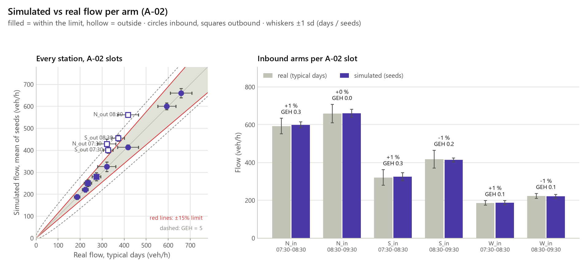
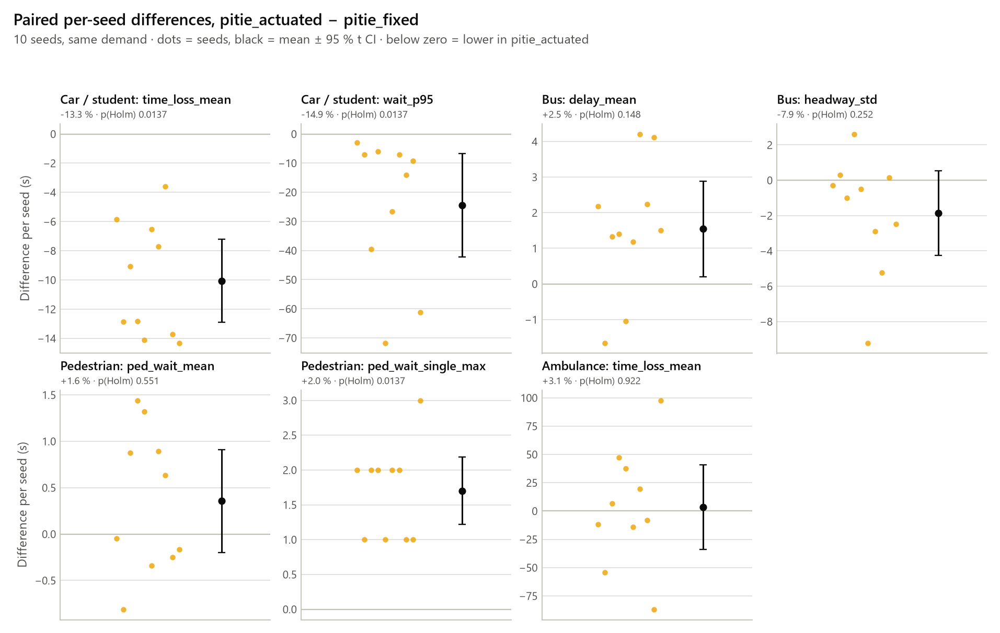

# Validation: Pitié-Salpêtrière digital twin vs reality

Generated by `python -m traffic_twin.validation.report --scenario configs/pitie_fixed.yaml` (spec 13.4, acceptance criterion A-02). Do not edit by hand: rerun `tasks.py validate`. Status words: PASS / FAIL (judged), ok / off (information rows), NOT_MEASURED (no field value yet), ASSUMED (model input not measured on site), NO_DATA, NO_SENSOR, NOT_IN_SIM, OUT_OF_WINDOW, INFO (descriptive, not judged).

## 1. Runs, code version, seeds and sensor days

| Item | Value |
|---|---|
| Scenario | `pitie_fixed` (controller `fixed`), from configs/pitie/network.yaml, configs/pitie/demand.yaml, configs/pitie/control.yaml, configs/pitie/measurement.yaml, configs/pitie_fixed.yaml |
| Code version (git) | 93b373c-dirty |
| Date of the runs | 2026-10-11 |
| Evaluation seeds | 1-10 (10 runs) |
| Window | 07:30-09:30 |
| config_hash / demand_hash | `1a2e6590875f` / `83a4f220fd20` (every run) |
| Sensor reference | `data/reference/pitie_302_hours.csv`, school-term Tue-Thu, MAD k 3.5 |
| Sensor days per arc | 508: 16 days (2026-09-01..2026-10-06); 510: 16 days (2026-09-01..2026-10-08); 511: 17 days (2026-09-01..2026-10-08); 513: 17 days (2026-09-02..2026-10-08); 509: 17 days (2026-09-01..2026-10-08); 512: 8 days (2026-09-22..2026-10-08); 514: 11 days (2026-09-02..2026-09-24) |
| Field file | `data/field/pitie_measurements.yaml`: 0 measured; all rows NOT_MEASURED |

## 2. Pre-registered thresholds

Pre-registered on 2026-10-11 in `configs/validation.yaml`, before any calibrated result (spec 17). A threshold changes only with a dated entry in `changes` of that file, listed below (this page is regenerated, so a note written here would be lost).

| Check | Rule |
|---|---|
| A-02 flows | every inbound arm within ±15% of the real typical-day mean in each slot 07:30-08:30, 08:30-09:30 (sim = mean of the evaluation seeds, E1 loops) |
| GEH (reported) | GEH < 5 on at least 85% of distinct counts (groups counted once) |
| Control slots | 08:00-09:00, 07:30-09:30 (information) |
| Signal (S0 only) | cycle ±2 s, green ±2 s, yellow ±0.5 s, all-red ±0.5 s; S1 descriptive |
| Queues | observed inside the simulated p10-p90, or within 2 vehicles of the median; sample ±300 s around the instant, all seeds |
| Reference days | at least 8 typical days per arc, else NO_DATA |
| Seeds | evaluation 1-10 (10 runs); calibration 101, 102, 103 (never overlap) |
| S0 vs S1 | exact Wilcoxon signed-rank, Holm over 7 headline KPIs, α = 0.05; equity flag above 5 % worse |
| Capacity (flag, no verdict) | a car arm with a mean depart delay above 30 s over a run is capacity-limited on that seed (section 7) |

Changes since pre-registration:

- 2026-10-11: preregistered date corrected from 2026-10-12 to 2026-10-11. Why: 2026-10-12 was the plan's target date; the thresholds were written on 2026-10-11, before the calibration loop and the evaluation runs.
- 2026-10-11: added thresholds.capacity_depart_delay_s: 30 (reporting flag only). Why: flags capacity-limited arms on the evaluation seeds (insertion delay is outside the timeLoss KPIs); same 30 s criterion as the network capacity test; no A-02, signal, queue or S0 vs S1 verdict depends on it.

## 3. Data and assumptions

Reference arcs (Paris sensors, D6):

- `N_in` (inbound arm N): arc 508, sensitivity arc 510; A-02. 508 upstream of Rue Poliveau; 510 = copy of 505 (Austerlitz), sensitivity only
- `S_in` (inbound arm S): arc 511; A-02. 509 = 511 = 5071 (one station)
- `W_in` (inbound arm W): arc 513; A-02. one station copied along ~700 m
- `N_out` (outbound arm N): arc 509; information only. same station as S_in (511)
- `S_out` (outbound arm S): arc 512; information only. south of Rue des Wallons
- `W_out` (outbound arm W): arc 514; information only. flow outage since 2026-09-24

Model inputs that are ASSUMED (not measured on site):

- ASSUMED: signal program: provisional (lead sketch v7 adapted, cycle 123 s), not field-measured
- ASSUMED: s_in lane 1 shared by buses and straight cars; S-left from lane 2 only
- ASSUMED: no pedestrian crossing on the N arm; W and WB crossings signalised at the junction
- ASSUMED: bus 57N served only in S_LEFT
- ASSUMED: lane use and connections at the stop lines from OSM plus the lane_use assumption, not surveyed
- ASSUMED: sidewalks 3 m wide (guessed); bus lanes open to emergency vehicles
- ASSUMED: network cropped to the junction: Rue Poliveau, Rue des Wallons and the nearby signals are not modelled
- ASSUMED: bus stops in-lane, no bay (OSM tags none): stop_57_S is on the only vehicle lane of s_out (OSM lanes:backward=1), so every dwell of a 57 S bus blocks N straight, W right and the ambulance route; stop_57_N is on the shared s_in lane 1 and leaves lane 2 free
- ASSUMED: N straight at capacity at 08:00-09:30 under this program and the in-lane stop_57_S: about 415 veh/h of demand against about 415 veh/h discharged when it is saturated (about 440 veh/h without the stop), a degree of saturation of about 1.0. On some seeds its queue grows past the 208 m of modelled n_in. The backlog then shows up as insertion delay (car depart_delay KPIs), which the time-loss and wait KPIs do not count
- ASSUMED: turn shares (D7), not counted: N to S 0.63, N to W 0.37; S to N 0.90, S to W 0.10; W to N 0.85, W to S 0.15
- ASSUMED: N inbound from arc 508 (proxy upstream of Rue Poliveau)
- ASSUMED: bus headways 91: 360 s, 24: 600 s, 57: 480 s (not from GTFS or a count)
- ASSUMED: bus dwell 20 s at every stop served (24 westbound has no stop)
- ASSUMED: pedestrian flows: 100 per hour per walk direction
- ASSUMED: sensors count buses: each arm's car demand is its sensor flow minus the buses scheduled to enter by it (57N on S, 7.5 veh/h); the E1 stations count all vehicles
- ASSUMED: ambulance route N to S (n_in to s_out, Austerlitz towards the hospital main gate), departing 08:10 (Q7)

Demand scaling (`demand.arm_scale`): N 1.0, S 1.0, W 1.0. Calibration log `docs/calibration_log.yaml`: converged on seeds 101, 102, 103; recommended scale = configured scale; its last iteration ran this config (config_hash).

## 4. Flows (A-02)

**A-02 verdict: PASS** (6 of 6 inbound arm x slot rows within ±15%). GEH < 5 on 10 of 10 distinct counts (100 %, target 85%: met).

A-02 rows (inbound arms):

| Station | Arc | Slot | Role | Real veh/h | Sim veh/h | Error % | GEH | Status |
|---|---|---|---|---|---|---|---|---|
| N_in | 508 | 07:30-08:30 | A-02 | 593 ± 41 (16 d) | 600 ± 15 (10 s) | 1.1 | 0.27 | PASS |
| N_in | 508 | 08:30-09:30 | A-02 | 659 ± 49 (16 d) | 660 ± 21 (10 s) | 0.2 | 0.05 | PASS |
| S_in | 511 | 07:30-08:30 | A-02 | 321 ± 41 (18 d) | 325 ± 21 (10 s) | 1.4 | 0.26 | PASS |
| S_in | 511 | 08:30-09:30 | A-02 | 417 ± 47 (17 d) | 414 ± 10 (10 s) | -0.9 | 0.18 | PASS |
| W_in | 513 | 07:30-08:30 | A-02 | 186 ± 12 (18 d) | 188 ± 11 (10 s) | 0.8 | 0.11 | PASS |
| W_in | 513 | 08:30-09:30 | A-02 | 223 ± 13 (16 d) | 221 ± 10 (10 s) | -0.9 | 0.14 | PASS |

Control slots, outbound stations (information) and the sensitivity arc:

| Station | Arc | Slot | Role | Real veh/h | Sim veh/h | Error % | GEH | Status |
|---|---|---|---|---|---|---|---|---|
| N_in | 508 | 08:00-09:00 | control | 660 ± 49 (16 d) | 658 ± 19 (10 s) | -0.4 | 0.11 | ok |
| N_in | 508 | 07:30-09:30 | control | 626 ± 42 (16 d) | 630 ± 12 (10 s) | 0.6 | 0.16 | ok |
| N_in | 510 | 07:30-08:30 | sensitivity | 1230 ± 94 (17 d) | 600 ± 15 (10 s) | -51.3 | 20.85 | off |
| N_in | 510 | 08:30-09:30 | sensitivity | 1382 ± 80 (16 d) | 660 ± 21 (10 s) | -52.2 | 22.59 | off |
| N_in | 510 | 08:00-09:00 | sensitivity | 1347 ± 124 (17 d) | 658 ± 19 (10 s) | -51.2 | 21.78 | off |
| N_in | 510 | 07:30-09:30 | sensitivity | 1310 ± 81 (16 d) | 630 ± 12 (10 s) | -51.9 | 21.83 | off |
| S_in | 511 | 08:00-09:00 | control | 397 ± 62 (18 d) | 405 ± 16 (10 s) | 2.0 | 0.41 | ok |
| S_in | 511 | 07:30-09:30 | control | 370 ± 42 (17 d) | 370 ± 12 (10 s) | -0.1 | 0.01 | ok |
| W_in | 513 | 08:00-09:00 | control | 229 ± 18 (18 d) | 230 ± 14 (10 s) | 0.3 | 0.05 | ok |
| W_in | 513 | 07:30-09:30 | control | 206 ± 13 (17 d) | 204 ± 8 (10 s) | -0.9 | 0.13 | ok |
| N_out | 509 | 07:30-08:30 | info | 321 ± 41 (18 d) | 428 ± 23 (10 s) | 33.6 | 5.56 | off |
| N_out | 509 | 08:30-09:30 | info | 417 ± 47 (17 d) | 562 ± 7 (10 s) | 34.6 | 6.52 | off |
| N_out | 509 | 08:00-09:00 | info | 397 ± 62 (18 d) | 548 ± 12 (10 s) | 37.9 | 6.93 | off |
| N_out | 509 | 07:30-09:30 | info | 370 ± 42 (17 d) | 495 ± 13 (10 s) | 33.9 | 6.02 | off |
| S_out | 512 | 07:30-08:30 | info | 327 ± 22 (9 d) | 401 ± 14 (10 s) | 22.7 | 3.89 | off |
| S_out | 512 | 08:30-09:30 | info | 372 ± 28 (8 d) | 455 ± 14 (10 s) | 22.5 | 4.11 | off |
| S_out | 512 | 08:00-09:00 | info | 356 ± 30 (9 d) | 448 ± 12 (10 s) | 25.7 | 4.56 | off |
| S_out | 512 | 07:30-09:30 | info | 351 ± 23 (8 d) | 428 ± 11 (10 s) | 22.1 | 3.93 | off |
| W_out | 514 | 07:30-08:30 | info | 234 ± 17 (11 d) | 250 ± 15 (10 s) | 6.9 | 1.03 | ok |
| W_out | 514 | 08:30-09:30 | info | 274 ± 20 (11 d) | 279 ± 18 (10 s) | 2.1 | 0.34 | ok |
| W_out | 514 | 08:00-09:00 | info | 280 ± 25 (11 d) | 286 ± 10 (10 s) | 1.9 | 0.31 | ok |
| W_out | 514 | 07:30-09:30 | info | 254 ± 17 (11 d) | 265 ± 11 (10 s) | 4.3 | 0.68 | ok |

**Circularity.** The car demand is built from the same sensors (arcs 508, 511, 513, typical days, same slots), so inbound A-02 mainly checks that the network carries and inserts the demand in the right time slots: it is not independent evidence of realism. The independent checks are the signal timing and queues from the field visit, the outbound flows (information only: they depend on the ASSUMED turn shares), and the 510 sensitivity row (arc 510 copies station 505 near Austerlitz). The loops count vehicles once they are inserted: an insertion backlog (section 7) shows up as missing flow late in the window.

## 5. Signal timing

Model = provisional program (`fixed.green_s` in the net's phase structure; ASSUMED until the field timing). Sim = green intervals of every evaluation run (SaveTLSSwitchTimes); a vehicle head's green includes the trailing clearance phases where it stays green; yellow and all-red are replayed from the program. A head green more than once per cycle is checked per stage (`<head>.green_s@<stage>`, e.g. ped_NB in HOP and in STM), never as the mean of its greens.

Status counts: NOT_MEASURED 41.

| Item | Model | Sim mean ± sd (n) | Field (n) | Tol | Status |
|---|---|---|---|---|---|
| cycle_s | 123.0 | 123.0 ± 0.0 (580) | – (0) | 2.0 | NOT_MEASURED |
| N_right.green_s | 51.0 | 51.0 ± 0.0 (590) | – (0) | 2.0 | NOT_MEASURED |
| N_right.yellow_s | 3.0 | 3.0 ± 0.0 (program) | – (0) | 0.5 | NOT_MEASURED |
| N_right.all_red_after_s | 8.0 | 8.0 ± 0.0 (program) | – (0) | 0.5 | NOT_MEASURED |
| N_straight.green_s | 37.0 | 37.0 ± 0.0 (590) | – (0) | 2.0 | NOT_MEASURED |
| N_straight.yellow_s | 3.0 | 3.0 ± 0.0 (program) | – (0) | 0.5 | NOT_MEASURED |
| N_straight.all_red_after_s | 5.0 | 5.0 ± 0.0 (program) | – (0) | 0.5 | NOT_MEASURED |
| bus_91_W.green_s | 24.0 | 24.0 ± 0.0 (580) | – (0) | 2.0 | NOT_MEASURED |
| bus_91_W.yellow_s | 3.0 | 3.0 ± 0.0 (program) | – (0) | 0.5 | NOT_MEASURED |
| bus_91_W.all_red_after_s | 8.0 | 8.0 ± 0.0 (program) | – (0) | 0.5 | NOT_MEASURED |
| bus_57_S.green_s | 6.0 | 6.0 ± 0.0 (580) | – (0) | 2.0 | NOT_MEASURED |
| bus_57_S.yellow_s | 3.0 | 3.0 ± 0.0 (program) | – (0) | 0.5 | NOT_MEASURED |
| bus_57_S.all_red_after_s | 8.0 | 8.0 ± 0.0 (program) | – (0) | 0.5 | NOT_MEASURED |
| bus_57_N.green_s | 6.0 | 6.0 ± 0.0 (590) | – (0) | 2.0 | NOT_MEASURED |
| bus_57_N.yellow_s | 3.0 | 3.0 ± 0.0 (program) | – (0) | 0.5 | NOT_MEASURED |
| bus_57_N.all_red_after_s | 7.0 | 7.0 ± 0.0 (program) | – (0) | 0.5 | NOT_MEASURED |
| S_straight.green_s | 51.0 | 51.0 ± 0.0 (590) | – (0) | 2.0 | NOT_MEASURED |
| S_straight.yellow_s | 3.0 | 3.0 ± 0.0 (program) | – (0) | 0.5 | NOT_MEASURED |
| S_straight.all_red_after_s | 7.0 | 7.0 ± 0.0 (program) | – (0) | 0.5 | NOT_MEASURED |
| S_left.green_s | 6.0 | 6.0 ± 0.0 (590) | – (0) | 2.0 | NOT_MEASURED |
| S_left.yellow_s | 3.0 | 3.0 ± 0.0 (program) | – (0) | 0.5 | NOT_MEASURED |
| S_left.all_red_after_s | 7.0 | 7.0 ± 0.0 (program) | – (0) | 0.5 | NOT_MEASURED |
| bus_91_E.green_s | 7.0 | 7.0 ± 0.0 (580) | – (0) | 2.0 | NOT_MEASURED |
| bus_91_E.yellow_s | 3.0 | 3.0 ± 0.0 (program) | – (0) | 0.5 | NOT_MEASURED |
| bus_91_E.all_red_after_s | 8.0 | 8.0 ± 0.0 (program) | – (0) | 0.5 | NOT_MEASURED |
| W.green_s | 20.0 | 20.0 ± 0.0 (590) | – (0) | 2.0 | NOT_MEASURED |
| W.yellow_s | 3.0 | 3.0 ± 0.0 (program) | – (0) | 0.5 | NOT_MEASURED |
| W.all_red_after_s | 4.0 | 4.0 ± 0.0 (program) | – (0) | 0.5 | NOT_MEASURED |
| ped_NB.green_s@HOP | 36.0 | 36.0 ± 0.0 (580) | – (0) | 2.0 | NOT_MEASURED |
| ped_NB.green_s@STM | 20.0 | 20.0 ± 0.0 (580) | – (0) | 2.0 | NOT_MEASURED |
| ped_NB.flashing_s | – | – (0) | – (0) | – | NOT_MEASURED |
| ped_S.green_s | 37.0 | 37.0 ± 0.0 (590) | – (0) | 2.0 | NOT_MEASURED |
| ped_S.flashing_s | – | – (0) | – (0) | – | NOT_MEASURED |
| ped_WB.green_s | 81.0 | 81.0 ± 0.0 (590) | – (0) | 2.0 | NOT_MEASURED |
| ped_WB.flashing_s | – | – (0) | – (0) | – | NOT_MEASURED |
| ped_W.green_s | 37.0 | 37.0 ± 0.0 (590) | – (0) | 2.0 | NOT_MEASURED |
| ped_W.flashing_s | – | – (0) | – (0) | – | NOT_MEASURED |
| stage_order | HOP > S_LEFT > STM > BUS_91 > BUS_57 | – | – (0) | – | NOT_MEASURED |
| varies_between_cycles | no | – | – (0) | – | NOT_MEASURED |
| bus_stages_on_demand | no | – | – (0) | – | NOT_MEASURED |
| ped_only_stage | no | – | – (0) | – | NOT_MEASURED |

## 6. Queues

Status counts: NOT_MEASURED 6.

| Approach | Time | Kind | Observed | Sim p10 / p50 / p90 (n) | Truncated | Status |
|---|---|---|---|---|---|---|
| N | – | cycle_max | – | – / – / – (–) | – | NOT_MEASURED |
| N | – | cycle_max | – | – / – / – (–) | – | NOT_MEASURED |
| S | – | cycle_max | – | – / – / – (–) | – | NOT_MEASURED |
| S | – | cycle_max | – | – / – / – (–) | – | NOT_MEASURED |
| W | – | cycle_max | – | – / – / – (–) | – | NOT_MEASURED |
| W | – | cycle_max | – | – / – / – (–) | – | NOT_MEASURED |

## 7. Safety and capacity

| Scenario | Runs | Collisions | Teleports | Emergency stops | Emergency braking | Vehicles left | Drain timeouts | Max depart delay (s) | Guard interventions | Audit violations |
|---|---|---|---|---|---|---|---|---|---|---|
| `pitie_fixed` | 10 | 0 | 0 | 0 | 0 | 0 | 0 | 472 | 0 | 0 |
| `pitie_actuated` | 10 | 0 | 0 | 0 | 0 | 0 | 0 | 258 | 0 | 0 |

Sums over all runs (run.json `health` and `safety`). A-04 requires 0 collisions and 0 unsafe signal sequences (audit) on every test seed; the guard must not intervene for the fixed and actuated controllers. `–` = not reported by these runs.

**Insertion delay and capacity.** Depart delay = time a vehicle waits to enter the network (SUMO `departDelay`). SUMO's `timeLoss`, behind every delay KPI of this page and of the S0 vs S1 table, does not include it: a vehicle that cannot be inserted waits upstream, outside these KPIs. A car arm whose mean depart delay over a run exceeds 30 s (`thresholds.capacity_depart_delay_s`, the criterion of the network capacity test) is capacity-limited on that seed: its demand is not served in time and its delay KPIs are understated. The worst 15-min mean groups vehicles by planned departure (depart - departDelay); far above the run mean, it shows a backlog growing within the window.

| Scenario | Vehicles | Trips | Mean (s) | Worst seed mean (s) | Worst 15-min mean (s) | Max (s) | Seeds with mean > 30 s | Status |
|---|---|---|---|---|---|---|---|---|
| `pitie_fixed` | car N | 12706 | 20.7 | 120.4 (seed 10) | 251 | 472 | 1, 10 | capacity-limited |
| `pitie_fixed` | car S | 7253 | 0.0 | 0.0 (seed 9) | 0 | 11 | none | ok |
| `pitie_fixed` | car W | 4108 | 0.0 | 0.1 (seed 5) | 0 | 4 | none | ok |
| `pitie_fixed` | bus | 940 | 0.1 | 0.2 (seed 1) | 0 | 3 | – | info |
| `pitie_fixed` | ambulance | 10 | 10.0 | 100.0 (seed 10) | 100 | 100 | – | info |
| `pitie_actuated` | car N | 12706 | 9.4 | 58.3 (seed 10) | 128 | 258 | 10 | capacity-limited |
| `pitie_actuated` | car S | 7253 | 0.0 | 0.0 (seed 9) | 0 | 9 | none | ok |
| `pitie_actuated` | car W | 4108 | 0.0 | 0.1 (seed 5) | 0 | 4 | none | ok |
| `pitie_actuated` | bus | 940 | 0.2 | 0.2 (seed 8) | 1 | 6 | – | info |
| `pitie_actuated` | ambulance | 10 | 3.5 | 18.0 (seed 10) | 18 | 18 | – | info |

## 8. Pedestrians

| Scenario | Single wait max, mean of seeds (s) | Worst seed (s) | Target (s) | Within target | Walk time loss max (s) |
|---|---|---|---|---|---|
| `pitie_fixed` | 85.6 | 86.0 | 90 | yes | 91.1 |
| `pitie_actuated` | 87.3 | 88.0 | 90 | yes | 93.3 |

The 90 s pedestrian target (A-04, D14) is judged on the longest single wait of a pedestrian (TraCI waiting time), not on the time lost over a whole walk.

## 9. S0 vs S1

Paired comparison **pitie_fixed** (S0) vs **pitie_actuated**: 10 seeds, same demand (`demand_hash` checked). Exact two-sided Wilcoxon signed-rank test on the per-seed differences, Holm over the headline KPIs; α = 0.05. With 10 seeds the smallest possible p is 0.0020. S1 - S0: mean paired difference with its 95 % Student-t CI (seconds unless stated).

| User | KPI | S0 mean ± sd | S1 mean ± sd | S1 - S0 [95 % CI] | Change | p | p (Holm) | Effect | Equity flag |
|---|---|---|---|---|---|---|---|---|---|
| car | `time_loss_mean` | 75.9 ± 12.9 | 65.8 ± 11.3 | -10.1 [-12.9, -7.2] s | -13.3 % | 0.0020 | 0.0137 | better | no |
| car | `wait_p95` | 164.5 ± 26.3 | 140.0 ± 22.7 | -24.5 [-42.3, -6.7] s | -14.9 % | 0.0020 | 0.0137 | better | no |
| bus | `delay_mean` | 61.0 ± 1.1 | 62.6 ± 2.6 | +1.5 [0.2, 2.9] s | 2.5 % | 0.0371 | 0.1484 | worse | no |
| bus | `headway_std` | 23.4 ± 0.3 | 21.6 ± 3.4 | -1.8 [-4.2, 0.5] s | -7.9 % | 0.0840 | 0.2520 | better | no |
| pedestrian | `ped_wait_mean` | 21.8 ± 0.7 | 22.2 ± 0.7 | +0.4 [-0.2, 0.9] s | 1.6 % | 0.2754 | 0.5508 | worse | no |
| pedestrian | `ped_wait_single_max` | 85.6 ± 0.5 | 87.3 ± 0.5 | +1.7 [1.2, 2.2] s | 2.0 % | 0.0020 | 0.0137 | worse | no |
| ambulance | `time_loss_mean` | 109.2 ± 52.5 | 112.5 ± 48.7 | +3.4 [-33.8, 40.6] s | 3.1 % | 0.9219 | 0.9219 | worse | no |

Other KPIs more than 5 % worse (not in the Holm family):

- ambulance `stops`: 1.30 → 1.60, S1 - S0 +0.30 [-0.18, 0.78] (+23.1 %, p 0.3750)
- bus `depart_delay_mean`: 0.137 → 0.165 s, S1 - S0 +0.028 [0.008, 0.047] s (+20.2 %, p 0.0195)
- bus `depart_delay_max`: 3.00 → 4.80 s, S1 - S0 +1.80 [0.69, 2.91] s (+60.0 %, p 0.0312)

## 10. Limitations and update after the field visit

- Inbound flows are close to circular (see section 4); few typical days (about 16) and shared Paris stations (509 = 511 = 5071, 510 = 505, 513 copied along ~700 m) leave about three independent inbound counts.
- Sensors are hourly: half-hour slots assume a uniform flow within each sensor hour (D5), on both the demand and the validation side.
- The signal program, lane use, turn shares, bus headways and pedestrian flows are ASSUMED until the field visit (section 3); every signal and queue row stays NOT_MEASURED until then.
- S1 max greens (HOP 38 s, STM 22 s) keep the worst-case crossing red at or under 88 s (open question Q3), but they are above S0's fixed greens (HOP 36 s, STM 20 s): S1 mostly ends greens early (gap-out) yet can extend HOP by up to 2 s, STM by up to 2 s, which lengthens the longest single pedestrian wait (`ped_wait_single_max` 85.6 → 87.3 s, Holm p 0.0137, section 9).
- Capacity: car N on seeds 1, 10 of `pitie_fixed` (worst seed mean 120 s, worst 15-min mean 251 s); car N on seed 10 of `pitie_actuated` (worst seed mean 58 s, worst 15-min mean 128 s) exceed the 30 s mean depart delay: the arm is capacity-limited on these evaluation seeds (the calibration loop judges capacity on the calibration seeds only). That insertion delay is outside every delay KPI: cars wait 10.9 s (`pitie_fixed`) vs 5.0 s (`pitie_actuated`) on average (pooled over all car trips) before entering, so the delay KPIs understate the gap between the scenarios. The ambulance waited up to 100 s to enter (`pitie_fixed` seed 10), also outside its time loss.

After the field visit (docs/field_protocol.md):

1. Fill `data/field/pitie_measurements.yaml` and run `tasks.py field-check`.
2. If the stage structure differs, update `pitie.tll.xml`, `network.stages`, `signal_groups` and `crossings`, then `tasks.py net tls-check --scenario configs/pitie_fixed.yaml` (without `--scenario`, `net` rebuilds the grid network).
3. Set `fixed.green_s` so that each head's green matches the measured mean.
4. Put the turning counts into the calibration (`tasks.py calib-data`).
5. Rerun `tasks.py part3`: signal and queue rows become PASS / FAIL; any failure is corrected through the demand or the driving parameters and documented (13.4). The calibration step stops the chain if an arm is capacity-limited or the recommended `arm_scale` is not the configured one; `compare` and `validate` rerun every run made with the old program, demand or net (stale `config_hash` / `demand_hash`) and refuse stale runs.
